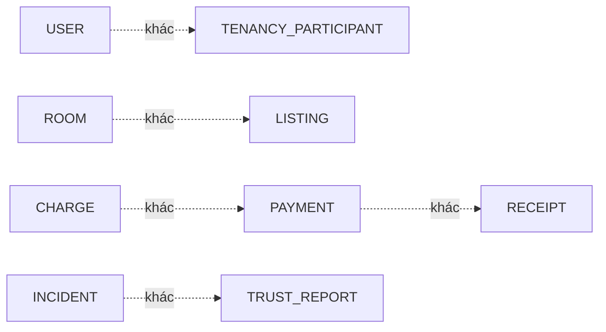

# Glossary TrọƠi

Glossary dùng để giữ vocabulary thống nhất giữa Product, Frontend, Backend và Database. Định nghĩa chi tiết vẫn thuộc canonical/database contract.

## Identity và vận hành

| Thuật ngữ | Nghĩa | Không phải |
| --- | --- | --- |
| `USER` | Digital identity của một người dùng | Global landlord/tenant/operator role |
| `ORGANIZATION` | Workspace vận hành thuê trọ | Một Property cụ thể |
| `PROPERTY` | Cơ sở/địa điểm chứa các Room | Room hoặc Listing |
| `ROOM` | Đơn vị thuê được vận hành | Listing; cũng không sở hữu agreed rent |

## Discovery

| Thuật ngữ | Nghĩa | Không phải |
| --- | --- | --- |
| `LISTING` | Public discovery projection của Room | Operational record của Room |
| `SEARCH/MAP` | Read surface cho published Listing/public location | Nguồn ghi business state |
| `INQUIRY` | Contact/interest bridge từ discovery | Booking/reservation bắt buộc |

## Rental relationship

| Thuật ngữ | Nghĩa | Không phải |
| --- | --- | --- |
| `TENANCY` | Một quan hệ thuê của một Room theo thời gian | User account |
| `TENANCY_PARTICIPANT` | Người tham gia Tenancy | Đồng nhất với USER |
| `PRIMARY` | Participant chính đang active | Global tenant role |
| `OCCUPANT` | Participant cư trú bổ sung | Primary participant |
| `TENANCY_TERMS` | Điều khoản thuê theo version | Mutable fields trực tiếp trên Tenancy |
| `TERMS_ACKNOWLEDGEMENT` | Xác nhận một Terms version cụ thể | Chữ ký/hợp đồng pháp lý mặc định |
| `TENANCY_NOTICE` | Bản ghi giao tiếp liên quan tenancy | Phán quyết pháp lý |

## Finance

| Thuật ngữ | Nghĩa | Không phải |
| --- | --- | --- |
| `BILLING_CYCLE` | Kỳ tạo nghĩa vụ phải thu có provenance Terms | Payment |
| `CHARGE` | Một nghĩa vụ phải thu (`RENT/ELECTRICITY/WATER`) | Tiền đã nhận |
| `PAYMENT` | Actual money inflow của một Tenancy | Receipt hoặc Charge |
| `PAYMENT_ALLOCATION` | Phân bổ Payment vào Charge | Payment mới |
| `PAYMENT_CLAIM` | Claim/evidence flow liên quan payment | Confirmed money mặc định |
| `DEPOSIT` | Trạng thái fulfillment/holding/settlement của tiền cọc | Deposit requirement trong Terms |
| `DEPOSIT_PAYMENT_APPLICATION` | Áp dụng Payment vào Deposit | Refund |
| `RECEIPT` | Evidence phát hành từ confirmed Payment | Payment source of truth |

## Operations và trust

| Thuật ngữ | Nghĩa | Không phải |
| --- | --- | --- |
| `INCIDENT` | Ticket/sự cố vận hành có lifecycle | Trust Report |
| `INCIDENT_EVENT` | Append-only incident history | Mutable summary thay thế Incident |
| `REVIEW` | Verified rental review theo eligibility | Public personal score mặc định |
| `TRUST_REPORT` | Report nhắm tới Listing hoặc Review | Incident report |
| `NOTIFICATION` | Delivery/side effect | Business source state |
| `DASHBOARD` | Read model/projection | Write authority |

## Các cặp dễ nhầm

## State vocabulary bắt buộc

- Listing: `DRAFT | PUBLISHED | UNPUBLISHED | ARCHIVED`.
- Tenancy: `DRAFT | ACTIVE | ENDING | ENDED | CANCELLED`.
- Room operational state: `VACANT | OCCUPIED | MAINTENANCE | INACTIVE`.
- Room record lifecycle: `ACTIVE | ARCHIVED`.
- Receipt: `ISSUED | VOIDED`.

Không tạo synonym persisted mới chỉ để phục vụ UI; UI label có thể dịch/format nhưng phải map về vocabulary chuẩn.
