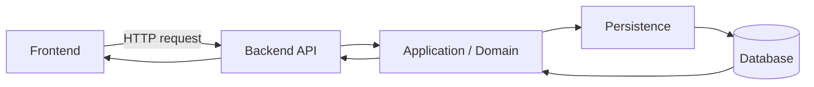
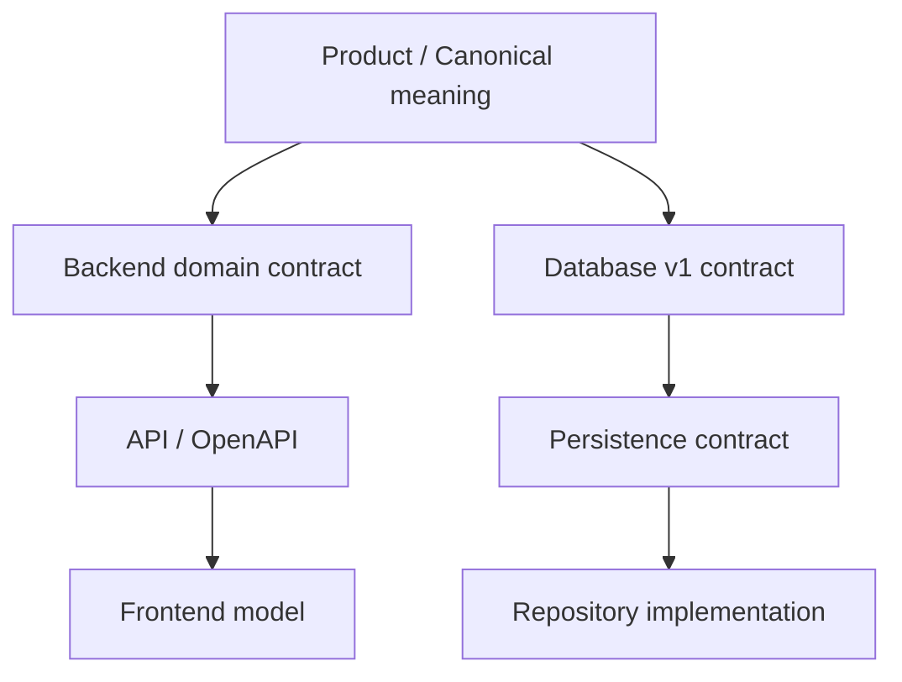
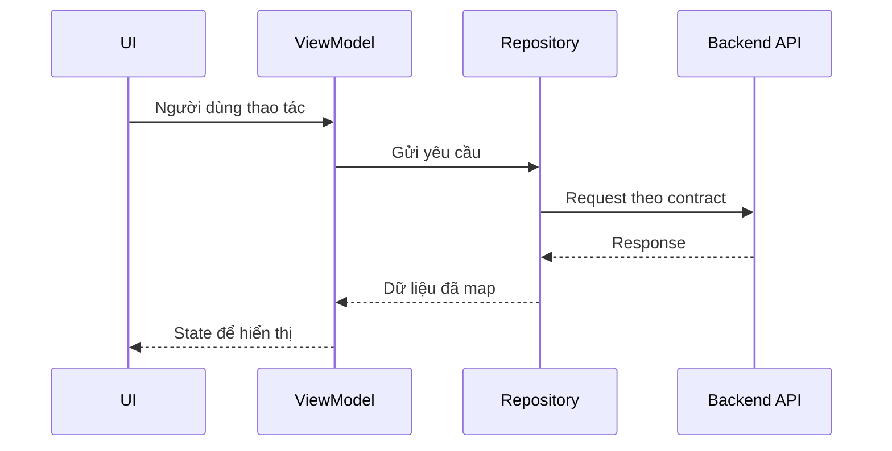
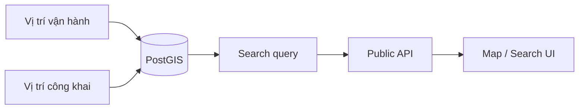

# Cách Frontend, Backend và Database nối với nhau

Tài liệu này không lặp lại toàn bộ business rule. Nó chỉ trả lời: **mỗi layer chịu trách nhiệm gì và khi chuyển dữ liệu qua layer khác thì dựa vào contract nào**.

## 1. Có hai góc nhìn cần tách riêng

### Luồng request khi hệ thống chạy

### Chiều mà implementation phải tuân theo nguồn chuẩn

Runtime gọi từ trên xuống database; nhưng implementation phía dưới không có quyền tự đổi meaning của contract phía trên.

## 2. Frontend ↔ Backend

Frontend gửi thao tác mà người dùng muốn thực hiện. Backend mới là nơi kiểm tra quyền, rule và quyết định thao tác có thành công hay không.

Frontend có thể có `UiState`, display model, loading/error state hoặc local cache riêng. Những thứ đó phục vụ trải nghiệm người dùng và phải map rõ về API/domain state chuẩn.

Không nên:

- cho phép transition mà Backend không hỗ trợ;
- dùng text label trên UI làm persisted state;
- tự thêm enum/field rồi coi đó là API contract;
- lấy mock/demo data để suy ra business rule.

## 3. Backend ↔ Database

Backend chịu trách nhiệm command và điều phối nghiệp vụ. Database chịu trách nhiệm lưu đúng fact và bảo vệ những ràng buộc cần transaction/concurrency safety.

Application pre-check vẫn hữu ích để trả lỗi dễ hiểu, nhưng không đủ cho các tình huống hai request chạy đồng thời.

Những case cần bảo vệ mạnh gồm ít nhất:

- một Room chỉ có một Listing hiện hành;
- một Room chỉ có một Tenancy chưa kết thúc;
- publish Listing phụ thuộc trạng thái Room/Property;
- checkout phải cập nhật Tenancy và Room cùng một workflow;
- tổng tiền phân bổ/áp dụng không vượt Payment;
- Deposit settlement không vượt số tiền đã giữ;
- Review/Claim/Acknowledgement phải khớp đúng Tenancy/User/Participant.

## 4. Ai làm gì trong các feature thường gặp?

| Việc | Frontend | Backend | Database |
| --- | --- | --- | --- |
| Hiển thị Listing | Hiển thị state | Trả dữ liệu | Lưu state |
| Đăng/ngừng đăng Listing | Gửi thao tác | Kiểm tra + đổi state | Bảo vệ integrity |
| Tenancy lifecycle | Hiển thị và gửi action | Quyết định transition | Lưu + chống race |
| PRIMARY participant | Nhập/hiển thị | Kiểm tra rule | Bảo vệ consistency |
| Billing/Charge | Hiển thị | Tạo/điều phối | Lưu khoản phải thu |
| Payment | Nhập/xem | Xác nhận/điều phối | Lưu tiền thực nhận |
| Receipt | Xem/tải/chia sẻ | Phát hành/void | Lưu lịch sử bằng chứng |
| Incident | Hiển thị timeline | Kiểm tra transition | Lưu Incident + event |
| Search/Map | Hiển thị | Tạo response công khai | Query PostGIS/public data |
| Notification | Nhận/hiển thị | Trigger/gửi | Lưu delivery fact nếu cần |
| Dashboard | Hiển thị | Tổng hợp | Cung cấp dữ liệu gốc |

## 5. Vị trí công khai và vị trí vận hành

Frontend Search/Map chỉ được nhận dữ liệu vị trí được phép công khai. Việc database có lưu địa chỉ chính xác không có nghĩa Backend được trả thẳng field đó ra public API.

## 6. Khi một thao tác bị từ chối

Nếu command thất bại:

- Backend trả lỗi theo API contract;
- Database rollback phần mutation chưa hoàn tất;
- Frontend hiển thị lỗi và không giả định business state đã đổi;
- nếu cần, Frontend refresh state mới nhất từ server.

## 7. Khi thay đổi một feature xuyên nhiều layer

Kiểm tra lần lượt:

1. Meaning nghiệp vụ có thay đổi không?
2. Backend rule/API có thay đổi không?
3. OpenAPI/DTO có thay đổi không?
4. Frontend mapping/UI state có thay đổi không?
5. Persistence/schema có thay đổi không?
6. Có invariant nào cần transaction/concurrency guard mới không?
7. Test nào phải cập nhật?
8. Context/backlog còn mô tả đúng flow không?

Không dùng migration để lén tạo business rule mới và cũng không dùng yêu cầu UI để bỏ qua invariant đã được chốt.

## Approved V1 integration boundaries — 2026-10-05

Optional MoMo is current V1; gateway as an MVP dependency remains FUTURE and general provider/platform expansion stays outside V1. Billing/Charge != Payment != Payment Claim != Deposit != Receipt != GatewayCheckout. Manual POST /finance/payments is operator-only, accepts MANUAL_CASH / MANUAL_TRANSFER and server-derived USER_RECORDED; reject client GATEWAY / PROVIDER_VERIFIED provenance. Only fully verified payment-success IPN creates gateway Payment. Verify signed create response before handoff; redirect is untrusted. No automatic allocation, Deposit funding or Receipt issuance. Replay POST /finance/checkouts with the same Idempotency-Key and immutable provider IDs; no separate retry endpoint.

Session acceptance: memory-only Google ID token; reacquire credential → verified /me → non-secret backend-user-scoped hints → capability validation → route. Native map/picker is required V1, renders public location only with no exact operational fallback and no raw-coordinate UX; geocoder/type/availability remain OPEN. Authenticated Listing-only Trust submission derives reporter identity server-side; Review entry, report listing/moderation, Claim and Inquiry Activity remain gated. Notice/acknowledgement are Tenancy-scoped. These contracts are approved targets, not claims of available implementation or completed runtime evidence.
