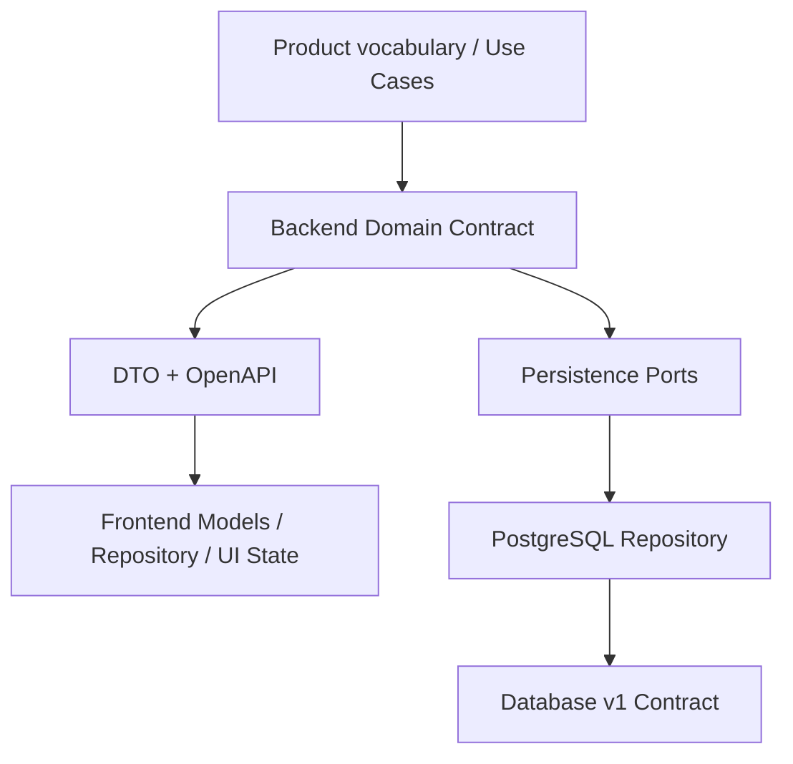
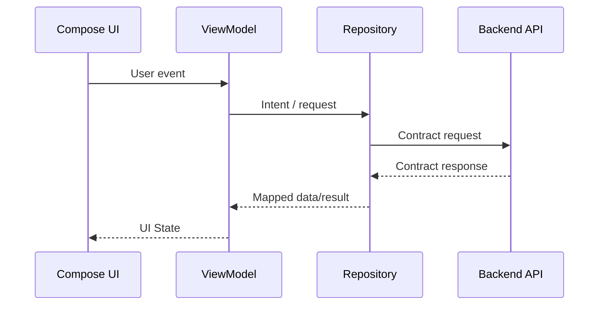
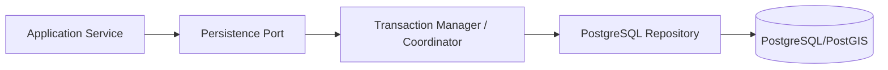
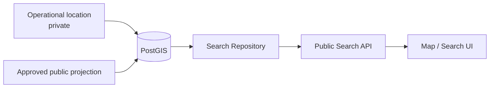

# Integration Contracts

Tài liệu này mô tả các boundary bắt buộc giữa Frontend, Backend và Database. Nó không duplicate toàn bộ business rule; mục tiêu là chỉ rõ **ai sở hữu rule, ai consume rule và contract nào nối các layer**.

## 1. Contract chain

Nếu một schema/model thay đổi ở giữa chain, hai phía của boundary phải được kiểm tra cùng nhau. Không được sửa một đầu rồi để đầu còn lại tự suy đoán.

## 2. Frontend ↔ Backend

Backend API/OpenAPI là contract giao tiếp giữa client và server. Frontend không được tự tạo business state hoặc enum khác contract chỉ vì UI cần thuận tiện.

Frontend có thể có `UiState`, display model hoặc local cache model riêng, nhưng phải có mapping rõ ràng tới API/domain semantics.

### Không được làm

- Frontend tự cho phép transition mà Backend không hỗ trợ.
- Dùng UI label làm persisted state.
- Tự thêm field/enum “tạm” rồi coi là API contract.
- Dựa vào demo data để suy ra business invariant.

## 3. Backend ↔ Database

Backend sở hữu application command, business orchestration và persistence intent. Database implementation thực thi persistence port và là enforcement cuối cho relational/concurrency invariant.

Application-level pre-check giúp trả lỗi rõ hơn nhưng không thay thế database guard nếu hai request đồng thời có thể phá invariant.

Các boundary cần transaction/concurrency safety gồm ít nhất:

- một current Listing trên một Room;
- một non-terminal Tenancy trên một Room;
- Listing publish ↔ Room vacancy;
- checkout ↔ Tenancy end + Room vacancy;
- Payment amount cap qua allocation + deposit application;
- Deposit settlement cap;
- các consistency guard của Review/Claim/Acknowledgement.

## 4. Ownership matrix

| Concern | Frontend | Backend | Database |
| --- | --- | --- | --- |
| Listing state display | Render | Expose state | Persist |
| Listing transition | Request intent | **Own transition** | Enforce integrity |
| Tenancy lifecycle | Render | **Own FSM/orchestration** | Persist + concurrency guard |
| PRIMARY participant rule | Render/validate form | Validate command | Enforce consistency where applicable |
| Billing/Charge | Render | Create/orchestrate | Persist authoritative facts |
| Payment received | Display/input | Validate/orchestrate | Persist authoritative fact |
| Receipt | Display | Issue/void behavior | Persist evidence/history |
| Incident lifecycle | Render timeline | **Own transition** | Persist + append history |
| Public map | Render | Shape public response | PostGIS query/public projection |
| Notification | Receive/render | Trigger/deliver | Optional delivery persistence only |
| Dashboard | Render | Compose read model | Query source facts |

## 5. Contract cho location và Search/Map

Operational location và public projection là hai concern khác nhau. Frontend Search/Map chỉ consume public projection do Backend expose; Backend query qua persistence contract; Database/PostGIS giữ dữ liệu và spatial query.

Không được expose exact operational location chỉ vì cột đó tồn tại trong database.

## 6. Contract cho error và rejected command

Rejected command phải không để lại partial mutation đã biết. Backend trả kết quả lỗi theo API contract; Database transaction rollback khi command không thể hoàn tất nhất quán; Frontend render lỗi mà không tự giả định state mới.

## 7. Thay đổi contract an toàn

Khi thay đổi một feature xuyên layer, kiểm tra theo thứ tự:

1. Business meaning có thay đổi không? Nếu có, kiểm tra canonical/context authority trước.
2. Backend domain/API contract có thay đổi không?
3. OpenAPI/DTO có thay đổi không?
4. Frontend model/repository/UI state có cần cập nhật không?
5. Persistence port/repository/schema có thay đổi không?
6. Invariant có cần transaction/concurrency guard mới không?
7. End-to-end tests và conformance tests nào phải cập nhật?
8. Context này có còn mô tả đúng boundary mới không?

Không dùng migration/schema change để lén tạo business semantics mới; cũng không dùng UI requirement để bypass domain invariant.
