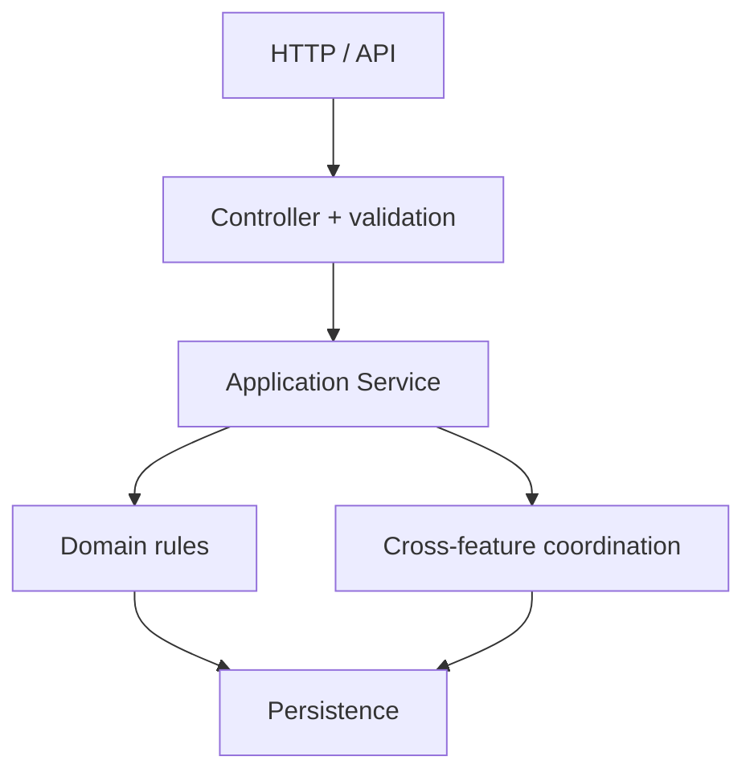
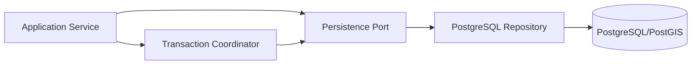

# Backend Context

Backend TrọƠi nhận yêu cầu từ client, kiểm tra nghiệp vụ và phối hợp việc đọc/ghi dữ liệu. Kiến trúc hướng tới Modular Monolith bằng TypeScript/NestJS.

## 1. Backend chịu trách nhiệm gì?

- expose API và validate input;
- xác thực, kiểm tra quyền theo resource/relationship;
- kiểm tra business rule;
- thực hiện lifecycle transition;
- điều phối một thao tác chạm nhiều module;
- làm việc với persistence qua repository/transaction boundary;
- tạo read model và trigger side effect khi cần.

## 2. Module map

Các baseline đã có module cho `identity-access`, `organization`, `property`, `room`, `listing`, `tenancy`, `rental-lifecycle`, `billing`, `receipt`, `incident`, `audit-trust`, `onboarding`; `subscription` chỉ là FUTURE scaffolding.

Module được chia theo trách nhiệm nghiệp vụ, không phải “mỗi table một module”. `rental-lifecycle` dùng cho những command cần phối hợp Room/Listing/Tenancy nhưng không lấy ownership entity khỏi module gốc.

## 3. Làm việc với Database

Application service không nên phụ thuộc trực tiếp vào PostgreSQL adapter.

Pre-check ở Backend giúp trả lỗi rõ hơn. Nhưng nếu hai request đồng thời có thể phá một invariant thì Database/transaction guard vẫn phải bảo vệ ở lớp cuối.

## 4. Một số rule không được làm lệch

- `USER` không có global landlord/tenant/operator role.
- Room operational state và Room record lifecycle là hai khái niệm khác nhau.
- Listing chỉ dùng `DRAFT | PUBLISHED | UNPUBLISHED | ARCHIVED`.
- Room rời `VACANT` thì Listing public hiện tại phải được xử lý ngay trong workflow.
- Một Room tối đa một Tenancy chưa kết thúc.
- Không direct `ACTIVE → ENDED`; checkout đi qua `ENDING`.
- Active Tenancy phải có đúng một active `PRIMARY`.
- Payment, Charge, Deposit và Receipt là các fact khác nhau.
- Notification/Dashboard không được sửa dữ liệu nguồn.
- Không tự đóng policy `OPEN` bằng default trong DTO/service.

## 5. API contract

API/OpenAPI là điểm gặp nhau giữa Android và Backend. Khi đổi route/DTO/enum:

1. kiểm tra meaning nghiệp vụ;
2. cập nhật rule/tests;
3. cập nhật API/OpenAPI;
4. báo tác động cho Frontend;
5. kiểm tra persistence nếu data shape hoặc invariant thay đổi.

Trong giai đoạn integration hiện tại, luôn kiểm tra artifact/runtime trên đúng HEAD trước khi nói rằng OpenAPI hoặc persistence đã được tích hợp đầy đủ.

## 6. Trước khi làm một feature

- đọc backlog feature;
- đọc `integration-contracts.md`;
- kiểm tra Canonical nếu feature chạm rule domain/data;
- xác định transaction boundary nếu command chạm nhiều fact;
- kiểm tra Frontend đang cần response gì thay vì để client tự suy luận state.

## 7. Đọc tiếp

- [`../integration-contracts.md`](../integration-contracts.md)
- [`database.md`](database.md)
- [`../../database/v1/README.md`](../../database/v1/README.md)
- [`../../backlogs/v1/`](../../backlogs/v1/)
