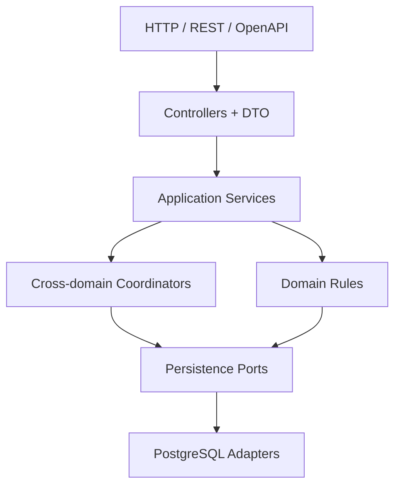
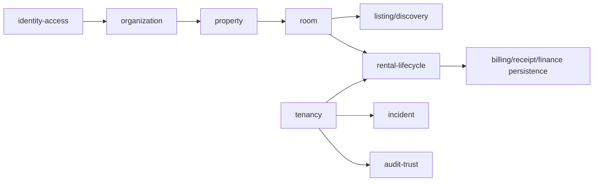
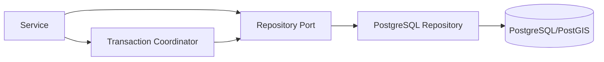

# Backend Context

Backend TrọƠi là Modular Monolith bằng TypeScript/NestJS, đóng vai trò application/domain boundary giữa client và persistence.

## 1. Trách nhiệm chính

Backend sở hữu:

- API/DTO contract và validation;
- identity/authentication integration boundary;
- resource/relationship-based authorization;
- business command và lifecycle transition;
- cross-domain orchestration;
- persistence intent qua repository ports;
- transaction coordination cho workflow nhiều aggregate;
- read-model/search orchestration;
- notification side-effect trigger.

## 2. Module map

Baseline backend có các module: `identity-access`, `organization`, `property`, `room`, `listing`, `tenancy`, `rental-lifecycle`, `billing`, `receipt`, `incident`, `audit-trust`, `onboarding` và `subscription` scaffolding.

`subscription` là FUTURE; sự tồn tại của module không nâng Subscription/Pricing/Quota thành current-core capability.

## 3. Business ownership

Module boundary không đồng nghĩa một table một module. Backend grouping đi theo business ownership:

`rental-lifecycle` là coordinator cho các command có effect vượt Listing/Room/Tenancy boundary; nó không chiếm ownership entity-local từ các module đó.

## 4. Persistence boundary

Application service không nên phụ thuộc trực tiếp PostgreSQL implementation. Persistence ports định nghĩa intent; PostgreSQL repositories implement các port; Transaction Manager/Coordinator bảo vệ atomicity.

Pre-check ở service hữu ích cho error semantics nhưng không đủ cho invariant có race; database/transaction guard phải là enforcement cuối.

## 5. Những rule Backend phải tôn trọng

- `USER` không có global landlord/tenant/operator role.
- Room state và record lifecycle là hai chiều riêng.
- Listing lifecycle chỉ dùng `DRAFT | PUBLISHED | UNPUBLISHED | ARCHIVED`.
- Room rời VACANT phải làm current Listing unavailable theo workflow đồng bộ.
- Một Room tối đa một non-terminal Tenancy.
- Không direct `ACTIVE → ENDED`; checkout đi qua `ENDING`.
- Active Tenancy có đúng một active PRIMARY participant.
- Payment, Receipt, Charge và Deposit là các fact khác nhau.
- Notification/Dashboard không mutate source domain.
- Canonical `OPEN` không được đóng bằng DTO default hoặc route guard vô tình.

## 6. API contract

Swagger/OpenAPI tooling đã có ở backend. API contract là boundary intended cho Android client, nhưng frontend production adapter hiện chưa tích hợp hoàn chỉnh.

Khi đổi DTO/route/enum:

1. kiểm tra domain authority;
2. cập nhật behavior/conformance tests;
3. cập nhật OpenAPI;
4. báo tác động cho Frontend mapping;
5. kiểm tra persistence nếu thay đổi semantics hoặc data shape.

## 7. Verification

Backend baseline có lint, typecheck, build, core behavior, ERD3 conformance và persistence integration tests. Không lấy một historical pass count làm bằng chứng cho HEAD mới nếu chưa chạy verification ở HEAD đó.

## 8. Đọc tiếp

- [`../integration-contracts.md`](../integration-contracts.md)
- [`database.md`](database.md)
- [`../../database/v1/README.md`](../../database/v1/README.md)
- [`../../backlogs/v1/`](../../backlogs/v1/)
