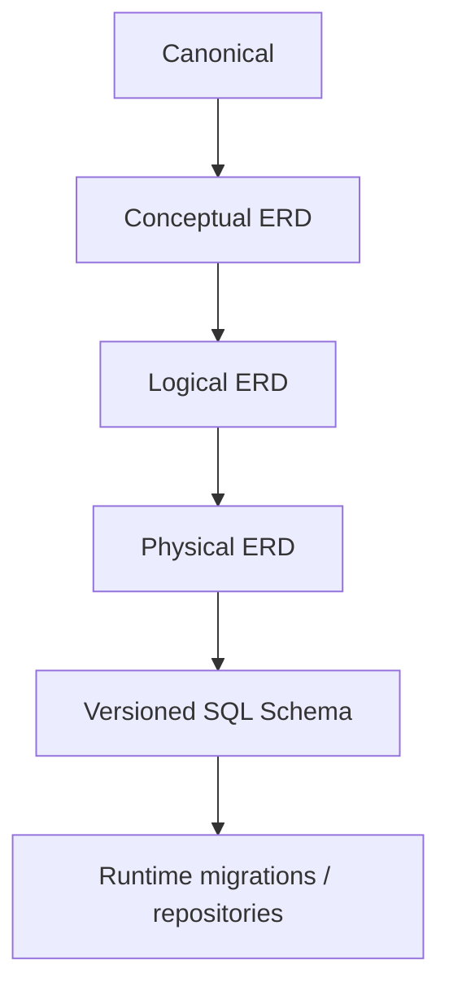
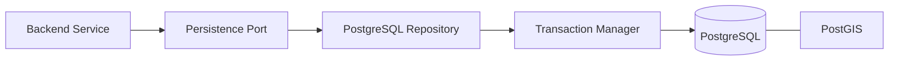
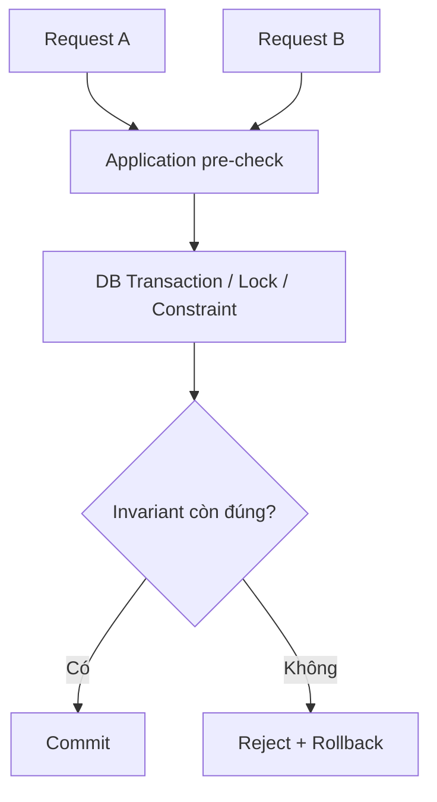
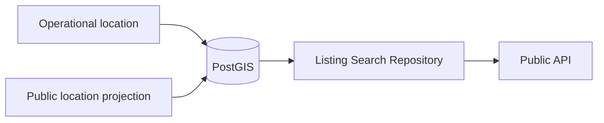

# Database Context

Database layer cung cấp authoritative persistence và integrity enforcement cho TrọƠi. Tài liệu này chỉ giải thích cách sử dụng database authority; không duplicate canonical/ERD/schema.

## 1. Authority hiện tại

Database contract release hiện tại: [`../../database/v1/`](../../database/v1/).

Đọc theo thứ tự:

1. [`canonical.md`](../../database/v1/canonical.md)
2. [`erd/conceptual.json`](../../database/v1/erd/conceptual.json)
3. [`erd/logical.json`](../../database/v1/erd/logical.json)
4. [`erd/physical.json`](../../database/v1/erd/physical.json)
5. [`schema/trooi-schema-20260927T153946Z.sql`](../../database/v1/schema/trooi-schema-20260927T153946Z.sql)

## 2. Runtime persistence

Baseline persistence hiện tại sử dụng PostgreSQL + PostGIS, Kysely + `pg`, `node-pg-migrate`, repository ports/adapters và PostgreSQL transaction manager.

PostGIS là extension của authoritative relational store, không phải business source of truth riêng.

## 3. Database chịu trách nhiệm gì?

- durable relational persistence;
- foreign key và relational integrity;
- uniqueness/check constraints đã thuộc physical contract;
- transaction atomicity;
- concurrency-safe enforcement cho invariant có thể race;
- geospatial storage/query cho Search/Map;
- giữ lịch sử/fact theo schema đã freeze.

Database không được dùng để lén tạo product rule mới ngoài authority contract.

## 4. Invariant cần enforcement mạnh

Các nhóm đã có transaction/concurrency guard trong persistence baseline gồm rental, billing, finance và trust consistency.

Ví dụ:

- tối đa một current Listing cho Room;
- tối đa một non-terminal Tenancy cho Room;
- publish Listing phụ thuộc Room vacancy/Property state;
- checkout phối hợp Tenancy và Room;
- tổng Payment Allocation + Deposit Application không vượt Payment amount;
- settlement Deposit không vượt funded amount;
- consistency của Review/Claim/Acknowledgement.

Application pre-check không thay thế transaction-safe enforcement trong trường hợp concurrent request.

## 5. Search/Map và location boundary

Database giữ operational location và public projection theo contract. Public Search/Map chỉ query projection được phép công khai.

Existence của exact location trong schema không cấp quyền expose nó ra client.

## 6. Redis và object storage

Redis và MinIO/S3-compatible storage từng được mô tả trong tech-stack cũ, nhưng không thuộc completed database implementation baseline hiện tại. Chúng phải được coi là `PLANNED` cho tới khi có implementation và verification tương ứng.

## 7. Provenance

[`../../database/v1/implementation-history.md`](../../database/v1/implementation-history.md) ghi lại quá trình implementation/verification tới database baseline. File đó là provenance, không cao hơn contract chain.

Không suy ra rằng mọi migration operation đều an toàn chỉ từ lịch sử verify tổng thể; behavior migration/rollback cụ thể phải được kiểm tra riêng trước khi sử dụng trong vận hành.

## 8. Đọc tiếp

- [`../source-of-truth.md`](../source-of-truth.md)
- [`../integration-contracts.md`](../integration-contracts.md)
- [`backend.md`](backend.md)
- [`../../database/README.md`](../../database/README.md)
