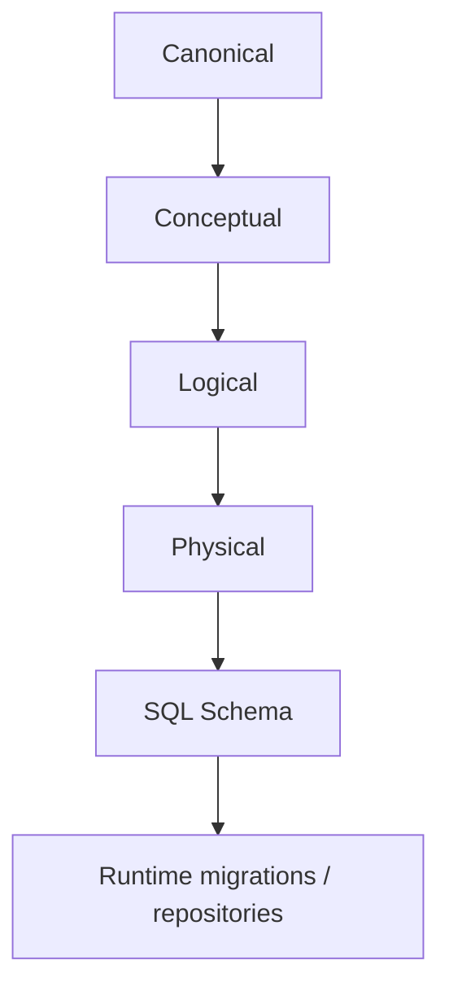
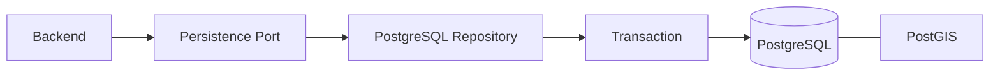

# Database Context

Database là nơi lưu dữ liệu nghiệp vụ phía server và là lớp bảo vệ cuối cho những ràng buộc có thể bị phá khi nhiều request chạy cùng lúc.

File này chỉ giải thích cách Database tham gia hệ thống. Nguồn chuẩn thật sự nằm trong [`../../database/v1/`](../../database/v1/).

## 1. Đọc Database contract theo thứ tự

1. [`canonical.md`](../../database/v1/canonical.md)
2. [`erd/conceptual.json`](../../database/v1/erd/conceptual.json)
3. [`erd/logical.json`](../../database/v1/erd/logical.json)
4. [`erd/physical.json`](../../database/v1/erd/physical.json)
5. [`schema/trooi-schema-20260927T153946Z.sql`](../../database/v1/schema/trooi-schema-20260927T153946Z.sql)

## 2. Database tham gia request như thế nào?

PostGIS chỉ mở rộng khả năng lưu/query vị trí; nó không tạo thêm một nguồn business state riêng.

## 3. Database phải bảo vệ gì?

- foreign key và quan hệ giữa các bản ghi;
- unique/check constraint đã thuộc contract;
- transaction atomicity;
- invariant dễ race khi hai request chạy cùng lúc;
- dữ liệu vị trí và query cho Search/Map;
- lịch sử/fact theo schema đã freeze.

Ví dụ dễ hiểu: Backend có thể pre-check “Room này chưa có Tenancy khác”. Nhưng nếu hai request cùng chạy, chỉ pre-check là chưa đủ; transaction/constraint/lock phía Database phải ngăn cả hai cùng commit.

## 4. Một số invariant cần lớp bảo vệ cuối

- tối đa một Listing hiện hành cho mỗi Room;
- tối đa một Tenancy chưa kết thúc cho mỗi Room;
- publish Listing phải khớp trạng thái Room/Property;
- checkout phải giữ Tenancy và Room nhất quán;
- tổng Payment Allocation + Deposit Application không vượt Payment;
- Deposit settlement không vượt số tiền đã giữ;
- Review/Claim/Acknowledgement phải khớp đúng User/Participant/Tenancy.

## 5. Search/Map và vị trí

Database có thể lưu cả vị trí vận hành và dữ liệu vị trí được phép công khai. Public API chỉ được dùng public projection theo contract.

Việc một cột tồn tại trong schema **không có nghĩa** nó được phép trả ra client.

## 6. Redis và object storage

Redis và MinIO/S3 từng xuất hiện trong hướng tech-stack, nhưng không thuộc completed database baseline hiện tại. Tiếp tục coi là `PLANNED` cho đến khi có implementation và verification tương ứng.

## 7. Provenance

[`../../database/v1/implementation-history.md`](../../database/v1/implementation-history.md) cho biết database baseline đã được xây và kiểm chứng qua những commit nào. Đây là lịch sử triển khai, không cao hơn Canonical/ERD/SQL contract.

## 8. Đọc tiếp

- [`../source-of-truth.md`](../source-of-truth.md)
- [`../integration-contracts.md`](../integration-contracts.md)
- [`backend.md`](backend.md)
- [`../../database/README.md`](../../database/README.md)
