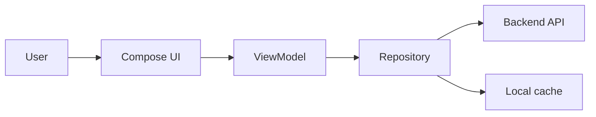
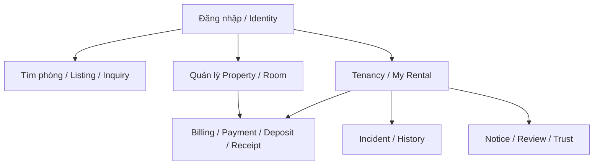

# Frontend Context

File này dành cho người đang làm Android app. Mục tiêu là để mở vào và biết ngay: **Frontend được quyết định gì, phải hỏi Backend ở đâu và những business rule nào không được tự nghĩ thêm ở UI**.

## 1. Frontend làm gì?

Android app chịu trách nhiệm phần người dùng nhìn thấy và thao tác:

- màn hình, navigation và UI state;
- nhận thao tác của người dùng;
- gọi Backend;
- map response thành dữ liệu dễ hiển thị;
- cache/preferences/client state khi cần;
- hiển thị loading/error/empty/success rõ ràng.

Frontend **không tự quyết** business lifecycle hoặc dữ liệu gốc phía server.

## 2. Những gì Frontend có thể tự giữ

Frontend có thể có `UiState`, display model, navigation state, loading/error state và local cache riêng. Những model này phục vụ UI và phải map được về API/domain state chuẩn.

Ví dụ: UI có thể hiển thị nhãn “Đang cho thuê”, nhưng không được tạo persisted Listing state `RENTED` nếu contract chuẩn chỉ có `DRAFT | PUBLISHED | UNPUBLISHED | ARCHIVED`.

## 3. Nhìn project theo feature

Tenant Portal hiện gồm các capability quanh My Rental, Terms, Deposit, Billing, Payment, Receipts, Tickets, Notices, Move-out, History và Find Rooms, tùy vào quan hệ/quyền thật của User.

## 4. Khi người dùng bấm một nút nghiệp vụ

Ví dụ người dùng bấm **Kích hoạt lượt thuê**:

1. Frontend gửi yêu cầu activate.
2. Backend kiểm tra Room, Participant, Terms và các rule liên quan.
3. Database commit thay đổi nếu mọi thứ hợp lệ.
4. Frontend nhận state mới rồi mới cập nhật màn hình như một lần thuê đã active.

Không optimistic-commit business state quan trọng trước khi server xác nhận.

## 5. Dữ liệu local

Room database/DataStore hoặc local cache, nếu được tích hợp, chỉ phục vụ trải nghiệm client. Chúng không thay thế PostgreSQL phía server.

Search/Map cũng chỉ dùng vị trí công khai Backend trả về; không tự expose exact operational location chỉ vì một model cũ từng chứa field đó.

## 6. Checklist trước khi làm một feature

1. Mở backlog feature trong [`../../backlogs/v1/`](../../backlogs/v1/).
2. Đọc luồng tương ứng trong [`../end-to-end-flows.md`](../end-to-end-flows.md).
3. Kiểm tra thuật ngữ trong [`../product-domain.md`](../product-domain.md) / [`../glossary.md`](../glossary.md).
4. Xác định API cần có qua [`../integration-contracts.md`](../integration-contracts.md).
5. Kiểm tra Backend đã expose contract thật chưa; đừng suy từ mock/demo.
6. Nếu cần đổi business meaning, phối hợp Backend/Database thay vì workaround ở UI.

## 7. Android UI system và Mock/Backend (ghi nhận 11/10/2026)

Trạng thái source trên branch `design/app-ui-redesign`: **Round 5 PASS đủ sáu vertical slices**; generic shell/header/card/list/information/button/dialog/field/state dùng chung `ui/components`. Round 6 đã xóa generic compatibility definitions sau khi caller production về zero; test caller đã migrate. Domain composition (media/ledger/navigation/filtered fields) vẫn thuộc feature. `V1PreviewNotice` là disclaimer có caller thật. Các gateway `V1ContractGateway/V1RentalGateway/V1PaymentGateway/V1TrustGateway` chỉ **phiên bản hóa adapter API**, được giữ nguyên. [Kiến trúc/component ownership/checklist hiện hành](../../designs/v1/android-frontend-architecture.md) mô tả ranh giới cụ thể.

Runtime Debug cho phép chuyển `Mock` / `Backend` qua `RuntimeDataSource`; Release chỉ dùng Backend. **Round 4 đã hoàn tất catalog tĩnh:** `src/debug/assets/fixtures/v1/` có manifest/version, accounts, references, conversations, rentals, operations và finance; `FixtureCatalog.kt`/`FixtureDomains.kt` parse/validate typed rồi cung cấp dữ liệu cho `DemoData`, `DemoRentalGraph`, `FixtureTroOiRepository`, `ListingFixtures` và profile Debug. Kotlin không còn sở hữu các seed rental/finance/incident/notice/dashboard cạnh tranh với JSON. Mock security/PIN/OTP test hooks và mutable preview state vẫn thuộc Debug, không xác nhận thanh toán/KYC/lưu tài khoản trên Backend. Kiểm tra bằng `app/scripts/verify_fixture_isolation.py`; [Round 4 QA](../../testing/LEGACY_UI_QA_ARCHIVE.md) ghi 192 unit tests, 6 native tests và asset/DEX isolation PASS. [Catalog/schema và hướng dẫn scenario](../../designs/v1/android-fixture-catalog.md) mô tả runtime ownership. [Round 5](../../testing/LEGACY_UI_QA_ARCHIVE.md) PASS; [Round 6](../../testing/LEGACY_UI_QA_ARCHIVE.md) PASS; [Round 7](../../testing/LEGACY_UI_QA_ARCHIVE.md) PASS; final regression và hai trục review độc lập đã hoàn tất (2026-10-12).

Kiến trúc đã chốt: **một design system cho generic UI + một catalog fixture Debug có manifest/schema version và domain JSON**, ánh xạ qua typed Kotlin adapter, không đóng gói fixture vào Release. [Current architecture record](../../designs/v1/android-frontend-architecture.md) mô tả implementation/guardrails; [draft ban đầu](../../testing/LEGACY_UI_QA_ARCHIVE.md) và [audit nguồn](../../testing/LEGACY_UI_QA_ARCHIVE.md) giữ provenance.

Tài liệu plan là **đề xuất triển khai**; chưa thay thế Canonical, API contract, schema, quyền thực hoặc source code đã được kiểm thử.

## 8. Đọc tiếp

- [`backend.md`](backend.md) — Backend xử lý thao tác người dùng ra sao.
- [`database.md`](database.md) — dữ liệu phía server được giữ/bảo vệ thế nào.
- [`../tech-stack.md`](../tech-stack.md) — stack và trạng thái integration hiện tại.
