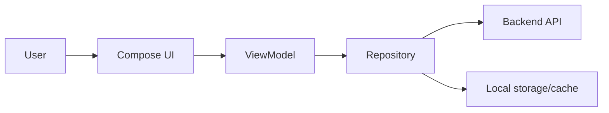
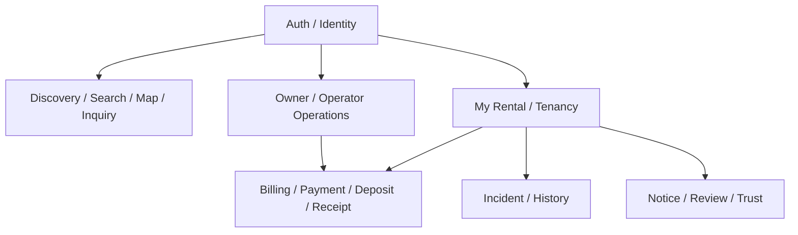

# Frontend Context

Tài liệu này giúp developer/agent Frontend hiểu vị trí của Android app trong TrọƠi và những contract tuyệt đối không được tự suy diễn.

## 1. Vai trò

Android app là product surface chính. Frontend chịu trách nhiệm presentation, interaction, navigation, UI state và mapping dữ liệu từ Backend thành trải nghiệm người dùng.

Frontend **không sở hữu** business lifecycle hoặc server source of truth.

## 2. Kiến trúc hiện tại

Baseline frontend có:

- Android native bằng Kotlin;
- Jetpack Compose / Material 3;
- MVVM + Repository foundation;
- Hilt dependency injection;
- feature areas cho auth, landlord và tenant;
- debug/demo repository và release repository boundary.

API production/OpenAPI integration chưa hoàn tất ở frontend baseline; demo/debug build không được dùng làm bằng chứng rằng Backend contract đã được tích hợp.

## 3. Quy tắc state

Frontend được phép có:

- `UiState` riêng;
- loading/error/empty state;
- display model;
- local navigation state;
- cache/offline representation.

Nhưng mọi persisted/business state phải map về contract chuẩn. Ví dụ Listing không được tự thêm `hidden` hoặc `rented` làm domain state.

## 4. Feature mental map

Tenant Portal capability hiện tại bao gồm các surface quanh My Rental, Terms, Deposit, Billing, Payment, Receipts, Tickets, Notices, Move-out, History và Find Rooms, tùy relationship/authorization thực tế.

## 5. Contract với Backend

Frontend phải consume API/OpenAPI thay vì tự duy trì một schema nghiệp vụ song song.

Khi Backend trả rejected command:

- không optimistic-commit business state như đã thành công;
- render error theo UX phù hợp;
- refresh/reconcile state nếu cần;
- không tự sửa lifecycle để “khớp UI”.

## 6. Local data

Room database/DataStore/other local persistence nếu được tích hợp chỉ phục vụ cache/preferences/client state. Chúng không thay PostgreSQL server truth.

Operational location private cũng không được render/expose chỉ vì API model từng chứa field đó; Search/Map phải dùng public projection.

## 7. Checklist trước khi làm feature Frontend

1. Đọc use case tương ứng trong [`../end-to-end-flows.md`](../end-to-end-flows.md).
2. Kiểm tra domain vocabulary trong [`../product-domain.md`](../product-domain.md) và [`../glossary.md`](../glossary.md).
3. Xác định API boundary trong [`../integration-contracts.md`](../integration-contracts.md).
4. Kiểm tra Backend đã expose contract thật chưa; không suy từ mock/demo data.
5. Không đưa FUTURE capability vào current UI nếu chưa được scope.
6. Nếu cần thay API/domain semantics, phối hợp Backend/Database thay vì workaround tại client.

## 8. Đọc tiếp

- [`backend.md`](backend.md) — Backend xử lý intent và business rule thế nào.
- [`database.md`](database.md) — persistence authority phía server.
- [`../tech-stack.md`](../tech-stack.md) — trạng thái công nghệ Frontend hiện tại.
