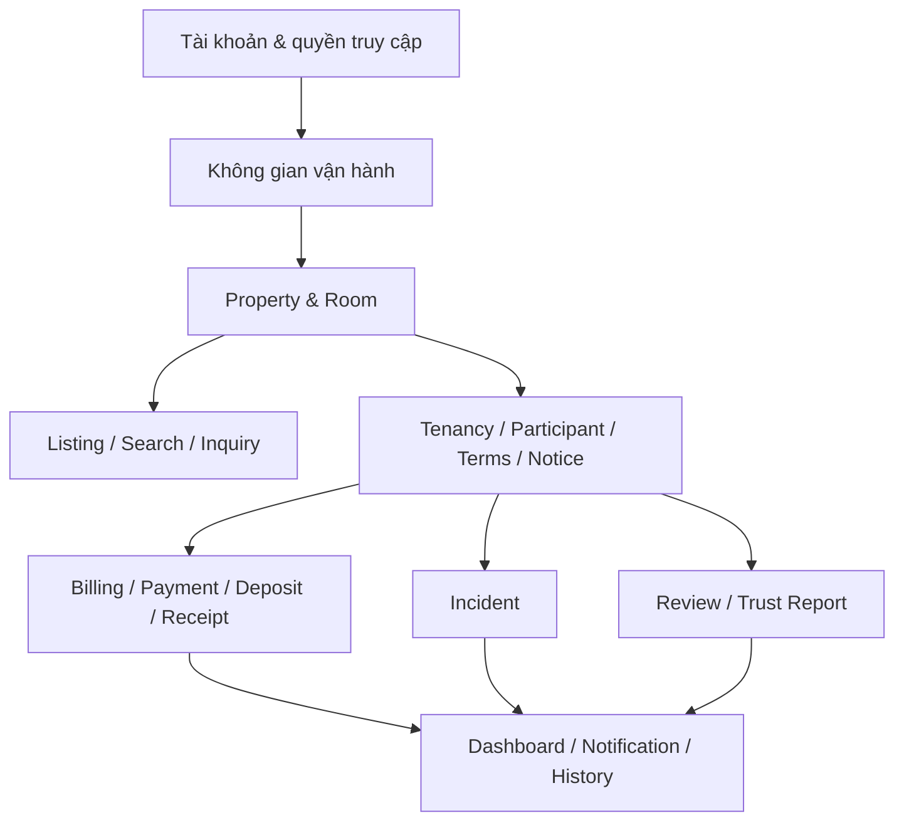
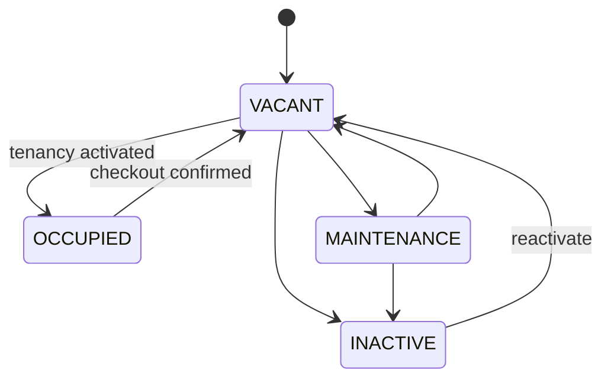
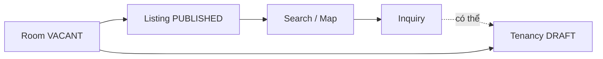
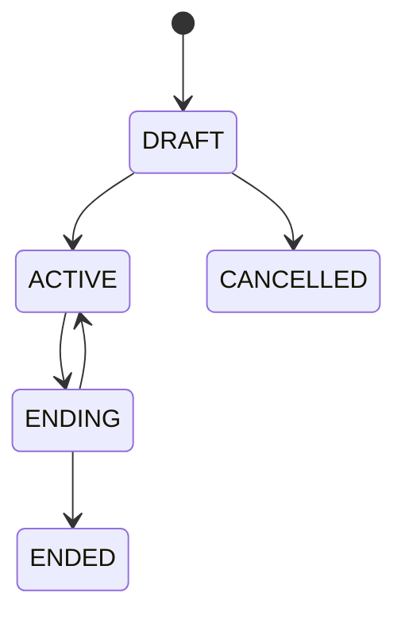
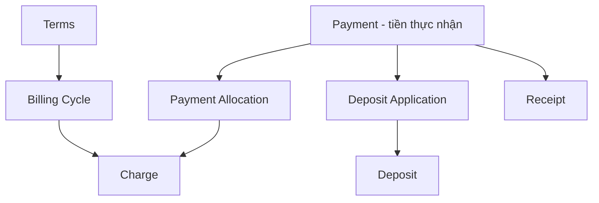

# Các phần nghiệp vụ của TrọƠi

Tài liệu này giúp Frontend, Backend và Database dùng cùng một cách hiểu về các khái niệm chính. Chi tiết chính thức vẫn nằm ở [`../database/v1/canonical.md`](../database/v1/canonical.md); nếu hai nơi nói khác nhau, Canonical là nguồn chuẩn.

## 1. Bản đồ tổng thể

## 2. Tài khoản và không gian vận hành

### USER

`USER` là tài khoản số. Nó không mang một role cố định kiểu landlord/tenant/operator.

### ORGANIZATION

`ORGANIZATION` là không gian để một chủ trọ/người vận hành quản lý các Property. Trong MVP, mỗi Organization có đúng một primary owner/operator; team/staff/delegation nâng cao để FUTURE.

Quyền phải dựa vào quan hệ thật với tài nguyên hoặc Tenancy, không dựa vào `User.role` toàn cục.

## 3. Property và Room

### PROPERTY

Đại diện cho một cơ sở/địa điểm quản lý phòng. Property có lifecycle `ACTIVE | ARCHIVED` và tách vị trí vận hành khỏi vị trí được phép công khai.

### ROOM

Đơn vị cho thuê cụ thể. Room có hai nhóm trạng thái khác nhau:

- trạng thái vận hành: `VACANT | OCCUPIED | MAINTENANCE | INACTIVE`;
- lifecycle của bản ghi: `ACTIVE | ARCHIVED`.

Giá thuê đã thỏa thuận không nằm trên Room; nó thuộc Terms của một Tenancy cụ thể.

## 4. Tìm phòng và liên hệ

### LISTING

Listing là **thông tin của một Room được đưa ra cho người tìm phòng xem**. Nó phục vụ discovery, không phải hồ sơ vận hành thật của Room.

Trạng thái chuẩn:

`DRAFT | PUBLISHED | UNPUBLISHED | ARCHIVED`

Chỉ được publish khi Property còn active, Room còn active và đang `VACANT`. Một Room có tối đa một Listing hiện hành chưa archive.

### SEARCH / MAP

Chỉ đọc các Listing đang `PUBLISHED` và chỉ dùng vị trí công khai đã được phép đưa ra ngoài. Địa chỉ vận hành chính xác không mặc định được expose.

### INQUIRY

Là nhu cầu liên hệ/quan tâm tới một Listing. Inquiry không phải booking/reservation và cũng không bắt buộc phải có trước khi tạo Tenancy.

## 5. Quan hệ thuê

### TENANCY

Tenancy là một lần thuê cụ thể của một Room theo thời gian.

Một Room chỉ được có tối đa một Tenancy chưa kết thúc (`DRAFT | ACTIVE | ENDING`). Khi Tenancy còn `ENDING`, chưa được tạo draft tiếp theo cho cùng Room.

### TENANCY_PARTICIPANT

Người thực sự tham gia Tenancy. Participant tồn tại độc lập với `USER`: một người có thể tham gia thuê dù chưa tạo tài khoản. Link sang `USER` là optional `0..1`.

Tenancy đang active phải có đúng một active `PRIMARY`; có thể có thêm nhiều `OCCUPANT`.

### TENANCY_TERMS

Lưu điều khoản thuê theo từng phiên bản: giá thuê, yêu cầu cọc, thời gian thuê, rule thanh toán, điện/nước và các điều kiện tối thiểu. Khi thay đổi, tạo version mới; không ghi đè lịch sử.

### TERMS_ACKNOWLEDGEMENT / TENANCY_NOTICE

Acknowledgement ghi nhận một participant đã xác nhận một Terms version cụ thể. Notice lưu lịch sử thông báo trong quan hệ thuê. Cả hai đều là dữ liệu ghi nhận thao tác/giao tiếp, không phải dịch vụ pháp lý.

## 6. Tiền thuê, thanh toán, cọc và biên nhận

Ba khái niệm không được trộn với nhau:

- `Charge`: khoản phải thu;
- `Payment`: tiền thực tế đã nhận và được xác nhận;
- `Receipt`: bằng chứng được phát hành từ Payment đủ điều kiện.

Deposit requirement nằm trong Terms; Deposit theo dõi số tiền đã giữ và quá trình settlement. Refund không phải một Payment âm.

## 7. Sự cố, trust và các phần dùng để hiển thị

### INCIDENT / INCIDENT_EVENT

Incident theo dõi một vấn đề vận hành của Room. Mỗi thay đổi quan trọng được ghi thành `INCIDENT_EVENT` để giữ lịch sử.

Lifecycle:

`REPORTED → ACKNOWLEDGED | REJECTED | CLOSED`

`ACKNOWLEDGED → IN_PROGRESS | REJECTED`

`IN_PROGRESS → RESOLVED | CLOSED`

`RESOLVED → CLOSED | IN_PROGRESS`

### REVIEW / TRUST_REPORT

Review dựa trên lịch sử thuê đủ điều kiện. Trust Report dùng để báo vấn đề với nội dung công khai như Listing hoặc Review. Cả hai tách biệt với Incident.

### DASHBOARD / NOTIFICATION / HISTORY

Đây là các phần giúp đọc, tổng hợp hoặc gửi thông tin. Chúng được xây từ dữ liệu gốc nhưng không được tự trở thành nơi ghi business state chính.

## 8. Một số rule xuyên nhiều phần cần nhớ

- Room rời `VACANT` thì Listing đang public phải được ngừng công khai trong cùng workflow.
- Checkout phải đưa Tenancy về `ENDED` và Room về `VACANT` một cách nhất quán.
- Room chỉ archive khi đủ điều kiện và không còn Tenancy/Incident đang chặn.
- Allocation hoặc Deposit Application không được trỏ sang Tenancy khác Payment.
- Chỉ confirmed Payment mới được tính là tiền đã nhận và dùng để phát hành Receipt.
- Incident Event giữ lịch sử theo kiểu append-only.
- Audit kỹ thuật không thay thế lịch sử nghiệp vụ.

Đọc [`integration-contracts.md`](integration-contracts.md) để biết rule nào được Frontend hiển thị, Backend kiểm tra/điều phối và Database bảo vệ.
