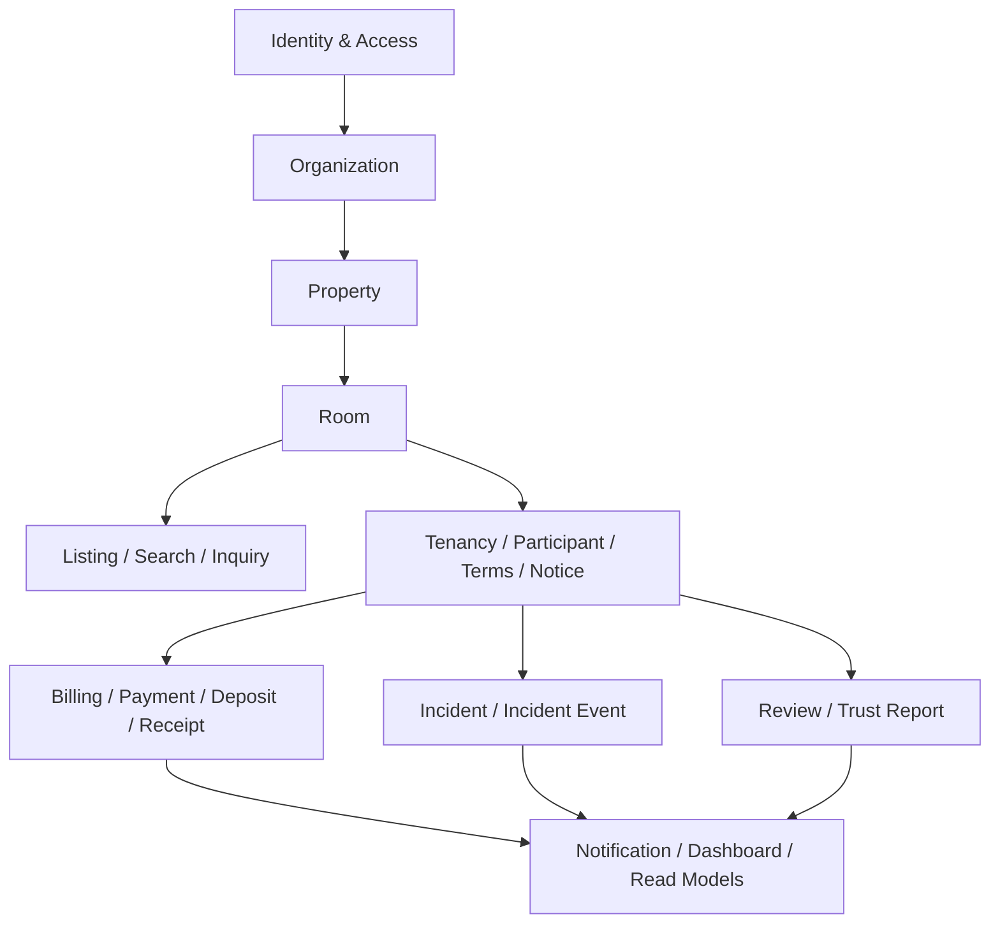
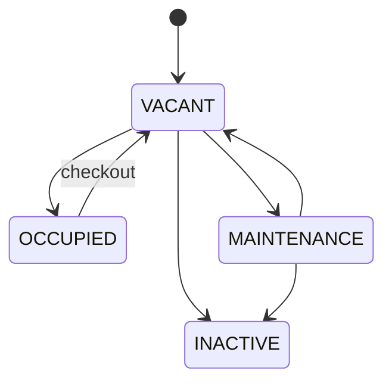
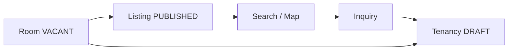
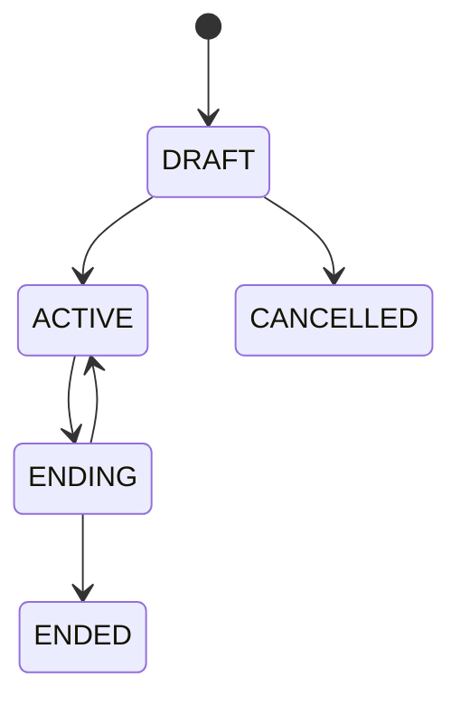
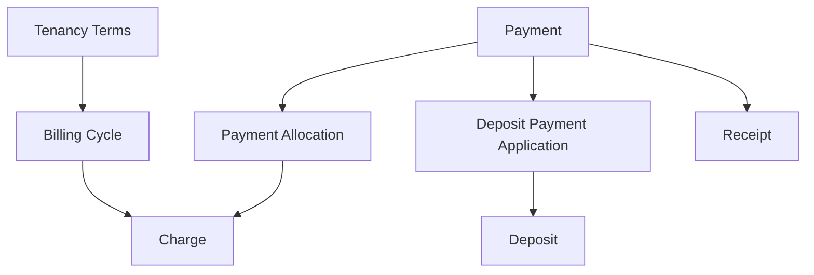

# Product Domain TrọƠi

Tài liệu này mô tả mental model nghiệp vụ dùng chung cho Frontend, Backend và Database. Nó không thay thế canonical; khi có xung đột, authority nằm ở [`../database/v1/canonical.md`](../database/v1/canonical.md).

## 1. Bản đồ domain

## 2. Identity & workspace

### USER
Digital identity. `USER` không có global role kiểu landlord/tenant/operator.

### ORGANIZATION
Workspace vận hành thuê trọ. MVP có primary owner reference; advanced team/delegation là FUTURE.

Quyền truy cập nghiệp vụ phải dựa trên ownership/resource relationship hoặc tenancy participation, không dựa vào một `User.role` toàn cục.

## 3. Property & Room

### PROPERTY
Đại diện một cơ sở/địa điểm quản lý phòng. Lifecycle hiện tại: `ACTIVE | ARCHIVED`. Property có operational location và public-location projection tách biệt.

### ROOM
Đơn vị thuê cụ thể. Room có hai chiều trạng thái độc lập:

- `operational_state = VACANT | OCCUPIED | MAINTENANCE | INACTIVE`
- `record_lifecycle = ACTIVE | ARCHIVED`

Room không sở hữu giá thuê đã thỏa thuận. Giá thuê thuộc Tenancy Terms.

## 4. Discovery

### LISTING
Public discovery projection của Room. Lifecycle chính xác:

`DRAFT | PUBLISHED | UNPUBLISHED | ARCHIVED`

Publish chỉ hợp lệ khi Room đang `VACANT`, active và Property active. Một Room có tối đa một current/non-archived Listing.

### SEARCH / MAP
Chỉ đọc public discovery projection được cho phép. Operational location riêng tư không được tự động expose ra public search.

### INQUIRY
Cầu nối giữa discovery và khả năng hình thành quan hệ thuê. Inquiry không phải booking/reservation và không phải điều kiện bắt buộc để tạo Tenancy.

## 5. Rental relationship

### TENANCY
Quan hệ thuê của một Room. Lifecycle hiện tại:

Một Room có tối đa một non-terminal Tenancy (`DRAFT | ACTIVE | ENDING`). Không được tạo draft kế tiếp khi tenancy hiện tại còn `ENDING`.

### TENANCY_PARTICIPANT
Người tham gia quan hệ thuê, tách biệt với `USER`. Participant có thể chưa có tài khoản; linkage tới USER là optional. Active tenancy có đúng một active `PRIMARY` và có thể có nhiều active `OCCUPANT`.

### TENANCY_TERMS
Điều khoản thuê theo version. Terms sở hữu rent, deposit requirement, dates, billing rules, utility rules và minimum-rental conditions. Thay đổi tài chính áp dụng từ billing boundary tiếp theo; MVP không prorate.

### TERMS_ACKNOWLEDGEMENT / TENANCY_NOTICE
Acknowledgement gắn với một Terms version cụ thể. Notice lưu lịch sử giao tiếp liên quan tenancy; không biến platform thành hệ thống phán quyết pháp lý.

## 6. Finance

- `BillingCycle` và `Charge` là nghĩa vụ phải thu.
- Charge type hiện tại: `RENT | ELECTRICITY | WATER`.
- `Payment` là tiền thực nhận; chỉ confirmed Payment mới tính là received money.
- `PaymentAllocation` phân bổ Payment vào Charge.
- `DepositPaymentApplication` dùng Payment để funding Deposit.
- `Receipt` là bằng chứng phát hành từ Payment đủ điều kiện; Receipt không phải Payment.
- Refund/settlement deposit là outbound movement, không phải negative Payment.

## 7. Operations, trust và read surfaces

### INCIDENT / INCIDENT_EVENT
Incident theo dõi vấn đề vận hành của phòng; `INCIDENT_EVENT` là lịch sử append-only.

Lifecycle:

`REPORTED → ACKNOWLEDGED | REJECTED | CLOSED`

`ACKNOWLEDGED → IN_PROGRESS | REJECTED`

`IN_PROGRESS → RESOLVED | CLOSED`

`RESOLVED → CLOSED | IN_PROGRESS`

`REJECTED` và `CLOSED` là terminal.

### REVIEW / TRUST_REPORT
Review và Trust Report là domain riêng, không phải Incident. Trust Report target Listing hoặc Review; public personal rating không phải semantics hiện tại.

### NOTIFICATION / DASHBOARD
Notification là side effect/delivery. Dashboard và các read model là projection phục vụ đọc. Các surface này không được mutate source business state hoặc trở thành write authority.

## 8. Cross-domain invariants quan trọng

- Room rời `VACANT` thì current Listing phải được unpublish đồng bộ.
- Checkout phải kết thúc Tenancy và trả Room về `VACANT` trong workflow nhất quán.
- Room archive yêu cầu `INACTIVE`, không có non-terminal Tenancy và không có open Incident.
- Allocation/deposit application không được cross Tenancy và tổng amount không vượt Payment amount.
- Chỉ confirmed Payment mới được dùng để tính tiền đã nhận và phát hành Receipt.
- Incident Event là append-only history.
- Technical audit không thay thế operational/business truth.

Xem [`integration-contracts.md`](integration-contracts.md) để biết invariant nào do Backend orchestration, Database constraint/transaction guard và Frontend consumption chịu trách nhiệm.
