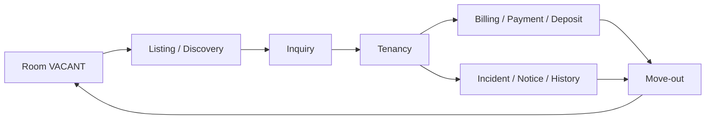
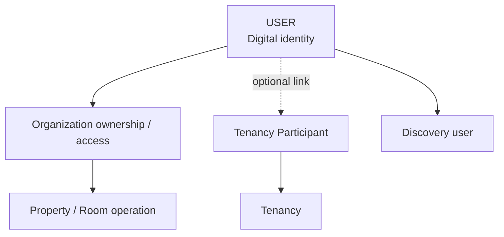
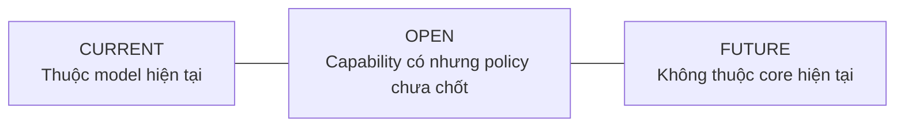

# Tổng quan dự án TrọƠi

## 1. TrọƠi là gì?

TrọƠi là nền tảng quản lý vòng đời thuê trọ, lấy **sổ vận hành theo từng phòng/tài sản** làm trung tâm. Hệ thống không chỉ phục vụ tìm phòng và cũng không chỉ là phần mềm quản lý chủ trọ; trọng tâm là lưu vết xuyên suốt một quan hệ thuê: phòng trống → công khai tìm người thuê → hình thành tenancy → phát sinh nghĩa vụ tài chính → thanh toán/biên nhận → sự cố → kết thúc thuê → quay lại vòng vận hành tiếp theo.

Search/Map và Listing là bề mặt discovery. Chúng không thay thế bản ghi vận hành của Room/Tenancy.

## 2. Vấn đề project giải quyết

TrọƠi hướng tới việc giảm tình trạng vận hành phòng trọ bằng ghi chú rời rạc, tin nhắn và bảng tính thiếu liên kết. Hệ thống gom các fact quan trọng của phòng và quan hệ thuê vào một mô hình có lịch sử, trạng thái và đối chiếu rõ ràng.

Các nhóm vấn đề chính:

- trạng thái phòng và listing dễ lệch nhau;
- thông tin người thuê và quan hệ thuê bị trộn với tài khoản đăng nhập;
- thỏa thuận thuê thiếu version/history;
- công nợ, khoản thu, đặt cọc và biên nhận dễ bị nhập nhằng;
- sự cố thiếu lifecycle và lịch sử xử lý;
- dữ liệu vận hành khó đối chiếu khi có thay đổi hoặc tranh chấp thông tin.

## 3. Người dùng và vai trò

TrọƠi không gán một global business role cố định cho `USER`. `USER` chỉ là digital identity; quyền và vai trò nghiệp vụ được suy ra từ quan hệ thực tế.

Các actor chính:

- **Chủ trọ / người vận hành:** quản lý Organization, Property, Room, Listing, Tenancy, tài chính và vận hành.
- **Người thuê / người tham gia tenancy:** có thể được liên kết với `USER`, nhưng tenancy participation tồn tại độc lập qua `TENANCY_PARTICIPANT`.
- **Người tìm phòng:** dùng Listing/Search/Map/Inquiry trước khi có quan hệ thuê.
- **Đối tác dịch vụ:** định hướng giai đoạn sau; không phải core marketplace trong MVP hiện tại.

## 4. Sản phẩm và surface

- **Android app:** sản phẩm chính để triển khai các luồng nghiệp vụ.
- **Landing/marketing website:** surface giới thiệu và hỗ trợ acquisition, không phải nơi sở hữu core business state.
- **Backend API:** application/domain layer dùng chung cho client.
- **PostgreSQL/PostGIS:** authoritative persistence cho dữ liệu nghiệp vụ và geospatial query.

## 5. Phạm vi CURRENT

Canonical hiện tại bao gồm các capability quanh Identity/Organization/Property/Room, Listing/Search/Map/Inquiry, Tenancy/Participant/Terms/Acknowledgement/Notice, Billing/Charge/Utility, Payment/Allocation/Payment Claim, Deposit, Receipt, Incident/Event, Dashboard/read model, Notification, Review và Trust Report.

`CURRENT` nghĩa là capability thuộc model hiện tại, không đồng nghĩa mọi UI/API đều đã hoàn thiện hoặc đã tích hợp end-to-end.

## 6. OPEN và FUTURE

Những policy được canonical đánh dấu `OPEN` vẫn chưa được quyết định ở lower layer. Ví dụ có các policy quanh Trust Report và xử lý phần Payment chưa phân bổ.

Các capability đang `FUTURE` gồm Subscription/Pricing/Quota, CSV/Excel import, advanced organization team/delegation, room assets, extra charge types, partner marketplace, AI/OCR, full messaging, saved search, OTA integration, proration và public ratings.

## 7. Những điều TrọƠi không phải

- Không phải hệ thống pháp lý hay dịch vụ tư vấn pháp lý.
- Không coi “ghi nhận thỏa thuận” là dịch vụ hợp đồng điện tử có hiệu lực pháp lý mặc định.
- Không dùng public personal rating làm trust model hiện tại.
- Không coi Notification, Dashboard, Search index, cache hay UI state là nguồn sự thật nghiệp vụ.
- Không coi Listing là bản ghi vận hành của Room.

## 8. Bước đọc tiếp theo

Đọc [`product-domain.md`](product-domain.md) để hiểu các domain và quan hệ; sau đó đọc [`system-map.md`](system-map.md) để hiểu chúng được triển khai qua Frontend, Backend và Database như thế nào.
