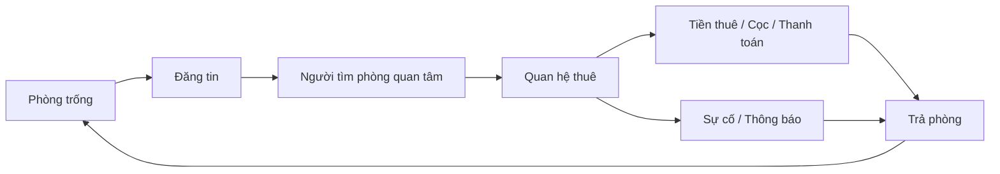
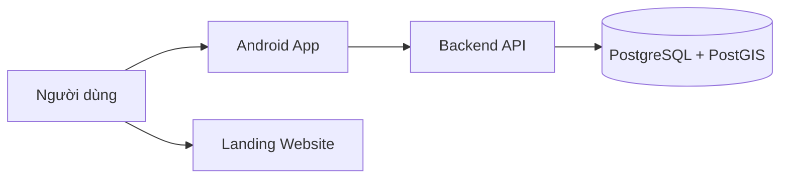

# Tổng quan dự án TrọƠi

## 1. TrọƠi là gì?

TrọƠi là nền tảng quản lý vòng đời thuê trọ dài hạn, lấy **hồ sơ vận hành của từng phòng** làm trung tâm.

Một phòng không chỉ có trạng thái “đang trống” hay “đang có người thuê”. Trong quá trình vận hành, nó còn được đăng tin, có người quan tâm, hình thành quan hệ thuê, phát sinh tiền thuê và tiện ích, có thể gặp sự cố, rồi kết thúc thuê và quay lại vòng tiếp theo. TrọƠi nối các mốc đó thành một lịch sử thống nhất thay vì để chúng nằm rời rạc trong tin nhắn, ghi chú và bảng tính.

Listing và Search/Map giúp người dùng tìm phòng. Chúng không thay thế hồ sơ vận hành thật của Room/Tenancy.

## 2. Project giải quyết vấn đề gì?

TrọƠi hướng tới các chủ trọ và người vận hành vẫn đang quản lý bằng nhiều nguồn rời rạc. Khi dữ liệu không nối với nhau, rất dễ xảy ra những tình huống như:

- phòng đã có người thuê nhưng tin vẫn còn hiển thị;
- thông tin tài khoản bị nhầm với người thực sự tham gia thuê;
- điều khoản mới ghi đè mất lịch sử cũ;
- tiền phải thu, tiền đã nhận, cọc và biên nhận bị coi như cùng một thứ;
- sự cố chỉ nằm trong chat và không có lịch sử xử lý;
- khi cần đối chiếu thì không biết dữ liệu nào là bản ghi chính.

TrọƠi giải bài toán đó bằng một chuỗi dữ liệu có trạng thái, lịch sử và mối quan hệ rõ ràng.

## 3. Ai sử dụng TrọƠi?

- **Chủ trọ / người vận hành:** quản lý nơi cho thuê, phòng, tin đăng, quan hệ thuê, tiền và các vấn đề phát sinh.
- **Người thuê / người tham gia thuê:** xem thông tin thuê của mình, điều khoản, tiền, biên nhận, sự cố, thông báo và lịch sử.
- **Người đang tìm phòng:** tìm phòng, xem bản đồ/tin đăng và gửi nhu cầu liên hệ.
- **Đối tác dịch vụ:** là hướng phát triển sau; không phải marketplace mở trong phần lõi hiện tại.

Một điểm quan trọng: `USER` chỉ là tài khoản số. Việc một người là chủ trọ, người thuê hay người tìm phòng được xác định từ quan hệ thật của họ với Organization, Property hoặc Tenancy; không dùng một `USER.role` toàn cục.

## 4. Sản phẩm gồm những phần nào?

- **Android app:** sản phẩm chính, nơi người dùng thực hiện các luồng nghiệp vụ.
- **Landing/marketing website:** giới thiệu sản phẩm và hỗ trợ thu hút người dùng; không giữ trạng thái nghiệp vụ chính.
- **Backend API:** nhận yêu cầu từ app, kiểm tra rule và điều phối nghiệp vụ.
- **PostgreSQL/PostGIS:** lưu dữ liệu nghiệp vụ và dữ liệu vị trí cần cho Search/Map.

## 5. Phạm vi hiện tại

Phần `CURRENT/FROZEN` hiện bao gồm các nhóm chính: Identity/Organization/Property/Room, Listing/Search/Map/Inquiry, Tenancy/Participant/Terms/Acknowledgement/Notice, Billing/Payment/Deposit/Receipt, Incident, Operational History, Dashboard, Notification, Review và Trust Report.

`CURRENT` chỉ có nghĩa là capability thuộc mô hình hiện tại. Nó **không có nghĩa** mọi màn hình, API và persistence đã hoàn thiện end-to-end trên branch integration hiện tại.

## 6. OPEN và FUTURE

- `OPEN`: capability đã nằm trong mô hình nhưng một policy cụ thể vẫn chưa chốt. Lower layer không được tự chọn đáp án rồi coi đó là rule chuẩn.
- `FUTURE`: chủ động để sau, không thuộc phần lõi hiện tại.

Các hướng FUTURE hiện gồm Subscription/Pricing/Quota, CSV/Excel import, advanced team/delegation, Room Asset Inventory, extra charge types, partner marketplace, AI/OCR, full realtime messaging, saved search, OTA/instant booking, proration và public personal ratings.

## 7. TrọƠi không phải gì?

- Không phải dịch vụ pháp lý hay nơi phân xử tranh chấp.
- Không coi việc “ghi nhận thỏa thuận” là mặc định tương đương hợp đồng điện tử có hiệu lực pháp lý.
- Không dùng public personal rating làm mô hình trust hiện tại.
- Không coi Dashboard, Notification, Search index, cache hay UI state là nơi giữ dữ liệu nghiệp vụ gốc.
- Không coi Listing là hồ sơ vận hành của Room.

## 8. Đọc tiếp

Đọc [`product-domain.md`](product-domain.md) để hiểu từng phần nghiệp vụ và cách chúng nối với nhau, sau đó đọc [`system-map.md`](system-map.md) để biết Frontend, Backend và Database chịu trách nhiệm ở đâu.
