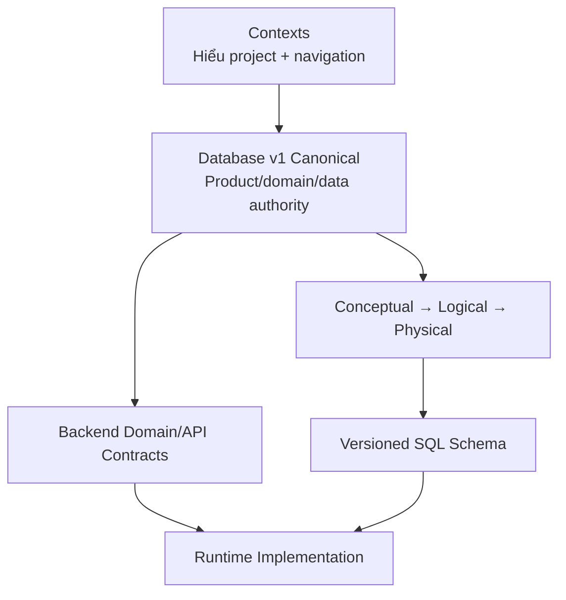
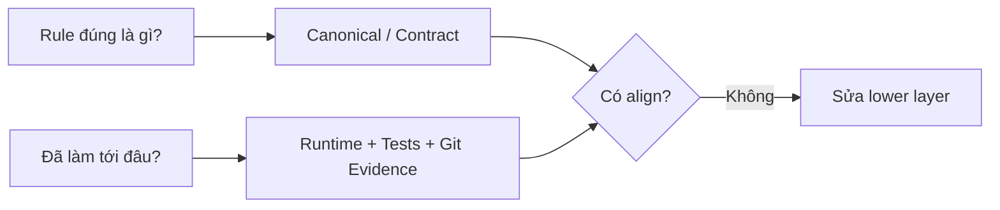

# Source of Truth

Tài liệu này trả lời câu hỏi: **khi context, spec, code, ERD hoặc schema nói khác nhau thì nguồn nào có quyền quyết định?**

## 1. Nguyên tắc chung

Không có một file duy nhất sở hữu mọi loại truth. Mỗi vùng tài liệu có trách nhiệm khác nhau.

## 2. Database contract v1

Authority release hiện tại nằm tại [`../database/v1/`](../database/v1/), theo thứ tự:

1. [`canonical.md`](../database/v1/canonical.md) — product/domain/database rules và CURRENT/OPEN/FUTURE boundaries.
2. [`erd/conceptual.json`](../database/v1/erd/conceptual.json) — conceptual model.
3. [`erd/logical.json`](../database/v1/erd/logical.json) — normalized logical model.
4. [`erd/physical.json`](../database/v1/erd/physical.json) — PostgreSQL/PostGIS physical contract.
5. [`schema/trooi-schema-20260927T153946Z.sql`](../database/v1/schema/trooi-schema-20260927T153946Z.sql) — executable SQL snapshot.

Nếu lower layer conflict với higher layer trong chain này, sửa lower layer; không làm yếu higher authority để giữ behavior cũ.

## 3. Vai trò của từng vùng docs

| Vùng | Vai trò | Có phải authority nghiệp vụ không? |
| --- | --- | --- |
| `docs/contexts/` | Shared mental model, onboarding, liên kết | Không override canonical |
| `docs/database/vN/` | Versioned product/domain/data contract | Có, theo authority chain của release |
| `docs/backlogs/vN/` | Scoped implementation work đang phát triển | Không tự định nghĩa business truth |
| `docs/temps/` | Chưa phân loại/chưa review | Tuyệt đối không |
| `docs/archives/` | Historical/special retained artifacts | Không |

`implementation-history.md` trong database release là provenance của implementation, không cao hơn canonical/ERD/schema chain.

## 4. Runtime và contract

Runtime code phải implement contract hiện hành. Tuy nhiên runtime vẫn là bằng chứng quan trọng để xác định **cái gì đã IMPLEMENTED**.

Hai câu hỏi phải tách biệt:

- “Business rule đúng là gì?” → đọc authority contract.
- “Code hiện đã làm tới đâu?” → đọc implementation/tests/git evidence.

## 5. OPEN và FUTURE

- `OPEN`: capability có thể thuộc model hiện tại nhưng policy chưa freeze; lower layer không được tự chọn default rồi gọi đó là authority.
- `FUTURE`: không được kéo vào current scope chỉ vì scaffold, old spec hoặc code cũ tồn tại.
- `CURRENT`: thuộc frozen model nhưng không đồng nghĩa mọi layer đã implement xong.

## 6. Cách xử lý conflict

Khi phát hiện hai nguồn khác nhau:

1. Xác định conflict thuộc product/domain, API, persistence, UI hay implementation status.
2. Xác định authority đúng cho concern đó.
3. Kiểm tra tài liệu nào cũ/historical.
4. Không tự hòa giải bằng cách tạo semantics thứ ba.
5. Sửa lower-authority artifact và test/conformance liên quan.
6. Nếu authority thật sự chưa quyết định, giữ trạng thái `OPEN` hoặc đưa vấn đề ra quyết định thay vì đoán.

## 7. Ví dụ

- UI có state `rented`, canonical Listing không có state này → sửa UI/model; Listing vẫn dùng `draft | published | unpublished | archived`.
- Code cũ có `User.role = tenant`, canonical tách USER và TENANCY_PARTICIPANT → sửa code; không sửa canonical để giữ code cũ.
- Tech-stack cũ ghi Redis đang dùng nhưng runtime baseline chưa có Redis → context ghi Redis `PLANNED`, không tuyên bố IMPLEMENTED.
- Dashboard hiển thị outstanding balance → đó là projection; không biến field projection thành financial write truth.

## 8. Reading rule cho agent mới

Bắt đầu từ [`README.md`](README.md) để hiểu hệ thống; khi cần quyết định business/data semantics thì chuyển sang database contract v1; khi cần biết lịch sử triển khai thì tra cứu lịch sử Git; khi cần biết việc đang làm thì đọc Backlogs.
