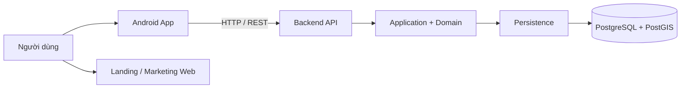
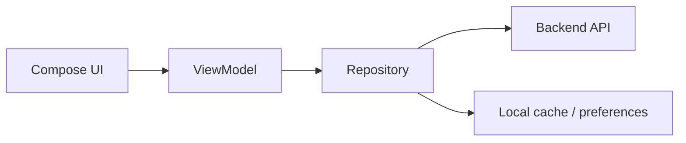
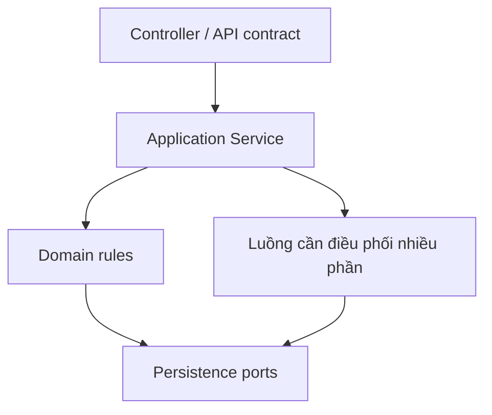
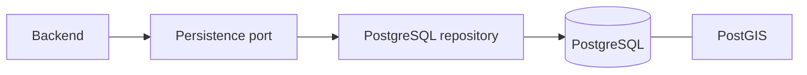
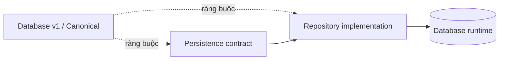

# Bản đồ hệ thống TrọƠi

Tài liệu này trả lời ba câu hỏi: **project có những phần kỹ thuật nào, mỗi phần làm gì và chúng nối với nhau ở đâu**.

## 1. Toàn cảnh

Android app là sản phẩm chính. Landing website phục vụ giới thiệu/marketing và không giữ trạng thái nghiệp vụ cốt lõi.

## 2. Frontend

Frontend lo phần người dùng nhìn thấy và thao tác:

- hiển thị dữ liệu và trạng thái;
- nhận thao tác của người dùng;
- gọi Backend theo API contract;
- giữ navigation/UI state và local cache khi cần;
- hiển thị lỗi hoặc state mới sau response.

Frontend **không tự quyết** Listing/Tenancy lifecycle, số tiền đã thực nhận hay các rule xuyên nhiều domain.

## 3. Backend

Backend là nơi kiểm tra và thực thi nghiệp vụ:

- xác thực và kiểm tra quyền;
- validate command;
- thực hiện lifecycle transition;
- điều phối một thao tác chạm nhiều domain;
- expose API/OpenAPI;
- thực hiện transaction qua lớp persistence;
- tạo read model hoặc side effect khi cần.

Kiến trúc backend đi theo Modular Monolith: module tách theo trách nhiệm nghiệp vụ nhưng vẫn chạy trong cùng một ứng dụng.

Các module đã xuất hiện trong các baseline gồm identity-access, organization, property, room, listing, tenancy, rental-lifecycle, billing, receipt, incident, audit-trust và onboarding. `subscription` chỉ là FUTURE scaffolding, không phải phần lõi hiện tại.

## 4. Database và lớp persistence

PostgreSQL/PostGIS giữ dữ liệu nghiệp vụ phía server. Backend không nên viết thẳng từ application service xuống database; thao tác đi qua persistence contract/repository và transaction boundary.

Database chịu trách nhiệm giữ dữ liệu bền vững, foreign key/uniqueness/check, transaction atomicity và những ràng buộc dễ bị phá khi nhiều request chạy cùng lúc.

## 5. Luồng chạy và nguồn chuẩn là hai chuyện khác nhau

Khi app chạy, request đi theo chiều Frontend → Backend → Database.

Khi thiết kế hoặc sửa semantics, implementation phải tuân theo nguồn chuẩn:

Đừng đọc sơ đồ runtime rồi hiểu nhầm rằng repository có quyền tự định nghĩa contract.

## 6. Các capability hỗ trợ

- **Search/Map:** đọc các Listing đang public và public location projection; PostGIS hỗ trợ truy vấn vị trí.
- **Notification:** gửi thông tin sau khi business event xảy ra; không tự thay đổi business state.
- **Dashboard:** tổng hợp dữ liệu để xem; không phải nơi ghi revenue/debt/occupancy truth.
- **Cache/Object storage:** có trong hướng kỹ thuật nhưng phải xem trạng thái cụ thể trong [`tech-stack.md`](tech-stack.md) trước khi coi là đã tích hợp.

## 7. Ai chịu trách nhiệm phần nào?

| Việc | Frontend | Backend | Database |
| --- | --- | --- | --- |
| Hiển thị UI | Chính | — | — |
| Nhận thao tác người dùng | Chính | Nhận/kiểm tra | — |
| Quyết định lifecycle transition | Hiển thị theo kết quả | Chính | Giữ state + bảo vệ integrity |
| API contract | Sử dụng | Định nghĩa/expose | — |
| Transaction nhiều bản ghi | — | Điều phối | Bảo đảm atomicity |
| Search/Map | Hiển thị | Điều phối query | PostGIS/query data |
| Dashboard | Hiển thị | Tổng hợp | Cung cấp dữ liệu gốc |
| Notification | Nhận/hiển thị | Trigger/gửi | Lưu delivery fact nếu cần |

Nếu một thay đổi đi qua hai layer trở lên, kiểm tra cả hai đầu contract thay vì chỉ sửa nơi đang báo lỗi.
