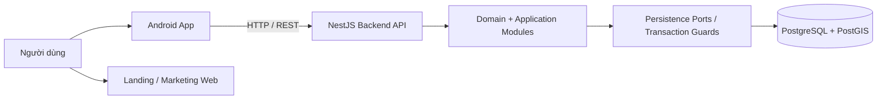
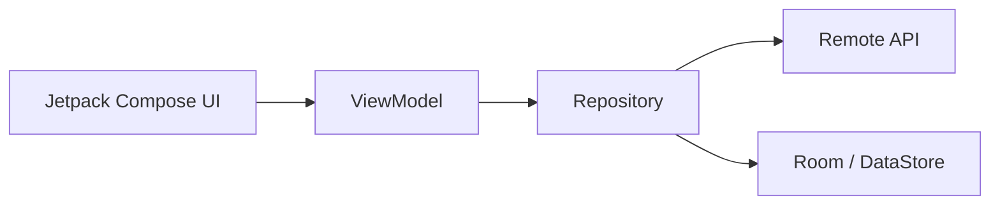
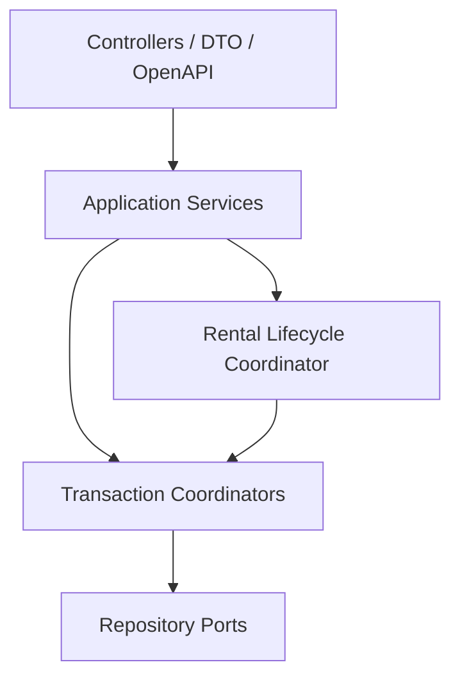
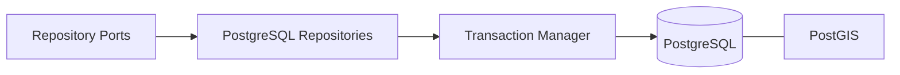
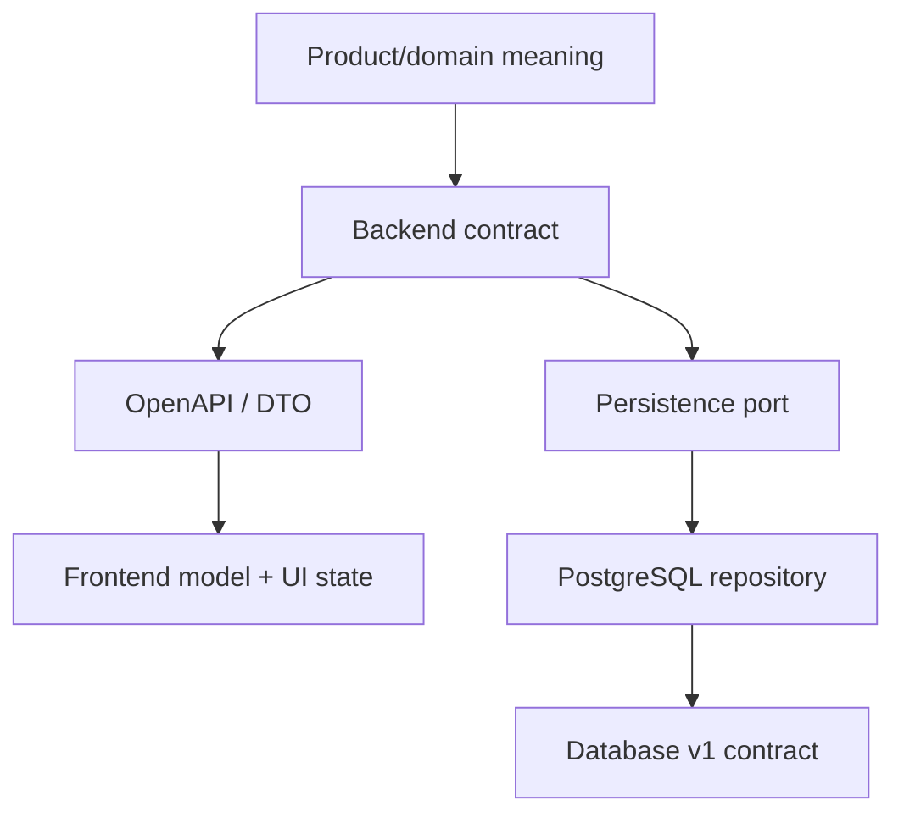

# System Map TrọƠi

Tài liệu này cho thấy TrọƠi gồm những thành phần kỹ thuật nào, mỗi thành phần sở hữu gì và chúng kết nối với nhau ra sao.

## 1. Kiến trúc cấp cao

Android app là product surface chính. Landing website là marketing surface và không sở hữu core business state.

## 2. Frontend

Frontend chịu trách nhiệm presentation và client interaction:

- render UI từ state;
- nhận user intent;
- gọi Backend theo API contract;
- quản lý UI state và local client state;
- cache/local persistence khi cần nhưng không thay server business truth.

Frontend không sở hữu Listing/Tenancy lifecycle, financial truth hoặc cross-domain invariant.

## 3. Backend

Backend là boundary chính cho application/domain behavior:

- authentication/identity boundary;
- business command validation;
- lifecycle transitions;
- cross-domain orchestration;
- authorization theo resource/relationship;
- API/OpenAPI contract;
- transaction coordination qua persistence ports.

Backend hiện đi theo Modular Monolith: nhiều module có boundary rõ nhưng cùng một deployable application.

Các module backend hiện có gồm identity-access, organization, property, room, listing, tenancy, rental-lifecycle, billing, receipt, incident, audit-trust và onboarding. `subscription` tồn tại như FUTURE scaffolding, không phải current-core authority.

## 4. Database & persistence

PostgreSQL/PostGIS là authoritative persistence platform cho dữ liệu nghiệp vụ hiện tại. Persistence layer gồm Kysely/pg client, repository implementations, transaction manager và transaction guards.

Database chịu trách nhiệm:

- relational/geospatial persistence;
- foreign key, uniqueness và check integrity;
- concurrency-safe guards cho invariant có thể race;
- transaction atomicity;
- query/read projection cần dữ liệu database.

## 5. Supporting capabilities

- **Search/Map:** read surface dựa trên published Listing và public location projection; PostGIS phục vụ spatial query.
- **Notification:** delivery side effect, không được sở hữu business state.
- **Dashboard/read model:** denormalized projection phục vụ đọc, không phải write authority.
- **Object storage / cache:** định hướng kỹ thuật có trong tài liệu cũ nhưng chưa thuộc baseline implemented hiện tại; xem [`tech-stack.md`](tech-stack.md).

## 6. Ownership giữa các layer

| Concern | Frontend | Backend | Database |
| --- | --- | --- | --- |
| UI/presentation state | Sở hữu | Không | Không |
| User intent | Thu nhận | Diễn giải/validate | Không |
| Business lifecycle | Render | Sở hữu transition/orchestration | Persist + guard integrity |
| API contract | Consume | Sở hữu/expose | Không |
| Persistence contract | Không | Sở hữu port/transaction intent | Implement/enforce |
| Relational integrity | Không | Pre-check khi hữu ích | Authoritative enforcement |
| Public Search/Map | Render | API/query orchestration | PostGIS/query projection |
| Dashboard | Render | Read-model orchestration | Query source |
| Notification | Render/receive | Trigger/delivery orchestration | Persist delivery fact nếu cần |

## 7. Nguyên tắc liên kết

Nếu một thay đổi vượt qua boundary giữa hai node trong sơ đồ trên, phải kiểm tra cả hai đầu contract và cập nhật context liên quan nếu mental model thay đổi.
