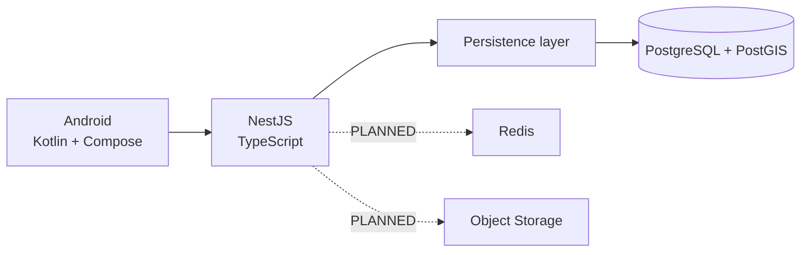

# Tech Stack TrọƠi

File này giúp trả lời một câu hỏi thực tế: **project đã dùng công nghệ gì, cái gì mới chỉ được chọn cho hướng triển khai và cái gì để sau**.

## 1. Cách đọc trạng thái

- **IMPLEMENTED:** đã có implementation/evidence ở một baseline của project.
- **PLANNED:** đã được chọn hoặc mô tả rõ nhưng chưa tích hợp đầy đủ.
- **FUTURE:** chưa thuộc phần lõi hiện tại hoặc phụ thuộc feature FUTURE.

> Quan trọng: `IMPLEMENTED` không luôn đồng nghĩa file runtime đã có trên HEAD của `integration/full-stack-sync`. Trong giai đoạn đang hội tụ các lane, hãy kiểm tra đúng branch/commit trước khi kết luận.

## 2. Toàn hệ thống

## 3. Frontend

| Thành phần | Trạng thái | Ghi chú |
| --- | --- | --- |
| Android native | IMPLEMENTED | Sản phẩm chính |
| Kotlin | IMPLEMENTED | Ngôn ngữ Android |
| Jetpack Compose / Material 3 | IMPLEMENTED | UI declarative |
| MVVM + Repository foundation | IMPLEMENTED | Boundary ViewModel/Repository đã có ở frontend baseline |
| Hilt | IMPLEMENTED | Dependency injection |
| Coroutines/Flow | IMPLEMENTED | Nền tảng async/reactive |
| Retrofit + OkHttp | PLANNED | Chưa nên coi là production API integration hoàn chỉnh |
| kotlinx.serialization | PLANNED | Mapping data/contract |
| Room local database | PLANNED | Local cache/persistence, không thay server truth |
| DataStore | PLANNED | Preferences/client state nhỏ |
| Coil | PLANNED | Image loading/cache |
| OpenAPI client integration | PLANNED | Cần nối với Backend contract thực tế |
| Marketing web | IMPLEMENTED foundation | Chỉ phục vụ marketing |

## 4. Backend

| Thành phần | Trạng thái | Ghi chú |
| --- | --- | --- |
| TypeScript | IMPLEMENTED | Ngôn ngữ Backend |
| NestJS | IMPLEMENTED | Modular Monolith application |
| HTTP / REST | IMPLEMENTED | Cách client gọi server |
| OpenAPI / Swagger | IMPLEMENTED backend baseline | Frontend consumption chưa hoàn tất |
| class-validator / class-transformer | IMPLEMENTED baseline | Validation ở API boundary |
| Google Auth Library | IMPLEMENTED | Google identity verification boundary |
| Kysely | IMPLEMENTED database baseline | Typed SQL/persistence |
| `pg` | IMPLEMENTED database baseline | PostgreSQL driver |
| node-pg-migrate | IMPLEMENTED database baseline | Migration tooling |
| ESLint / Prettier / TypeScript checks | IMPLEMENTED | Static tooling |

## 5. Database và persistence

| Thành phần | Trạng thái | Ghi chú |
| --- | --- | --- |
| PostgreSQL | IMPLEMENTED database baseline | Nơi lưu dữ liệu nghiệp vụ phía server |
| PostGIS | IMPLEMENTED database baseline | Query vị trí cho Search/Map |
| Repository ports | IMPLEMENTED database baseline | Tách application khỏi DB adapter |
| PostgreSQL repositories | IMPLEMENTED database baseline | Runtime adapter |
| Transaction Manager | IMPLEMENTED database baseline | Giữ nhiều thay đổi cùng transaction |
| Transaction/concurrency guards | IMPLEMENTED database baseline | Bảo vệ các invariant dễ race |
| Dev seed/reset | IMPLEMENTED database baseline | Workflow phát triển |
| Redis | PLANNED | Chưa thuộc completed baseline |
| MinIO / S3-compatible storage | PLANNED | Chưa thuộc completed baseline |

## 6. Hạ tầng và delivery

| Thành phần | Trạng thái | Ghi chú |
| --- | --- | --- |
| Docker Compose cho persistence dev | IMPLEMENTED database baseline | PostgreSQL dev workflow |
| Vercel cho marketing web | IMPLEMENTED foundation | Marketing deployment |
| GitHub Actions | IMPLEMENTED | Workflow tồn tại; không suy ra mọi commit đã có CI |
| Traefik | PLANNED | Chưa là runtime baseline hiện tại |
| Production container topology | PLANNED | Chưa freeze |

## 7. Testing và verification

Các baseline Backend/Database đã có nhiều lớp kiểm tra như build, typecheck, lint, core behavior, ERD conformance, persistence integration, migration parity, restart và concurrency. Frontend baseline cũng có unit/build/lint/instrumentation ở mức foundation.

Nhưng một test từng pass ở branch cũ **không phải bằng chứng** rằng HEAD hiện tại đã pass. Khi cần claim trạng thái hiện tại, chạy hoặc đọc evidence của đúng commit.

## 8. Đừng suy diễn từ tên công nghệ

- Redis/MinIO chưa được coi là đã tích hợp chỉ vì chúng từng xuất hiện trong design.
- OpenAPI là hướng contract giữa Backend và Android, nhưng cần kiểm tra artifact/runtime của đúng branch trước khi dùng.
- Local database trên Android chỉ là dữ liệu local/cache; PostgreSQL vẫn giữ dữ liệu nghiệp vụ phía server.
- Một lựa chọn công nghệ không có quyền tự đóng policy Canonical đang `OPEN`.

Đọc [`layers/frontend.md`](layers/frontend.md), [`layers/backend.md`](layers/backend.md) và [`layers/database.md`](layers/database.md) nếu cần nhìn stack theo từng phần.
