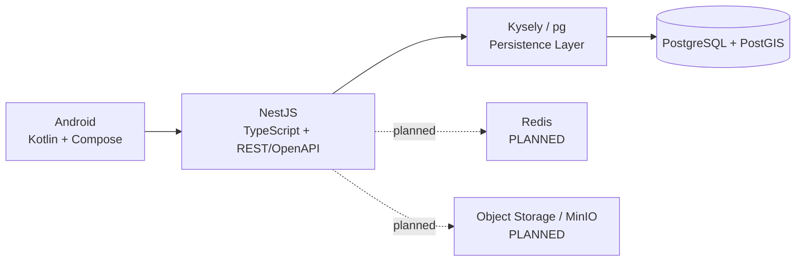
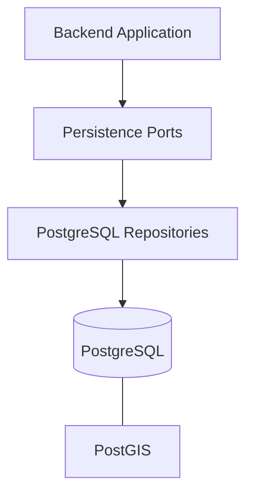

# Tech Stack TrọƠi

Tài liệu này tổng hợp stack toàn hệ thống và tách rõ **IMPLEMENTED**, **PLANNED** và **FUTURE**. Một công nghệ xuất hiện trong design doc cũ không đồng nghĩa đã được tích hợp runtime.

## 1. Quy ước trạng thái

- **IMPLEMENTED:** có implementation/evidence trong baseline hiện có của project.
- **PLANNED:** đã được chọn hoặc mô tả cho kiến trúc nhưng chưa có integration/runtime đầy đủ.
- **FUTURE:** chưa thuộc nhu cầu core hiện tại hoặc phụ thuộc capability FUTURE.

## 2. System stack

## 3. Frontend

| Thành phần | Trạng thái | Ghi chú |
| --- | --- | --- |
| Android native | IMPLEMENTED | Product surface chính |
| Kotlin | IMPLEMENTED | Ngôn ngữ Android |
| Jetpack Compose / Material 3 | IMPLEMENTED | Declarative UI |
| MVVM + Repository foundation | IMPLEMENTED | ViewModel + repository boundary đã có |
| Hilt | IMPLEMENTED | Dependency injection |
| Coroutines/Flow | IMPLEMENTED | Dùng cùng Android lifecycle/ViewModel stack; integration data chưa hoàn chỉnh |
| Retrofit + OkHttp | PLANNED | Có trong frontend stack design, chưa thấy dependency runtime ở baseline app hiện tại |
| kotlinx.serialization | PLANNED | Contract/data mapping target |
| Room local database | PLANNED | Local structured cache/persistence; không thay server truth |
| DataStore | PLANNED | Preferences/local small state |
| Coil | PLANNED | Image loading/cache |
| OpenAPI client integration | PLANNED | Frontend release hiện chưa tích hợp Backend OpenAPI |
| Static marketing web | IMPLEMENTED foundation | `web/` riêng; không sở hữu core nghiệp vụ |

## 4. Backend

| Thành phần | Trạng thái | Ghi chú |
| --- | --- | --- |
| TypeScript | IMPLEMENTED | Backend language |
| NestJS | IMPLEMENTED | Modular Monolith application |
| HTTP / REST | IMPLEMENTED | Client-server API style |
| OpenAPI / Swagger | IMPLEMENTED backend | Swagger tooling có trong backend; frontend consumption chưa hoàn tất |
| class-validator / class-transformer | IMPLEMENTED | DTO/input validation |
| Google Auth Library | IMPLEMENTED integration boundary | Google identity verification support |
| Kysely | IMPLEMENTED | Typed SQL/persistence client layer |
| `pg` | IMPLEMENTED | PostgreSQL driver |
| node-pg-migrate | IMPLEMENTED | Migration tooling |
| ESLint / Prettier / TypeScript checks | IMPLEMENTED | Static verification/tooling |

Backend tổ chức theo Modular Monolith. Module boundary đi theo business ownership, không theo “mỗi table một module”.

## 5. Database & persistence

| Thành phần | Trạng thái | Ghi chú |
| --- | --- | --- |
| PostgreSQL | IMPLEMENTED | Authoritative relational persistence |
| PostGIS | IMPLEMENTED | Spatial data/query cho Search/Map |
| Repository ports | IMPLEMENTED | Backend persistence abstraction |
| PostgreSQL repositories | IMPLEMENTED | Runtime adapters |
| Transaction Manager | IMPLEMENTED | Atomic persistence boundary |
| Transaction/concurrency guards | IMPLEMENTED | Rental, billing, finance, trust invariants |
| Deterministic dev seed/reset | IMPLEMENTED | Development persistence workflow |
| Redis | PLANNED | Cache/temporary state; chưa thuộc completed baseline |
| MinIO / S3-compatible object storage | PLANNED | Binary object storage; chưa thuộc completed baseline |

## 6. Infrastructure / delivery

| Thành phần | Trạng thái | Ghi chú |
| --- | --- | --- |
| Docker Compose cho persistence dev | IMPLEMENTED | Backend có `compose.persistence.yml` workflow cho PostgreSQL |
| Vercel cho marketing web | IMPLEMENTED foundation | Frontend web có Vercel configuration |
| GitHub Actions | IMPLEMENTED | Không mặc định coi mọi branch/commit đã có CI |
| Traefik | PLANNED | Có trong stack design cũ, chưa coi là runtime baseline |
| Full production container topology | PLANNED | Chưa freeze trong context hiện tại |

## 7. Testing / verification

Backend baseline có các lớp kiểm tra: build, typecheck, lint, domain/core behavior, ERD3 conformance, persistence integration, migration parity và restart/concurrency tests. Frontend foundation có unit tests, lint/build và Android instrumentation/smoke surfaces.

Không được dùng một test pass ở branch cũ để tuyên bố commit hiện tại đã qua CI nếu chưa chạy/verify đúng commit đó.

## 8. Những stack không được tự suy diễn

- Redis và MinIO không được ghi như đã implemented chỉ vì chúng xuất hiện trong tài liệu tech-stack cũ.
- OpenAPI là contract target giữa Backend và Android nhưng frontend release hiện chưa tích hợp API production hoàn chỉnh.
- Local Room database của Android, nếu triển khai, vẫn chỉ là local persistence/cache; PostgreSQL vẫn là server business truth.
- Technology choice không được dùng để tự đóng một policy canonical đang `OPEN`.

Xem [`layers/frontend.md`](layers/frontend.md), [`layers/backend.md`](layers/backend.md) và [`layers/database.md`](layers/database.md) để hiểu stack theo từng layer.

## 9. Lưu ý về integration baseline

`IMPLEMENTED` trong tài liệu này mô tả implementation đã có bằng chứng trong các baseline Frontend/Backend/Database đang được đồng bộ vào `integration/full-stack-sync`. Trong giai đoạn docs-first hiện tại, không được suy ra rằng mọi runtime file của các baseline đó đã được merge vào branch integration chỉ từ tài liệu này.

Khi cần xác nhận một capability đã hiện diện trên HEAD đang làm việc hay chưa, kiểm tra runtime tree, tests và Git evidence của đúng HEAD đó.
