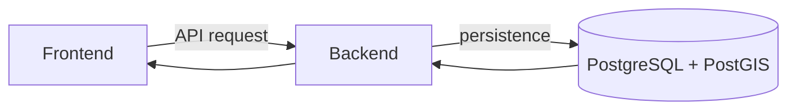

# Database TrọƠi

`docs/database/` chứa các **database contract đã được version hóa**. Nếu bạn chỉ muốn hiểu project, hãy bắt đầu từ [`../contexts/`](../contexts/). Nếu bạn cần biết dữ liệu, quan hệ và ràng buộc chính xác phải như thế nào, đây là nơi cần đọc.

## Release hiện tại

**Database contract hiện tại: [`v1/`](v1/)**

Đọc theo thứ tự:

1. [`v1/canonical.md`](v1/canonical.md) — nghiệp vụ, lifecycle, cardinality và các mục `FROZEN / OPEN / FUTURE`.
2. [`v1/erd/conceptual.json`](v1/erd/conceptual.json) — các khái niệm và quan hệ chính.
3. [`v1/erd/logical.json`](v1/erd/logical.json) — mô hình logic chi tiết hơn.
4. [`v1/erd/physical.json`](v1/erd/physical.json) — cách contract được thể hiện trên PostgreSQL/PostGIS.
5. [`v1/schema/trooi-schema-20260927T153946Z.sql`](v1/schema/trooi-schema-20260927T153946Z.sql) — SQL snapshot đã freeze.

[`v1/implementation-history.md`](v1/implementation-history.md) ghi lại quá trình xây database baseline và evidence đã từng chạy. Nó giúp biết **đã làm gì**, nhưng không có quyền thay đổi Canonical/ERD/SQL contract.

## Database nối với Frontend và Backend thế nào?



- Frontend không đọc/ghi Database trực tiếp.
- Backend kiểm tra nghiệp vụ và điều phối thao tác.
- Database lưu dữ liệu và bảo vệ integrity/transaction/concurrency constraint.

Khi **hệ thống chạy**, request đi từ Frontend → Backend → Database.

Khi **thiết kế hoặc sửa contract**, implementation phải tuân theo chuỗi Canonical → ERD → SQL. Đừng hiểu ngược hai chiều này.

## Version `v1`, `v2` có nghĩa gì?

Đó là version của **database contract release**, không phải level ERD.

Bên trong mỗi release vẫn có ba mức:

```text
Conceptual
→ Logical
→ Physical
→ SQL
```

Khi có `v2`, `v1` vẫn được giữ lại để biết contract cũ từng như thế nào; không chuyển release cũ vào archive chỉ vì có version mới hơn.

## Những gì không nằm ở đây

Tech stack toàn hệ thống không phải database contract. Xem [`../contexts/tech-stack.md`](../contexts/tech-stack.md).

Frontend/Backend flow cũng không nên suy ra trực tiếp từ table/column. Xem:

- [`../contexts/product-domain.md`](../contexts/product-domain.md)
- [`../contexts/integration-contracts.md`](../contexts/integration-contracts.md)
- [`../contexts/layers/database.md`](../contexts/layers/database.md)
- [`../contexts/source-of-truth.md`](../contexts/source-of-truth.md)

Nếu một artifact thấp hơn mâu thuẫn với nguồn chuẩn phía trên, sửa artifact thấp hơn thay vì làm yếu rule đã freeze.
