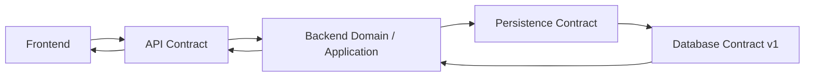

# Tài liệu Database TrọƠi

Thư mục này chứa các **database contract release được version hóa chính thức** của TrọƠi.

Database contract là authority cho cấu trúc dữ liệu, quan hệ, invariant persistence và schema thực thi. Frontend **không đọc/ghi Database trực tiếp**; Frontend đi qua API contract của Backend. Backend dùng persistence contract/repository để làm việc với Database.

## Release hiện tại

**Current release: `v1`**

Đọc authority database hiện tại theo thứ tự:

1. [`v1/canonical.md`](v1/canonical.md) — product/domain rules và boundary `CURRENT / OPEN / FUTURE`.
2. [`v1/erd/conceptual.json`](v1/erd/conceptual.json) — mô hình khái niệm.
3. [`v1/erd/logical.json`](v1/erd/logical.json) — mô hình logic/quan hệ chuẩn hóa.
4. [`v1/erd/physical.json`](v1/erd/physical.json) — physical contract PostgreSQL/PostGIS.
5. [`v1/schema/trooi-schema-20260927T153946Z.sql`](v1/schema/trooi-schema-20260927T153946Z.sql) — SQL snapshot đã freeze.

[`v1/implementation-history.md`](v1/implementation-history.md) ghi lịch sử implement và verification evidence. Đây là provenance, **không có authority cao hơn contract chain phía trên**.

## Database nằm ở đâu trong toàn hệ thống?

## Quy tắc version

Các thư mục `v1`, `v2`, ... là **database contract release**, không phải level ERD và không phải sprint implementation.

Khi có release mới:

- cập nhật README này để trỏ tới release hiện hành;
- giữ release cũ tại chỗ để bảo toàn lịch sử contract;
- không tạo thêm `current/` hoặc `latest/` làm authority song song.

## Ranh giới archive

Tài liệu obsolete/pre-versioned cấp repository nằm dưới [`../archives/`](../archives/). Các database release chính thức đã version hóa không được chuyển vào archive chỉ vì có release mới hơn.

Canonical v3.6 trước thời điểm version hóa hiện được giữ tại `docs/archives/database/pre-versioned/canonical-v3.6.md`.

## Tech stack

Tech stack là system context, không phải database contract. Xem [`../contexts/tech-stack.md`](../contexts/tech-stack.md) để biết công nghệ nào `IMPLEMENTED`, `PLANNED` hoặc `FUTURE`.

## Liên kết với context chung

- [`../contexts/product-domain.md`](../contexts/product-domain.md) — domain vocabulary chung.
- [`../contexts/integration-contracts.md`](../contexts/integration-contracts.md) — ownership giữa Frontend/Backend/Database.
- [`../contexts/layers/database.md`](../contexts/layers/database.md) — cách đọc Database trong kiến trúc hệ thống.
- [`../contexts/source-of-truth.md`](../contexts/source-of-truth.md) — thứ tự authority và cách xử lý conflict.

Nếu một artifact thấp hơn mâu thuẫn với authority cao hơn trong release hiện tại, phải sửa artifact thấp hơn; không làm yếu invariant đã freeze chỉ để giữ behavior cũ.
