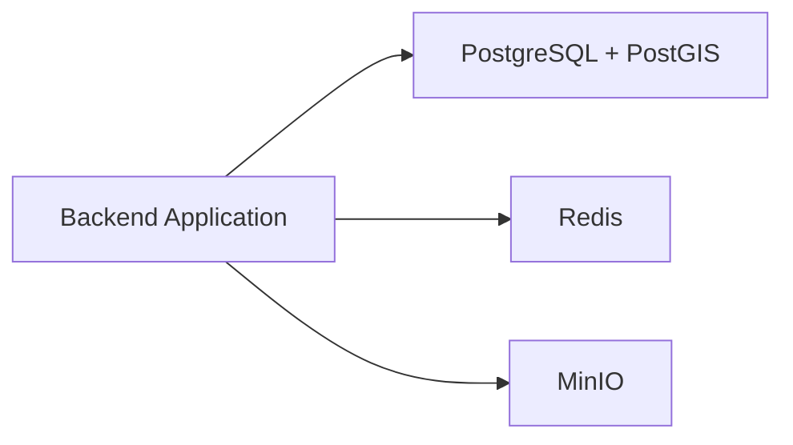
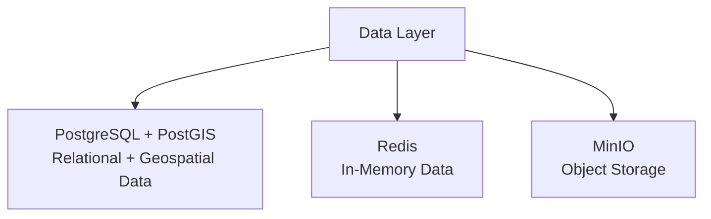
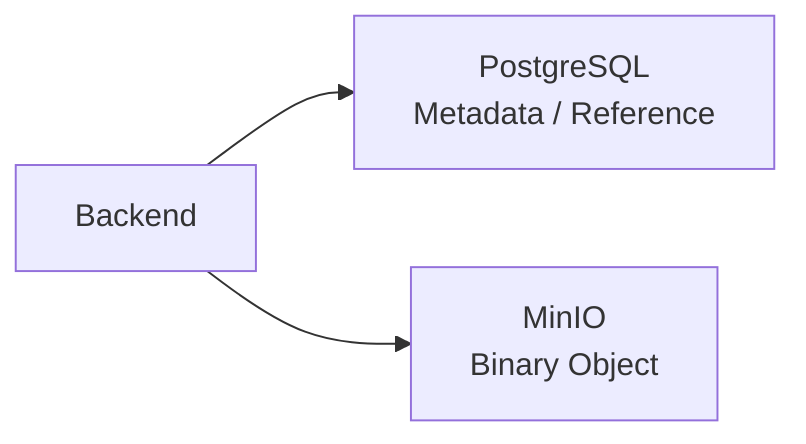
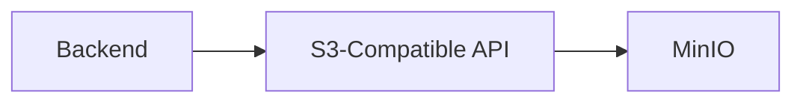
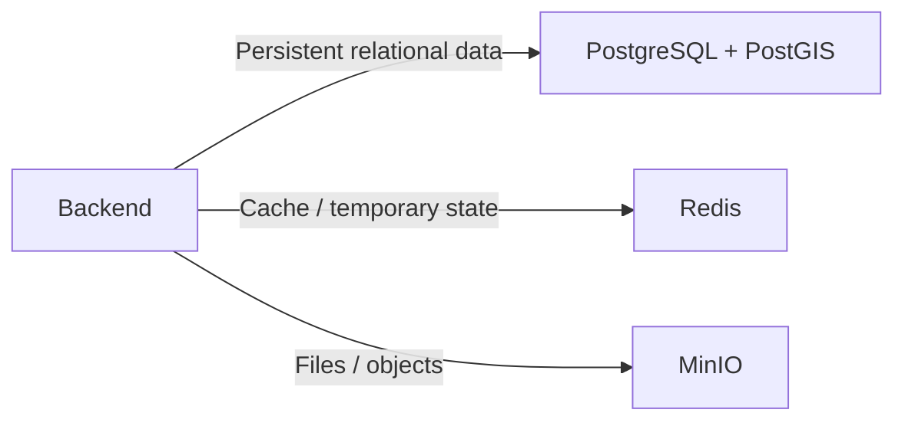

# Database Tech Stack — TrọƠi

Tài liệu này ghi nhận **tech stack đã chốt cho lớp dữ liệu của TrọƠi**.

Database stack hiện tại gồm:

- **PostgreSQL + PostGIS** - relational database and geospatial capability for Search/Map;
- **Redis** — in-memory data store cho cache và state tạm thời;
- **MinIO** — object storage self-hosted tương thích S3.

Tài liệu này chỉ mô tả **công nghệ được sử dụng và vai trò của chúng**.  
Schema, entity, migration strategy, ORM, backup policy và database design chi tiết được định nghĩa ở tài liệu riêng.

---

## 1. Tổng quan

| Khu vực | Công nghệ | Vai trò |
| --- | --- | --- |
| Relational Database | PostgreSQL | Lưu dữ liệu nghiệp vụ bền vững |
| Geospatial Extension | PostGIS | geography(Point,4326), spatial query, and GiST indexing for Search/Map |
| In-Memory Data Store | Redis | Cache và dữ liệu tạm thời |
| Object Storage | MinIO | Lưu file và binary object |
| Storage Protocol | S3-compatible API | Giao tiếp với object storage |

---

## 2. Kiến trúc tổng quan



Mỗi công nghệ đảm nhiệm một loại workload khác nhau:



---

# 3. PostgreSQL

**PostgreSQL** là relational database chính của TrọƠi.

PostgreSQL được chọn làm nơi lưu trữ dữ liệu nghiệp vụ cần:

- persistence;
- relational integrity;
- transaction;
- constraint;
- indexing;
- structured query.

PostgreSQL đóng vai trò **authoritative data store** cho dữ liệu nghiệp vụ của hệ thống.

Redis và MinIO không thay thế vai trò này.

## 3.1 PostGIS

**PostGIS** is the required PostgreSQL extension for geospatial data used by Search/Map. The physical schema uses `geography(Point,4326)` for locations and GiST indexes for spatial lookup.

Exact operational location remains private operational data; public search reads only the approved public projection.

PostGIS is part of the relational database stack and is not a separate business source of truth.

---

# 4. Redis

**Redis** là in-memory data store của hệ thống.

Redis phù hợp với dữ liệu cần:

- truy cập nhanh;
- cache;
- expiration;
- state có vòng đời ngắn;
- counter hoặc temporary state.

Redis không phải database nghiệp vụ chính.

Dữ liệu trong Redis phải được xem là dữ liệu có thể hết hạn hoặc tái tạo khi cần.

---

# 5. MinIO

**MinIO** là object storage self-hosted tương thích với **Amazon S3 API**.

MinIO được sử dụng để lưu các binary object như:

- image;
- document;
- attachment;
- uploaded file.

Binary object không được lưu trực tiếp trong PostgreSQL nếu không có lý do kỹ thuật đặc biệt.

PostgreSQL lưu metadata hoặc object reference, trong khi file thật được lưu trong MinIO.



---

# 6. S3-Compatible API

MinIO cung cấp API tương thích với chuẩn **S3**.

Backend nên giao tiếp với object storage thông qua S3-compatible interface thay vì phụ thuộc vào implementation-specific API.



Cách tiếp cận này giữ storage layer có interface thống nhất và giảm coupling giữa application code với MinIO.

---

# 7. Phân chia trách nhiệm



| Công nghệ | Trách nhiệm chính |
| --- | --- |
| PostgreSQL + PostGIS | Persistent relational + geospatial data |
| Redis | Cache và temporary state |
| MinIO | File và object storage |

---

# 8. Stack chốt

```text
Database & Storage
│
├── PostgreSQL
│   └── Relational Database
│
├── Redis
│   └── In-Memory Data Store
│
└── MinIO
    └── S3-Compatible Object Storage
```

Database tech stack hiện tại của TrọƠi được giới hạn ở:

**PostgreSQL + PostGIS + Redis + MinIO**

Những công nghệ chưa được chốt như ORM, migration framework, database administration tool hoặc backup tooling không thuộc tài liệu này.
