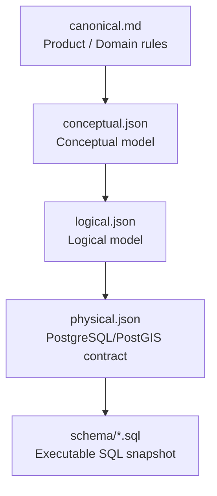
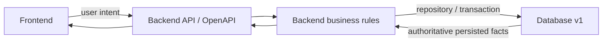

# Database Contract v1

## Metadata release

- **Database contract version:** `v1`
- **Source canonical version:** Canonical Product & Domain Freeze `v3.7`
- **Source integration branch:** `integration/backend-database`
- **Source integration merge SHA:** `50465bf0ddafc1b7aec2b1e8dfafde35636ca4b9`
- **Database implementation baseline SHA:** `33975fb4c9300d444c3912fdc9bb7d04d030aab6`
- **Schema freeze source commit:** `e092bafe1afdeb9df3beae78ed06e5cf974917e6`
- **Schema freeze timestamp:** `2026-09-27T15:39:46Z`

Release này đưa Canonical v3.7, chuỗi ERD và SQL đã validate vào **database contract release đầu tiên được version hóa rõ ràng**, không thay đổi business meaning đã freeze.

## Authority chain

Đọc theo thứ tự:

1. [`canonical.md`](canonical.md)
2. [`erd/conceptual.json`](erd/conceptual.json)
3. [`erd/logical.json`](erd/logical.json)
4. [`erd/physical.json`](erd/physical.json)
5. [`schema/trooi-schema-20260927T153946Z.sql`](schema/trooi-schema-20260927T153946Z.sql)
Nếu lower layer mâu thuẫn với higher authority, phải sửa lower layer; không làm yếu authority phía trên chỉ để giữ implementation behavior cũ.

## Phân biệt release version và ERD level

- `v1` là **database release version**.
- `conceptual`, `logical`, `physical` là **ERD abstraction level**.
- Hai khái niệm này độc lập; không gọi `conceptual` là v1, `logical` là v2, `physical` là v3.

## Provenance

Các filename trước khi version hóa là:

- `docs/database/canonical-v3.7.md`
- `docs/database/erd/trooi-erd-lv1-conceptual.json`
- `docs/database/erd/trooi-erd-lv2-logical.json`
- `docs/database/erd/trooi-erd-lv3-physical.json`
- `docs/database/schema/trooi-schema-lv3.sql`

Filesystem `v1/` chỉ đóng gói các artifact này thành một database contract release rõ ràng; không đổi semantics.

Xem [`implementation-history.md`](implementation-history.md) để biết implementation/verification provenance.

## Quan hệ với Frontend và Backend

Frontend không dùng trực tiếp ERD/SQL để quyết định lifecycle. Backend sở hữu business orchestration; Database bảo vệ persistence integrity và các invariant cần transaction/concurrency guard.

## Context liên quan

- [`../../contexts/product-domain.md`](../../contexts/product-domain.md)
- [`../../contexts/integration-contracts.md`](../../contexts/integration-contracts.md)
- [`../../contexts/layers/database.md`](../../contexts/layers/database.md)
- [`../../contexts/source-of-truth.md`](../../contexts/source-of-truth.md)
