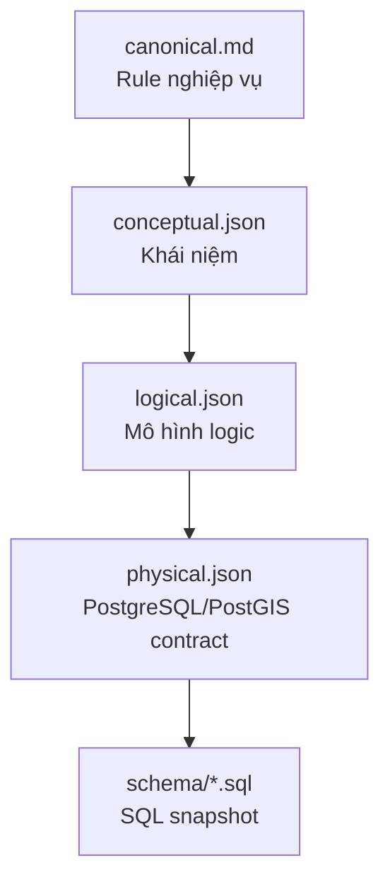
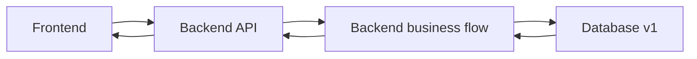

# Database Contract v1

`v1` là release database đầu tiên của TrọƠi được đóng gói rõ ràng theo một chuỗi từ nghiệp vụ tới SQL.

## Metadata

- **Database contract version:** `v1`
- **Canonical:** `v3.7`
- **Source integration branch:** `integration/backend-database`
- **Source integration merge SHA:** `50465bf0ddafc1b7aec2b1e8dfafde35636ca4b9`
- **Database implementation baseline SHA:** `33975fb4c9300d444c3912fdc9bb7d04d030aab6`
- **Schema freeze source commit:** `e092bafe1afdeb9df3beae78ed06e5cf974917e6`
- **Schema freeze timestamp:** `2026-09-27T15:39:46Z`

Các SHA/timestamp trên được giữ nguyên để truy ngược nguồn gốc của release.

## Đọc v1 như thế nào?

Thứ tự đọc:

1. [`canonical.md`](canonical.md)
2. [`erd/conceptual.json`](erd/conceptual.json)
3. [`erd/logical.json`](erd/logical.json)
4. [`erd/physical.json`](erd/physical.json)
5. [`schema/trooi-schema-20260927T153946Z.sql`](schema/trooi-schema-20260927T153946Z.sql)

Nếu một mức phía dưới không khớp mức phía trên, mức phía dưới phải được sửa.

## `v1` không phải “ERD level 1”

Hai khái niệm này khác nhau:

- `v1` = **version của database contract release**.
- `conceptual / logical / physical` = **ba mức mô tả ERD bên trong release**.

Không gọi Conceptual là v1, Logical là v2, Physical là v3.

## Frontend và Backend dùng release này ra sao?

Frontend không dùng ERD/SQL để tự quyết lifecycle. Backend kiểm tra và điều phối nghiệp vụ. Database v1 giữ persistence contract và các ràng buộc cần database bảo vệ.

## Lịch sử triển khai

[`implementation-history.md`](implementation-history.md) ghi những commit và verification evidence đã hình thành database baseline này. Đây là **lịch sử triển khai**, không phải nguồn để override Canonical/ERD/SQL.

## Context liên quan

- [`../../contexts/product-domain.md`](../../contexts/product-domain.md)
- [`../../contexts/integration-contracts.md`](../../contexts/integration-contracts.md)
- [`../../contexts/layers/database.md`](../../contexts/layers/database.md)
- [`../../contexts/source-of-truth.md`](../../contexts/source-of-truth.md)
