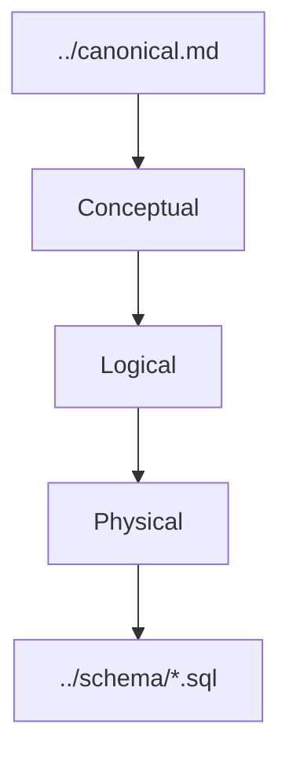

# ERD của Database Contract v1

Ba file ERD trong thư mục này là **ba cách nhìn cùng một domain ở mức chi tiết khác nhau**, không phải ba release riêng.

## Ba mức

- [`conceptual.json`](conceptual.json) — trả lời “hệ thống có những khái niệm nghiệp vụ nào và chúng liên quan với nhau ra sao?”.
- [`logical.json`](logical.json) — đi sâu hơn vào entity, attribute, cardinality và constraint logic.
- [`physical.json`](physical.json) — mô tả cách contract được thể hiện trên PostgreSQL/PostGIS.

Mỗi mức phía dưới phải giữ đúng meaning của mức phía trên.

## Frontend có cần đọc ERD không?

Frontend có thể đọc để hiểu thêm hệ thống, nhưng **không dùng ERD để tự tạo API model hoặc lifecycle**. Khi làm feature, ưu tiên:

- [`../../../contexts/product-domain.md`](../../../contexts/product-domain.md)
- backlog feature tương ứng;
- API contract Backend expose.

## Backend dùng ERD thế nào?

Backend lấy business rule từ Canonical/domain contract rồi dùng persistence contract để đọc/ghi dữ liệu. Table shape không tự quyết business semantics.

## Database dùng ERD thế nào?

Database dùng chuỗi Conceptual → Logical → Physical → SQL để giữ đúng cardinality, type, constraint, index và các ràng buộc đã freeze.

## Nhắc lại về version

`v1` là version của database contract. `conceptual`, `logical`, `physical` chỉ là level bên trong `v1`.
