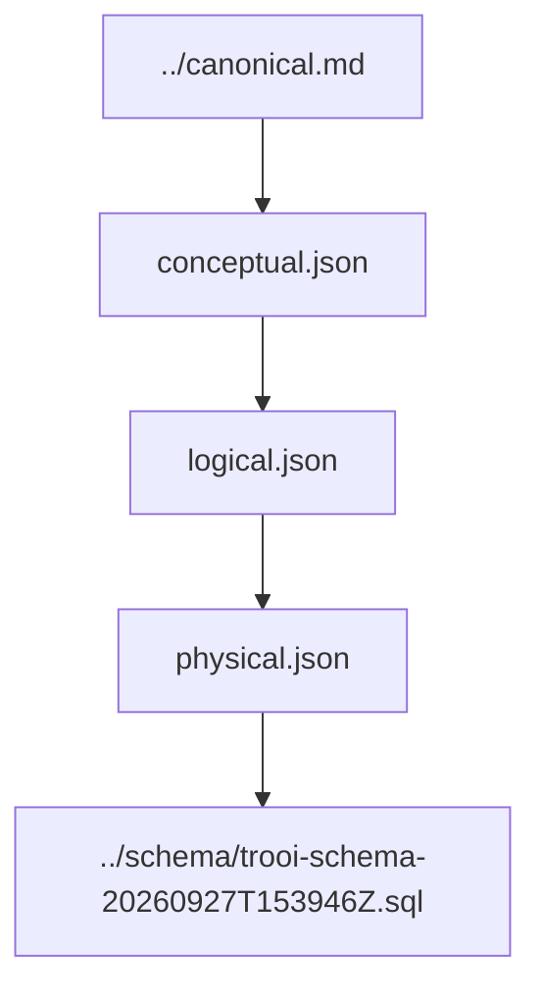

# ERD — Database Contract v1

ERD của database release `v1` được chia theo ba mức abstraction. Ba file này mô tả cùng một domain từ khái niệm → logic → physical contract, không phải ba release khác nhau.

## Ba mức ERD

- [`conceptual.json`](conceptual.json) — business concepts và quan hệ cấp cao.
- [`logical.json`](logical.json) — entity/attribute/cardinality/constraint ở mức logic chuẩn hóa.
- [`physical.json`](physical.json) — PostgreSQL/PostGIS physical contract dùng để derive/validate SQL.

## Authority order

Nếu artifact thấp hơn mâu thuẫn với artifact cao hơn, phải sửa artifact thấp hơn.

## Cách dùng theo layer

**Frontend**

Không dùng ERD để tự quyết business lifecycle hoặc tự tạo API model. Frontend đọc [`../../../contexts/product-domain.md`](../../../contexts/product-domain.md) và API contract của Backend.

**Backend**

Dùng Canonical/domain contract để quyết định business rule, sau đó dùng persistence contract/repository boundary để làm việc với dữ liệu. Không để table shape tự định nghĩa business semantics.

**Database**

Dùng chuỗi Conceptual → Logical → Physical → SQL để bảo toàn cardinality, constraint, type, index và transaction integrity đã freeze.

## Versioning

`v1` là database contract release. `conceptual`, `logical`, `physical` là ERD abstraction level bên trong release đó.
