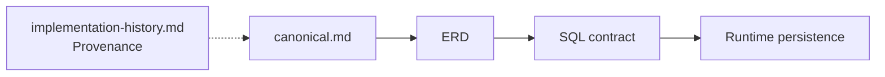

# Lịch sử triển khai Database v1

Tài liệu này ghi lại **implementation history dựa trên evidence** cho database contract `v1`.

Nội dung được tái dựng từ các commit của database lane ban đầu và chỉ ghi những claim có bằng chứng trong repository/commit record. Tài liệu này là **provenance**, không override [`canonical.md`](canonical.md), ERD hoặc SQL contract.

## Baseline

- Backend integration prerequisite: `e77edc2461a216e37f4f05b6715a00daf746ea4d`
- Database implementation baseline: `33975fb4c9300d444c3912fdc9bb7d04d030aab6`
- Backend/database integration đã hội tụ: `50465bf0ddafc1b7aec2b1e8dfafde35636ca4b9`

## Task 1 — Chuẩn hóa tên implementation

**Commit:** `253d278f0c207a089d4069f299a762e3a7abd86c`

- Đổi tên tooling/test executable khỏi cách gọi theo level tài liệu LV sang `physical_contract_*` trung tính.
- Giữ nguyên filename của authority document tại thời điểm đó.
- Progress log gốc ghi nhận Python database suite, TypeScript naming audit, TypeScript project checks và `git diff --check` đều pass.

## Task 2 — PostgreSQL runtime configuration

**Commit:** `cfddd57bc8d408a858c270bb822a651a777705f7`

- Thêm PostgreSQL runtime configuration, dependency Kysely/pg/node-pg-migrate, env example, PostGIS Compose service, health check, persistent volume và test-database bootstrap.
- Task record gốc ghi configuration tests, source/test typecheck, lockfile supply-chain policy và `git diff --check` pass.
- Docker verification ban đầu được hoãn tới khi Docker Desktop khả dụng; PostGIS được xác nhận healthy ở bước sau.

## Task 3 — Initial schema migration bất biến

**Commit:** `eeed35af9aae1b76d5c33d0cc27afb481680e4c2`

- Thêm versioned up/down migration SQL và migration runner.
- Thêm PostgreSQL test harness và catalog-parity integration test.
- Record gốc ghi SHA-256 của up snapshot khớp frozen DDL, có 29 business table; source/test check và snapshot audit pass trước khi có live Docker parity.
## Task 4 — Typed PostgreSQL client

**Commit:** `aef060d60f29fa359dadc73a592c015f2c32969e`

- Thêm typed Kysely/pg client, Nest database module/token, scalar parser và schema type cho frozen physical model.
- Giữ decimal dạng string chính xác, calendar date, normalized timestamp, JSON/nullability và opaque geography tại persistence boundary.
- Record gốc ghi source/test typecheck, Nest build, exact AST contract audit, scalar parser smoke test và `git diff --check` pass.

## Task 5 — Persistence port và error translation

**Commit:** `b6d11b11c60caeea9096ba363408791e9af62958`

- Thêm aggregate-oriented repository port, không expose Kysely/pg qua application boundary.
- Thêm lock-aware repository operation, persistence error class và mapping PostgreSQL SQLSTATE/network error.
- Record gốc ghi mapper tests, typecheck, physical-contract port audit, dependency-boundary scan và `git diff --check` pass.

## Task 6 — Transaction manager và repository-set factory

**Commit:** `6db963598777d1d2802cfa7c0e9527cc3858d420`

- Thêm application-facing `TransactionManager`, transaction context gồm chín repository và repository-set factory theo transaction scope.
- After-commit effect chỉ chạy sau commit thành công; failure của effect không rewrite business result đã commit; không implicit retry.
- Verification được ghi nhận: PostGIS 16 transaction tests 4/4, source/test typecheck và `git diff --check` pass.

## Task 7 — Core rental repositories

**Commit:** `4d0469573afeb9cbe2edca4e96d359e8493bc3a9`

- Implement adapter PostgreSQL cho Identity, Organization, Property/Room, Listing/StatusEvent/Inquiry với mapping tường minh.
- Thêm PostGIS point helper, deterministic room lock ordering và stable PostgreSQL error translation mà không tự tạo vocabulary cho policy `OPEN`.
- Verification được ghi nhận: core-rental chain, scalar/null/geography round trip, duplicate-current-listing mapping, FK mapping, catalog parity, typecheck và `git diff --check` pass trên PostGIS 16.
## Task 8 — Tenancy aggregate repository

**Commit:** `f004e846a1a616b0099b3634aca5a81e5183dbee`

- Implement persistence cho Tenancy, Participant, versioned Terms, Acknowledgement và Notice với stable-owner tenancy locking.
- Giữ exact decimal/date/timestamp/null semantics và để các review/deposit-change/acknowledgement policy đang `OPEN` tiếp tục `OPEN`.
- Verification được ghi nhận: tenancy integration 1/1, source/test typecheck, Nest build và `git diff --check` pass trên PostGIS 16.

## Task 9 — Finance aggregate repository

**Commit:** `35e95b1c7a54d19f13b42b769a95ffe41b47ed46`

- Implement persistence cho BillingCycle, Charge, Utility, MeterReading, Payment, Allocation, Claim, Receipt, Deposit, Application, Settlement và DepositEvent.
- Dùng decimal string chính xác và SQL aggregate sum với Payment/Deposit owner lock; policy over-allocation theo từng Charge vẫn `OPEN`.
- Verification được ghi nhận: finance integration, catalog parity, source/test typecheck và `git diff --check` pass trên PostGIS 16.

## Task 10 — Supporting repositories

**Commit:** `b7eec592b105e28e597bd9ba24f9796dd29f22df`

- Implement Incident + append-only IncidentEvent, Review + TrustReport và Notification adapter.
- Wire toàn bộ chín aggregate repository vào transaction-scoped repository set và đăng ký database provider mà không tự tạo notification channel ngoài authority.
- Verification được ghi nhận: bốn repository integration suite, source/test typecheck, Nest build, explicit-column scan và `git diff --check` pass trên PostGIS 16.

## Task 11 — Rental transaction guards

**Commit:** `51f6eb4887542c1242d2de871c3d0c0a12733c39`

- Thêm atomic coordination cho Listing publish, Room transition, Property/Room archive, Tenancy creation/activation và checkout với deterministic lock ordering.
- Enforce Listing unpublish đồng bộ khi Room không còn available, open-Incident archive block, active PRIMARY/nonterminal-tenancy rule và archived-Property reactivation protection.
- Verification được ghi nhận: 7 rental guard và 4 race scenario bắt buộc pass; race suite pass 10 lần liên tiếp; typecheck và `git diff --check` pass.

## Task 12 — Billing và utility guards

**Commit:** `7f395e0c82d6748e36647909ca69c9e59e14ee19`

- Thêm atomic BillingCycle creation với Tenancy owner lock, overlap prevention và Terms provenance/effective-boundary check.
- Thêm utility Charge validation xuyên Room/type/connection/meter reading; policy multiple-connections-per-type vẫn `OPEN`.
- Verification được ghi nhận: behavior + overlap-race test pass; concurrent overlapping-cycle test pass 20 lần liên tiếp; typecheck và `git diff --check` pass.
## Task 13 — Finance transaction guards

**Commit:** `f1849e42b797e1096864bf08d0257cd45808d578`

- Thêm command có guard cho Payment allocation, Deposit application/settlement, Payment correction, Receipt issue/replacement và DepositEvent provenance với stable owner lock.
- So sánh capacity bằng PostgreSQL exact numeric query và giữ predecessor history; không tự sinh refund Payment.
- Verification được ghi nhận: 8 finance guard pass; race cho allocation/application và settlement-cap pass 20 lần liên tiếp; typecheck và `git diff --check` pass.

## Task 14 — Trust consistency guards

**Commit:** `baae892a122036dbd8ce41b62622768ff5a0d413`

- Thêm consistency command cho Review, PaymentClaim và TermsAcknowledgement với Tenancy locking cùng Participant/User provenance check.
- Review yêu cầu Tenancy `ENDED`; occupancy duration, multiplicity, editing/moderation, rating dimension và property-correction policy vẫn giữ `OPEN`.
- Verification được ghi nhận: trust behavior tests, complete guard suite 12/12, physical guard coverage 23/23, typecheck và `git diff --check` pass.

## Task 15 — Public Listing search bằng PostGIS

**Commit:** `33b011d3061d62edc8ab8af5754af0c3c0c80b69`

- Thêm public Listing search dùng `ST_DWithin` và `ST_Distance` trên `listings.public_location_projection` chỉ.
- Validate radius hữu hạn, không âm; loại Listing không published; không expose operational Property location và không tự thêm filter chưa được chốt.
- Verification được ghi nhận: range/privacy/distance/invalid-radius assertion pass, EXPLAIN chọn `ix_listings_published_location`, typecheck/static privacy scan/`git diff --check` pass.

## Task 16 — Development seed và reset workflow xác định

**Commit:** `b81c933e908ba42f0b16b55ce4224b6b448b5e43`

- Thêm synthetic User → Organization → Property → Room seed data xác định thông qua runtime repository.
- Thêm `db:reset` và `db:seed`; bổ sung rollback-preparation migration thứ hai thay vì sửa migration bất biến `000001`.
- Verification được ghi nhận: real down/down/up/seed workflow pass, deterministic reset-and-seed recreation pass hai lần, migration parity vẫn 29 business table, typecheck và `git diff --check` pass.
## Task 17 — Wire application service vào PostgreSQL và đóng source-of-truth audit

Task 17 hoàn thành qua chuỗi commit wiring/audit sau:

- `5d13dbe421792e8926d6cc50dc0a2e926d07948e` — align runtime Identity contract với physical schema; ghi nhận 40/40 focused identity/core tests, 9/9 Google verifier tests, 5/5 persistence adapter/transaction tests và TypeScript typecheck pass.
- `c2c37ef002d9ac0da6757c2607d39b27e4548c29` — persist Identity, Organization, Property và Room service; ghi nhận 36/36 core behavior tests, restart persistence integration và TypeScript typecheck pass trên PostGIS 16.
- `827ae2be17444e62049fdd4973dd9abd3cb82ee6` — persist Listing và Inquiry service; ghi nhận 44/44 Listing/Inquiry/rental-lifecycle/conformance tests, restart integration và TypeScript typecheck pass.
- `c978d49683dbc13201b28a06d3e7d0ff8e368d1f` — chuyển Tenancy, Participant, Terms, Acknowledgement và Notice state về PostgreSQL repository và thêm restart coverage. Commit message không nêu numeric verification total nên tài liệu này không tự suy diễn con số.
- `40a16f682b722e52b286a6bf4a2424803b7492f0` — chuyển Billing và Receipt state sang PostgreSQL repository/guarded operation. Commit message không nêu numeric verification total nên không tự tạo claim.
- `6f7daa840b8fc30b0350e998adf8608fa6a653ca` — T17-A/T17-B persist Incident/IncidentEvent và TrustReport truth, kèm restart evidence.
- `1dd4c46d0343ccf9346126d6a6cc53c5f2ac112f` — T17-C chứng minh BillingCycle+Charge atomicity, rollback behavior, finance restart coverage và giữ guard/concurrency suite GREEN.
- `33975fb4c9300d444c3912fdc9bb7d04d030aab6` — T17-D/T17-E/T17-F loại duplicate onboarding authority, cô lập FUTURE Subscription khỏi current core, thêm database shutdown lifecycle/explicit Nest injection metadata, xử lý lint debt và ghi nhận lint/typecheck/conformance/runtime/full regression GREEN.

## Tóm tắt freeze v1

**Implementation baseline:** `33975fb4c9300d444c3912fdc9bb7d04d030aab6`

Trạng thái được ghi nhận tại thời điểm freeze:

- PostgreSQL persistence đã được implement và wire vào current application service.
- PostGIS public Search/Map repository đã được implement.
- Database lane có real PostgreSQL transaction/guard/concurrency/restart coverage.
- Redis không thuộc completed baseline này.
- Các Canonical policy `OPEN` vẫn giữ `OPEN`; capability `FUTURE` vẫn giữ `FUTURE` trừ khi authority thay đổi riêng.
- Database branch ghi local/runtime verification GREEN ở Task 17 audit cuối.
- Không claim GitHub Actions run cho integration merge SHA `50465bf0ddafc1b7aec2b1e8dfafde35636ca4b9`.
## Những điểm chưa được claim / còn cần review

- `database/migrations/000002_prepare_initial_rollback.ts` tồn tại để bảo toàn lịch sử bất biến của `000001`. Semantics của single-step `db:migrate:down` vẫn cần review riêng; tài liệu này **không** tuyên bố rollback đã hoàn toàn an toàn trong mọi trường hợp.
- Persistence plan từng có Task 18 cho observability/final verification, nhưng không có dedicated Task 18 implementation commit trước baseline `v1`; vì vậy `v1` chỉ claim evidence hoàn thành tới Task 17.
- Redis và MinIO **không** được claim là đã implement trong database release này.

## Cách dùng lịch sử này

Lịch sử implementation dùng để biết **đã làm gì và evidence nào từng được ghi nhận**, không dùng để override business/domain/database contract hiện tại.

## Liên kết với toàn hệ thống

- [`../../contexts/source-of-truth.md`](../../contexts/source-of-truth.md)
- [`../../contexts/integration-contracts.md`](../../contexts/integration-contracts.md)
- [`../../contexts/layers/backend.md`](../../contexts/layers/backend.md)
- [`../../contexts/layers/database.md`](../../contexts/layers/database.md)
- [`README.md`](README.md)
