# Frontend Tech Stack — TrọƠi

Tài liệu này ghi nhận **tech stack đã chốt cho frontend mobile của TrọƠi**.

Trong phạm vi hiện tại, frontend của TrọƠi là ứng dụng **Android native**, được phát triển bằng Kotlin và Jetpack Compose. Mục tiêu của stack là giữ codebase rõ ràng, nhất quán, dễ bảo trì và đủ chặt để nhiều thành viên cùng sử dụng AI coding assistant mà không tự tạo ra các kiến trúc hoặc convention khác nhau.

Tài liệu này chỉ mô tả **frontend/mobile stack**. Backend, database và hạ tầng server được định nghĩa riêng.

---

## 1. Tổng quan

| Khu vực | Công nghệ | Vai trò |
| --- | --- | --- |
| Platform | Android | Nền tảng mobile chính |
| Language | Kotlin | Ngôn ngữ phát triển Android |
| UI Framework | Jetpack Compose | Xây dựng giao diện declarative |
| Architecture | MVVM + Repository | Tổ chức state, business flow và truy cập dữ liệu |
| Project Organization | Feature-first | Tổ chức source code theo feature |
| Dependency Injection | Hilt | Quản lý dependency |
| Async | Kotlin Coroutines | Xử lý tác vụ bất đồng bộ |
| Reactive State | Kotlin Flow | Luồng dữ liệu và state thay đổi theo thời gian |
| Networking | Retrofit + OkHttp | Giao tiếp với backend API |
| Serialization | kotlinx.serialization | Chuyển đổi JSON và Kotlin model |
| Local Database | Room | Local persistence và structured cache |
| Local Preferences | DataStore | Lưu preference và local state nhỏ |
| Image Loading | Coil | Tải và cache ảnh |
| API Contract | OpenAPI | Contract giữa mobile và backend |
| UI/UX Design | Figma | Source of truth cho Design System |

---

## 2. Kiến trúc tổng quan

Frontend sử dụng **MVVM kết hợp Repository Pattern**.

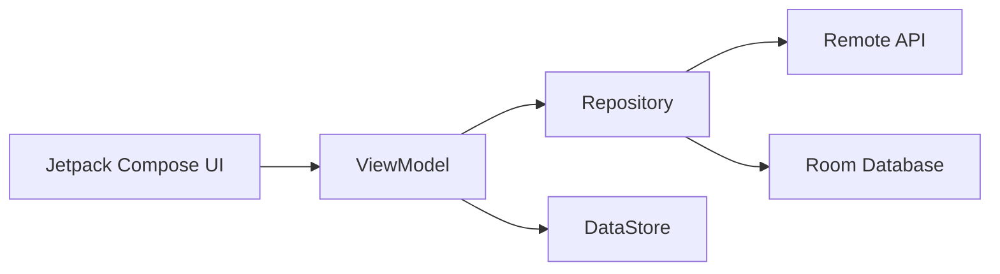

Luồng dữ liệu cơ bản:

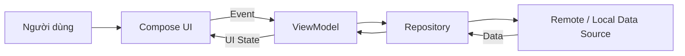

Nguyên tắc chính:

- UI không trực tiếp gọi API hoặc database.
- ViewModel quản lý state của màn hình.
- Repository đóng vai trò boundary cho data access.
- Remote API và local storage được ẩn phía sau Repository.
- UI được render từ state thay vì thay đổi View thủ công.

---

# 3. Android

**Android** là nền tảng mobile chính của TrọƠi trong giai đoạn hiện tại.

Dự án phát triển Android native thay vì sử dụng framework cross-platform. Điều này giúp team làm việc trực tiếp với Android SDK và tránh thêm abstraction không cần thiết khi chưa có yêu cầu phát triển iOS.

Android app là sản phẩm chính của TrọƠi, nơi triển khai các luồng nghiệp vụ như:

- quản lý phòng;
- người thuê;
- công nợ;
- biên nhận;
- báo sự cố;
- lịch sử vận hành;
- dashboard.

---

# 4. Kotlin

**Kotlin** là ngôn ngữ chính của ứng dụng Android.

Các đặc điểm quan trọng:

- static typing;
- null-safety;
- coroutine support;
- tích hợp trực tiếp với Android SDK;
- interoperability với Java;
- ecosystem Android trưởng thành.

Kotlin được sử dụng cho toàn bộ phần mobile application, bao gồm:

- UI logic;
- ViewModel;
- Repository;
- data model;
- networking;
- local persistence;
- application service.

Không sử dụng Java cho feature mới nếu không có lý do kỹ thuật cụ thể.

---

# 5. Jetpack Compose

**Jetpack Compose** là UI framework chính của TrọƠi.

Compose sử dụng mô hình declarative:

> UI là kết quả của state hiện tại.

Thay vì thay đổi trực tiếp từng View, ứng dụng cập nhật state và Compose tự render lại phần UI cần thiết.

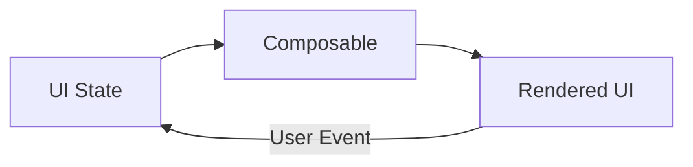

Compose được dùng để xây dựng:

- screen;
- reusable component;
- navigation UI;
- form;
- dialog;
- bottom sheet;
- loading state;
- empty state;
- error state.

UI implementation phải bám theo Design System đã định nghĩa trong Figma.

---

# 6. MVVM

Frontend sử dụng **Model–View–ViewModel (MVVM)** làm pattern chính cho presentation layer.

## View

Trong TrọƠi, View chủ yếu là các **Composable**.

View có trách nhiệm:

- hiển thị UI state;
- nhận interaction từ người dùng;
- chuyển event về ViewModel.

View không chứa business logic phức tạp.

## ViewModel

ViewModel chịu trách nhiệm:

- quản lý UI state;
- nhận event từ UI;
- gọi Repository;
- xử lý presentation logic;
- chuyển dữ liệu thành state phù hợp cho UI.

Ví dụ:

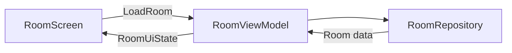

ViewModel không truy cập trực tiếp database implementation hoặc HTTP client.

---

# 7. Repository Pattern

**Repository** là boundary giữa presentation layer và data layer.

Ví dụ:

```text
RoomViewModel
        ↓
RoomRepository
       ↙ ↘
Remote   Local
API      Room DB
```

Repository chịu trách nhiệm quyết định dữ liệu đến từ:

- backend;
- local cache;
- database;
- hoặc sự kết hợp giữa các nguồn.

Điều này giúp ViewModel không cần biết dữ liệu được lấy từ đâu.

---

# 8. Feature-first Organization

Source code ưu tiên tổ chức theo **feature-first** thay vì gom toàn bộ class theo technical layer.

Ví dụ:

```text
features/
├── auth/
├── properties/
├── rooms/
├── tenants/
├── billing/
├── receipts/
├── incidents/
└── dashboard/
```

Một feature có thể chứa các thành phần riêng của nó:

```text
rooms/
├── data/
├── domain/
├── presentation/
└── navigation/
```

Mục tiêu là để những phần liên quan đến cùng một nghiệp vụ nằm gần nhau.

Cách tổ chức này giúp:

- developer dễ tìm code;
- giảm coupling giữa feature;
- AI coding assistant xác định scope thay đổi rõ hơn;
- tránh tạo các folder global quá lớn như `screens/`, `models/`, `services/`.

Cấu trúc chi tiết có thể được điều chỉnh khi implementation bắt đầu, nhưng nguyên tắc **feature-first** được giữ cố định.

---

# 9. Hilt

**Hilt** được sử dụng cho Dependency Injection.

Hilt chịu trách nhiệm cung cấp các dependency như:

- Repository;
- API client;
- Room Database;
- DAO;
- DataStore;
- application service.

Ví dụ:

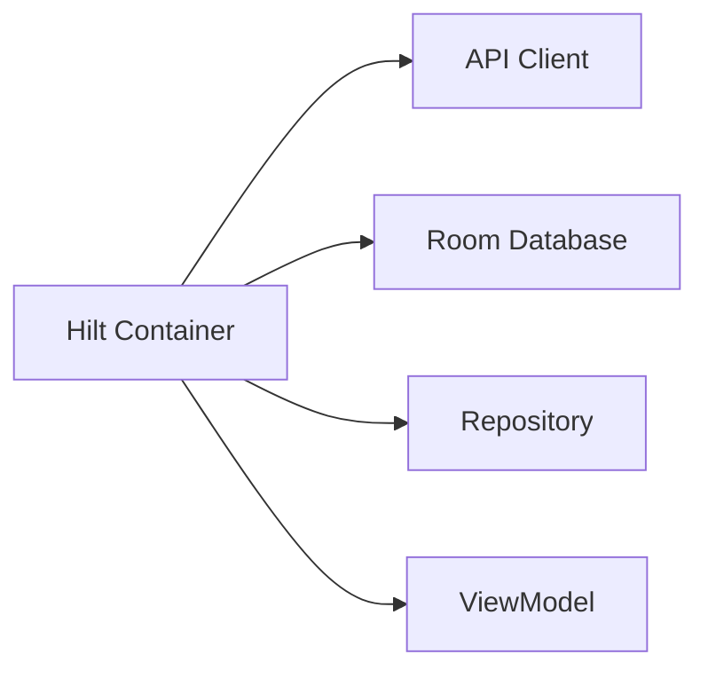

Dependency không nên được khởi tạo thủ công trong Composable hoặc ViewModel nếu có thể được quản lý bởi Hilt.

---

# 10. Kotlin Coroutines

**Kotlin Coroutines** là cơ chế chính để xử lý asynchronous operation.

Các tác vụ điển hình:

- gọi backend API;
- đọc/ghi Room;
- upload file;
- xử lý I/O;
- thực hiện background operation.

Các operation dài không được chạy trực tiếp trên UI thread.

---

# 11. Kotlin Flow

**Flow** được sử dụng để biểu diễn dữ liệu thay đổi theo thời gian.

Flow phù hợp với:

- UI state;
- dữ liệu từ Room;
- stream dữ liệu từ Repository;
- reactive updates.

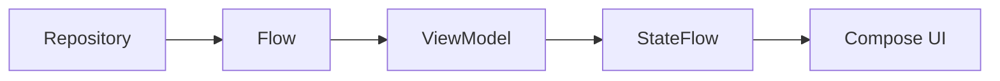

`StateFlow` được ưu tiên cho state được expose từ ViewModel ra UI.

---

# 12. Retrofit

**Retrofit** là HTTP client chính của ứng dụng.

Retrofit định nghĩa các backend endpoint thành Kotlin interface.

Nó được sử dụng cho các operation như:

- authentication;
- lấy danh sách phòng;
- cập nhật thông tin phòng;
- quản lý người thuê;
- công nợ;
- biên nhận;
- ticket sự cố.

Retrofit API definition phải phù hợp với OpenAPI contract.

---

# 13. OkHttp

**OkHttp** cung cấp HTTP transport phía dưới Retrofit.

OkHttp chịu trách nhiệm cho các chức năng như:

- connection management;
- interceptor;
- request header;
- authentication header;
- timeout;
- network logging.

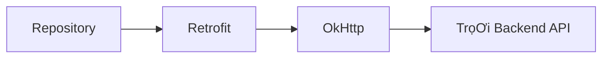

Networking concern dùng chung nên được cấu hình tập trung thay vì mỗi feature tự tạo HTTP client.

---

# 14. kotlinx.serialization

**`kotlinx.serialization`** được sử dụng để serialize và deserialize dữ liệu giữa JSON và Kotlin object.

Ví dụ:

```text
Backend JSON
    ↓
kotlinx.serialization
    ↓
Kotlin DTO
```

Serialization model phải bám theo contract của backend.

Không sử dụng nhiều JSON library song song nếu không có yêu cầu cụ thể.

---

# 15. Room

**Room** là local relational database của ứng dụng Android, được xây dựng trên SQLite.

Room có thể được sử dụng cho:

- local persistence;
- structured cache;
- dữ liệu cần giữ qua nhiều lần mở app;
- hỗ trợ một phần trải nghiệm khi mạng không ổn định.

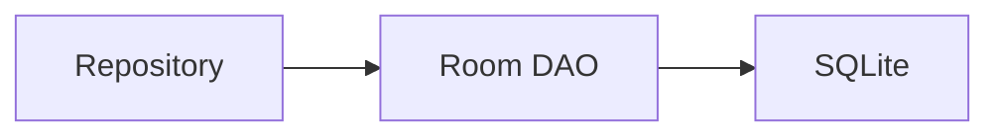

Room không phải nguồn dữ liệu nghiệp vụ chính của hệ thống.

Backend vẫn giữ authoritative data.

---

# 16. DataStore

**DataStore** được sử dụng cho dữ liệu local nhỏ không cần relational database.

Ví dụ:

- theme;
- language;
- onboarding state;
- UI preference;
- cấu hình local.

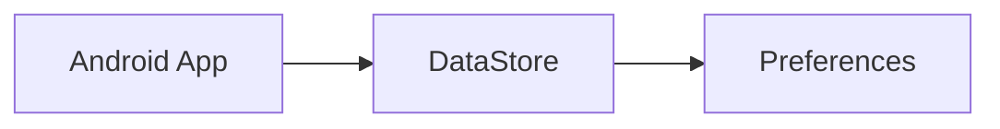

DataStore không được dùng để lưu plaintext credential hoặc secret nhạy cảm.

---

# 17. Coil

**Coil** là image loading library chính.

Coil chịu trách nhiệm:

- tải ảnh từ remote source;
- cache ảnh;
- decode ảnh;
- hiển thị ảnh trong Compose.

Các use case của TrọƠi gồm:

- ảnh phòng;
- avatar;
- ảnh sự cố;
- attachment hình ảnh;
- các media khác trong app.

Coil được dùng thay cho việc tự xây dựng image loading và caching layer.

---

# 18. OpenAPI Contract

**OpenAPI** là contract giữa frontend Android và backend.

Frontend không tự suy đoán:

- endpoint;
- request structure;
- response structure;
- field name;
- error structure.

Luồng contract:

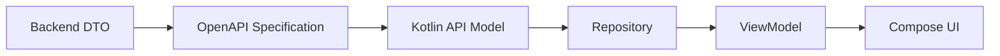

Khi backend contract thay đổi, frontend implementation phải được cập nhật theo OpenAPI specification.

OpenAPI đóng vai trò ranh giới kỹ thuật giữa frontend và backend.

---

# 19. Figma

**Figma** là source of truth cho UI/UX và Design System của ứng dụng.

Figma định nghĩa:

- color;
- typography;
- spacing;
- radius;
- iconography;
- component;
- component state;
- screen;
- interaction.

Luồng implementation:

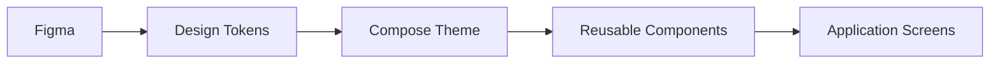

UI implementation không tự tạo style riêng cho từng feature nếu style đó đã được định nghĩa trong Design System.

Các component dùng chung nên được implement một lần và tái sử dụng giữa các feature.

---

# 20. Quan hệ giữa các thành phần frontend

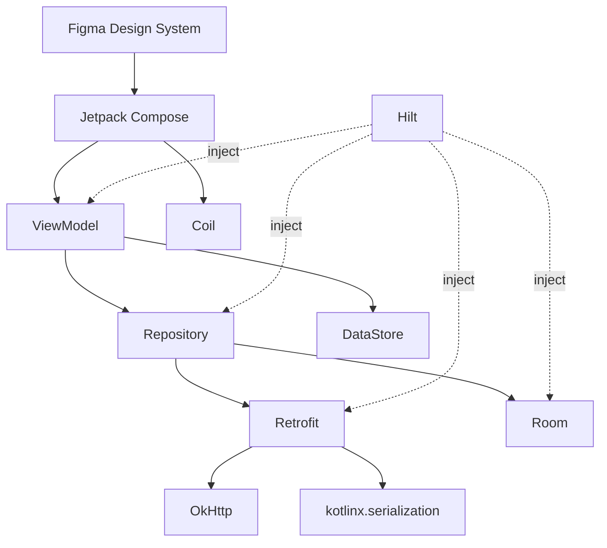

---

# 21. Stack chốt

Frontend TrọƠi hiện sử dụng:

```text
Android
├── Kotlin
├── Jetpack Compose
│
├── Architecture
│   ├── MVVM
│   ├── Repository Pattern
│   └── Feature-first
│
├── State & Async
│   ├── Coroutines
│   └── Flow
│
├── Dependency Injection
│   └── Hilt
│
├── Networking
│   ├── Retrofit
│   ├── OkHttp
│   └── kotlinx.serialization
│
├── Local Data
│   ├── Room
│   └── DataStore
│
├── Media
│   └── Coil
│
├── API Contract
│   └── OpenAPI
│
└── Design
    └── Figma
```

Các công nghệ chưa được chốt hoặc chưa cần thiết cho frontend hiện tại không được xem là một phần của tech stack cho đến khi có quyết định kỹ thuật riêng.
