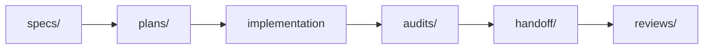

# Superpowers

`docs/superpowers/` lưu các artifact của **quá trình phát triển**, không phải business source of truth hiện tại.

## Các khu vực

- [`specs/`](specs/) — design specification và snapshot thiết kế đã được chốt tại thời điểm tương ứng.
- [`plans/`](plans/) — kế hoạch implementation/execution cho một scope đã xác định.
- [`audits/`](audits/) — evidence kiểm tra tại một thời điểm: baseline, conformance, completion hoặc verification.
- [`handoff/`](handoff/) — bàn giao giữa agent/dev/session.
- [`handoff/reviews/`](handoff/reviews/) — review response cho một handoff cụ thể.

## Cách sử dụng

- Artifact lịch sử phải được đọc theo **thời điểm và SHA** của nó.
- Không dùng một spec/plan/handoff cũ để override [`../contexts/`](../contexts/), [`../backlogs/`](../backlogs/) hoặc database authority hiện hành.
- Nếu một artifact lịch sử mâu thuẫn với authority hiện tại, giữ artifact làm provenance và sửa implementation/lower layer theo authority hiện tại.
- Không rewrite historical artifact chỉ để làm cho nó trông giống trạng thái hiện tại.
