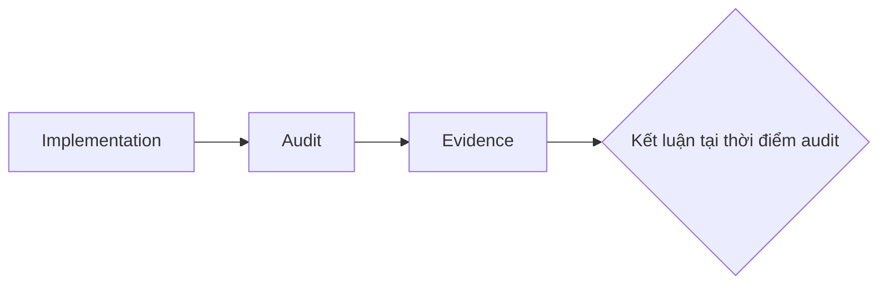

# Audits

`docs/superpowers/audits/` lưu evidence kiểm tra tại **một thời điểm cụ thể**: baseline, conformance, verification hoặc completion audit.

Audit trả lời các câu hỏi như:

- trạng thái nào đã được kiểm tra;
- kiểm tra trên branch/SHA nào;
- evidence nào đã được quan sát;
- điều gì pass/fail;
- còn limitation hoặc non-claim nào.

Audit không tự trở thành authority cho product/domain. Một audit cũ chỉ chứng minh trạng thái tại baseline/SHA được ghi trong chính artifact đó.

Không sửa historical audit để phản ánh code hiện tại. Nếu cần đánh giá trạng thái mới, tạo audit mới hoặc verification mới.
