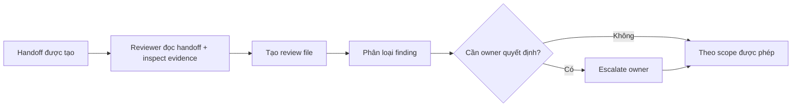

# Handoff Reviews

`docs/superpowers/handoff/reviews/` lưu các review response bất biến cho handoff.

Review không phải lệnh tự động sửa bug. Mục tiêu là ghi lại: reviewer quan sát được gì, điểm khác biệt nào có thể là chủ ý, evidence nào tồn tại và quyết định nào vẫn cần owner chốt.

## Quy tắc đặt tên

```text
<reviewer>-<YYYYMMDD-HHmmss>-<handoff-short>-review.md
```

Quy ước:

- `reviewer`: handle người/agent review, viết thường;
- timestamp: giờ local project (`Asia/Ho_Chi_Minh`, UTC+07:00);
- `handoff-short`: định danh kebab-case rút ra từ handoff;
- mỗi vòng review tạo một file mới;
- không overwrite review trước đó.

## Metadata bắt buộc

```yaml
review_of: docs/superpowers/handoff/<handoff-file>.md
reviewer: <reviewer>
reviewed_sha: <git-sha>
status: accepted | changes-requested | owner-decision-required
```

Các key và giá trị `status` trên là contract của review workflow, giữ nguyên tiếng Anh để ổn định automation/tooling.
## Classification của finding

Mỗi finding phải có đúng một classification chính:

- `CONFIRMED_DEFECT` — evidence cho thấy implementation/handoff vi phạm contract, test, spec hoặc invariant đã được chấp nhận.
- `INTENTIONAL_DEVIATION` — implementation khác plan/spec và có evidence cho thấy khác biệt là chủ ý, có rationale.
- `CONTEXT_MISSING` — hành vi đáng nghi nhưng evidence hiện có chưa đủ để kết luận đúng/sai.
- `PROPOSED_IMPROVEMENT` — chưa chứng minh hành vi hiện tại sai, nhưng có cải tiến hợp lý và trade-off rõ.
- `NEEDS_OWNER_DECISION` — có nhiều lựa chọn hợp lệ và quyết định sẽ thay đổi architecture, product behavior, scope hoặc authority.

Không biến mọi khác biệt so với plan thành `CONFIRMED_DEFECT`.

## Kỷ luật evidence

Mỗi finding phải tách rõ:

```text
Observed fact
Inferred intent
Verified intent
Evidence
Reviewer recommendation
Owner decision
```

- `Observed fact` phải được hỗ trợ trực tiếp bởi code, test, log, commit, docs hoặc runtime evidence.
- `Inferred intent` phải ghi là chưa xác minh nếu không có evidence.
- `Verified intent` cần nguồn rõ như commit message, comment, spec, test, handoff hoặc owner statement.
- Không tuyên bố agent "cố ý" làm gì nếu chưa có bằng chứng.
- Với rationale hợp lý nhưng chưa xác minh, dùng `Possible rationale - unverified`.
- Recommendation chỉ mang tính tư vấn trừ khi scope/handoff/owner cho phép implementation trực tiếp.
## Workflow review



Review có thể kết thúc với một trong ba `status`:

```text
accepted
changes-requested
owner-decision-required
```

## Quy tắc quyết định

- `CONFIRMED_DEFECT` chỉ được sửa trực tiếp khi execution scope hiện tại đã cho phép sửa đó.
- `INTENTIONAL_DEVIATION` phải giữ lại rationale trong review, kể cả khi owner sau đó chọn revert.
- `CONTEXT_MISSING` không được kích hoạt thay đổi code cho tới khi có thêm evidence hoặc owner quyết định.
- `PROPOSED_IMPROVEMENT` phải nêu cost/trade-off và không mặc định là defect.
- `NEEDS_OWNER_DECISION` là hard stop cho nhánh quyết định đó; agent không tự chọn thay owner.

Dùng [`TEMPLATE.md`](TEMPLATE.md) để tạo review mới.
