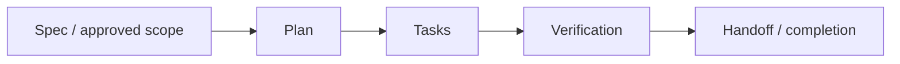

# Plans

`docs/superpowers/plans/` lưu kế hoạch **implementation/execution** cho một scope đã được xác định.

Một plan nên làm rõ:

- mục tiêu execution;
- phạm vi và dependency;
- thứ tự task;
- điểm cần verify;
- điều kiện dừng hoặc bàn giao.

Plan không phải product/domain authority và không tự thay đổi backlog hiện hành. Khi plan cũ mâu thuẫn với context, backlog hoặc database contract hiện tại, authority hiện tại được ưu tiên.

Không coi việc một plan tồn tại là bằng chứng rằng mọi task trong plan đã được implement. Trạng thái implementation phải dựa trên code, commit, test/audit và handoff tương ứng.
