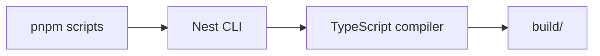
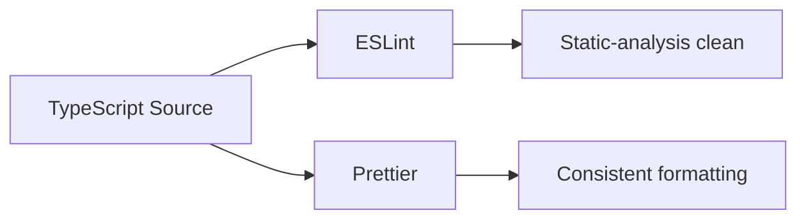
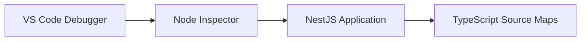

# Backend Development Foundation — Design

## Mục tiêu

Thiết lập nền tảng phát triển tối thiểu cho backend TrọƠi để team có thể viết, chạy, build, lint, format và debug TypeScript/NestJS một cách nhất quán trước khi bắt đầu database schema hoặc business implementation.

Phạm vi của bước này chỉ là **development tooling và application bootstrap foundation**. Không chốt ORM, database client, authentication implementation, testing framework, Redis/MinIO client hay observability.

## Phạm vi

Các thành phần sẽ được thiết lập:

- `pnpm` làm package manager;
- TypeScript compiler và Node.js type definitions;
- NestJS runtime foundation;
- NestJS CLI/schematics cho development;
- `ts-node` cho TypeScript execution trong development;
- ESLint cho static analysis;
- Prettier cho formatting;
- source maps để debug TypeScript;
- VS Code launch configuration;
- VS Code workspace settings và extension recommendations;
- EditorConfig để giữ formatting cơ bản nhất quán giữa editor.

## Package groups

### Runtime dependencies

- `@nestjs/common`
- `@nestjs/core`
- `@nestjs/platform-express`
- `reflect-metadata`
- `rxjs`

### Development dependencies

- `typescript`
- `@types/node`
- `ts-node`
- `@nestjs/cli`
- `@nestjs/schematics`
- `eslint`
- `@eslint/js`
- `typescript-eslint`
- `globals`
- `prettier`
- `eslint-config-prettier`

Version cụ thể sẽ được resolve khi cài đặt bằng `pnpm`; không hard-code version trong design document.

## File layout

```text
/
├── package.json
├── pnpm-lock.yaml
├── nest-cli.json
├── tsconfig.json
├── tsconfig.build.json
├── eslint.config.mjs
├── .prettierrc
├── .editorconfig
├── .vscode/
│   ├── launch.json
│   ├── settings.json
│   └── extensions.json
└── src/
    ├── main.ts
    ├── app.module.ts
    └── modules/
        └── ...
```

`src/modules/` hiện có 12 bounded module skeleton và được giữ nguyên. `main.ts` và `app.module.ts` chỉ bootstrap NestJS; không thêm business module wiring vượt quá mức cần thiết ở bước này.

## Scripts

`package.json` cần cung cấp tối thiểu:

```text
pnpm start:dev
pnpm start:debug
pnpm build
pnpm typecheck
pnpm lint
pnpm format
pnpm format:check
```

Ý nghĩa:

- `start:dev`: chạy NestJS ở chế độ watch;
- `start:debug`: chạy Node inspector để attach debugger;
- `build`: compile production build;
- `typecheck`: kiểm tra TypeScript mà không emit;
- `lint`: chạy ESLint;
- `format`: chạy Prettier ghi thay đổi;
- `format:check`: kiểm tra formatting mà không sửa file.

## TypeScript và build output

TypeScript configuration phải ưu tiên:

- strict type checking;
- decorator support cho NestJS;
- metadata emit cho NestJS dependency injection;
- source maps;
- separate build config để loại trừ file development-only khi cần;
- output build vào `build/`.

Backend dùng `build/` thay cho NestJS default `dist/` vì `.gitignore` dùng chung của TrọƠi cố ý không ignore `dist/` để branch landing page có thể version deployable static files. Rule `**/build/` hiện đã được ignore, nên backend build artifact không làm bẩn working tree.

Không thêm path alias nếu chưa có nhu cầu thực tế ở foundation này.

## Nest CLI

`nest-cli.json` chỉ định source root và giữ Nest CLI làm entry point thống nhất cho development/build scripts.



Không dùng `nest new` để regenerate project vì repository đã có `src/modules/` và docs riêng cần được bảo toàn.

## ESLint và Prettier

ESLint phụ trách correctness/static analysis; Prettier phụ trách formatting.

Nguyên tắc:



ESLint dùng flat config. `globals` cung cấp Node runtime globals cho lint configuration. `eslint-config-prettier` được dùng để tránh xung đột giữa rule formatting của ESLint và Prettier.

## Debug workflow

Debug sử dụng Node.js Inspector thay vì một package debugger riêng.



`start:debug` mở inspector; `.vscode/launch.json` cung cấp cấu hình attach phù hợp để breakpoint map về source TypeScript.

## VS Code workspace

`.vscode/settings.json` sẽ cấu hình các behavior an toàn ở workspace level như format-on-save và formatter cho TypeScript/JSON/Markdown khi phù hợp.

`.vscode/extensions.json` chỉ recommend extension cần cho backend development:

- ESLint;
- Prettier;
- EditorConfig.

Không phụ thuộc extension để build hoặc chạy application.

## Không nằm trong bước này

Các concern sau được cố ý để ngoài scope:

- PostgreSQL ORM / query builder;
- migration tooling;
- Redis client;
- MinIO/S3 SDK;
- authentication strategy như Google OAuth, OTP, JWT hoặc session;
- Swagger/OpenAPI bootstrap chi tiết;
- Jest/Vitest hoặc E2E framework;
- Docker/Compose;
- CI/CD;
- logging/observability stack;
- business entity, repository, controller hoặc service của 12 bounded modules.

Các concern trên sẽ được quyết định bằng task/spec riêng khi backend foundation đã chạy ổn định.

## Tiêu chí hoàn thành

Foundation được coi là đạt khi fresh checkout/worktree có thể:

1. cài dependency bằng `pnpm install`;
2. chạy NestJS development server;
3. attach debugger và đặt breakpoint ở TypeScript source;
4. `pnpm typecheck` thành công;
5. `pnpm lint` thành công;
6. `pnpm format:check` thành công;
7. `pnpm build` thành công;
8. build artifact nằm trong `build/` và không làm working tree dirty;
9. không làm thay đổi boundary của 12 module hiện tại.

## Kết quả mong muốn

Sau bước này repository backend có một môi trường phát triển ổn định để bắt đầu các task tiếp theo như domain map, database schema, authentication và vertical slice đầu tiên mà không phải tiếp tục tranh luận về tooling cơ bản.