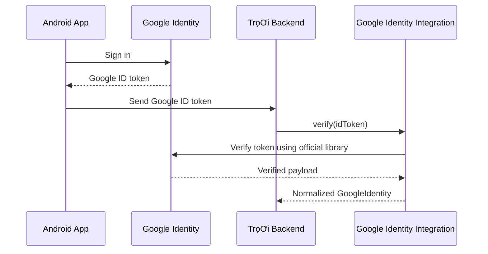
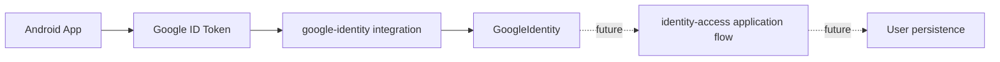

# Google Auth Integrations — Design

## Mục tiêu

Tạo một boundary riêng cho các external integration của backend TrọƠi, bắt đầu bằng Google Identity verification cho luồng đăng nhập Android-first.

Mục tiêu của bước này không phải hoàn thiện authentication flow của TrọƠi. Bước này chỉ tạo một adapter mỏng để backend có thể nhận Google ID token, xác minh token bằng SDK chính thức và chuyển dữ liệu Google-specific thành một internal contract ổn định mà các module nghiệp vụ có thể consume sau này.

Thiết kế phải giữ `src/modules/**` tập trung vào business/domain concerns và tránh để SDK hoặc naming của external provider lan vào bounded modules.

## Branch

Implementation sẽ được thực hiện trên branch:

```text
backend/google-auth-integrations
```

Branch này phải được tạo từ HEAD mới nhất của:

```text
backend/core-foundations
```

Không tạo từ `main`.

## Architectural boundary

Backend được chia thành hai lớp concern khác nhau:

```text
src/modules/
→ business/domain/application concerns
→ không import external provider SDK trực tiếp

src/integrations/
→ giao tiếp với external APIs/SDKs/providers
→ normalize dữ liệu vendor-specific thành internal contract
→ không chứa business decisions hoặc domain state
```

`src/integrations/` là một infrastructure boundary, không phải bounded business module.

Nguyên tắc này được chọn để phòng trường hợp TrọƠi về sau cần thêm external providers như Maps, object storage, SMS/email, payment, AI/OCR hoặc các dịch vụ khác mà không làm các domain module phình to hoặc bị khóa theo vendor.

## Scope hiện tại

Bước này chỉ thêm Google Identity verification integration.

Flow mục tiêu:



Android/client-side login UI, Credential Manager setup và backend endpoint orchestration không nằm trong scope này.

## File layout

```text
/
├── .env.example
├── package.json
├── pnpm-lock.yaml
└── src/
    ├── integrations/
    │   ├── README.md
    │   └── google-identity/
    │       ├── README.md
    │       ├── google-identity.types.ts
    │       ├── google-identity.errors.ts
    │       ├── google-id-token-verifier.ts
    │       ├── google-id-token-verifier.spec.ts
    │       └── index.ts
    └── modules/
        └── identity-access/
            └── README.md
```

`src/modules/identity-access/README.md` không cần đổi boundary hiện tại. Integration code không được chuyển vào `identity-access`.

## Integration-level README

`src/integrations/README.md` phải mô tả convention dùng chung cho external integration:

- integration code có thể phụ thuộc SDK/API của vendor;
- integration code phải trả về internal contract thay vì để vendor payload lan ra ngoài;
- integration code không được tạo user, gán role, quyết định quyền truy cập hoặc mutate domain state;
- integration code không được chứa persistence/business workflow;
- mỗi provider/integration có folder riêng;
- chỉ scaffold provider khi có use case thực tế, không tạo placeholder cho future providers.

## Google Identity contract

Normalized identity contract tối thiểu:

```typescript
export interface GoogleIdentity {
  subject: string;
  email?: string;
  emailVerified?: boolean;
  name?: string;
  pictureUrl?: string;
}
```

Ý nghĩa:

- `subject`: stable Google subject identifier từ claim `sub`; đây là external identity key chính;
- `email`: email do Google payload cung cấp nếu có;
- `emailVerified`: trạng thái xác minh email nếu claim có;
- `name`: display name nếu có;
- `pictureUrl`: avatar URL nếu có.

Không dùng email làm stable Google identity key.

## Verifier contract

Integration expose một contract tối thiểu:

```typescript
export interface GoogleIdTokenVerifier {
  verify(idToken: string): Promise<GoogleIdentity>;
}
```

Concrete implementation dùng official `google-auth-library`.

Verifier chịu trách nhiệm:

1. reject token rỗng/không hợp lệ ở integration boundary;
2. verify Google ID token với expected audience;
3. đảm bảo payload có `sub` hợp lệ;
4. normalize payload thành `GoogleIdentity`;
5. không leak raw vendor error ra ngoài boundary.

## Error model

Integration cần một error type nội bộ đủ nhỏ để caller không phụ thuộc trực tiếp vào error classes của Google SDK.

Ví dụ semantic categories:

```text
INVALID_TOKEN
INVALID_PAYLOAD
PROVIDER_ERROR
```

Không cần xây một generic error framework cho toàn bộ `src/integrations/` ở bước này.

Caller chỉ cần phân biệt verification thất bại mà không phải hiểu implementation detail của Google SDK.

## Environment contract

Tạo `.env.example` và commit file này.

Nội dung hiện tại chỉ chứa environment variables đã có runtime contract thực tế:

```dotenv
# Application
PORT=3000

# Google Identity
GOOGLE_CLIENT_ID=
```

Không thêm trước các biến chưa được code consume như:

```text
GOOGLE_CLIENT_SECRET
JWT_SECRET
DATABASE_URL
REDIS_URL
MINIO_*
```

`GOOGLE_CLIENT_ID` được dùng làm expected audience khi verify Google ID token.

`.env` thật tiếp tục không được commit.

## Configuration rule

Google verifier không được đọc `process.env` rải rác bên trong từng method.

Client ID phải được inject/provide vào verifier tại construction boundary để:

- dễ test;
- fail sớm khi configuration thiếu;
- giữ verifier deterministic;
- tránh coupling trực tiếp giữa domain caller và environment implementation.

Bước này chưa cần đưa `@nestjs/config` vào dependency nếu chưa có nhu cầu application-wide configuration module. Có thể dùng một factory/construction helper nhỏ hoặc constructor argument rõ ràng.

## Dependency

Runtime dependency mới:

```text
google-auth-library
```

Không thêm Passport strategy, OAuth callback framework hoặc session/JWT package trong bước này.

`package.json` và `pnpm-lock.yaml` phải được cập nhật bằng `pnpm` trên branch mới.

## Testing strategy

Vì đây là production integration code, verifier phải có automated tests.

Không gọi Google network thật trong test suite.

Test boundary phải cho phép fake/mock phần Google SDK verification và kiểm tra behavior của adapter.

Các case tối thiểu:

1. valid verified payload → trả `GoogleIdentity` đã normalize;
2. empty token → reject bằng internal integration error;
3. verified payload thiếu `sub` → reject bằng internal integration error;
4. Google verification client throw/reject → map về internal integration error;
5. optional claims thiếu → vẫn trả identity hợp lệ nếu `sub` tồn tại.

Nếu backend foundation chưa có test runner phù hợp, implementation plan phải chọn giải pháp test nhỏ nhất có thể và ghi rõ dependency/tooling bổ sung. Không được bỏ automated test chỉ vì foundation trước đó chưa chọn test framework.

## Interaction với identity-access

`identity-access` sau này có thể consume `GoogleIdentity`, nhưng branch này chưa implement application authentication flow.

Boundary dự kiến:



Google integration không được biết:

- TrọƠi `User` entity;
- OWNER / OPERATOR / TENANT / PLATFORM_ADMIN role assignment;
- organization membership;
- tenant invitation;
- user persistence;
- JWT/session issuance.

## Không nằm trong bước này

Cố ý để ngoài scope:

- `POST /auth/google` controller/endpoint;
- Android Credential Manager implementation;
- create/find/update TrọƠi user;
- database schema hoặc repository;
- JWT access token;
- refresh token;
- session management;
- logout/revoke session;
- OTP;
- role/access assignment;
- organization membership;
- Passport.js strategy;
- web OAuth redirect/callback flow;
- Google authorization-code exchange;
- additional integrations như Maps, MinIO, email/SMS hoặc payment.

Các concern này phải có task/spec riêng khi cần.

## Design constraints

1. `src/modules/**` không import `google-auth-library`.
2. Google-specific payload/error types không leak ra ngoài integration boundary.
3. `GoogleIdentity.subject` là required stable external identity identifier.
4. Không dùng email làm identity key thay cho `sub`.
5. Không thêm generic abstraction cho nhiều auth providers khi hiện chỉ có Google.
6. Không thêm placeholder integration folders cho future providers.
7. Không đọc secrets/configuration trực tiếp từ nhiều điểm trong verifier.
8. Không đưa business logic hoặc persistence vào `src/integrations/`.
9. `.env.example` chỉ chứa variables thực sự được consume.
10. Existing 12 bounded module READMEs và backend foundation phải được bảo toàn.

## Verification gates

Implementation được coi là đạt khi có fresh evidence cho toàn bộ các gate sau:

1. branch `backend/google-auth-integrations` được fork từ latest `backend/core-foundations`;
2. `google-auth-library` được cài bằng `pnpm` và lockfile được cập nhật;
3. `.env.example` tồn tại, được commit và không chứa secret thật;
4. `src/integrations/README.md` khóa boundary/convention;
5. Google verifier tests pass;
6. `pnpm typecheck` pass;
7. `pnpm lint` pass;
8. `pnpm format:check` pass;
9. `pnpm build` pass;
10. `git diff --check` không báo whitespace error;
11. `src/modules/**` không có thay đổi ngoài những gì spec cho phép;
12. không có endpoint, DB, JWT/session hoặc business auth flow ngoài scope bị thêm vào.

## Kết quả mong muốn

Sau bước này TrọƠi có một external integration boundary rõ ràng và một Google Identity verifier độc lập với business modules.

Backend có thể verify Google ID token và nhận một `GoogleIdentity` normalized, nhưng vẫn chưa quyết định user persistence, token/session strategy hoặc role assignment.

Cấu trúc này cho phép thêm external providers trong tương lai mà không làm các bounded modules phụ thuộc trực tiếp vào vendor SDK hoặc phình to theo từng integration.