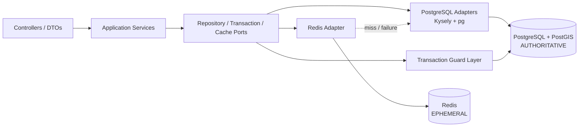

# TrọƠi PostgreSQL + Redis Implementation Design

**Date:** 2026-09-28
**Branch:** `database/postgres-redis-implementation`
**Status:** Design for review — implementation must not start until this spec is approved and an implementation plan is written.

## 1. Intent

This phase turns the frozen TrọƠi data contract into executable persistence without reopening the domain model.

The implementation must provide:

- PostgreSQL/PostGIS migration history derived from frozen ERD LV3;
- production-shaped PostgreSQL persistence adapters;
- explicit transaction boundaries for cross-row/cross-table invariants;
- concurrency-safe enforcement of all frozen transaction guards;
- PostGIS-backed geospatial access for Search/Map;
- Redis as reconstructable cache/ephemeral infrastructure only;
- development database bootstrap, deterministic seed support, and integration tests.

The phase succeeds only when persistence implements the frozen contract exactly and the application no longer depends on in-memory state for current persisted business truth.
## 2. Authority and non-negotiable constraints

Repository authority is, in order:

```text
docs/database/canonical-v3.7.md
→ docs/database/erd/trooi-erd-lv1-conceptual.json
→ docs/database/erd/trooi-erd-lv2-logical.json
→ docs/database/erd/trooi-erd-lv3-physical.json
→ docs/database/schema/trooi-schema-lv3.sql
→ migrations / persistence / backend implementation
```

`trooi-erd-lv3-physical.json` is authoritative for exact physical columns, PostgreSQL types, nullability, PK/FK definitions, CHECK constraints, ordinary UNIQUE constraints, indexes, transaction guards, and OPEN-policy boundaries.

`trooi-schema-lv3.sql` is a validated reference DDL, not migration history.

Implementation must not infer schema from current service DTOs, existing in-memory maps, historical docs, or model memory when LV3 has a more specific answer.

Any implementation need not decided by Canonical/LV3 must stop and be reported as an ambiguity. It must not be silently decided in ORM mappings, SQL, repository code, Redis, or service logic.
Hard prohibitions for this phase:

- no global `USER.role = LANDLORD|TENANT`;
- no invented room/property type vocabulary;
- no Charge over-allocation policy while it is OPEN;
- no Review multiplicity unique constraint while it is OPEN;
- do not remove `DEPOSIT_EVENT.amount`;
- no max-one utility connection/type rule;
- no negative Payment used as a deposit refund;
- no Redis/read-model/cache as authoritative business truth;
- no FUTURE capability added to the current physical schema for convenience;
- no rewrite of shared migration history after it exists;
- no force-push, main merge, branch deletion, or worktree deletion as part of implementation.

Physical target at design time:

```text
PostgreSQL + PostGIS
29 tables
59 foreign keys
50 CHECK constraints
2 ordinary UNIQUE constraints
65 indexes
23 transaction guards
17 OPEN policies
```
## 2.1 Documentation vs implementation naming boundary

`LV1`, `LV2`, and `LV3` are documentation/design-level labels only. They exist to distinguish Canonical/ERD review layers and may remain in `docs/` authority filenames, design prose, review notes, and references to the frozen contract.

Implementation artifacts must use semantic/runtime names, not ERD-level names. For all executable or runtime-facing implementation work, the case-insensitive tokens `lv1`, `lv2`, and `lv3` are prohibited in:

- source-code filenames and directory names;
- class, type, interface, function, method, variable, constant, provider, and module identifiers;
- migration filenames and migration identifiers;
- SQL implementation filenames outside the documentation authority tree;
- test filenames, test-suite identifiers, and fixture names;
- script filenames and package-script command names;
- configuration keys, environment-variable names, cache keys, metric names, and log event names.

Use semantic names such as `physical_contract`, `initial_schema`, `schema_contract`, `catalog_parity`, or domain/aggregate names instead. The implementation must not leak ERD review-level numbering into runtime vocabulary.

This rule also applies to existing non-documentation validation tooling before persistence implementation begins. The current pre-implementation names under `scripts/database/` and `tests/database/` that contain `lv1`, `lv2`, or `lv3` must be renamed to neutral semantic names while preserving behavior, imports, test coverage, and authority references. For example:

```text
scripts/database/lv3_validate.py              -> scripts/database/physical_contract_validate.py
scripts/database/lv3_render_sql.py            -> scripts/database/physical_contract_render_sql.py
scripts/database/lv3_render_lucid.py          -> scripts/database/physical_contract_render_lucid.py
scripts/database/lv3_verify_catalog.py        -> scripts/database/physical_contract_verify_catalog.py
scripts/database/lv3_catalog.sql              -> scripts/database/physical_contract_catalog.sql
tests/database/test_lv3_validate.py            -> tests/database/test_physical_contract_validate.py
tests/database/test_lv3_render_sql.py          -> tests/database/test_physical_contract_render_sql.py
tests/database/test_lv3_render_lucid.py        -> tests/database/test_physical_contract_render_lucid.py
tests/database/test_lv3_verify_catalog.py      -> tests/database/test_physical_contract_verify_catalog.py
tests/database/sql/trooi-schema-lv3-smoke.sql -> tests/database/sql/schema-smoke.sql
```

The authority files under `docs/database/` keep their existing level-labelled filenames because they are documentation/design artifacts, not runtime implementation names.

## 3. Verified repository baseline

At the start of this design pass:

- `backend/core-foundations` remote HEAD = `94d11fd31d76dde54ac5c0432d1fb1bbaef2ec8d`;
- `database/postgres-redis-implementation` was still at the old `f5f8c035...` base and had no branch-specific work;
- the database branch was cleanly fast-forwarded and normally pushed to `94d11fd...` with no force push;
- the database worktree is clean and local/remote database heads now match the shared backend root.

Baseline verification after synchronization:

```text
backend tests                 49/49 PASS
TypeScript typecheck          PASS
database tests                45/45 PASS
LV3 validator                 PASS
fresh PostGIS schema apply    PASS
SQL smoke                     PASS
pg_catalog parity             PASS
table count                   29
```

The implementation must preserve these gates and add persistence-specific tests rather than replacing the existing suites.

A minor documentation debt remains in `database/README.md`: wording still says “LV3 physical candidate”. This may be corrected as documentation only; it must not alter schema semantics.
## 4. Contract reconciliation gate before persistence wiring

The current backend scaffold is persistence-agnostic but some service-level semantics predate the final LV3 freeze. Those shapes must not be copied into database models as-is.

Known mismatches that require reconciliation against Canonical/LV3 before a module is persisted:

- Room currently collapses operational state and record lifecycle into one status; LV3 keeps them separate.
- Current Room transitions include paths that are not legal in the frozen lifecycle.
- Current Tenancy transitions do not fully match the frozen `DRAFT | ACTIVE | ENDING | ENDED | CANCELLED` FSM.
- Current Listing uses `hidden/rented` terminology rather than frozen `DRAFT | PUBLISHED | UNPUBLISHED | ARCHIVED` semantics.
- Current Billing contracts allow loose charge type strings even though the current whitelist is only `RENT`, `ELECTRICITY`, and `WATER`.
- Current Receipt service models payment-like state, while the frozen domain separates Payment from Receipt.
- Current service IDs are generated as prefixed strings; physical identity uses UUID.
- Current subscription/pricing and CSV-style onboarding/import scaffolds represent FUTURE capability and must not drive current physical persistence.

Reconciliation means changing backend-facing contracts to follow frozen authority; it does not mean changing Canonical/LV3 to preserve stale scaffold behavior.
## 5. Persistence tooling decision

Selected stack:

```text
PostgreSQL driver       pg
Typed query layer       Kysely
Migration runner        node-pg-migrate
Cache client            redis (official Node client)
Relational database     PostgreSQL 16
Geospatial extension    PostGIS
```

Rationale:

- the physical contract already exists independently of any ORM;
- SQL must remain the closest executable representation of LV3;
- Kysely provides typed query construction without owning schema semantics;
- `pg` exposes explicit transactions and row locks needed for the 23 guards;
- SQL migrations preserve exact CHECK, FK, partial-index, GiST, and PostGIS behavior;
- Redis remains a separate adapter behind a cache port.

No ORM auto-sync, schema push, or generated migration diff may be used as the authoritative schema mechanism.
## 6. Target architecture



Domain/application code must not import Kysely, `pg`, or the Redis client directly. Infrastructure implements narrow ports owned by application/domain boundaries.
## 7. Migration architecture

Create immutable migration history under `database/migrations/`.

Recommended shape:

```text
database/
├── README.md
├── migrations/
│   ├── 000001_initial_schema.ts
│   └── sql/
│       ├── 000001_initial_schema.up.sql
│       └── 000001_initial_schema.down.sql
└── seeds/
```

The first migration is a versioned snapshot of the frozen LV3 physical contract. It must not execute the mutable reference file directly at migration runtime.

Creation rule:

1. generate/copy baseline SQL from the frozen LV3 reference;
2. store it under migration history;
3. verify deterministic equivalence with the frozen physical contract;
4. apply it to an empty PostGIS database;
5. run smoke and `pg_catalog` parity checks.

Once shared, `000001_initial_schema` is history. A future schema change requires a new migration after an upstream Canonical/LV1/LV2/LV3 change; old migration content must not be silently rewritten.
## 8. PostgreSQL type boundary

Persistence mappings must be explicit and testable.

Required handling:

- `uuid` stays UUID/string identity; do not reintroduce prefixed runtime IDs.
- `numeric(18,2)` and `numeric(18,6)` must not be blindly coerced to JavaScript `number` where precision could be lost.
- `date` keeps calendar-date semantics and must not acquire accidental timezone conversion.
- `timestamptz` is normalized at the persistence boundary.
- `jsonb` must use typed payloads where a stable contract exists and opaque JSON only where LV3 intentionally permits it.
- `geography(Point,4326)` is accessed through explicit PostGIS helpers rather than represented as an invented domain shape.

Money arithmetic used for persistence decisions must use an exact representation strategy. Repository code must never compare database monetary values through floating-point arithmetic.

Database defaults, generated values, and nullability come from LV3/migration semantics; application code must not duplicate them inconsistently.
## 9. Repository boundaries

Do not introduce a generic CRUD repository as the primary business abstraction. Repositories must reflect aggregate ownership and transaction needs.

Recommended aggregate-oriented boundaries:

```text
Identity / Organization
Property / Room / Listing / Inquiry
Tenancy / Participant / Terms / Acknowledgement / Notice
Billing / Charge / Utility Connection / Meter Reading
Payment / Allocation / Claim / Receipt
Deposit / Application / Settlement / Event
Incident / Incident Event
Review / Trust Report
Notification
```

Repository ports expose only operations the application layer needs, including lock-aware variants where required.

Examples:

- `RoomRepository.getForUpdate(roomId)`;
- `PaymentRepository.getForUpdate(paymentId)`;
- `DepositRepository.getForUpdate(depositId)`;
- aggregate-specific reads and append/update operations.

Query builders and raw database handles must not leak through repository ports.
## 10. Transaction manager and lock discipline

Introduce a small transaction abstraction:

```text
TransactionManager.run(callback)
    → TransactionContext
        → repositories bound to one PostgreSQL transaction
        → afterCommit callbacks
```

Default isolation remains PostgreSQL `READ COMMITTED` unless a specific guard proves it insufficient after explicit locking.

Correctness strategy:

```text
row-local constraints      → PostgreSQL CHECK / FK / UNIQUE / index
aggregate concurrency      → stable-owner row lock + validate + write
cross-aggregate operation  → deterministic lock order + one transaction
cache work                 → after commit only
```

Do not use Redis distributed locks to protect authoritative business invariants.

Lock acquisition order must be deterministic inside each command path to reduce deadlock risk. Deadlocks/serialization failures that remain possible must be translated into bounded retry behavior only where the operation is safe to retry.

No application workflow may treat “read current totals, then insert” under ordinary READ COMMITTED as sufficient when the frozen guard is aggregate-sensitive.
## 11. Transaction guard implementation map

All 23 LV3 guards remain authoritative. The code-level grouping below is organizational only; it does not redefine guard semantics.

### Room / Property / Listing / Tenancy coordination

1. `listing_publish_eligibility`
2. `room_leave_vacant_unpublish`
3. `property_archive_guard`
4. `room_archive_guard`
5. `tenancy_activation`
6. `tenancy_checkout`
17. `open_incident_archive_blocker`

Stable lock owners are primarily Room and Property rows. Publish, occupancy, checkout, and archive transitions must be serialized around those owners.

### Billing / Utility

7. `billing_cycle_no_overlap`
8. `billing_cycle_terms_provenance`
14. `utility_provenance`

Stable lock owner is normally Tenancy or the specific aggregate row required by LV3 semantics. No new utility cardinality rule may be invented.
### Payment / Receipt / Deposit

9. `payment_allocation_same_tenancy`
10. `deposit_application_same_tenancy`
11. `payment_amount_cap`
12. `payment_correction`
13. `receipt_issue`
15. `deposit_event_provenance_amount`
16. `deposit_settlement_amount_cap`
23. `receipt_replacement`

Payment and Deposit rows are stable aggregate lock owners for conservation-sensitive operations.

Critical concurrency requirements include:

- concurrent allocations/applications must never exceed Payment amount;
- concurrent settlements must never exceed funded Deposit amount;
- replacement records must preserve predecessor history and tenancy/payment consistency.

The OPEN Charge over-allocation policy remains OPEN. Implement only the frozen Payment-level conservation invariant and exact LV3 constraints; do not add an inferred per-Charge aggregate cap.
### Review / Trust / Acknowledgement

18. `review_eligibility`
19. `review_historical_property_target`
20. `payment_claim_consistency`
21. `terms_acknowledgement_consistency`
22. `review_author_identity`

These guards enforce frozen provenance and identity consistency only. They must not close any Review, Trust Report, Payment Claim, or moderation OPEN policy.

## 12. PostGIS integration

Search/Map stays on PostgreSQL/PostGIS. No Elasticsearch/OpenSearch is introduced in this phase.

The physical contract uses `geography(Point,4326)` and GiST indexing. Repository helpers may use explicit functions such as `ST_DWithin`, `ST_Distance`, and `ST_MakePoint` where they preserve the frozen public-location projection semantics.

Search/Map reads only eligible `PUBLISHED` Listing projection data. Exact operational location must not become public by query convenience.

The room/property type filter owner and vocabulary remain OPEN; persistence must not add a type column, enum, CHECK, seed vocabulary, or filter contract that closes that policy.
## 13. Redis architecture

Redis is optional acceleration, never authoritative business storage.

Allowed roles in this phase:

- cache for reconstructable read projections;
- short-lived technical state;
- counters/rate-limit state only where policy is already decided;
- ephemeral lookup acceleration.

Invariant:

```text
Redis flush/loss
→ PostgreSQL still contains complete authoritative business state
→ application can reconstruct cached data
```

Business writes commit in PostgreSQL first. Cache mutation/invalidation runs only after commit.

Redis failure must not roll back a successful authoritative PostgreSQL transaction. Cache GET failure degrades to PostgreSQL; cache SET/DEL failure is logged/observed and does not convert successful business writes into failures.
### 13.1 Redis key contract

Use a namespaced convention:

```text
trooi:<environment>:v1:<namespace>:<resource-key>
```

Examples:

```text
trooi:dev:v1:dashboard:org:<uuid>
trooi:dev:v1:property-summary:<uuid>
```

Every cache namespace must declare:

- source PostgreSQL query/projection;
- key construction;
- TTL;
- invalidation events;
- acceptable staleness;
- fallback behavior;
- observability fields.

No business cache key may have an implicit infinite lifetime. Do not use Redis `KEYS` scans for runtime invalidation; keys must be directly addressable or use intentionally bounded indexing structures.
### 13.2 Initial cache scope

Do not cache correctness-sensitive public Listing/Search state in the first Redis slice.

Reason: Room leaving `VACANT` must synchronously unpublish the current Listing. If PostgreSQL commits but cache invalidation fails, a stale public-search cache could expose an occupied/unavailable room as published.

The current frozen schema has no outbox table, and this phase must not invent one solely to make cache invalidation stronger.

Initial Redis adoption should therefore target projections where bounded staleness is acceptable, such as dashboard/summary reads, after the owning queries exist.

Listing/Search may be reconsidered later only with an explicitly reviewed consistency design that does not make Redis part of business correctness.

## 14. Development runtime

Local development should provide a reproducible containerized dependency stack:

```text
PostgreSQL 16 + PostGIS
Redis
```

MinIO is already part of the broader storage stack but is outside this PostgreSQL + Redis phase unless a persistence path under implementation explicitly requires an existing frozen object reference contract.
Environment configuration should expose infrastructure through validated application config, at minimum:

```text
DATABASE_URL
REDIS_URL
```

Credentials must not be committed. Startup should fail clearly when required PostgreSQL configuration is invalid. Redis configuration may support degraded operation where the selected feature permits cache bypass.

## 15. Seed strategy

Seeds exist for development/test/reference scenarios, not as a parallel source of truth.

Seed data must be:

- deterministic enough for repeatable tests/demos;
- synthetic, with no real tenant/customer data;
- valid under LV3 constraints and transaction guards;
- free of invented OPEN-policy vocabulary;
- free of FUTURE-only entities/fields.

Where seeds create aggregate-sensitive state, prefer going through the same persistence/application command path that enforces guards. Direct SQL seed inserts are acceptable only for simple reference/bootstrap rows whose invariants are entirely row-local and already guaranteed by the database contract.
## 16. Testing strategy

Testing must prove both schema fidelity and runtime behavior.

### Contract and migration tests

- the physical-contract validator remains green after its neutral naming cleanup;
- fresh database migration applies from zero;
- migrated catalog matches LV3 PK/FK/CHECK/UNIQUE/index inventory;
- PostGIS extension and GiST behavior are present;
- existing schema smoke suite passes against migrated schema;
- baseline migration is not dependent on mutable docs at runtime.
- a static implementation-naming audit fails if non-documentation executable/runtime paths, filenames, source identifiers, script commands, config keys, cache keys, metrics, or log-event names contain case-insensitive `lv1`, `lv2`, or `lv3`.

### Repository integration tests

Each persisted aggregate requires real PostgreSQL integration coverage for:

- create/read/update paths actually used by application commands;
- nullability and mapping edges;
- exact numeric handling;
- FK and CHECK failures translated to expected application errors;
- PostGIS query behavior where relevant;
- rollback behavior on failed multi-write commands.
### Concurrency tests

Concurrency tests must use independent PostgreSQL connections/transactions, not simulated promise interleaving on one transaction.

Minimum race cases:

- two attempts to activate/create competing non-terminal Tenancies for one Room;
- simultaneous Payment allocations/applications approaching the Payment amount cap;
- simultaneous Deposit settlements approaching funded amount;
- Listing publish racing Room occupancy/state transition;
- checkout racing another Room-state operation;
- archive racing creation/transition of child state that would make archive invalid.

Each race test must assert both the returned outcome and final persisted state.

### Redis integration tests

- cache hit and miss behavior;
- TTL expiration;
- deterministic invalidation;
- Redis unavailable on GET falls back to PostgreSQL;
- Redis unavailable on SET/DEL does not undo committed PostgreSQL writes;
- full Redis flush followed by successful reconstruction from PostgreSQL.
## 17. Error handling and observability

Infrastructure failures must be classified rather than surfaced as raw driver errors.

At minimum distinguish:

- connectivity/configuration failure;
- not-found/business precondition failure;
- unique/check/FK constraint failure;
- lock/deadlock/serialization failure;
- migration failure;
- Redis degraded/unavailable state.

Logs/metrics should make transaction and cache behavior diagnosable without logging sensitive business payloads.

Useful signals include:

- PostgreSQL pool health and acquisition latency;
- transaction duration and rollback count;
- deadlock/serialization retry count;
- repository query latency by operation name, not raw user data;
- Redis hit/miss/error counts by cache namespace;
- cache fallback count;
- migration version at startup/health diagnostics.

Redis degradation is observable but is not equivalent to authoritative database failure.
## 18. Module integration rule

Persistence should replace in-memory business state incrementally by module/aggregate, not through one large rewrite.

For each module slice:

```text
reconcile service contract to frozen domain
→ define/confirm repository port
→ implement PostgreSQL adapter
→ implement required transaction guards
→ switch application service from Map/state engine to port
→ run existing + new integration/concurrency tests
→ only then continue to the next slice
```

Temporary dual-write between in-memory Maps and PostgreSQL is prohibited because it creates two business truths and ambiguous rollback semantics.

A module may remain entirely in-memory while another module is migrated only if the boundary is explicit and no command depends on cross-store atomicity. Once a cross-module command requires authoritative state from both sides, the dependent slices must be migrated together or the command must remain disabled until they are.

FUTURE-only modules may keep scaffold code for compilation/history, but this phase must not give them new current-schema persistence.
## 19. Scope boundaries

In scope:

- pre-implementation neutral naming cleanup for non-documentation code/scripts/tests that still contain `lv1`, `lv2`, or `lv3`;
- PostgreSQL/PostGIS connection and configuration;
- immutable migration baseline from frozen LV3;
- typed query/persistence layer;
- current-domain repository adapters;
- explicit transaction manager and frozen guards;
- PostGIS query support for current Search/Map semantics;
- Redis connection/cache infrastructure and safe initial cache surfaces;
- development containers/bootstrap and deterministic seeds;
- integration, concurrency, migration, and cache-failure tests.

Out of scope unless upstream authority changes first:

- Subscription/pricing persistence;
- CSV/Excel import persistence;
- partner marketplace/dispatch/commission;
- AI/OCR/predictive features;
- room asset inventory;
- generic Service/WiFi/Parking/Other charge types;
- full realtime messaging;
- proration engine;
- public personal tenant/landlord rating;
- resolution of any of the 17 OPEN policies.
## 20. Acceptance criteria

This phase is complete only when all of the following are true:

- a fresh environment can build the database from migration history alone;
- the migrated database remains catalog-equivalent to frozen LV3 for the current baseline;
- exact 29-table physical semantics are preserved;
- the backend regression suite remains green after Canonical/LV3 reconciliation; tests that encode stale pre-freeze semantics are updated to the frozen authority rather than preserved as authority;
- the baseline database 45/45 frozen-contract suite remains green alongside the new persistence tests;
- TypeScript typecheck remains green;
- physical-contract validation, schema smoke, and catalog parity remain green;
- current persisted business state no longer depends on in-memory Maps;
- all 23 frozen transaction guards have real integration coverage;
- aggregate-sensitive guards have race tests proving safe behavior under concurrency;
- PostGIS queries operate on authoritative PostgreSQL data and respect public/private location boundaries;
- Redis can be flushed or become unavailable without losing authoritative business state;
- Redis failure does not roll back successful PostgreSQL business writes;
- no OPEN policy is silently closed;
- no FUTURE capability is introduced into current physical persistence;
- no non-documentation executable/runtime artifact contains `lv1`, `lv2`, or `lv3` in its path, filename, source identifier, command, config key, cache key, metric, or log-event name.

Completion claims require fresh test evidence from the branch, not assumptions based on earlier runs.
## 21. OPEN-policy preservation checklist

The following policies remain intentionally unresolved and must stay unresolved during implementation:

1. Payment unallocated amount handling.
2. Payment Claim evidence format.
3. Payment Claim confirmation permission.
4. Deposit requirement change after partially held.
5. Review minimum occupancy duration.
6. Review edit policy.
7. Review moderation authority.
8. Review target (property_id) correction authority.
9. Review rating dimensions.
10. Trust Report login requirement.
11. Trust Report rate limit.
12. Trust Report moderation permissions.
13. Trust Report evidence policy.
14. Notification delivery channels.
15. Charge over-allocation across multiple Payments targeting one Charge.
16. Review multiplicity per eligible Participant/Tenancy.
17. Search/Map room/property type authoritative owner and vocabulary.

If an implementation task appears to require one of these answers, stop that task and escalate the ambiguity rather than choosing a policy locally.
