# Database foundation — physical proposal and policy gates

**Current status: four-table addendum REVIEWED_FROZEN (`vnext.identity-foundation.1`); Database Task 2 implemented and verified; runtime activation BLOCKED.**
**Task 1 review:** 2026-10-13; five owner decisions are APPROVED with adjustments; Account Verification acceptance ACCEPTED_WITH_NON_SCHEMA_CONDITIONS recorded; runtime timing/benchmark closure remains independent.
**Source baseline:** `feature/profile-identity-foundation`, `079047bc986e71a2993959c0e7c22cc6834deaeb`.
**Authority:** frozen Canonical v3.7 → explicit approved product decisions → reviewed contracts → schema/migrations → implementation → tests.

The owner's Google-first authentication update is recorded as AUTH-01–AUTH-06 and PROFILE-01 in the [decision register](2026-10-12-profile-identity-decision-register.md). JSON-only public content is CONTENT-01. These product decisions supersede the initial audit's authentication gate recommendations. Remaining G1–G7 details and all physical mechanisms below are explicitly identified; the earlier documentation-only restriction was superseded by explicit owner Task 2 authorization on 2026-10-13; only the four-table persistence scope is implemented.

## 1. Conceptual boundaries

PostgreSQL owns immutable digital User identity, organization/tenancy relationships, durable evidence and approved personal metadata. The existing rental and financial aggregates retain their existing responsibilities. The initialized, editable User Profile owns display information; it does not own tenancy participant snapshots, global roles, billing history or organization contact.

At the baseline, Google verifies issuer/subject and directly derives a UUID; provider claims are transient. The approved target persists verified primary login email and initial display name, resolves issuer aliases without rekeying, and adds an optional User-owned password credential after secure reauthentication. Email control, provider identity, password authentication, face comparison and identity approval remain separate facts.

Private object storage owns binary media; any future PostgreSQL media record owns its object reference and authorization context. Redis cache is disposable. An OTP challenge store must be a separate fail-closed security boundary owned by the Account Verification lane. Public legal/help content is packaged JSON; the database stores evidence of acceptance, not another text catalog.

## 2. Logical ERD

Only `USERS`, `ORGANIZATIONS`, `TENANCIES` and `TENANCY_PARTICIPANTS` below are existing frozen roots. Every other entity and cardinality is a proposal with approval status and OPEN parameters tracked by G1–G7 in section 7. The diagram expresses candidate relationships, not authorization to create all of them.

```mermaid
erDiagram
    USERS ||--o{ ORGANIZATIONS : primary_owner
    TENANCIES ||--o{ TENANCY_PARTICIPANTS : membership
    USERS |o--o{ TENANCY_PARTICIPANTS : optional_user_link
    USERS ||--o| USER_PROFILES : initialized_then_user_edited
    USERS ||--o| PASSWORD_CREDENTIALS : optional_after_reauthentication
    USERS ||--o{ AUTH_IDENTITIES : proposed_provider_binding
    USERS ||--o| USER_EMAILS : current_verified_primary
    USERS ||--o{ AUTH_SESSIONS : protocol_open
    USERS ||--o{ SECURITY_EVENTS : vocabulary_open
    USERS ||--o{ LEGAL_ACCEPTANCES : proposed_evidence
    USERS ||--o{ PRIVACY_CONSENT_EVENTS : purposes_open
    USERS ||--o{ DATA_SUBJECT_REQUESTS : disposition_open
    USERS ||--o{ MEDIA_OBJECTS : owner_policy_open
    USERS ||--o{ IDENTITY_VERIFICATIONS : decisions_open
    IDENTITY_VERIFICATIONS ||--o{ IDENTITY_VERIFICATION_EVIDENCE : proposed_evidence_link
    MEDIA_OBJECTS ||--o{ IDENTITY_VERIFICATION_EVIDENCE : protected_reference
    USERS ||--o{ USER_NOTIFICATION_PREFERENCES : categories_open
    USERS ||--o{ SUPPORT_REQUESTS : visibility_open
    ORGANIZATIONS ||--o| ORGANIZATION_PROFILES : proposed_public_projection
```



## 3. Conditional physical design

Common proposal: IDs use PostgreSQL `uuid`, instants use `timestamptz`, named vocabularies use `text` with approved CHECK constraints, and text is not assigned arbitrary business length limits. ID generation follows the existing backend convention, never a shared default UUID. No business-state, consent, verification or retention defaults are selected. References to Users/Organizations use `NO ACTION` pending a deletion disposition contract. The four minimal identity tables are reviewed in the separate vNext addendum; other domain tables remain proposals and are not in that slice.

| Concern / candidate table | Proposed columns and nullability | Keys / cardinality / lookup | Gate |
| --- | --- | --- | --- |
| Existing `users` | Keep `user_id uuid NOT NULL`; no additional role or lifecycle field | Existing `pk_users` unchanged | Frozen |
| `auth_identities` | `auth_identity_id uuid NOT NULL`, `user_id uuid NOT NULL`, `provider text NOT NULL`, canonical `issuer text NOT NULL`, verified `subject text NOT NULL`, `linked_at timestamptz NOT NULL` | PK; User FK; UNIQUE `(provider,issuer,subject)`; User lookup index; Google alias CHECK contract below | F-A1 owner APPROVED; persistence acceptance OPEN |
| `user_emails` | `user_email_id uuid NOT NULL`, `user_id uuid NOT NULL`, `email_address text NOT NULL`, `normalized_email text COLLATE "C" NOT NULL`, `verified_at timestamptz NOT NULL`, `verification_source text NOT NULL`, `email_revision bigint NOT NULL` | PK; User FK; UNIQUE User and UNIQUE normalized email; all rows are current verified primary emails in MVP; positive revision, no verification default | F-E1/F-E2 owner APPROVED; persistence acceptance OPEN |
| `user_profiles` | `user_id uuid NOT NULL`, `display_name text NULL`, `created_at/updated_at timestamptz NOT NULL`; avatar fields deferred to G5 | User PK/FK; insert-only Google initialization; NULL name requires user input, not a placeholder | F-G2 minimal shape APPROVED; extended G2/runtime validation OPEN |
| `password_credentials` | `user_id uuid NOT NULL`, `password_hash text NOT NULL`, `credential_revision bigint NOT NULL`, `created_at/password_changed_at timestamptz NOT NULL` | User PK/FK; 0..1 row; encoded salted hash only; revision guards stale writes; no email/password duplicate or credential default | F-C1 Argon2id/revision shape APPROVED; runtime G1-P/R/S OPEN |
| `auth_sessions` | `auth_session_id uuid NOT NULL`, `user_id uuid NOT NULL`, `session_verifier_hash` representation OPEN, `issued_at/expires_at timestamptz NOT NULL`, `revoked_at timestamptz NULL` | PK, User FK, unique verifier if a persistent opaque-session protocol is selected; User/expiry lookup; no raw token | G1 |
| `security_events` | `security_event_id uuid NOT NULL`, subject/actor User references with nullability OPEN for failed or system actions, `security_event_kind text NOT NULL`, `occurred_at timestamptz NOT NULL`; approved typed context only | PK; subject/time index after event vocabulary; no generic unlimited payload, raw token or OTP | G1, G3 |
| `legal_acceptances` | `legal_acceptance_id uuid NOT NULL`, `user_id uuid NOT NULL`, `document_id/content_version/content_hash/locale text NOT NULL`, `accepted_at timestamptz NOT NULL`, approved acceptance context | PK; User FK; evidence-only, immutable write path; User/document/version index; exact retry uniqueness requires repeated-acceptance semantics | G3 |
| `privacy_consent_events` | `privacy_consent_event_id uuid NOT NULL`, `user_id uuid NOT NULL`, `consent_purpose/content_version/event_kind text NOT NULL`, `occurred_at timestamptz NOT NULL`, approved evidence reference | PK; User FK; append-only purpose/time index; event vocabulary and lawful evidence basis OPEN; no `consent=true` default | G3 |
| `data_subject_requests` | `data_subject_request_id uuid NOT NULL`, `requester_user_id uuid NOT NULL`, `request_kind/request_state text NOT NULL`, `received_at timestamptz NOT NULL`, `closed_at timestamptz NULL`, approved disposition reference | PK; requester FK and request/time index; closure pair/check and transitions require an approved disposition model | G3 |
| `media_objects` | `media_object_id uuid NOT NULL`, `uploaded_by_user_id uuid NOT NULL`, `storage_bucket/object_key/content_type text NOT NULL`, `byte_size` integer capacity OPEN, checksum representation OPEN, `created_at timestamptz NOT NULL`; owner/resource link and lifecycle fields OPEN | PK; uploader FK; object identity unique only after object-version policy; resource ownership must use enforceable FKs, not unvalidated polymorphic IDs | G5 |
| `identity_verifications` + optional `identity_verification_evidence` | Attempt UUID and subject User FK; approved verification state, method, timestamps, decision actor/provenance; separate evidence link `(identity_verification_id,media_object_id,evidence_kind)` | Attempt PK; composite evidence uniqueness; attempt/User index; evidence FKs; similarity measurements separate from approval | G6 |
| `user_notification_preferences` | `user_id uuid NOT NULL`, `notification_category/delivery_channel text NOT NULL`, explicit preference value and `updated_at timestamptz NOT NULL` | Candidate composite PK `(user_id,notification_category,delivery_channel)`; User FK; no category/channel or initial opt-in default selected | G4 |
| `support_requests` | `support_request_id uuid NOT NULL`, `requester_user_id uuid NOT NULL`, `support_category/request_state text NOT NULL`, `message text NOT NULL`, `created_at timestamptz NOT NULL`; assignment, closure and attachment model OPEN | PK; requester FK and requester/time index; internal staff model cannot be invented as a global User role | G7 |
| `organization_profiles` | `organization_id uuid NOT NULL`, optional `public_description text`, explicit organization-owned public contact fields after approval | Organization PK/FK gives 0..1 profile; never default to owner's personal email/phone | G2 |

This is the minimum set of responsibilities to review, not a mandate for one table per concern. The four authentication/Profile contracts above implement the approved model when their remaining gates and physical review close. Session/audit protocol remains G1, KYC remains G6, and no bank-detail table is proposed. Password ownership is solely by User, not by a duplicated email identity.

### 3.1 Authentication constraints and write contracts (PROPOSED)

- `auth_identities`: `pk_auth_identities(auth_identity_id)`, `fk_auth_identities_user(user_id)` → `users` with `NO ACTION`, `uq_auth_identities_principal(provider,issuer,subject)`, `ix_auth_identities_user_id(user_id)`. The Google-only binding uses `provider='google'` and canonical `issuer='https://accounts.google.com'` under a named `ck_auth_identities_google_principal` constraint, plus a nonempty subject check. These are protocol/scope invariants (AUTH-01/AUTH-06), not configurable business defaults. Both verified issuer spellings resolve to this key. No unique email on this table and no password/OTP identity rows. Principal and owner are immutable; writer privileges/guarded repository operations must prevent reassignment, because UNIQUE alone does not.
- `user_emails`: `pk_user_emails(user_email_id)` and `fk_user_emails_user(user_id)` → `users NO ACTION`. Task 1 supersedes the earlier partial-index/primary-flag proposal: `uq_user_emails_user(user_id)` and `uq_user_emails_address(normalized_email)` over the column with proposed deterministic `COLLATE "C"` are unconditional UNIQUE constraints/indexes. Every row is the current verified primary email; secondary login emails are excluded in MVP. `email_revision` is explicitly initialized to 1, positive and increases on every primary-email/proof change; the stable row is updated, never removed/reinserted by a change. Proposed `ck_user_emails_revision_positive`, nonempty-address/key checks and `ck_user_emails_verification_source` (`google` or `email_otp`) enforce reviewed metadata scope, not proof validity. Exactly one verified primary is required at completion of the Google registration transaction; legacy uninitialized Users may have none. At-most-one indexes alone do not guarantee existence. The UNIQUE User index already supports ownership reads; no duplicate User index is needed. Owner normalization/collation policy is approved; use the addendum, with Account Verification acceptance of the shared normalization boundary before repository implementation. F-E1 now APPROVES ASCII case-insensitive local-part/lowercase IDNA domain login key. Preserve original email separately; dots/plus remain unchanged. The addendum key CHECK rejects non-ASCII/uppercase normalized values; Backend still supplies a fully validated IDNA key. C collation compares normalized bytes and does not itself normalize an original address. `verified_at` records proof observation and `verification_source` records Google or approved Email OTP proof, not KYC or mailbox ownership forever. The first Google transaction explicitly supplies verified address/proof and revision; no default makes an unverified address primary. Row presence denotes current primary status, not permanent mailbox ownership. Conflicts abort the attempted registration/update without creating a partial User or merging into the existing email owner.
- `user_profiles`: `pk_user_profiles(user_id)` is also `fk_user_profiles_user` → `users NO ACTION`. `display_name` may be NULL only to represent missing input; initialization never fills it from email or into `legal_name`. Missing-name interaction/access and accepted display-name values remain G2. No uniqueness on a display name. The initial transaction inserts the Profile once; on conflict it leaves the existing row untouched. Google authentication never updates it, even if name is NULL or a provider claim changes. User editing is a separate authenticated write; first login/edit races must preserve the User's completed edit.
- `password_credentials`: `pk_password_credentials(user_id)` / `fk_password_credentials_user` → `users NO ACTION`. No row until an approved setup succeeds. `password_hash` is the library's self-describing salted encoding (owner-required Argon2id), including Argon2id algorithm and work parameters; no separate plaintext, reversible value, email or provider token. `ck_password_credentials_hash_present` rejects empty encoding; the addendum `ck_password_credentials_argon2id_encoding` requires the encoding prefix, without claiming salt/parameter/strength validation; Argon2id salted encoding validation is owned by the credential boundary, not a claim that a SQL regex proves strength. `credential_revision` is an explicitly assigned monotonic concurrency counter with a positive-value CHECK, not a business quota/default. Replacement and approved rehash increment it. Proposed initial value is 1; no credential deletion/reinsertion in MVP, so an old revision cannot become current again. Password removal remains deferred until a durable generation contract prevents ABA. Password change time records secret change; a rehash of the same secret need not pretend the User changed the password. No additional lookup index is needed beyond the User PK.
- New account completion atomically establishes provider binding, primary email and initial Profile. Legacy mapping-only resolution is distinct from registration completion; it does not attest that missing email/Profile is initialized. A migrated legacy account is initialized from fresh verified proof, not guessed data. No FK on `users` forces uninitialized v1 Users to already have these new rows. Secure registration proof and a Google binding are prerequisites for password setup; a User FK alone is insufficient authorization.
- Parameters and timing decisions belong to G1-P/G1-R/G1-O/G1-S. No default password, expiry, lockout, retention, Argon2id work factor or unconditional fallback is selected. Hashes are never returned in Profile/session DTOs or logged.

For authoritative machine-readable artifacts after approval, create a separate vNext addendum using the existing `schemaVersion/status/source`, logical `entities/relationships/invariants`, and physical `tables/columns/references/checks/uniqueConstraints/indexes` structures. Do not mark a draft `REVIEWED_FROZEN` or append candidates to v1 JSON. Current v1 validators intentionally enforce exactly the frozen catalog; a future addendum needs separate reviewed validation rather than weakening those checks.

## 4. Transactions, compatibility and concurrency (PROPOSED)

### 4.1 Google principal resolution and registration

Verify Google proof outside the database transaction; reject unsupported issuer, invalid signature/audience/expiry and missing subject before resolution. A verified subject permits computing the two historical IDs using the unchanged `googlePrincipalUserId` algorithm for `accounts.google.com` and `https://accounts.google.com`; canonicalizing the lookup key must not change either historical derivation.

Proposed concurrency strategy: use READ COMMITTED and acquire a transaction-scoped advisory lock derived from the canonical provider-principal key **before** any candidate reads. All resolver/binding writers must use the same lock namespace/key; a hash collision only serializes unrelated principals, never identifies a User. Keep the full principal UNIQUE constraint authoritative. After acquiring the lock, new statements read the committed winner; REPEATABLE READ snapshots taken before waiting are unsuitable without restart. Lock existing User rows in sorted UUID order after the principal lock; all credential/email writers lock the owning User before dependent rows. Lock timeout/deadlock/serialization failures roll back and retry only the entire transaction under a bounded operational policy. [PostgreSQL locking documentation](https://www.postgresql.org/docs/current/explicit-locking.html) supports transaction-scoped advisory locks; the choice/key implementation still requires review.

Within one transaction:

1. Read canonical `(google, https://accounts.google.com, subject)` binding and check supported legacy candidate Users. If a mapping exists, its owner must be compatible with existing candidates. If both distinct legacy Users exist, or any binding conflicts, fail closed with no reassignment/merge; G1-A owns remediation. Email never breaks this tie.
2. If there is no mapping and exactly one legacy User exists, bind that same User using the verified proof. If neither exists, only the explicit Google registration flow may create one, using the existing derivation from the verified issuer. Insert a new User strictly; unexpected UUID conflict must restart resolution/return conflict, never blindly attach via `ensureUser` and assume ownership. A protected request may resolve an existing account but cannot register one.
3. Initialize missing Profile and verified primary email only under this Google initialization contract; require verified email proof and honor G1-E collision/completion policy. Profile insertion is `ON CONFLICT DO NOTHING` semantics, never an update from provider claims. Existing email/edited Profile are preserved. A resolved legacy User may acquire a provider mapping independently of email/name completion, preserving existing Google access; fresh proof initializes required rows in one separate initialization transaction when ready. A new User cannot be committed without its required verified email and initial Profile. Any proposed OTP pending-registration proof stays outside these four durable tables and is subject to G1-E approval.
4. Commit User + canonical binding + required initialization atomically. On principal uniqueness/serialization conflict, roll back the whole attempt (including any candidate User/Profile/email), retry by resolving the winner and validate its owner. Do not retry an email ownership conflict as a merge. Use bounded, reviewed operational retries, without an invented business retry policy.

The canonical-principal unique constraint plus complete rollback/re-resolution handles simultaneous first registrations carrying opposite aliases. When an existing User row exists, locking it serializes initialization and credential changes; locking an absent mapping row alone does not protect first registration. Cutover must retire all legacy direct-ID writers before this guarantee is claimed. In particular, both `IdentityAccessService` and `AuthGuard` currently invoke `verifyGoogleIdToken`, which derives a UUID directly: Account Verification must route verified proof from both through the shared resolver. Google and password sessions must use the resolved User consistently for every subsequent request.

No bulk issuer/subject backfill can be inferred from a UUID. Existing accounts without fresh proof remain uninitialized. Do not adopt a second User through matching email, create alias rows that point to different Users, or change Organization, Participant or financial FKs.

### 4.2 Password setup, login and recovery

- Setup requires a resolved Google-registered User and approved secure reauthentication bound to the setup action. Compute the expensive salted hash outside a row-locking transaction; then revalidate proof and expected credential state inside the commit boundary. Lock the User and insert a credential only if none exists. Concurrent setup cannot turn into last-writer-wins replacement.
- Password login looks up the unique approved normalized primary email, verifies the owning User's stored hash, and uses the common G1-S session protocol. Missing/ambiguous email or credential cannot register, attach a provider or bypass reauthentication. To prevent a password-reset race, recheck the credential revision, current primary email row/key/revision and account/session eligibility before issuing authentication; a stale successfully verified hash must not issue a session after it has been replaced.
- Change/recovery binds proof to User, purpose, target email where applicable, and expected credential revision (or explicit absence for approved setup), plus expected email revision where applicable. Lock/revalidate and perform compare-and-swap replacement. Reset versus change, reset versus login, and reset versus rehash races must fail/retry against current state without overwriting a newer password. Approved rehash uses the same revision check.
- Consume a recovery/sensitive-operation proof only for its permitted operation. Proposed Redis/PostgreSQL failure policy: atomically consume the purpose-bound Redis proof before the database write; revalidate target/revision in PostgreSQL; a database rollback or crash burns the proof and requires fresh approved proof. Never restore consumed proof or fabricate success. This deliberately fail-closed cross-store contract cannot claim a distributed transaction; user-visible retry semantics and proof eligibility remain G1-R/G1-O review items.
- A recovery proof cannot create a User, silently perform first-password setup for a Google-only account, replace primary email or issue a normal authenticated session. G1-R must explicitly govern accounts with no password and acceptable reauthentication factors. Do not assume an old `email_verified` claim is fresh recovery proof.
- Password replacement, required audit evidence and revocation/session-version mutation must be atomic when the G1-S protocol uses PostgreSQL, or use its reviewed consistency mechanism. Missing security prerequisites fail closed. The precise session-revocation scope and evidence lifecycle remain OPEN, not an implied default.


### 4.4 Primary-email change and stale-proof protection (PROPOSED)

Account Verification supplies existing resolved User, accepted purpose-bound reauth, target-address proof and expected current `user_email_id/email_revision`; proof binds normalized target and User. The database lane does not interpret tokens/OTP or infer authorization from a User FK.

1. Normalize the target under the approved policy before hashing/proof delivery; no target-only OTP can change an account. Consume approved proof under the reviewed fail-closed Redis/PG boundary.
2. In PostgreSQL lock User then current email row, compare stable row ID/current revision and recheck eligibility. If an identical normalized address is reverified, apply reviewed idempotency/revision semantics; it is not an ownership transfer. A concurrent change or stale proof returns a typed stale-state result.
3. Update the same row's accepted address, normalized key, proof metadata and increment revision. UNIQUE address enforces collision even across different Users; two competing claimants cannot both commit. Concurrent exchanges may deadlock/collide; roll back, never drop uniqueness or temporarily clear primary email. Use bounded whole-operation retries only with still-valid proof; burned proof requires fresh proof.
4. Commit required security audit and session/recovery invalidation under G1-S's reviewed durable transaction contract. If that sink/contract is unavailable, do not enable the operation. After commit, old address cannot perform password lookup, old-email OTP fails revision checks, and later Google claims cannot restore it. Password ownership stays by User; no hash is moved.

A primary-email login lookup returns row ID/revision along with User/credential revision; before session issuance the runtime must atomically validate all observed versions with its session issuance contract. A check followed by an unrelated asynchronous session write leaves a race. Session/audit sink design is intentionally not invented in this four-table proposal.

### 4.5 Compatibility inventory, cutover and conflicts (PROPOSED)

Source scan at HEAD finds one direct User creator: `IdentityAccessService.authenticateWithGoogle` calls `identity.ensureUser(principal.userId)`. `verifyGoogleIdToken` creates the raw UUID used by both login and `AuthGuard`; the guard itself does not persist Users but can direct authorization to the wrong alias User. `getSessionContext` projects provider claims and reads relationships using that UUID. Durable consumers must receive persisted Profile/email and resolved User. No other production caller of `ensureUser` or `googlePrincipalUserId` was found; repeat the scan against integration and Account Verification before cutover, since this finding is not a global deployed-writer inventory.

Deploy additive schema after review without changing existing FK roots. Prepare the shared resolver/runtime and compatible response contract; drain or gate old direct-ID registration writers during activation and route both login and guard through the resolver. Do not activate an alias-safe login with an old guard, or roll back to raw-ID writers after mapping activation. Keep old Google clients supported via reviewed Google-bearer-to-resolved-User compatibility until common session transition is approved; do not assume replacing all bearer tokens atomically is possible. Rollback is feature-off/forward correction preserving mappings, not dropping populated rows/rekeying Users. Old-writer fencing and backward client/session behavior need G1-A/G1-S sign-off.

For dual legacy UUIDs or incompatible mapping, reject before any account-private/domain operation. Produce restricted conflict evidence; inventory both Users and all references read-only, then follow the decision register's separately authorized remediation workflow. A mapping without either legacy candidate is incompatible under the current deterministic-ID contract and fails closed; a future import mechanism needs explicit approval. Freshly verified subject proof cannot establish that either unrelated arbitrary UUID is its owner. No automatic merge, delete, email-based selection or FK reassignment.

### 4.6 Future test matrix — designed, not executed

| Case | Assertions / layer |
| --- | --- |
| Normalization | Domain case/IDNA and ASCII local-case variants match/collide under F-E1; Gmail dot/plus untouched; Unicode local/quoted/list/domain-literal input rejects under proposed MVP policy. Port/runtime tests under the now-approved F-E1 policy. |
| Duplicate email | Two different subjects claiming same normalized primary: only one completed registration, other typed conflict, no partial User/binding/Profile; DB transaction test. |
| Alias compatibility | Each legacy UUID vector unchanged; either issuer resolves mapping/one legacy candidate to same original User; references unchanged. Helper + resolver/real DB. |
| No legacy User / alias race | Opposite issuers start simultaneously, many repetitions; one User/binding/email/Profile committed, both successful retries resolve same UUID. Winner is first committed valid transaction, not email selection. Real DB. |
| Legacy conflicts | Two UUID candidates, incompatible mapping, arbitrary mapping owner: deny resolution/protected access, zero ownership/ref writes; typed conflict audit where safe. Resolver + DB. |
| Existing mapping / new claims | Edited email/name, cleared/missing existing Profile, name change: preserve rows; only self completion changes NULL. Missing/unverified email cannot invalidate an existing complete account's Google principal. Runtime + DB. |
| Completion / authorization | Absent/invalid seed enters completion; same-User valid name succeeds, cross-User edit denied, rejected input never truncates; legacy relationship permissions conserved. Runtime + DB. |
| Primary-email change | Reauth + new verification + revision CAS; duplicate target aborts; concurrent changes one wins, old-address lookup/proofs reject, UUID/credential owner unchanged; audit failure rolls back. DB + security runtime. |
| Credential races | Two first setups one wins; reset/reset, change/reset, rehash/reset reject stale CAS; login verified before reset/email change cannot issue later session from stale state; no revision reuse after rehash. DB + session runtime. |
| Proof failure | Wrong purpose/User/email revision, replay, expiry, resend accumulated attempts, Redis outage/restart, delivery failure and consume-before-DB crash fail closed; OTP never registers/session-issues. Auth-lane tests after parameters approved. |
| Atomic rollback | Inject failure after User, binding, email, Profile and required audit/session mutations; no partial completed account, winner rows unaffected; burned proof not restored. Real DB + runtime fault injection. |
| Upgrade / immutable roots | Populated v1 snapshot, nullable Participant, organization/tenancy/payment refs and historical migrations unchanged; legacy rows remain valid without fabricated mappings; isolated fresh/upgrade/down-up on empty fixture only after authorization. |
| Cutover | Old writer excluded; legacy Google bearer and both new auth methods resolve same User; mixed version rejected/gated; no raw guard fallback. Integration/deployment rehearsal. |

### 4.7 Proposed durable repository handoff

These are interface review candidates for the existing identity repository/transaction manager, not implemented methods or auth runtime. All operations take the current transaction executor; no repository starts an independent transaction. Account Verification verifies/consumes proof; Profile persists vetted outcomes. Hash reads use a credential-only projection.

- `lockGooglePrincipal(principal)` and `readGoogleResolution(principal, legacyUserIds)` return mapping/candidate owners under the shared lock; binding insert is immutable and conflicts return `principal_conflict`, not upsert-owner.
- `createGoogleUserFoundation(input)` atomically inserts User/canonical binding/verified email/Profile, returning resolved User and completion state; `initializeLegacyFoundation(input)` locks the existing User and inserts only missing approved rows. Inputs include explicit timestamps/proof source, normalized key and initial revisions; no fabricated defaults.
- `findPrimaryLogin(normalizedEmail)` returns stable email row/User/email revision and optional credential-only hash/revision. No lookup creates or links a User.
- `replacePrimaryEmail(userId, expectedEmailRowId, expectedRevision, verifiedTarget)` returns `updated | stale_state | email_conflict`; it requires the caller's reviewed same-transaction audit/session collaborator before activation.
- `insertPasswordCredential(userId, expectedAbsent, encodedHash)` and `replacePasswordCredential(userId, expectedRevision, encodedHash, kind)` return `updated | stale_state`; setup requires existing Google binding. The runtime owns proof eligibility; repository checks absence/current revision and never interprets mailbox OTP as reauth.
- `initializeProfileIfAbsent` never updates on conflict; `updateOwnDisplayName` consumes the runtime-authorized resolved User/validated value, locks consistently and returns persisted Profile. Session context excludes hashes/provider subject and uses persisted current email/name.

The following **PROPOSED review signatures** replace the earlier method sketches as the handoff contract. No production interface is created. Lock-key implementation and the common session/audit collaborator remain auth-lane review items; their absence blocks activating sensitive writes, not independently creating these four tables.

```ts
import type { Transaction } from 'kysely';
import type { Database } from '../../../src/infrastructure/database/schema.types';

type Tx = Transaction<Database>;
type UserId = string; // Existing UUID representation; never an email-derived ID.
type Revision = string; // Positive base-10 PostgreSQL bigint, never lossy JS number.
type Instant = string; // Validated UTC ISO-8601 timestamp supplied explicitly.
type GoogleIssuer = 'accounts.google.com' | 'https://accounts.google.com';
type GooglePrincipal = { issuer: GoogleIssuer; subject: string };
type VerifiedEmail = {
  address: string; normalizedEmail: string;
  verifiedAt: Instant; verificationSource: 'google' | 'email_otp';
};
type EmailRow = VerifiedEmail & {
  userId: UserId; userEmailId: string; emailRevision: Revision;
};
type ProfileRow = {
  userId: UserId; displayName: string | null;
  createdAt: Instant; updatedAt: Instant;
};
type CredentialRow = {
  userId: UserId; passwordHash: string; credentialRevision: Revision;
  createdAt: Instant; passwordChangedAt: Instant;
};
type ErrorCode = 'user_not_found' | 'principal_conflict' | 'legacy_conflict'
  | 'email_conflict' | 'stale_state' | 'credential_exists'
  | 'google_binding_required' | 'profile_missing';
type Result<T> = { ok: true; value: T } | { ok: false; error: ErrorCode };
type Resolution = { kind: 'resolved'; userId: UserId }
  | { kind: 'unregistered' };
type LoginSnapshot = {
  userId: UserId; userEmailId: string; normalizedEmail: string;
  emailRevision: Revision; credentialRevision: Revision;
};

interface IdentityFoundationPersistence {
  resolveGooglePrincipal(tx: Tx, principal: GooglePrincipal): Promise<Result<Resolution>>;
  createGoogleUserFoundation(tx: Tx, input: {
    principal: GooglePrincipal; email: VerifiedEmail;
    displayName: string | null; now: Instant;
  }): Promise<Result<{ userId: UserId; email: EmailRow; profile: ProfileRow }>>;
  initializeLegacyFoundation(tx: Tx, input: {
    principal: GooglePrincipal; userId: UserId; email: VerifiedEmail;
    displayName: string | null; now: Instant;
  }): Promise<Result<{ email: EmailRow; profile: ProfileRow }>>;
  findPrimaryLogin(tx: Tx, normalizedEmail: string): Promise<{
    email: EmailRow; credential: CredentialRow | null;
  } | null>;
  replacePrimaryEmail(tx: Tx, input: {
    userId: UserId; expectedEmailId: string; expectedEmailRevision: Revision;
    target: VerifiedEmail;
  }): Promise<Result<EmailRow>>;
  initializeProfileIfAbsent(tx: Tx, input: {
    userId: UserId; displayName: string | null; now: Instant;
  }): Promise<Result<ProfileRow>>;
  updateOwnDisplayName(tx: Tx, input: {
    userId: UserId; displayName: string; now: Instant;
  }): Promise<Result<ProfileRow>>;
  insertPasswordCredential(tx: Tx, input: {
    userId: UserId; encodedHash: string; now: Instant;
  }): Promise<Result<CredentialRow>>;
  replacePasswordCredential(tx: Tx, input: {
    userId: UserId; expectedRevision: Revision; encodedHash: string;
    kind: 'change' | 'reset' | 'rehash'; now: Instant;
  }): Promise<Result<CredentialRow>>;
  validateLoginSnapshot(tx: Tx, expected: LoginSnapshot): Promise<Result<LoginSnapshot>>;
}
```

- Only verified Google proof reaches principal methods; repository canonicalizes the lookup issuer, computes **both** unchanged legacy IDs itself, locks principal then User(s) in sorted order, and never selects by email. Resolution may bind one proven legacy User; it cannot register. Creation rechecks unregistered state under that same lock, derives the ID from verified actual issuer and inserts all four required foundation facts atomically (credential remains absent). If another transaction won, return `stale_state` for whole-operation re-resolution, not an owner-changing upsert.
- Legacy initialization verifies the resolved mapping owner equals `input.userId`. Existing email/Profile is returned unchanged, including NULL/edited values. Proof-derived email is inserted only when missing; an occupied address returns `email_conflict` without undoing pre-existing ownership. New registration requires email/Profile, legacy mapping-only resolution does not attest completion.
- Profile initialize returns existing row unchanged; same-User edit uses an already authorized resolved User, locks User and updates only validated text/timestamp. Concurrent self edits serialize with last committed edit winning; no optimistic Profile revision is proposed. Missing edit row returns `profile_missing`, then the approved self-completion flow initializes it; Google never fills an existing NULL name.
- Credential insert locks User, requires a Google binding and absent row, sets revision 1; second setup returns `credential_exists`. Replacement locks User/credential, requires expected revision, increments it with overflow rejection and preserves creation time. Change/reset update secret-change time; rehash preserves it. Email change likewise increments the stable email row revision and preserves User/credential ownership. No credential/email delete-reinsert operations exist.
- Account Verification verifies reauth/OTP/target normalization/secret policy before repository calls; types are **not** proof of authorization. Expensive hash verification runs outside locks. `validateLoginSnapshot` locks User/email/credential and compares row ID, current key and both revisions; `stale_state` rejects stale success. Locks must remain held through the accepted same-transaction session issuance/audit operation; returning success then writing a session outside this transaction is unsafe. Missing durable session collaborator leaves password activation disabled.
- Domain conflicts return typed results; orchestrator must abort the **whole transaction** on any failed mutation result (returning `{ok:false}` from a transaction callback must not accidentally commit earlier writes). Use abort/rollback semantics at the transaction boundary. SQL uniqueness/FK errors first require rollback/savepoint handling before any further query; do not catch and keep using an aborted PostgreSQL transaction. Deadlock/serialization/lock timeout return a sanitized retryable transaction failure through the existing error mapper, never a guessed User or successful no-op. Retry the full transaction after rollback under reviewed bounded operational limits; no email-owner conflict retry becomes a merge.
- Only restricted credential verifier/writer consumes `CredentialRow`; Profile/session DTOs cannot include hash/provider subject. Required audit/revocation collaborators run in the same accepted commit boundary; failing collaborator rolls back the mutation. Proof burned before DB failure requires new proof. Exact auth event/session storage remains independently scoped, not extra fields/defaults in these four tables.


### 4.8 Other durable boundaries

Legal/consent evidence requires idempotency, append-only withdrawal and immutable writer permissions; UNIQUE alone does not make evidence immutable (G3). Media finalization requires resource authorization and an idempotent object/database reconciliation model (G5); no PostgreSQL transaction spans object storage. Neither concern is implemented by this authentication update.

## 5. Visibility and personal-data classification

| Data | Classification / ownership | Proposed enforcement; unresolved authorization |
| --- | --- | --- |
| User UUID / provider subject | Account/security identifiers | Backend authenticated User binding; provider subject never a public profile field |
| Primary login email / optional phone, birth date, legal name | Private personal data | Approved Google email initialization is AUTH-02; other field collection/public or staff access remains G2 |
| Password hash and credential revision | Restricted credential data | Credential verifier/writer only; never Profile/session projections, logs, analytics or public export payloads |
| Profile display name/avatar | Potential public personal data | Explicit approved projection only; avatar ownership must match the User |
| Organization description/contact | Organization-owned public projection | Existing primary-owner relationship authorizes writes; public fields explicitly selected |
| Acceptance/consent/security/session evidence | Private account/audit data | Restricted evidence readers/writers; no full legal content or token payloads |
| Listing/incident attachment | Domain-owned media | Listing publication never grants access to incident evidence; existing references keep their meaning |
| CCCD/selfie/verification evidence | Highly sensitive identity data | Separate private storage/access and evidence links; no collection until purpose, reviewer and retention approve |
| Support/export/deletion request | Private case data | Requester access and explicit staff permissions; attachments inherit case sensitivity |

The existing MinIO/S3 adapter throws a typed unavailable error; it is not a media service. The Redis no-op adapter produces misses and is not an OTP store. No public bucket, presigned-URL persistence, binary/Base64 relational payload, raw credential, OTP or token is proposed.

## 6. Retention, deletion and recovery dependency matrix

No retention duration is selected. Neither an operational environment variable nor a nullable timestamp approves retention policy.

| Dependency | Existing/proposed behavior | Approval required before erasure |
| --- | --- | --- |
| User → Organization primary ownership | Frozen `NO ACTION` FK | Transfer/close workspace obligations; never cascade ownership away |
| User → Participant and history | Nullable User FK with `NO ACTION`; participant history survives | Approved unlink procedure retaining effective tenancy membership/history |
| User → financial evidence | Frozen financial relationships conserved | Review actor/reference retention and lawful disposition; no Profile cascade |
| User → identities/emails/password credentials/sessions | Proposed account-private facts | Revoke/block access before erase; recovery, identifier reuse and audit evidence policy |
| User → legal/consent/security evidence | Proposed append-only evidence | Retain, pseudonymize or erase by approved purpose; withdrawal is an event, not deletion of history |
| Media → avatar/listing/incident/KYC | Proposed enforceable domain links | Block deletion while protected reference/legal hold exists; finalize cleanup with retry/reconciliation |
| KYC attempt → evidence/decision | Proposed separate sensitive records | Raw evidence versus decision retention, holds, authorized review and deletion attestation |
| Support/request → messages/attachments/export objects | Proposed case ownership | Case closure, staff visibility, delivery expiry and hold/disposition policy |

Migration dependency order after physical approval (runtime security activation approval remains separate): alias-aware `auth_identities` → primary `user_emails` and `user_profiles` initialization → optional `password_credentials` (session/audit tables only in a separately approved dependent migration) → other Profile/Organization fields → media metadata/resource relations → avatar/evidence FKs → KYC → support/data-subject/preferences when their gates close. Independent acceptance evidence requires G3. The database lane owns numbering and durable contracts; Account Verification consumes them and owns auth orchestration. Registration rollout must not expose partial initialization between these dependencies. Profile-local tip is `000005`, but the 2026-10-13 read-only inventory confirms Payment Integration `55985da` already contains `000006_demo_gateway` and `000007_sepay_production`. Both numbers are occupied; recheck integration/all lane inventory with Duy Anh before allocation. No number, including candidate `000008`, is reserved here.

Keep all v1 files and applied migrations byte-identical. Empty test databases may verify the complete historical down/up sequence. Populated production recovery uses forward correction; dropping a populated evidence table is not an authorized rollback. Before any release, rehearse expand-only upgrade from a populated, appropriately isolated/redacted snapshot, verify references and catalog, and define recovery for interrupted migration and storage cleanup. No shared database is touched by this review.

Required future tests: FK/nonexistent owners, duplicate principal/email ownership, concurrent login/link collision with same versus different owners, immutable evidence updates, append-only withdrawal, avatar/evidence ownership, unauthorized media/case reads, illegal state transition, erase blocked by obligations, token/OTP/PII logging, fresh bootstrap, populated upgrade, down/up on empty schema and separate vNext catalog drift. These tests cannot be claimed before the corresponding contracts exist.

## 7. Blocking decisions ready for review

Use the [decision register's G1–G7 taxonomy](2026-10-12-profile-identity-decision-register.md#stable-gate-taxonomy). AUTH-01–AUTH-06, PROFILE-01 and CONTENT-01 are APPROVED; the concrete schema above is PROPOSED. G1–G3 are partially resolved, not fully closed. Remaining email/normalization, password parameters, reauthentication/recovery, OTP parameters, session/audit and legacy-collision remediation are G1-E/P/R/O/S/A. G2–G7 retain their named unresolved field, privacy, media, notification, KYC and support decisions. No arbitrary state machine or parameter is selected to unblock SQL.

Payment receive-method storage and Connections/social graph are DEFERRED / OUT OF SCOPE, not additional active gates. Preserve the existing financial model and distinguish tenancy acknowledgement from app legal evidence. The [execution plan](../plans/2026-10-12-profile-identity-foundation-execution.md) includes explicit branch ownership, security acceptance tests and JSON-only asset migration tasks. No source, migration, staging, commit or deployment is authorized by this proposal.

## 8. Task 1 physical readiness conclusion (2026-10-13)

The [decision register](2026-10-12-profile-identity-decision-register.md#blocking-classification-and-freeze-decision) classifies schema blockers separately from runtime and unrelated feature gates. All four minimal shapes are now owner APPROVED and physically reviewed; their addendum remains acceptance-pending rather than formally frozen. No minimal business choice remains unresolved. Freshness, operational cutover and session/audit activation are runtime gates unless their selected design changes these tables. No additional session/event/pending-registration/history table is selected for this slice. Proposed security parameters are review candidates in the register, not production defaults. Freeze requires the schema decisions and relevant persistence acceptance in the [final owner checklist](2026-10-13-profile-identity-final-owner-checklist.md), plus physical review. OTP TTL/session lifetime/hash benchmarking alone do not block independent schema authoring. No migration is authored or run here.


## 9. Minimal physical approval / freeze preparation

Owner F-E1/F-E2/F-A1/F-C1/F-G2 are APPROVED. The authoritative four-table [vNext addendum](../../database/vnext/identity-foundation/README.md) separates reviewed minimal structure from the other proposal tables above. Existing v1 and migrations remain unchanged. New schema key is ASCII lowercase local-part plus lowercase IDNA A-label domain; retain original address. Argon2id is required by the owner's current decision; work parameters are not a SQL/default choice.

Physical documentation review finds columns/nullability/FKs/UNIQUE/indexes/CAS representation ready. Remaining formal freeze gate is the [Account Verification persistence acceptance request](2026-10-13-profile-identity-persistence-acceptance-request.md): transaction locking/rollback, revision absence/CAS, stale session issuance and confirmation of no required extra durable columns. Current status PHYSICAL_REVIEW_COMPLETE_ACCEPTANCE_PENDING is deliberately distinct from REVIEWED_FROZEN and from OPEN runtime activation. No new session/event/history table is included to bypass review.


## Formal freeze — current authority

Owner confirmed Account Verification ACCEPTED_WITH_NON_SCHEMA_CONDITIONS on 2026-10-13 for vnext.identity-foundation.1 at Profile HEAD 079047bc986e71a2993959c0e7c22cc6834deaeb, and authorized formal freeze/Database Implementation. The separate addendum is now REVIEWED_FROZEN; exact-byte SHA-256 fingerprints are in `docs/database/vnext/identity-foundation/freeze-manifest.json`. Earlier acceptance-pending statements are historical and superseded. Runtime activation remains BLOCKED; no session/audit/OTP/Google guard runtime is included.
