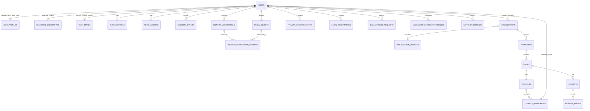

# Profile & Identity / DB vNext — Proposed logical contract

**Status: APPROVED AUTHENTICATION MODEL; PHYSICAL DESIGN PROPOSED / NOT FROZEN · 2026-10-13 Task 1 review**
**Authority:** Canonical v3.7 and Database v1 retain priority; the owner's explicit Google-first update is recorded in the [decision register](2026-10-12-profile-identity-decision-register.md). APPROVED decisions and remaining OPEN parameters are distinct. This update authorizes documentation only; proposed tables are not migrations.
**Branch base:** `design/app-ui-redesign` at `ef1da3b` (previous integration-based design branch archived); **Platform:** Android Kotlin/Compose → NestJS → PostgreSQL/PostGIS; optional Redis challenge service and private S3-compatible media store.

## 1. Approved product boundaries

- Profile root menu must be exactly, in order: **Xem hồ sơ → Cài đặt tài khoản → Quyền riêng tư & Pháp lý → Giới thiệu chủ nhà → Nhận trợ giúp → Đăng xuất**. The shortcuts **Lịch sử thuê** and **Kết nối** are above the menu; "Kết nối" has no approved data/social graph semantics.
- **Xóa tài khoản** is the last action inside **Cài đặt tài khoản**; handle reauthentication, open obligations, lifecycle and retention. It is not a one-tap destructive DB cascade.
- One User may be an operator and tenant concurrently. Existing `tenancy_participants.user_id` may be NULL; ownership and permissions derive from domain relationships, never global roles.
- **Google-first registration (AUTH-01–AUTH-06):** only Google initially creates an account. Later authentication supports Google or Email + Password for the same User. Email OTP supports verification, password recovery and sensitive operations only; it cannot register or log in independently. Contact phone is not phone OTP. Android never holds SMTP credentials or S3 root keys.
- **Initial and editable Profile (PROFILE-01):** persist Google's verified email as the primary login email; seed `display_name` from Google name when present, otherwise request user input. Never infer `legal_name`. Later Google logins must not overwrite user edits. Optional password setup requires secure reauthentication after Google registration; store only a secure hash, preferably Argon2id.
- Static **Terms, Privacy and Help** content is JSON-only Public Content Catalog packaged offline in Android at `app/src/main/assets/public/content/`. PostgreSQL stores version acceptance/consent events, **not a second copy of legal text**.
- Profile avatar, listing/property/room photos, incident media and KYC scans belong to different permission domains. Binary bytes in private S3-compatible storage; metadata and durable references in PostgreSQL.
- KYC MVP *proposal*: CameraX + ML Kit QR/OCR/Face Detection + CompreFace 1:1. Face match is not liveness or document authenticity. No automatic VERIFIED status based on face score alone.
- Notification category preferences, Help FAQ versus support ticket, and payment receive method ownership must remain separate by concern.

## 2. Logical ERD — relationships, not yet tables

- Entities in ALL CAPS reflect existing v1 domain roots when names match; other names are logical candidates. `IDENTITY_VERIFICATION_EVIDENCE` is a link model, not proof an extra physical table is needed.
- Room/Listing/Incident ↔ media links are **domain-specific proposals** pending authority for attachment cardinality, visibility and retention. No generic polymorphic public-media table is approved by this drawing.
- Task 1 proposes `user_emails` 0..1 current row per User, preserving legacy Users with no initialized row. Completed Google-first registration has exactly one verified primary login email; EMAIL-01 excludes secondary login emails in MVP. The earlier 0..N draft is superseded for this slice. `password_credentials` is 0..1 per User; absence means no password login.
- A Profile is initialized for each new Google registration; legacy Users may have none. Missing Google name leaves `display_name` unset until the User supplies it; incomplete-profile access and validation rules remain G2 OPEN.
- Other records may be combined or split after a privacy/uniqueness/index review; no schema cardinality is frozen by Mermaid alone.

## 3. Proposed data boundary matrix

| Logical concern | Candidate fields / constraints for review | Authority and warning |
| --- | --- | --- |
| `users` (existing) | immutable `user_id uuid`; later lifecycle state if approved | Do not replace UUIDs already referenced by tenancy/org/payment |
| `user_profiles` | User PK/FK; `display_name`, initialization/update timestamps; optional avatar only after G5 | PROFILE-01 approved: initial Google name or user input, then User-owned edits; no provider overwrite or inferred legal name. Other fields/public projection remain G2 OPEN |
| `user_emails` | User FK, email address, normalized login key, verified proof metadata, primary designation | Initial primary from verified Google claim approved; one unambiguous primary login lookup; MVP secondary login emails excluded (EMAIL-01); normalization/freshness/reuse mechanisms remain G1-E PROPOSED/OPEN; change security invariant EMAIL-02 approved |
| `auth_identities` | User FK, provider, canonical issuer, subject, link timestamp; principal UNIQUE | Alias-aware lookup preserves existing User IDs; no email identity mirror or silent owner reassignment |
| `password_credentials` | User PK/FK, encoded salted password hash, credential revision, creation/change timestamps | Optional 0..1 credential; setup after secure reauth; same User for both login methods. G1-P/G1-R/G1-S parameter gates remain OPEN |
| `auth_sessions` | user, session identifier/hash, issued/expires/revoked, last seen, auth assurance; hashed secrets only | Session protocol and mandatory reauth still design gates |
| `security_events` | user, actor, event type, occurred_at, limited metadata, safe device/session ref | No raw tokens, OTPs, full sensitive payloads |
| `media_objects` | media ID, uploader, owner/context, private bucket/key, MIME, bytes, SHA-256, upload lifecycle, created/deleted, retention | PostgreSQL is metadata truth; object bytes belong to S3 |
| `identity_verifications` | user, attempt ID/status, method, decision, evidence references, timestamps, reviewer/provenance | Face similarity/result separate from decision; no automatic “KYC VERIFIED” |
| `privacy_consent_events` | user, purpose/version, affirmative/revoke event, timestamp, audit source | Append-only event evidence; clarify valid lawful basis/purposes |
| `legal_acceptances` | user, document ID/locale/version/content hash, accepted_at, context | Distinct from tenancy `terms_acknowledgements` |
| `data_subject_requests` | authenticated requester, access/export/erasure type, received/status/closed, disposition reference | Deletion requests can share lifecycle; do not erase finance/audit illegally |
| `user_notification_preferences` | user, category/channel, chosen state, updated_at | Essential security notices remain mandatory where required |
| `support_requests` | requesting user, category, content, status, assignee, created/closed and protected attachment refs | Separate from public FAQ; authorized internal visibility |
| `organization_profiles` | organization ID, public-safe description, logo/contact display rules | Do not leak primary owner's personal phone/email by default |
| `tenancy_participant_details` | tenancy participant ID, optionally linked User, verified contact/snapshot policy | Nullable User link survives; user Profile must not overwrite history |
| Payment/collection method ownership | User vs Organization separate; provider token/reference only | No new bank-detail storage until actual UI/workflow contract is approved |

## 4. Approved authentication model and proposed resolution contract

The [decision register](2026-10-12-profile-identity-decision-register.md) is authoritative for approval status. The [physical proposal](2026-10-12-profile-identity-foundation-physical-proposal.md) specifies constraints and transactions; its mechanisms remain subject to physical review.

### Registration, Profile and subsequent login

1. Verify Google signature, audience, expiry and supported issuer; only then use issuer + subject to resolve the account. Email and name are claims, never account identifiers for linking.
2. Resolve an existing canonical provider mapping or the supported legacy issuer-derived User candidates before creating anything. If there is one unambiguous existing User, retain it. Conflicting candidates fail closed under G1-A; do not pick by email or move relationships.
3. Only Google registration may atomically create the User, provider mapping, verified primary login email and initial Profile. A missing/unverified email cannot satisfy the registration contract; completion and third-party mailbox freshness proposals remain G1-E OPEN pending owner choice. Do not create fabricated verified contact data.
4. Seed `display_name` from Google name once. When name is absent, leave it unset and request user input. Never copy it to `legal_name`, derive a placeholder from the email or assign a role. User edits are persisted by the Profile operation, never by a later provider-claim refresh.
5. Subsequent Google login resolves the same `user_id` and reads persisted Profile/email. It does not overwrite display name, avatar, contact or primary login email from new Google claims. EMAIL-02 requires reauthentication, verification of the new mailbox, collision checks, atomic update and security audit. The current-email revision/write/session contract is proposed, not approved by that product invariant.
6. For an unmigrated legacy User, fresh verified Google proof may initialize missing records once. Existing Profile rows are never overwritten, including an intentionally empty/cleared display name. Password or OTP requests cannot perform legacy registration/backfill.

### Issuer aliases without rekeying

The current `googlePrincipalUserId` produces different UUIDs for `accounts.google.com` and `https://accounts.google.com`. Keep that function and namespace compatible. The proposed resolver canonicalizes only the provider lookup key to `https://accounts.google.com`, checks both supported legacy derivations using freshly verified subject proof, and binds the existing User without changing its ID. New registration may retain the existing derivation from the verified token's actual issuer; the canonical-principal unique constraint and transaction rollback/retry make alias races converge to one User. No hash inversion or guessed provider backfill.

Every authenticated Google path must use the same resolver, including `IdentityAccessService.authenticateWithGoogle` and `AuthGuard`; a raw deterministic-ID fallback in the guard would bypass alias resolution. Protected requests resolve existing mappings and must not become an alternative registration endpoint. Retire uncoordinated direct-ID writers during the approved cutover; deployment/collision remediation is G1-A OPEN.

### Optional password and recovery

- Google-registered User + secure, purpose-bound reauthentication → optional password setup. Store a salted secure hash only; Argon2id is preferred. Absence of `password_credentials` is meaningful, not a blank/default password.
- Email + Password resolves the persisted primary login email to an existing User, verifies that User's credential, then uses the same application authentication/session contract as Google. Unknown email, missing credential or ambiguous lookup cannot create a User or link a provider.
- Password hashes are keyed by User, not email, so changing a login identifier cannot transfer the credential. Setup/change/recovery serialize on that User and check credential revision so stale proof cannot overwrite a newer credential.
- Recovery OTP authorizes a narrowly scoped password-recovery operation for an existing account. It does not create an account, authenticate the User by itself, attach a Google identity or grant Profile/tenancy access. First-password setup still requires the approved reauthentication contract; eligibility for an account with no password remains G1-R OPEN.
- Session protocol, accepted proofs/age, revocation, password rules/work factors, rate limits and retention are OPEN G1 parameters. Security parameter candidates with evidence/trade-offs are in the Task 1 decision register; none is approved or a runtime default.

## 5. Email OTP proof boundary

`request purpose-bound challenge → secure challenge verifier/counters in Redis → Backend SMTP delivery → atomic one-time proof consumption → authorized email verification / password recovery / sensitive operation on the existing User`.

Redis challenge storage is separate from reconstructable read cache. Verification fails closed when challenge state is missing/unavailable; never substitute `NoopCacheAdapter`. No plaintext OTP in PostgreSQL, Redis or logs. SMTP remains Backend-owned; Gmail is a sender, not a restriction on recipient addresses.

Bind each proof to purpose, target User, stable email row/revision and credential version (or explicit absence for setup). Pending Google-bound completion proof may instead bind verified principal until the new User transaction commits, only if G1-E approves that flow; it never permits OTP-only registration. A proof for email verification cannot reset a password, and recovery proof cannot issue a normal session. PostgreSQL and Redis have no shared transaction: the proposed fail-closed consumption order and retry boundary are in the physical spec. G1-O/G1-R/G1-S must close before runtime implementation.

## 6. Media / KYC privacy and lifecycle

- Four concrete classes: avatar (per User), room/property/listing (domain-owned public versus private), incident evidence (private unless authorized), KYC document front/back/selfie (highly sensitive).
- Upload contract proposal: authenticated create intent → policy checks (size, MIME, owner, content/type limits) → private upload to server/S3 scoped target → verify checksum/scan → durable metadata and context linkage finalized → temporary authorized download. Object key is opaque; **never store presigned URL as persistent ID**.
- Failures: orphan cleanup and expiration, idempotent finalize, retries, object-not-found reconciliation, private bucket default, no S3 root secret in Android, no localhost URLs in app production.
- KYC: CameraX/ML Kit support capture and extraction only. CompreFace 1:1 measures face match, not liveness or document authenticity. Approval/rejection/manual review, retention/destruction, audit and purpose consent **must be agreed before storing live identity documents**.
- Existing `incident_events.attachment_reference` and `payment_claims.evidence_reference` cannot be silently reinterpreted into `media_objects` without compatibility/backfill plan.

## 7. Authorization, consent and lifecycle gates

| Operation | Required enforcement boundary |
| --- | --- |
| View/edit Profile | Authenticated same User; field-level public contact projection must be explicitly defined |
| Set/change password or change primary login email | Existing User + approved purpose-bound reauth/recovery proof, credential revision checks, collision handling and audit; no email-based merge |
| View tenant history | Derive from `tenancies`/`tenancy_participants` incl. historic links; don't duplicate into Profile |
| Update Organization public contact | Relationship-based owner permission, Organization-owned projection |
| Private KYC/incident download | Short-lived access after Backend resource/purpose checks, never merely “knows key” |
| Accept legal/privacy document | Immutable version/hash + authenticated User + occurrence timestamp; contents come from Android Assets |
| Withdraw privacy purpose / delete account | Append event/request and follow reviewed obligations; protect ongoing Tenancy and finance/audit integrity |
| Marketing notification preference | Distinguish optional marketing from essential operational/security notifications |
| Support ticket | Own ticket + restricted internal staff, scoped attachments, audit |

## 8. Approval and execution gates

The only current gate taxonomy is **G1–G7** in the [decision register](2026-10-12-profile-identity-decision-register.md#stable-gate-taxonomy): authentication/security; Profile/organization visibility; legal/privacy/disposition; notifications; media; KYC; support. G1–G3 are partially resolved; G4–G7 remain OPEN. The earlier payment-storage item is DEFERRED / OUT OF SCOPE, not an eighth gate.

AUTH-01–AUTH-06 and PROFILE-01 are approved product behavior. Concrete physical constraints and remaining security parameters still need review; this task changes documentation only. Frozen v1 files and applied migrations stay immutable. The [execution plan](../plans/2026-10-12-profile-identity-foundation-execution.md) assigns database contracts to Profile/Foundation, authentication runtime to Account Verification, and JSON-only asset/UI migration to the Android integration lane.

## Source baseline and references

Profile baseline HEAD `079047b` has local migration tip `000005_optional_sepay_gateway`. Task 1 preflight confirms Payment Integration `55985da` already includes `000006_demo_gateway` and `000007_sepay_production`; neither number is available to Profile. Recheck coordinated inventory before allocation; no number is reserved. The [initial source review](../audits/2026-10-12-profile-identity-foundation-source-review.md) retains historical verification evidence; its former approval recommendations are superseded by this update and the decision register.

Google documents both supported issuer forms and stable subject-based identity. Email is not a stable account key; a third-party mailbox's current ownership may require additional proof even when a Google claim says verified. That recovery/freshness policy remains G1-E/G1-R OPEN; it does not authorize email merging. See [Google backend authentication](https://developers.google.com/identity/sign-in/web/backend-auth).

Argon2id is the preferred approved direction; implementation parameters require review and benchmarking rather than copied defaults. See [OWASP password storage](https://cheatsheetseries.owasp.org/cheatsheets/Password_Storage_Cheat_Sheet.html).

## 9. Task 1 minimal identity readiness (2026-10-13)

The [register's Task 1 review](2026-10-12-profile-identity-decision-register.md#task-1--decision-closure-and-readiness-review-2026-10-13) adds EMAIL-01/EMAIL-02 with explicit owner provenance. Normalization, third-party mailbox freshness, email reuse, security parameters and minimal Profile access/validation remain PROPOSED/OPEN. Read-only review of Account Verification's KYC handoff confirms its auth boundary, not its acceptance of these proposals.

Minimal target: verified canonical Google principal → unchanged User UUID; one current verified primary email row; nullable initial display name requiring self completion; optional encoded hash credential keyed by User. No extra Profile/media/KYC/legal/session tables are authorized by the four-entity scope. Primary-email change replaces the stable row under an email revision, not provider linking, credential transfer or a new identity. Password secret revision and email revision are distinct stale-state guards; rehash is not a secret change. Session issuance must serialize/revalidate both with the eventual common session contract.

Owner-approved normalization lowercases ASCII local-part for a case-insensitive login key, preserves dots/plus tags/original address and lowercases an IDNA A-label domain; international local parts are deferred pending SMTPUTF8 support. This is the owner-approved product policy, including the accepted trade-off for genuinely case-distinct mailboxes; it is not automatic account merging or a general mailbox identity equivalence rule. Source verifier currently drops `hd`, token freshness and nonce metadata; interactive reauth/mailbox authority require auth-lane contract work. Missing/unverified Google email cannot complete today; a proposed user-input/OTP completion exception requires explicit approval and does not make OTP an independent registration method.

The [physical transaction/test matrix](2026-10-12-profile-identity-foundation-physical-proposal.md#46-future-test-matrix--designed-not-executed) covers alias races, duplicate email, profile preservation, stale proofs/credentials, dual legacy Users and rollback. Principal-scoped transaction locking plus full unique constraints is proposed; old direct-ID writers must be fenced and guard/login/session projections cut over together. Ambiguous legacy principal fails closed; operational remediation never selects by email or rekeys references.

**Freeze:** no physical table is frozen. Mandatory schema choices are key normalization/comparison, one-row email/revision/reuse, nullable Profile shape/private-only scope and credential lifecycle/version representation. Exact validation/completion restrictions are activation policies unless selected SQL checks change the shape. G1-P/R/O/S numerical tuning and session/audit activation need owner/auth-lane acceptance and measurements; they must not be silently filled in by repository implementers. Unrelated G2 extensions/G3–G7 can remain OPEN for the minimal identity migration, subject to retaining frozen references and no destructive disposition.

## Final decision closure gate

Use the short [final owner checklist](2026-10-13-profile-identity-final-owner-checklist.md) for F-E1–F-G2 approval, and physical section 4.7 for Account Verification's typed persistence review. Earlier Task 1 audit details are retained as evidence, not additional blanket freeze blockers. The owner selected ASCII case-insensitive local-part; case-only login keys now collide and cannot belong to two Users. Original address and dot/plus aliases stay unchanged; no identity is merged.

Independent four-table physical freeze requires schema-affecting decisions and persistence acceptance only. OTP TTL, session lifetime, Argon2id benchmarks, operational collision remediation and writer cutover remain activation gates under the minimal shape. A runtime choice that actually requires additional durable state reopens only its affected physical dependency; no speculative tables are added to clear runtime blockers.

## Current Minimal Physical Contract approval

The owner's explicit F-E1/F-E2/F-A1/F-C1/F-G2 decisions close the minimal schema business choices; see the register for provenance and exclusions. [Separate vNext logical/physical addendum](../../database/vnext/identity-foundation/README.md) is PHYSICAL_REVIEW_COMPLETE_ACCEPTANCE_PENDING. No table is yet labelled REVIEWED_FROZEN: Account Verification must accept the affected persistence dependency contract or identify an actual schema-changing objection. Exact name/password/OTP/session parameters and mailbox/recovery UX remain independent activation gates, not reasons to block this additive four-table shape.
