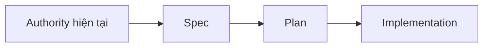

# Specs

`docs/superpowers/specs/` lưu **design specification** và các snapshot thiết kế đã được chốt tại thời điểm tương ứng.

Một spec trả lời chủ yếu các câu hỏi:

- đang thiết kế cái gì;
- boundary và responsibility nằm ở đâu;
- constraint/invariant nào phải được giữ;
- những lựa chọn kiến trúc nào đã được chấp nhận tại thời điểm đó.

Spec là development artifact. Khi đọc spec cũ, luôn đối chiếu với [`../../contexts/source-of-truth.md`](../../contexts/source-of-truth.md) và authority hiện hành trước khi dùng nó làm cơ sở implementation mới.

Không rewrite historical spec để phản ánh trạng thái mới; nếu semantics hiện tại đã thay đổi, cập nhật authority/context hoặc tạo artifact mới phù hợp.
