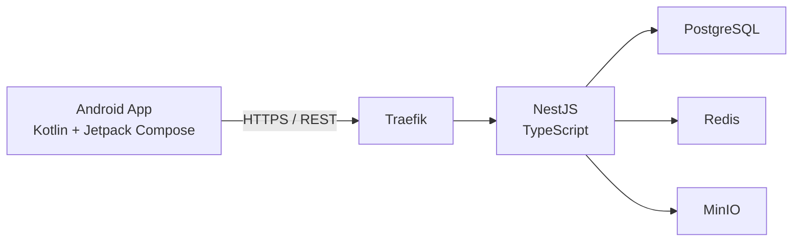
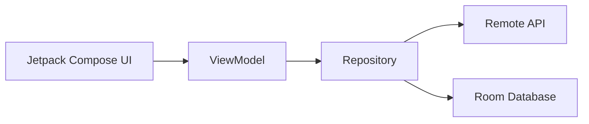
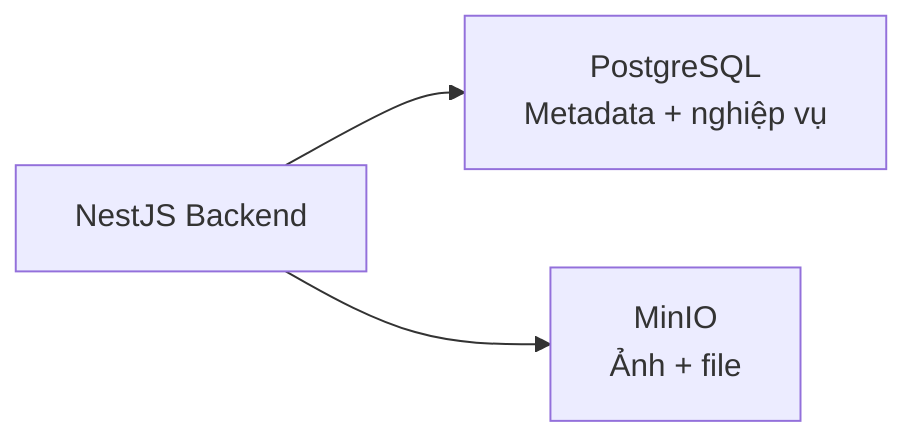
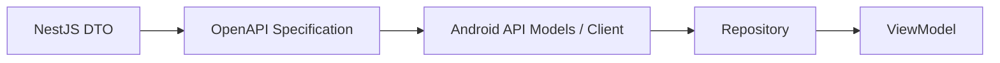
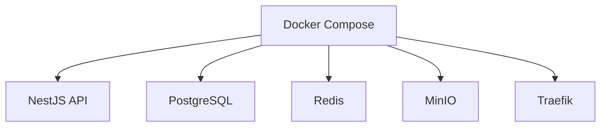

# Tóm tắt Tech Stack TrọƠi

Tài liệu này ghi nhận **tech stack đã chốt** cho ứng dụng mobile TrọƠi và hạ tầng backend hỗ trợ.

TrọƠi được phát triển theo hướng **Android-first**, backend **self-hosted**, kiến trúc ưu tiên tính đơn giản, rõ ràng và dễ duy trì. Mục tiêu là để toàn bộ team — bao gồm cả khi sử dụng AI coding assistant — cùng làm việc trên một stack thống nhất, tránh tự ý thay đổi công nghệ hoặc kiến trúc giữa các feature.

---

## 1. Tổng quan tech stack

| Khu vực | Công nghệ | Vai trò |
| --- | --- | --- |
| Mobile Platform | Android | Nền tảng ứng dụng chính |
| Mobile Language | Kotlin | Ngôn ngữ chính cho Android |
| Mobile UI | Jetpack Compose | Xây dựng giao diện Android theo hướng declarative |
| Mobile Architecture | MVVM + Repository | Tổ chức state, logic màn hình và truy cập dữ liệu |
| Dependency Injection | Hilt | Quản lý dependency trên Android |
| Async / Reactive State | Kotlin Coroutines + Flow | Xử lý bất đồng bộ và state phản ứng |
| HTTP Client | Retrofit + OkHttp | Giao tiếp với backend API |
| Serialization | kotlinx.serialization | Chuyển đổi JSON và Kotlin object |
| Local Database | Room | Lưu trữ dữ liệu cục bộ có cấu trúc |
| Local Preferences | DataStore | Lưu preference và state nhỏ trên thiết bị |
| Image Loading | Coil | Tải và cache ảnh trong Compose |
| Backend | NestJS | Framework backend chính |
| Backend Language | TypeScript | Ngôn ngữ backend |
| Backend Architecture | Modular Monolith | Backend chia module nhưng vẫn là một ứng dụng triển khai thống nhất |
| Primary Database | PostgreSQL | Nguồn dữ liệu nghiệp vụ chính |
| Cache / Temporary State | Redis | Cache và dữ liệu tạm thời |
| Object Storage | MinIO | Lưu file/ảnh theo chuẩn S3-compatible |
| API Contract | OpenAPI / Swagger | Contract giữa backend và Android |
| Reverse Proxy | Traefik | Routing và HTTPS cho backend self-hosted |
| Containerization | Docker | Đóng gói service và dependency |
| Multi-container Management | Docker Compose | Quản lý môi trường nhiều container |
| CI/CD | GitHub Actions | Build, test và validation tự động |
| UI/UX Design | Figma | Source of truth cho UI/UX và Design System |

### Sơ đồ tổng quan

---

# 2. Mobile Application

## Kotlin

**Kotlin** là ngôn ngữ chính để phát triển ứng dụng Android của TrọƠi.

Kotlin có type system chặt chẽ, hỗ trợ null-safety và tích hợp trực tiếp với hệ sinh thái Android. Việc sử dụng Kotlin giúp dự án làm việc trực tiếp với Android SDK mà không phải thêm một lớp abstraction cross-platform không cần thiết ở giai đoạn hiện tại.

---

## Jetpack Compose

**Jetpack Compose** là framework UI chính của ứng dụng Android.

Compose sử dụng mô hình giao diện declarative: UI được render từ state thay vì thao tác thủ công với View. Cách này phù hợp với kiến trúc state-driven, giúp component dễ tái sử dụng, dễ kiểm thử và dễ đồng bộ với Design System trong Figma.

---

## MVVM + Repository

Ứng dụng Android sử dụng **MVVM kết hợp Repository Pattern**.

Vai trò chính của từng lớp:

- **Compose UI**: hiển thị state và gửi user interaction.
- **ViewModel**: quản lý state của màn hình và điều phối logic.
- **Repository**: cung cấp một boundary thống nhất cho việc truy cập dữ liệu.
- **Remote / Local Data Source**: giao tiếp với backend API hoặc local database.

Source code mobile nên ưu tiên tổ chức theo **feature-first**, để mỗi feature chứa phần UI, state và data logic liên quan thay vì chia toàn bộ project chỉ theo technical layer.

---

## Hilt

**Hilt** được dùng cho Dependency Injection trên Android.

Hilt chịu trách nhiệm cung cấp các dependency như API client, Repository, Room Database và các application service. Việc inject dependency tập trung giúp giảm coupling, tránh khởi tạo object thủ công ở nhiều nơi và giữ wiring nhất quán giữa các feature.

---

## Kotlin Coroutines + Flow

**Kotlin Coroutines** được dùng để xử lý các tác vụ bất đồng bộ như gọi API, truy vấn database hoặc thao tác file mà không block UI thread.

**Flow** được dùng cho stream dữ liệu và state thay đổi theo thời gian. Flow tích hợp tốt với ViewModel và Jetpack Compose để xây dựng UI phản ứng theo state.

---

## Retrofit + OkHttp

**Retrofit** là HTTP client chính để Android giao tiếp với backend TrọƠi.

**OkHttp** là lớp networking phía dưới, đảm nhiệm connection, interceptor, header, authentication và logging request/response.

API model và endpoint phía Android phải bám theo OpenAPI contract của backend, không tự định nghĩa schema riêng.

---

## kotlinx.serialization

**`kotlinx.serialization`** được dùng để serialize và deserialize dữ liệu giữa JSON và Kotlin model.

Thư viện này tích hợp trực tiếp với Kotlin, giúp model có typing rõ ràng và giữ cách mapping dữ liệu nhất quán trong toàn ứng dụng.

---

## Room

**Room** là local relational database trên Android, xây dựng trên SQLite.

Room được dùng cho local persistence hoặc cache có cấu trúc khi cần. Nó không thay thế database phía server; **PostgreSQL vẫn là source of truth của dữ liệu nghiệp vụ**.

---

## DataStore

**DataStore** được dùng để lưu các preference và state nhỏ trên thiết bị.

Ví dụ:

- theme;
- ngôn ngữ;
- onboarding state;
- các cấu hình local không mang tính quan hệ.

Thông tin nhạy cảm không được lưu plaintext trong DataStore.

---

## Coil

**Coil** được sử dụng để tải và cache ảnh trong ứng dụng Android.

Các nội dung phù hợp gồm ảnh phòng, ảnh sự cố, avatar hoặc các media được hiển thị trong Jetpack Compose.

---

# 3. Backend

## NestJS

**NestJS** là framework backend chính của TrọƠi.

NestJS cung cấp cấu trúc rõ ràng dựa trên module, controller, service, dependency injection, validation và HTTP API. Convention có sẵn của NestJS giúp backend duy trì cùng một kiểu tổ chức giữa các domain khác nhau.

---

## TypeScript

**TypeScript** là ngôn ngữ chính của backend.

Static typing giúp tăng độ an toàn khi làm việc với domain model, DTO, service và API contract, đồng thời giảm lỗi do object structure không thống nhất.

---

## Modular Monolith

Backend được xây dựng theo kiến trúc **Modular Monolith**.

Các domain nghiệp vụ được tách thành module độc lập về mặt tổ chức code nhưng vẫn chạy trong cùng một backend application.

Các module dự kiến ban đầu gồm:

- Authentication;
- Properties;
- Rooms;
- Tenancies;
- Billing;
- Receipts;
- Incidents;
- Notifications;
- Audit History.

Kiến trúc này giữ boundary giữa các domain đủ rõ mà không đưa distributed-system complexity vào MVP.

---

# 4. Data & Storage

## PostgreSQL

**PostgreSQL** là relational database chính và là **authoritative data store** của TrọƠi.

PostgreSQL lưu các dữ liệu nghiệp vụ bền vững như:

- user;
- property;
- room;
- tenancy;
- charge;
- payment record;
- receipt;
- incident;
- permission;
- operational history.

Dữ liệu của TrọƠi có nhiều quan hệ và cần transaction/data integrity rõ ràng, nên PostgreSQL phù hợp làm nguồn dữ liệu trung tâm.

---

## Redis

**Redis** dùng cho dữ liệu tạm thời hoặc dữ liệu cần truy cập nhanh trong bộ nhớ.

Các use case có thể gồm:

- cache;
- rate limiting;
- OTP state;
- session metadata;
- state ngắn hạn.

Redis **không phải source of truth** cho dữ liệu nghiệp vụ.

---

## MinIO

**MinIO** là object storage self-hosted tương thích S3.

MinIO dùng để lưu các file nhị phân như:

- ảnh phòng;
- ảnh sự cố;
- attachment của biên nhận;
- avatar;
- tài liệu upload.

PostgreSQL chỉ lưu metadata và object reference; file thật nằm trong MinIO.

Việc dùng S3-compatible API cũng giúp storage layer không bị khóa cứng vào một implementation duy nhất.

---

# 5. API Contract

## OpenAPI / Swagger

**OpenAPI** là contract chính thức giữa backend NestJS và ứng dụng Android.

Contract mô tả:

- endpoint;
- request model;
- response model;
- validation;
- status code;
- error structure.

**Swagger** được dùng ở backend để generate và expose OpenAPI specification.

OpenAPI đóng vai trò source of truth để mobile và backend không tự phát triển schema khác nhau.

---

# 6. Infrastructure

## Docker

**Docker** được dùng để đóng gói backend service và các infrastructure dependency thành container.

Điều này giúp môi trường development và deployment sử dụng cùng version và configuration, giảm khác biệt giữa máy của các thành viên trong team.

---

## Docker Compose

**Docker Compose** dùng để quản lý môi trường nhiều container trong quá trình development và triển khai self-hosted ban đầu.

Môi trường có thể gồm:

- NestJS API;
- PostgreSQL;
- Redis;
- MinIO;
- Traefik.

Mục tiêu là để toàn bộ backend environment có thể khởi động theo cùng một cấu hình thay vì mỗi thành viên tự cài từng dependency theo cách riêng.

---

## Traefik

**Traefik** là reverse proxy của hạ tầng backend self-hosted.

Các trách nhiệm chính:

- routing request tới backend service;
- HTTPS/TLS termination;
- domain/subdomain routing;
- tích hợp với Docker service.

Các application service không cần expose trực tiếp ra Internet mà đi qua Traefik.

---

# 7. Development Tooling

## GitHub Actions

**GitHub Actions** là nền tảng CI/CD của dự án.

Workflow tự động sẽ được sử dụng để kiểm tra các thay đổi thông qua các bước như:

- Android build;
- backend build;
- automated test;
- static analysis;
- API contract validation.

Workflow cụ thể có thể thay đổi theo codebase, nhưng GitHub Actions là nền tảng automation đã được chọn.

---

## Figma

**Figma** là source of truth cho UI/UX và Design System của TrọƠi.

Figma định nghĩa các nền tảng và component giao diện trước khi được implement trong Jetpack Compose, bao gồm:

- màu sắc;
- typography;
- spacing;
- component state;
- reusable component;
- application screen.

Android implementation phải bám theo Design System chung trong Figma thay vì mỗi feature tự tạo style riêng.
