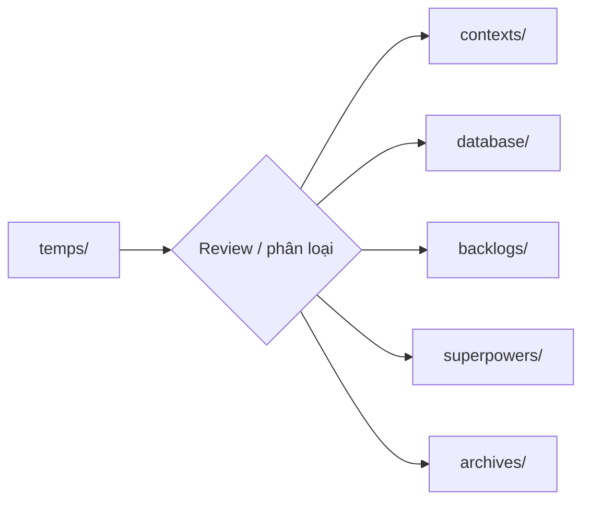

# Tài liệu tạm thời

`docs/temps/` là khu staging cho tài liệu chưa thuộc chính thức vào hệ thống documentation hoặc vẫn cần review trước khi phân loại.

File trong thư mục này:

- không phải authority;
- có thể chưa hoàn chỉnh, stale, trùng lặp hoặc chưa được xác minh;
- phải được review trước khi chuyển sang `contexts/`, `database/`, `backlogs/`, `superpowers/`, `archives/` hoặc khu vực lâu dài khác;
- không được agent, test hoặc implementation xem như nguồn ổn định.

Việc đưa một file ra khỏi `temps/` là một quyết định phân loại rõ ràng. Không tự động promote tài liệu chỉ vì nó đã nằm trong repository lâu ngày.
