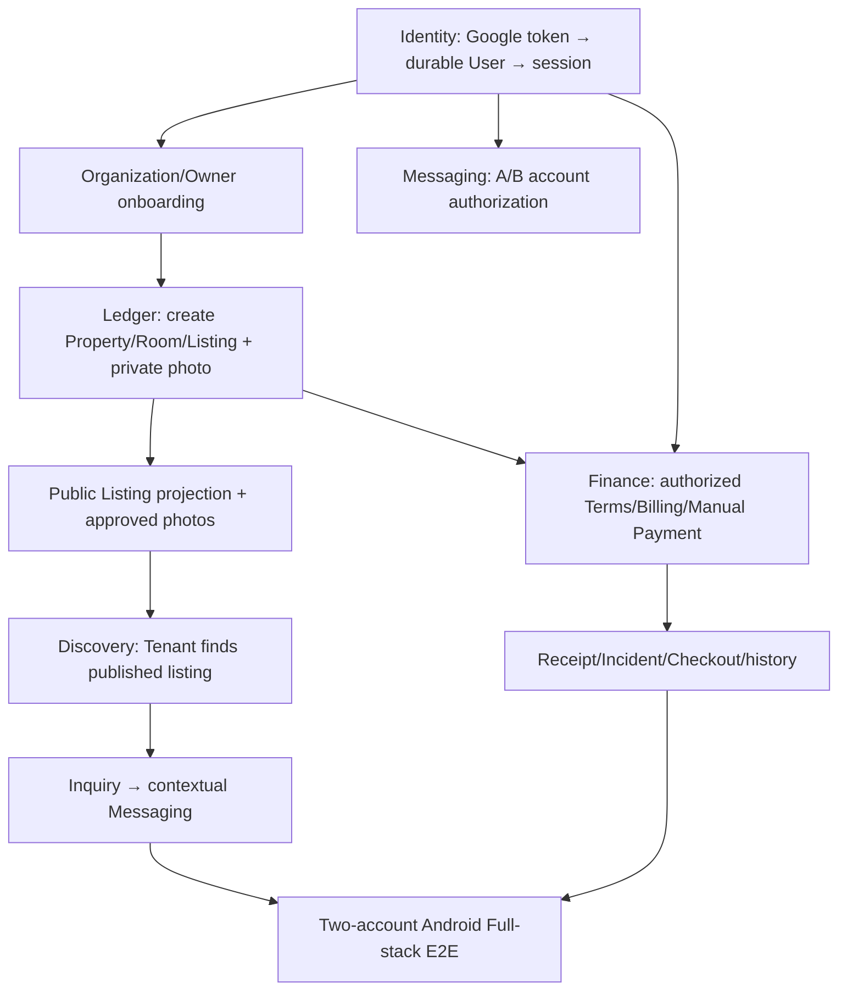

# TrọƠi — Integration Gap Register & Acceptance Checklist

> **Snapshot:** 14/10/2026  
> **Baseline:** `integration/discovery-ledger-ui-preview` — `36ee8f5c00a58743aad2d6273b20887975f296f6`  
> **Scope:** Hồ sơ / Identity, Tin nhắn, Sổ vận hành, Discovery; và các phụ thuộc Full-stack.  
> **Quy tắc:** Ghi nhận tình trạng theo source và bằng chứng kiểm thử đã có. **Không diễn giải “đã có code” thành “đã PASS Android Full-stack”.**  
> **Trạng thái tổng:** `PARTIAL_WITH_GATES` — **chưa** `PASS_FULLSTACK`.

## 0. Quy ước trạng thái

| Ký hiệu | Ý nghĩa |
|---|---|
| `IMPLEMENTED` | Đã tìm thấy code/route/UI, chưa mặc định chứng minh chạy E2E. |
| `PASS_BACKEND` | Backend/API/DB/storage contract đã qua test phù hợp; chỉ chứng nhận phạm vi backend được nêu, không suy ra Android hoặc live provider. |
| `PASS_ANDROID` | Android build/unit/instrumentation/device evidence đã qua; phải ghi rõ component hay journey, thiết bị và giới hạn. Không tự suy ra backend hoặc Full-stack. |
| `PASS_FULLSTACK` | Hành trình nghiệm thu chạy qua Android và Backend/API/storage thật theo DoD, gồm principal/ownership và readback tương ứng; chỉ dùng khi có evidence cho cả hai đầu. |
| `BLOCKED` | DoD chưa đạt vì gate/phụ thuộc chưa mở hoặc evidence còn thiếu; nêu rõ blocker và không nâng thành PASS. |
| `NOT_IMPLEMENTED` | Chưa có cơ chế production tương ứng. |
| `DEFERRED` | Chưa bắt buộc để đạt MVP; cần chốt trước production khi thích hợp. |
| `DRAFT_PR` | Thay đổi còn trong draft pull request; chưa được xem là implementation đã nghiệm thu. |

**Không dùng checklist trống để suy luận rằng code chưa có**: một số tài liệu P5.2B cũ đã bị supersede bởi P5.2C về ảnh Asset. Mọi kết luận lấy baseline tại HEAD nêu trên.

## 1. Tổng quan bốn module

| Module | Đã có | Thiếu / chưa được chứng minh | Trạng thái |
|---|---|---|---|
| **Hồ sơ (Profile/Identity)** | UI Profile/Settings/Onboarding; lưu tên hiển thị; Google token verifier + durable resolver đã code; Organization create route/client adapter exists; private avatar API/storage and Android picker/client readback slice added | Mở phiên Google cho User thật, đăng ký mới, approved session/reauth, usable Organization onboarding, OTP có provider, preference, KYC, Android E2E | **`BLOCKED` — P0; có các slice `PASS_BACKEND`/`PASS_ANDROID`, runtime Identity gate OFF** |
| **Tin nhắn (Messaging)** | Backend PostgreSQL, MinIO ảnh riêng tư, authorization A/B/C, Android Messages UI, Inquiry/Tenancy context | Hai Google account thật → gửi/nhận/ảnh → logout/restart; UI/device QA; một số reliability/scaling | **`PASS_BACKEND` + `PASS_ANDROID` (component); Full-stack P0 `BLOCKED`** |
| **Sổ (Ledger)** | Property/Room/Listing, AssetWizard, ảnh riêng tư MinIO, Tenancy/Terms, Billing/Manual Payment/Deposit/Receipt, Incident/Checkout/History; Mock Ledger offline và public photo projection đã có code | Owner Organization thật; Asset/Payment E2E; PostgreSQL/MinIO photo authorization/readback; crash recovery / due day | **`PASS_BACKEND` + `PASS_ANDROID` (component); Full-stack P0 `BLOCKED`** |
| **Discovery** | UI feed/search/filter/sort/compare/detail, Google Maps, radius query, Inquiry entry; Android now loads owner-approved public photo covers/details | Owner publish → Tenant sees listing/photo → Inquiry → Messaging full flow; PostgreSQL/MinIO and device acceptance; map/device; favorites persistence; geocoding PR #10 chưa merge | **`PASS_BACKEND` + `PASS_ANDROID` (component); Full-stack P0 `BLOCKED`** |

### Phụ thuộc trọng tâm

---

## 2. Hồ sơ — Profile / Identity / Organization

**Kết luận:** Profile chưa đủ để người dùng mới đăng nhập và sử dụng trọn bộ app. Đây là **blocker có tác động rộng nhất** lên các module khác.

### Đã triển khai / có bằng chứng

- [x] Giao diện Profile, Settings, Security, trang trợ giúp và luồng Onboarding chủ trọ ba bước.
- [x] `user_profiles.display_name` có thao tác cập nhật/đọc lại PostgreSQL qua principal được cấp quyền (`PASS_BACKEND`; Identity runtime gate remains OFF).
- [x] Google ID token verifier; `GooglePrincipalResolver` giải quyết binding `auth_identities` và từ chối xung đột (kiểm thử cô lập).
- [x] Không tự động tạo User bằng Google `sub` hoặc claim phòng demo trong Identity foundation mới.
- [x] OCR CCCD hỗ trợ **gợi ý nhập liệu**, không xác minh căn cước và không tạo quyền sở hữu.

### Gaps và việc cần làm

| ID | Ưu tiên | Vấn đề | Điều kiện nghiệm thu (DoD) | Trạng thái |
|---|---|---|---|---|
| `PRO-P0-01` | **P0** | `TROOI_IDENTITY_FOUNDATION_RESOLUTION_ENABLED` mặc định off; cutover/session/audit chưa hoàn tất | Google thật → durable User đúng binding; AuthGuard cùng principal; refresh/restart/logout/revoke không mâu thuẫn; tài khoản không hợp lệ bị từ chối | `BLOCKED` overall. `G1-A PASS_BACKEND` slice: explicit immutable `(google, canonical issuer, subject)` binding is required; deterministic UUID-only auto-binding is removed, email is never used, ambiguous/inconsistent bindings fail closed. `G1-S PASS_BACKEND` backend slice: additive `000016_identity_sessions`; gated nonce challenge, opaque hashed access/refresh exchange, refresh rotation/reuse family revocation, logout/revoke-all and redacted append-only events. `identity-foundation.integration.ts` 2/2 and `identity-sessions.integration.ts` 1/1 pass against isolated PostgreSQL; the session test additionally asserts unset/false gate emits no challenge or DB event, active session resolves through the production AuthGuard to its durable User, logout/revoke-all are denied on the next guarded request, access/idle/absolute expiry, and atomic rollback of create/logout/revoke-all if the audit insert fails. Android nonce/session transport, Keystore persistence and fail-closed refresh failure/replay handling pass component tests on API 37 (`PASS_ANDROID`). Read-only preflight tool and tests are implemented; the complete reviewed manifest/hash still must be run and approved. Physical-device Keystore and live-account acceptance remain pending; runtime gate stays OFF |
| `PRO-P0-02` | **P0** | Người dùng Google mới chưa đăng ký được | Quy trình đăng ký có xác minh email, không đụng ownership lịch sử, không tạo User giả, test trường hợp alias/collision | `PASS_BACKEND` slice: explicit `/register/google` requires verified email, fresh `auth_time`, one-use request nonce and normalized-email uniqueness; creates User only in registration transaction and never creates Organization. Isolated PostgreSQL covers success, unverified email, email collision, nonce replay and no partial User. `PASS_ANDROID` component: Backend signup exposes a Google-only registration action, obtains a `REGISTER` challenge, and sends the proof only to `/register/google`; API 37 UI and MockWebServer contract tests pass. Live Google registration remains `BLOCKED`; Identity runtime gate stays OFF |
| `PRO-P0-03` | **P0** | Organization create route/client có sẵn nhưng chủ trọ chưa thể hoàn tất onboarding trong app | Một User được ủy quyền hoàn thành onboarding → tạo Organization/role thực trong PostgreSQL; truy cập Sổ được; outsider không thể nhận quyền | `BLOCKED` overall. `PASS_BACKEND`: protected reauth challenge/proof requires fresh Google `auth_time` ≤5m and matching immutable User binding; proof is bound to current User+session and operation purpose, expires in 5m, and is consumed atomically with Organization insert; replay/stale proof fails. PostgreSQL tests cover create/replay/stale-auth/audit. `PASS_ANDROID` component: Operator action now requests authenticated challenge, nonce-bound Credential Manager proof, backend reauth proof, then sends proof with create; MockWebServer verifies authenticated endpoints and exact create payload. Real Google `auth_time` availability/freshness, device interaction and live owner onboarding remain unverified, so full P0 is blocked |
| `PRO-P0-04` | **P0** | Luồng hai tài khoản trên Android chưa được nghiệm thu | Owner/Tenant login, chuyển tài khoản, restart, logout/relogin; mỗi người chỉ đọc dữ liệu có quyền | `BLOCKED` |
| `PRO-P1-01` | P1 | OTP email/phone thực và proof-bound flow còn thiếu | OTP server-side, TTL/cooldown/attempt limit/replay protection, đúng User/operation; test chống chiếm quyền | `BLOCKED` — no SMTP/SMS provider or SDK is configured. Removed Debug's fixed `123456` acceptance; Debug and backend modes now fail closed. Unit test `ContactOtpSubmitTest`, instrumentation `otpCannotBeSentOrVerifiedInMockOrBackendModeWithoutAProvider`, and `interruptedOtpNeverShowsVerificationWithoutAProvider` pass (2026-10-15). Needs an approved provider/sender sandbox and delivery policy before OTP can be implemented; no OTP is exposed or faked |
| `PRO-P1-02` | P1 | Đổi email, password setup/change/reset, PIN, reauthentication thiếu hợp đồng an toàn | API có proof và audit, session invalidation, không có UI giả thành công | `BLOCKED` — proposed Google-only MVP policy in `docs/temps/Credential_Changes_MVP_Policy_Draft_2026-10-15.md`; email stays metadata on existing User and requires same-subject fresh verified Google proof; password/PIN setup and recovery remain unavailable. Await explicit approval before implementation |
| `PRO-P1-03` | P1 | Avatar riêng tư cần picker và authenticated owner readback Android | Owner tải ảnh JPEG/PNG ≤2 MB → private storage + metadata → restart/cross-device readback; User khác bị từ chối | `PASS_BACKEND` — additive `000015_user_profile_avatars`, principal-scoped controller/service contract, private MinIO, replacement/recovery intent and hash-checked readback pass isolated PostgreSQL/MinIO integration. `PASS_ANDROID` (component) — private owner API transport uses only `/identity-access/profile/avatar`, bearer token and no client owner ID; profile picker action appears only when Backend upload callback is provided (API 37 Compose test). Android client validates selected media, pins the session token/User, and requires exact-byte API readback before success. `PASS_FULLSTACK` remains `BLOCKED`: live approved Identity session, real selected-photo upload/readback, restart/cross-device and second-User denial are not accepted end-to-end |
| `PRO-P1-04` | P1 | Preferences/notifications vẫn là local UI state | Save/refresh qua API, persisted theo User và có default an toàn | `BLOCKED` pending product approval of category/channel/default semantics; proposed secure MVP and acceptance criteria in `docs/temps/Notification_Preferences_MVP_Policy_Draft_2026-10-15.md`. No fake persistence or notification delivery added |
| `PRO-P2-01` | P2 / security gate | Trường thông tin cá nhân bổ sung, CCCD/KYC lưu chứng cứ/review | Data contract/retention/RBAC/manual review được duyệt; OCR không tự xác nhận KYC | `BLOCKED` pending explicit approval of `docs/temps/Identity_KYC_MVP_Policy_Draft_2026-10-15.md`; the draft proposes optional local OCR and no retained evidence/verified state for MVP. No schema/API/KYC claim was added |
| `PRO-P2-02` | P2 | Screenshot, dark mode, font 200%, TalkBack, keyboard, camera OCR | Thiết bị thực/emulator có bằng chứng cho mọi trạng thái quan trọng | Partial `PASS_ANDROID` component: API 37 `NativeAccountEntryTest` passes 4/4; Backend email-change unavailable state remains reachable at 200% font in light/dark. Captured and visually inspected the email screen and blocked-state dialog at 320dp in both themes ([light screen](evidence/PRO-P2-02-font200/email-settings-font2-light.png), [light dialog](evidence/PRO-P2-02-font200/email-change-blocked-font2-light.png), [dark screen](evidence/PRO-P2-02-font200/email-settings-font2-dark.png), [dark dialog](evidence/PRO-P2-02-font200/email-change-blocked-font2-dark.png)); text and actions fit without clipping. `AccountSecurityUiTest.backendLoginEmailGateCanBeActivatedByKeyboard` also passes on API 37 using Compose focus and an injected Enter event. Overall remains `BLOCKED` pending TalkBack, physical-keyboard traversal, camera/OCR, and broader real-device visual acceptance |

**Quan trọng về Recovery của Duy Anh:** Có code email OTP/login grant cũ nhưng **không copy** `000008_login_otp` vào baseline vì `000008_identity_foundation` đã frozen. Nếu tái triển khai, dùng migration mới **sau `000011`** và bind OTP vào *durable User* đã resolve; không `ensureUser()` theo `sub`, không claim seed tự động. OTP của Recovery chưa nằm trong app baseline dưới dạng Backend flow hoạt động.

---

## 3. Tin nhắn — Messaging + PostgreSQL + MinIO

**Kết luận:** **MinIO Messaging đã chạy trong bài test Backend thật**, không cần viết lại hệ thống lưu ảnh từ đầu. Chưa đủ bằng chứng Android E2E với hai Google User thật.

### Đã triển khai / có bằng chứng

- [x] Contextual conversations theo **Inquiry** và **Tenancy**, sender/membership do Backend xác định.
- [x] PostgreSQL lưu conversation, participants, immutable messages, attachment metadata, read watermark.
- [x] MinIO lưu **private JPEG attachments**; API tải ảnh đã xác thực; không phát public bucket URL.
- [x] Bài test HTTP cô lập: A/B gửi–nhận, đọc lại sau DB/service reconnect, C/anonymous bị chặn, ảnh riêng tư readback `1/1 PASS` trong handoff.
- [x] Android UI có text/image, gallery, thumbnail camera, draft, loading/retry, refresh khi resume, đường vào từ Inquiry/Tenancy.
- [x] Các negative tests ngăn sender spoofing, account-switch sau dispatch, refresh cũ che kết quả send.

### Gaps và việc cần làm

| ID | Ưu tiên | Vấn đề | DoD | Trạng thái |
|---|---|---|---|---|
| `MSG-P0-01` | **P0** | Chưa test A/B bằng Google login/Identity thật | Hai User bind thật → Inquiry/Tenancy authorized → trao đổi text/JPEG trên emulator → DB/MinIO readback | `BLOCKED` bởi Identity |
| `MSG-P0-02` | **P0** | Chưa nghiệm thu UI camera/gallery/restart/account-switch | Ảnh hiển thị lại sau restart; không rò ảnh giữa tài khoản; lỗi gửi giữ draft; scroll/keyboard ổn | `BLOCKED` — `PASS_ANDROID` component: `NativeMessagingStatesTest.rejectedLocalSaveKeepsDraftAndValidatesBeforeCallingTheRepository` passes on API 37, asserting oversize rejection before repository call, retained draft after save failure, and no success state. Authenticated camera/gallery upload, restart, and account-switch isolation remain unverified |
| `MSG-P0-03` | **P0** | Inquiry → Message sau relaunch chưa end-to-end | Inquiry nhận ID thật, mở conversation, không tạo trùng; sau restart vào được hội thoại đã có | `BLOCKED` |
| `MSG-P1-01` | P1 | Lịch sử chưa pagination; response Android giới hạn 3 MB | Phân trang/cursor ổn định, history dài tải dần, không nhân đôi hoặc mất tin | `PASS_BACKEND` + `PASS_ANDROID` (component); `PASS_FULLSTACK` remains `BLOCKED` pending authenticated API-backed device readback |
| `MSG-P1-02` | P1 | Read watermark có race khi cập nhật đồng thời | Watermark đơn điệu, không lùi trong race test | `PASS_BACKEND` — isolated PostgreSQL/MinIO HTTP integration passes repeated concurrent newer/stale updates and asserts the persisted watermark never regresses |
| `MSG-P1-03` | P1 | MinIO orphan cleanup mới best-effort, không crash-safe | Retry/reconciliation an toàn sau process kill giữa upload và DB commit | `PASS_BACKEND` — additive migration `000014` persists attachment intents before PUT; row locks serialize in-flight PUT/commit against recovery; startup removes stale uncommitted objects after a 15-minute grace and preserves committed attachments. Isolated PostgreSQL/MinIO HTTP integration now also `SIGKILL`s a real child process after confirmed PUT and before DB commit, then verifies startup cleanup; live-provider/Android acceptance remains separate |
| `MSG-P2-01` | P2 | Chưa có push notification/background delivery, performance/stress | Định nghĩa sản phẩm, triển khai khi ngoài-MVP cần | `DEFERRED` |

**Ràng buộc hiện tại:** text tối đa 4.000 ký tự; tối đa 5 JPEG/tin, tối đa 2.000.000 byte/ảnh. Kết quả `1/1` là **một integration test với nhiều assertion**, không phải chứng nhận live provider hay màn Android end-to-end.

---

## 4. Sổ — Ledger / Rental Operations / Finance

**Kết luận:** Backend nghiệp vụ của Sổ tương đối đầy đủ cho MVP, có ảnh riêng tư MinIO và tests. Blocker nằm ở Owner authorization, refresh Mock offline và hành trình Android end-to-end.

### Đã triển khai / có bằng chứng

- [x] Property → Room → Listing; asset fields, tiện nghi multi-select, draft/publish/archive được code.
- [x] `AssetWizard → BackendTroOiRepository → authenticated Listing media API → PostgreSQL metadata + private MinIO bytes`; JPEG/PNG, quyền chủ, outsider denial, ordering/retry/readback đã test Backend.
- [x] Migration additive `000010_listing_asset_details` và `000011_listing_asset_media` (không thay frozen `000008`).
- [x] Tenancy/participants/Terms có billing day; Billing RENT/ELECTRICITY/WATER; manual Payment/Deposit/Receipt; Incident/Checkout/history.
- [x] Manual Payment có provenance **`USER_RECORDED`** cho `MANUAL_CASH` / `MANUAL_TRANSFER`, không được mô tả thành `PROVIDER_VERIFIED`.

### Gaps và việc cần làm

| ID | Ưu tiên | Vấn đề | DoD | Trạng thái |
|---|---|---|---|---|
| `LED-P0-01` | **P0** | Owner không có Organization/role production do onboarding chưa nối Backend | Google Owner thật → tạo Organization → tạo Property/Room có quyền → outsider 403 | `BLOCKED` bởi Profile |
| `LED-P0-02` | **P0** | Mock Sổ có thể lỗi khi DemoPay `localhost:3001` offline | Mock Owner/Tenant mở Sổ khi không chạy DemoPay, vẫn thấy fixture operations/historical finance với nhãn rõ; checkout/action online lỗi minh bạch, không fake verified Payment | `PASS_ANDROID` — `:app:testDebugUnitTest --tests com.trooi.app.core.model.FixtureCatalogTest.mockLedgerLoadsHistoricalFixtureWhenDemoPayIsOffline` (2026-10-14) |
| `LED-P0-03` | **P0** | Chưa nghiệm thu AssetWizard upload từ Android → MinIO → app | Owner chọn JPEG/PNG, save/publish, reload/restart hiển thị đúng, thử outsider, thứ tự/cover/remove | `BLOCKED` — `PASS_BACKEND` for authenticated HTTP/private MinIO upload, readback, owner scope and public approval; `PASS_ANDROID` for the isolated AssetWizard save-rejection/state-retention component (`NativeRemainingStatesTest` 1/1); authenticated API-backed upload/reopen/restart device flow remains unverified |
| `LED-P0-04` | **P0** | Chưa test Terms → Billing → Manual Payment → Receipt trên Android | Ghi cash/transfer thật do operator xác nhận; Backend trả `USER_RECORDED`, phân bổ Charge/Deposit, readback hai phía qua restart | `BLOCKED` |
| `LED-P0-05` | **P0** | Incident/Checkout/history chưa có full device test | Tenant báo sự cố → Owner cập nhật → checkout; history/Payment không bị xóa sau restart | `BLOCKED` |
| `LED-P0-06` | **P0** | Scenario vòng đời thuê chưa có authenticated Android journey | Có scenario versioned executable với assertions DB/API/ảnh/quyền/lịch sử | `PASS_BACKEND` — J04 runner combines PostgreSQL lifecycle/finance history with real HTTP identity resolution, private MinIO photo APIs, outsider denial, linked-Tenant read and Nest/DB restart readback; live Google and Android acceptance remain separate gates |
| `LED-P0-07` | **P0** | Public photo projection của ảnh Asset chưa được nghiệm thu end-to-end | Có chính sách duyệt/publish ảnh và route public chỉ cho tin PUBLISHED/đủ quyền; không lộ owner media/private object key | `PASS_BACKEND` + `PASS_ANDROID` (component); `PASS_FULLSTACK` remains `BLOCKED` pending authenticated Android API-backed acceptance |
| `LED-P1-01` | P1 | Media upload/delete intent đã code; cần nghiệm thu fault injection PostgreSQL/MinIO | Fault injection sau PUT, sau delete trước DB commit, reconciliation an toàn | `PASS_BACKEND` — isolated local PostgreSQL + real MinIO fault paths and fresh-service startup reconciliation pass; live provider/Android acceptance remains separate |
| `LED-P1-02` | P1 | Ngày đến hạn 29–31 trong tháng ngắn chưa xác định | Clamp về ngày cuối tháng; kiểm thử deterministic; chỉ date-only Việt Nam | `PASS_BACKEND` — resolver and BillingCycle projection use month of `periodStart`; core 19/19 and isolated PostgreSQL `billing-due-date.integration.ts` 1/1 verify Feb clamp, persisted-Terms readback, unknown historical rule null, and invalid calendar day null. `tenancy-billing-day.test.ts` now also passes 10/10 including Gregorian 1900/2000 leap rules and year 0001/9999 boundaries. Tenancy adapter PostgreSQL integration 1/1. `PASS_ANDROID` component — unit 244/244 and compile pass; API decoder/render contract is covered. No authenticated device/API acceptance; `PASS_FULLSTACK` remains unproven |
| `LED-P1-03` | P1 | Terms Backend chấp nhận JSON due-date rộng hơn editor Android | Ghi rõ contract và validation/backward compatibility; không phá Terms lịch sử | `PASS_BACKEND` — DTO and service both accept only exact `{day: integer 1..31}` for new writes; PostgreSQL round-trip confirms historical `{}` preserved. `PASS_ANDROID` component — editor emits `{day}`, decoder accepts unknown historical JSON without inferring a day; unit contract passes. No Terms row rewrite/migration |

**Không làm lại:** ảnh MinIO owner, manual-payment engine, tenancies/charges/receipts. Trước hết **kiểm chứng UI ↔ API ↔ DB/storage ↔ UI**.

---

## 5. Khám phá — Discovery / Public Listing / Map

**Kết luận:** UI mới đã có, nhưng chưa đóng vòng dữ liệu thực từ Owner Publish đến Tenant Inquiry/Messaging.

### Đã triển khai / có bằng chứng

- [x] Feed, tìm kiếm khu vực/loại/giá, sort, compare tối đa 3 listing.
- [x] Listing Detail có tiện nghi, mô tả, chi phí chào, quy tắc; Inquiry entry.
- [x] Google Maps / chọn vị trí / tìm theo bán kính và giá bằng API public Listing.
- [x] Debug APK tích hợp Discovery + Ledger đã build; JVM `234/234 PASS`, Listing Detail instrumentation `1/1 PASS` trên bản preview trước đó.
- [x] Khi dùng Backend mode, không cố tình thay kết quả rỗng bằng fixture.

### Gaps và việc cần làm

| ID | Ưu tiên | Vấn đề | DoD | Trạng thái |
|---|---|---|---|---|
| `DIS-P0-01` | **P0** | Owner Publish → Tenant thấy listing chưa được Android E2E test | Owner publish → API PUBLISHED → Tenant reload/feed/search/detail có đúng ID/giá/trạng thái và không có tin riêng tư | `BLOCKED` — lifecycle publish and isolated PostGIS public search pass; authenticated Android Owner→Tenant feed/detail journey remains unverified |
| `DIS-P0-02` | **P0** | Public Listing photo pipeline chưa được nghiệm thu end-to-end | Ảnh được phép công bố hiển thị đúng ở public card/detail; unpublish/archive ẩn theo policy; private MinIO object không lộ | `PASS_BACKEND` + `PASS_ANDROID` (component); `PASS_FULLSTACK` remains `BLOCKED` pending authenticated Android API-backed acceptance (see `LED-P0-07`) |
| `DIS-P0-03` | **P0** | Inquiry → Messaging chưa có E2E hai Google User | Tenant Inquiry → Owner nhận context → A/B mở đúng conversation → history tồn tại sau restart | `BLOCKED` |
| `DIS-P1-01` | P1 | Amenity public mapping cần nghiệm thu với database và Android runtime | Persist stable IDs trong Owner → public projection đúng label/icon, không thêm tiện nghi không có | `PASS_BACKEND` + `PASS_ANDROID` (component): isolated PostGIS search verifies stable allowlisted amenity IDs and public projection; Android catalog/detail component evidence is documented below. Authenticated Owner→Tenant acceptance and `PASS_FULLSTACK` remain `BLOCKED` |
| `DIS-P1-02` | P1 | Map API key/markers/location picker, lỗi và quyền vị trí chưa device accepted | Emulator có key test hợp lệ; marker/detail/camera center/bounds, no-permission and no-key states correct | `BLOCKED` overall; partial `PASS_ANDROID` component: `NativeMapSmokeTest` 3/3 on API 37 verifies no-key state, public-only markers/camera search, and private pin isolation; `NativeDiscoveryStatesTest.deniedLocationPermissionKeepsSearchWithoutDeviceCoordinates` passes 2 runs, confirming denied location yields null coordinates. No Maps API key is configured; valid-key interactive map and real bounds acceptance remain unverified |
| `DIS-P1-03` | P1 | Favorited IDs ở một số màn là state Compose local | Chốt có đưa Favorite vào MVP không; nếu có: User-scoped persistence và reload/restart | `DEFERRED` |
| `DIS-P1-04` | P1 | Geocoding tìm phòng bằng địa chỉ từ Duy Anh mới ở PR #10 | Typecheck/lint/build/test Backend, privacy/usage policy, explicit opt-in, rate limit/cache; rồi mới merge | `DRAFT_PR` — reviewed read-only at head `b0991750`; PR remains draft and reports `DO NOT MERGE`. GitHub checks show only Vercel preview checks, no typecheck/lint/build/backend test evidence. External address disclosure and process-local-only throttling/cache still need privacy/production review; no approval or merge |
| `DIS-P1-05` | P1 | Empty/loading/error/retry/filters API vs local chưa test đủ | Empty/error/reset/timeout/giá không hợp lệ, không trộn fixture vào Backend | `PASS_BACKEND` + `PASS_ANDROID` component — PostGIS public spatial/price integration; Android tests cover invalid price/filter reset and error/retry without fixture fallback (`NativeDiscoveryStatesTest` 6/6); `BackendTroOiRepository` maps two timed-out GET attempts to `NETWORK_UNAVAILABLE`; new `NativeDiscoveryViewModelTest` drives the real ViewModel/repository through I/O failure, visible error, retry, and empty UI without fixtures (1/1 API 37). `PASS_FULLSTACK` remains unproven because no live API runtime/account was used |
| `DIS-P2-01` | P2 | Dark mode, font 200%, TalkBack, share, performance danh sách dài | Device QA với ảnh/video và accessibility | `DEFERRED` — `PASS_ANDROID` component for Discovery error/retry at 200% font in light/dark on one API 37 emulator; TalkBack, tablet/landscape, share, and long-list performance remain unverified |

**Không tạo lại:** amenity multi-select trong `AssetWizard` đã có code; backlog UI-04 cũ mô tả trạng thái trước đó. Cần kiểm tra persistence/public mapping, không duplicate implementation.

---

## 6. Kế hoạch triển khai có thứ tự và Gate nghiệm thu

### Wave A — Mở khóa người dùng thật (`P0`, blocker chung)

- [x] `APP-A01` Phê duyệt Identity G1-A/G1-E/G1-S: legacy mapping/cutover, verified-email registration, session/audit/revocation. Draft bảo mật cụ thể ở [Identity_G1_Policy_Draft_2026-10-14.md](Identity_G1_Policy_Draft_2026-10-14.md); cả ba quyết định được duyệt 2026-10-15. Gate vẫn `OFF` đến khi acceptance (cutover manifest, Android secure session, live-account/device) đạt và có quyết định bật riêng.
- [ ] `APP-A02` Google login/registration theo **durable User** và AuthGuard nhất quán; không tự claim seeded owner. Backend login/session + explicit verified-email registration and Android `REGISTER` flow are wired behind OFF gate; live-account/device acceptance and gate enablement remain pending.
- [ ] `APP-A03` Owner onboarding → Organization + relationship-based permissions thật.
- [ ] `APP-A04` Test 2 tài khoản khác nhau, logout, restart, User/Org/tenancy authorizations. **Gate A** = cả hai vào app, tách dữ liệu chính xác.

### Wave B — Sổ + Discovery cùng dữ liệu

- [ ] `APP-B01` Sửa Mock Ledger offline để QA không phụ thuộc DemoPay 3001 và không giả tạo Payment thật.
- [ ] `APP-B02` Owner AssetWizard tạo phòng + ảnh MinIO + readback sau restart.
- [ ] `APP-B03` Public photo projection có chính sách publish rõ ràng.
- [ ] `APP-B04` Publish → tenant Discovery feed/search/detail nhận đúng dữ liệu.
- [ ] `APP-B05` Test tiện nghi, địa điểm public/operational, publish/unpublish/archive. **Gate B** = Owner publish → Tenant thấy tin công khai.

### Wave C — Inquiry → Messages

- [ ] `APP-C01` Tenant Inquiry thật, nhận ID chính xác.
- [ ] `APP-C02` A/B trao đổi text/JPEG, ảnh private MinIO; C bị 403.
- [ ] `APP-C03` Restart cả hai, không duplicate conversation hoặc mất lịch sử. **Gate C** = Messaging Android Full-stack PASS.

### Wave D — Rental + Finance + Closeout

- [ ] `APP-D01` Tenancy/Terms/billing day đọc lại.
- [ ] `APP-D02` RENT/ELECTRICITY/WATER → Manual Payment `USER_RECORDED` → allocation/Deposit → Receipt.
- [ ] `APP-D03` Incident → Checkout → lịch sử tồn tại sau restart.
- [ ] `APP-D04` Tạo một JSON scenario **executable** kiểm toàn hành trình. **Gate D** = rental operations Full-stack PASS.

### Wave E — Reliability, regression và release

- [ ] `APP-E01` Backend typecheck/lint/build/full test + database-v1 conformance; exact frozen `000008` fingerprint.
- [ ] `APP-E02` Android Debug/Release APK, JVM, instrumentation; MinIO permission/reconnect/failure, account isolation.
- [ ] `APP-E03` Chốt due-day 29–31, MinIO reconciliation strategy, Messaging pagination/watermark theo release scope.
- [ ] `APP-E04` Light/dark, 200% font, accessibility, camera/gallery, keyboard, error states.
- [ ] `APP-E05` Release candidate với test report và zero P0 blockers. **Gate E** = `PASS_FULLSTACK` khi có bằng chứng thực, không dựa vào test fixture đơn lẻ.

### Gate log mẫu

| Gate | Kết quả | Evidence (commit, command, artifact, screenshot, DB run ID) | Reviewer/date |
|---|---|---|---|
| A — Live Identity + Organization | `NOT_RUN` | — | — |
| B — Ledger ↔ Discovery publication | `NOT_RUN` | — | — |
| C — Inquiry ↔ Messaging MinIO Android | `NOT_RUN` | — | — |
| D — Finance / Incident / Checkout Android | `NOT_RUN` | — | — |
| E — Full regression / release candidate | `NOT_RUN` | — | — |

### P0 execution updates

- Identity G1 decision follow-up (2026-10-15): G1-A/G1-E/G1-S policies approved. Backend implementation adds gated session/challenge exchange and explicit verified-email registration, with durable refresh rotation, replay family revocation and append-only redacted audit. Evidence: isolated PostgreSQL `identity-foundation.integration.ts` 2/2 and `identity-sessions.integration.ts` 1/1; `pnpm run typecheck` passes. `PRO-P0-01` remains `BLOCKED` pending Android KeyStore refresh/rotation, reviewed cutover manifest/preflight and real Google/device acceptance; `PRO-P0-02` is `PASS_BACKEND` only. Identity runtime gate remains `OFF`; Organization creation remains fail-closed pending operation-bound reauthentication. No `PASS_FULLSTACK` claim.
- Android Identity client follow-up (2026-10-15): Credential Manager now obtains a backend LOGIN nonce and requests a nonce-bound Google proof; the API exchanges it for backend access/refresh credentials; access stays in memory, refresh is AES-GCM encrypted with an Android Keystore key, resume rotates the refresh token, and logout attempts backend revocation before clearing local credentials. `:app:compileDebugKotlin` and `:app:testDebugUnitTest` pass (244 tests). These are `PASS_ANDROID` component-contract checks only; no emulator/device Keystore persistence or live account was tested, explicit Google registration UI remains missing, and the backend Identity gate remains OFF. Do not report `PASS_FULLSTACK`.
- Android Google registration follow-up (2026-10-15): signup Backend mode now requests a nonce challenge for purpose `REGISTER`, uses Credential Manager, then calls the explicit unauthenticated `/identity-access/register/google` endpoint. It does not route through login or the OTP/password preview form. Evidence: `BackendRuntimeContractTest.googleRegistrationUsesTheExplicitPublicRegistrationRoute` passes; API 37 `NativeAuthLayoutTest.backendSignupOffersExplicitGoogleRegistrationWithoutMockOtpForm` passes; `:app:compileDebugKotlin` passes. These are client/component checks only; Google verification, live account registration and resulting app session remain unverified, and the Identity gate stays OFF. No `PASS_FULLSTACK` claim.
- Organization reauthentication Backend follow-up (2026-10-15): protected `identity-access/reauth/organization-create/{challenge,proof}` and `POST /organizations` require a five-minute nonce-bound fresh Google proof for the exact current User/session; challenge consumption plus Organization ownership write is one transaction. Integration verifies PostgreSQL insert, replay rejection/no duplicate, stale `auth_time` rejection and audit; DTO spoofing test and resource authorization behavior pass 24/24, typecheck/lint pass. This is `PASS_BACKEND` slice only. Android integration follows separately; Identity remains `BLOCKED`, gate OFF, no `PASS_FULLSTACK`.
- Organization reauthentication Android follow-up (2026-10-15): Operator UI now runs the authenticated challenge → Credential Manager nonce-bound Google token → backend fresh-auth proof → Organization create sequence. The server accepts only verified `auth_time` ≤5m and fails closed if the provider omits/stales it. `:app:compileDebugKotlin` and `:app:testDebugUnitTest` pass (244/244); MockWebServer verifies reauth endpoint auth headers/nonce and Organization proof payload. This is component `PASS_ANDROID`; no live Google account/device fresh-auth result was exercised. `PRO-P0-03` stays blocked for real-account/device acceptance, Identity gate remains OFF and no Full-stack PASS is claimed.
- `LED-P0-02`: `PASS_ANDROID` at source HEAD after the Mock repository stopped fetching finance during fixture reads. Debug Owner/Tenant operations and explicitly historical finance remain available without DemoPay; checkout still fails against an unavailable service. Evidence: `:app:testDebugUnitTest --tests com.trooi.app.core.model.FixtureCatalogTest.mockLedgerLoadsHistoricalFixtureWhenDemoPayIsOffline` passed (2026-10-14). This does not establish `PASS_BACKEND` or `PASS_FULLSTACK`.
- `LED-P0-07`: backend/API and Android support owner-selected public photos. Migration `000012_public_listing_photos` defaults each photo to private; public IDs/content require owner opt-in and a currently `PUBLISHED` Listing, and content responses use `Cache-Control: no-store`. Android provides per-photo consent, protected owner updates, lazy visible-card cover loading, and detail-gallery loading. Fresh isolated PostgreSQL/MinIO HTTP integration passes `1/1` for owner upload/readback, outsider denial, public opt-in/projection/content, and unpublish hiding; private MinIO reconnect/readback passes `1/1`. The Android UI component evidence remains separate from authenticated API-backed device acceptance, so `PASS_FULLSTACK` remains `BLOCKED`.
- `LED-P0-03`: private Asset media has fresh PostgreSQL/MinIO reconnect/readback (`1/1`) and authenticated HTTP owner/outsider authorization (`1/1`). Android emulator component `NativeRemainingStatesTest.wizardRejectedDraftSaveRetainsValuesAndAllStepsRemainReachable` passes `1/1`, covering only valid-draft save rejection/state retention and step reachability. Authenticated Android upload/reload/restart remains unverified; overall P0 stays `BLOCKED`, with no `PASS_FULLSTACK` claim.
- Identity/Organization P0 follow-up: on isolated local PostgreSQL, `identity-foundation.integration.ts` passes `2/2` and `identity-vnext.integration.ts` passes `20/20`, covering durable User binding, concurrent resolution, alias/collision fail-closed behavior, legacy ownership/reference preservation, CAS/session foundations, and migration guards. This is `PASS_BACKEND` for the database contract only. G1-A/G1-E/G1-S policy approval is recorded in `Identity_G1_Policy_Draft_2026-10-14.md`; `PRO-P0-01/02/04` remain `BLOCKED` pending cutover manifest/preflight, Android secure-storage/device work, and live Google two-account acceptance. `PRO-P0-03` has reauthentication implementation but remains blocked on live acceptance. No `PASS_FULLSTACK` claim.
- `LED-P0-04` backend follow-up: isolated PostgreSQL billing guards pass `1/1`, finance conservation/provenance/receipt guards `1/1`, and rental publish/activation/checkout guards `2/2`. Evidence covers server-derived manual provenance and finance/lifecycle invariants, not the complete Owner/Tenant Android sequence. The cross-device/restart acceptance remains `BLOCKED`; no `PASS_FULLSTACK` claim.
- `DIS-P1-01`: backend projects only recognized amenity catalog IDs for published Listings through public feed and spatial search; Android maps IDs using the existing `AmenityCatalog` and renders a real Listing detail without loading demo fixture details. `pnpm test:discovery:postgis-search` passes against isolated local PostGIS twice, including public projection, unknown amenity filtering, radius/price boundaries and spatial index use. Existing Android evidence is JVM `241/241` and emulator detail component `2/2` (`PASS_ANDROID` for that component). Combined gate is `PASS_BACKEND` + component `PASS_ANDROID`; authenticated Owner→Tenant journey and `PASS_FULLSTACK` remain `BLOCKED`.
- `PRO-P0-03`: the Organization API and Android adapter are implemented, but the app refuses the create write while no server-supported reauthentication proof exists. Backend organization/authorization behavior tests pass `13/13`; Android `ProtectedSubmissionTest` confirms no request is sent and no success is shown without reauthentication, while the request contract test verifies the authenticated POST shape. This is a fail-closed partial implementation, not production onboarding; remain `BLOCKED` pending approved session/reauth and live Identity acceptance.
- `PRO-P0-01` Android secure-storage follow-up: API 37 instrumentation `RefreshCredentialStorePersistenceTest` passes `2/2`, proving the Keystore-backed refresh credential decrypts across store recreation, is not stored as plaintext, clears through the store clear operation, and corrupted ciphertext fails closed. This is `PASS_ANDROID` for the storage component only; physical-device validation, end-to-end session/logout/account-switch flows, cutover preflight and live Google acceptance remain outstanding. Identity runtime gate stays OFF.
- `PRO-P0-01` G1-A preflight follow-up: `pnpm run identity:cutover:preflight -- --manifest <path>` requires an explicit read-only acknowledgement and dedicated `IDENTITY_PREFLIGHT_DATABASE_URL`; it opens a repeatable-read read-only transaction, checks only supplied explicit mappings against existing Users/bindings, outputs counts plus exact manifest SHA-256, then rolls back. It never creates bindings or changes ownership. Pure tests pass `4/4`; isolated PostgreSQL integration passes `1/1` for valid/missing bindings and unchanged User/identity rows; CLI pass on one disposable test mapping reports scope `supplied_manifest_only`. This is a tested preflight component, not a production cutover result: reviewed complete mapping and operator approval of its exact hash are still required, and the runtime gate remains OFF.
- `PRO-P0-01` Android refresh failure follow-up: API 37 `RefreshSessionFailureTest` passes `3/3`. A rejected refresh, ambiguous network failure, or malformed rotation response clears the in-memory access token and persisted rotating refresh credential, preventing stale-token use, incomplete session acceptance, or replay of a possibly consumed refresh token; repository returns failure and requires reauthentication. This `PASS_ANDROID` component does not prove live Google session continuity; an ambiguous timeout may require a new login. Identity gate remains OFF.
- `LED-P1-01`: migration `000013_listing_asset_media_intents` persists retryable operation state before MinIO upload/deletion. See the fresh isolated PostgreSQL/MinIO fault-injection evidence below (`PASS_BACKEND` for those recovery contracts only).
- `MSG-P1-02`: read watermark persistence atomically keeps the greater of the existing timestamp and the message timestamp observed by the request. The isolated PostgreSQL/MinIO integration passes concurrent newer/stale updates twice and confirms the stored timestamp never regresses (`PASS_BACKEND`).
- `MSG-P1-03`: additive migration `000014_messaging_attachment_upload_intents` records each bounded JPEG object key and participant/message binding before MinIO PUT. The worker holds intent row locks while it uploads and atomically commits Message + Attachment rows with intent removal; concurrent recovery therefore waits and cannot remove an active PUT. Failed requests attempt immediate cleanup but retain intents if storage cleanup fails; startup reconciliation processes only intents older than a 15-minute grace, deleting objects without committed Messages and preserving objects referenced by committed Messages. Integration verifies intent existence before storage PUT, recovery blocked by an in-flight PUT, stale orphan cleanup, committed-object preservation, and a fresh intent left untouched. `pnpm test:messaging:integration` passes twice on isolated PostgreSQL/MinIO; `identity-foundation.integration.ts` passes `2/2` after migration-order updates. This is `PASS_BACKEND` for recovery behavior, not an OS hard-kill or live Google/Android acceptance.
- `MSG-P1-01`: added `GET /messaging/conversations/:id/messages/page` with bounded keyset pagination ordered by `(created_at, message_id)`, participant check, opaque validated cursor and batched attachment lookup. Android now loads the newest 50 messages and exposes an older-page action, merging by message ID. Cursor tests pass 2/2; backend typecheck/lint/build pass; Android JVM `241/241`, instrumentation compile, and targeted `olderMessagePageCanBeRequestedFromConversation` pass on emulator. The isolated PostgreSQL/MinIO HTTP test passes `1/1` on repeat runs, covering paging, equal-timestamp UUID tie-break, two test accounts, outsider denial, private image readback and reconnect. This is `PASS_BACKEND` and `PASS_ANDROID` for the implemented slices; `PASS_FULLSTACK` remains `BLOCKED` because the Android device was not authenticated against this API runtime. The integration uses a test verifier and does not represent live Google acceptance.
- Android verification follow-up for `MSG-P1-01`: the earlier `NativeMessagingStatesTest` class run exposed a stale notification-source label expectation (`TENANCY` renders “Xem hồ sơ thuê”). Updated that assertion to match `notificationSourceLabel`; the full API 37 class now passes `3/3`, including older-page request, save rejection/draft retention, and both-theme messaging/notification feedback states. This is component `PASS_ANDROID`, not authenticated API-backed device acceptance or `PASS_FULLSTACK`.
- `LED-P0-06`: the application-restart scenario uses distinct Owner and Tenant principals, publishes via the RentalLifecycle coordinator, activates after Terms acknowledgement, verifies the Listing is unpublished and Room occupied, and asserts manual transfer remains server-derived `USER_RECORDED` after restart. The harness refuses remote/non-`trooi_test` reset targets.
- `LED-P0-06` follow-up: J04 now runs as one versioned PostgreSQL/MinIO scenario via `pnpm test:ledger:lifecycle-restart` with `application-restart.json` plus `asset-media-flow.json`. It creates only disposable test actors from deterministic legacy candidate IDs, exercises production Google principal resolution with a test verifier, uploads/reads exact private image bytes through authenticated HTTP, checks published public photo projection and hiding after unpublish, denies outsider Asset/Tenancy reads, allows the linked Tenant, and restarts both Nest API and database client before verifying photo, tenancy, payment, allocation, receipt, incident, notice and trust history. Two fresh runs pass `1/1`; backend typecheck/lint/build pass. This is `PASS_BACKEND` for J04, not live Google or Android. `LED-P0-03/04/05` still require Android UI journey; no `PASS_FULLSTACK` claim.
- `LED-P1-01`: `pnpm test:ledger:media-faults` now runs against isolated `trooi_test` and a unique bucket on local MinIO using the production S3 adapter. It injects PostgreSQL transaction failure after MinIO PUT (orphan object is removed by a fresh service's startup reconciliation), after MinIO DELETE before DB commit (metadata/intent survive and startup reconciliation completes deletion), and a temporary MinIO delete failure (retry later completes safely). Exact object bytes and final metadata/intent state are asserted. The integration passes `1/1` twice; this is `PASS_BACKEND` for these crash-window/retry contracts only, not real-provider or Android acceptance.
- `DIS-P0-01`: the Discovery UI seed creates a DRAFT and publishes it through `RentalLifecycleCoordinator`; the public HTTP assertion verifies the published projection and USER actor event. Isolated PostgreSQL/PostGIS search now passes `1/1`, proving only published, in-range public projections are returned, amenity IDs are allowlisted, private exact address is not projected, and price/radius filters work. This is `PASS_BACKEND` for the search projection; no authenticated Owner publish UI → Tenant Android feed/detail was exercised, so overall remains `BLOCKED` (not `PASS_FULLSTACK`).
- `DIS-P1-04` read-only PR review (2026-10-14): PR #10 is still draft at head `b0991750e49a9ac3f0948e2d1f3265dc675ca64f`; its author explicitly says `DO NOT MERGE` until typecheck/lint/build/backend tests, DB + Android regression, and privacy review. Observed GitHub checks are Vercel preview only; no code-quality or test checks are reported. The proposed adapter is disabled by default and uses an explicit submitted address, but rate limiting/cache are process-local, so neither production usage controls nor privacy approval are established. No change was made to the PR branch and no user address was sent to the provider. `DIS-P1-04` remains `DRAFT_PR`, not `PASS_BACKEND` or `PASS_FULLSTACK`.
- `MSG-P0-02` Android component follow-up: corrected the instrumentation selector to target the existing `message-save` test tag and removed a stale assertion that expected a success message after a deliberately failed save. On API 37, `NativeMessagingStatesTest.rejectedLocalSaveKeepsDraftAndValidatesBeforeCallingTheRepository` passes (1/1): over-limit drafts are rejected before callback, failed save keeps draft text, and no success state appears. This is `PASS_ANDROID` for the component only; authenticated photo send/readback, restart and account-switch remain `BLOCKED`, with no `PASS_FULLSTACK` claim.

## 7. Không làm / nguyên tắc an toàn

1. **Không merge nguyên `recovery/payment-methods`**: migration `000008_login_otp` xung đột frozen `000008_identity_foundation`; Auth/ownership cũ không tương thích.
2. **Không nói Payment đã verified** với nguồn cash/transfer do User ghi nhận; `USER_RECORDED` khác `PROVIDER_VERIFIED`.
3. **Không coi upload private Asset media là public Listing photo**. Phải có public projection/publish policy riêng.
4. **Không tự tạo Organization, User, verified KYC, OTP thành công** để vượt gate E2E.
5. **Không dùng test-host/mock verifier thay cho live Google account E2E**. Test Backend/MinIO cô lập là bằng chứng hữu ích nhưng chỉ cho lớp đó.
6. **Không chạy migrations destructive / reset dữ liệu production** để “cho test qua”.
7. Chỉ ghi `PASS_BACKEND`, `PASS_ANDROID` hoặc `PASS_FULLSTACK` khi evidence gắn với đúng HEAD/integration branch; không dùng một lớp PASS để ngụ ý lớp còn lại.

## 8. Source / Provenance

Tài liệu này tổng hợp từ source + báo cáo nghiệm thu đã tồn tại trên GitHub, **không có lần chạy test mới trong bước soạn Markdown**.

- [Profile & Identity acceptance](https://github.com/onsra520/TroOi-Project/blob/integration/discovery-ledger-ui-preview/docs/implementation/phase5/profile-identity-acceptance.md)
- [Messaging Phase 4 integration](https://github.com/onsra520/TroOi-Project/blob/integration/discovery-ledger-ui-preview/docs/implementation/unified-source/phase4-messaging-integration.md)
- [Messaging Full-stack MVP scope](https://github.com/onsra520/TroOi-Project/blob/integration/discovery-ledger-ui-preview/docs/messages-fullstack-mvp.md)
- [Ledger Rental Operations acceptance](https://github.com/onsra520/TroOi-Project/blob/integration/discovery-ledger-ui-preview/docs/implementation/phase5/ledger-rental-ops-acceptance.md)
- [Phase 5 execution checklist](https://github.com/onsra520/TroOi-Project/blob/integration/discovery-ledger-ui-preview/docs/implementation/phase5/execution-checklist.md)
- [Discovery UI deferred backlog (historical; reassess against newer code)](https://github.com/onsra520/TroOi-Project/blob/integration/discovery-ledger-ui-preview/docs/backlogs/discovery-ui-deferred-20261014.md)
- [Selective Recovery audit PR #9](https://github.com/onsra520/TroOi-Project/pull/9)
- [Geocoding adaptation PR #10 — draft; unmerged](https://github.com/onsra520/TroOi-Project/pull/10)

**Khuyến nghị vị trí trong repo:** `docs/implementation/phase5/integration-gap-register-20261014.md`.  
**Cập nhật khi:** merge thay đổi, một gate chuyển trạng thái hoặc phát hiện gap mới; ghi rõ commit SHA và bằng chứng, không overwrite lịch sử.

## 9. Work log — 2026-10-15

- G1-A/G1-E/G1-S policy approvals recorded; backend gated verified-email registration and durable session contract committed as `07496bd`. Backend evidence: `identity-foundation.integration.ts` 2/2, `identity-sessions.integration.ts` 1/1, typecheck/lint pass. Identity remains globally `BLOCKED`; runtime gate OFF pending cutover manifest, registration UI, physical device/live account and separate enablement approval.
- Android session exchange committed as `e84e9cc`: nonce-bound Google login, opaque backend tokens, Android Keystore AES-GCM refresh storage, refresh-on-restore, and best-effort server logout. `:app:testDebugUnitTest` 244/244 and `:app:compileDebugKotlin` pass. This proves component contract, not device Keystore behavior or `PASS_FULLSTACK`.
- Approved due-day/Terms policy implementation in this P1 slice: strict new `{day}` writes, preserved historical JSON reads, and deterministic Vietnam date-only month clamp helper. Verification: typecheck, ESLint on changed TS, core/DTO tests 42/42, tenancy PostgreSQL adapter integration 1/1, Android unit tests 244/244. Month-end helper has no current BillingCycle due-date consumer and remains component-level evidence.
- LED-P1-02 BillingCycle projection: backend returns `dueDate` from the Terms rule using the calendar month containing `periodStart`; malformed dates (including impossible calendar days) and unknown legacy rules return null. `pnpm test:ledger:due-date` passes 1/1 against a newly isolated local PostgreSQL test DB, including persisted Terms, Feb clamp and unknown historic JSON; tenancy adapter integration passes 1/1. Core tests pass 19/19, `pnpm typecheck`, `pnpm lint`, and `git diff --check` pass. With local Android SDK explicitly set, `:app:testDebugUnitTest` and `:app:compileDebugKotlin` pass; this is component contract evidence only. No Payment data is produced/changed; frozen `000008` is untouched. `PASS_BACKEND` and `PASS_ANDROID` component; authenticated device/API acceptance and `PASS_FULLSTACK` remain unproven.
- Discovery P1 device follow-up: `NativeDiscoveryStatesTest` passes 6/6 and `NativeMapSmokeTest` passes 3/3 on API 37. This is Android component evidence for error/retry/fixture isolation and map no-key/public-marker/private-pin behavior; `DIS-P1-02/05` stay BLOCKED for valid-key/location acceptance and integrated ViewModel→UI timeout readback. Instrumentation compile uncovered a stale `OperatorViewModel` fixture after reauthentication constructor changes; updated it with a real offline `BackendApi` adapter and corrected expected transport error to `NETWORK_UNAVAILABLE`. Targeted `NativeOwnerStatesTest.operatorFailedReadRetryAndProtectedCreateKeepDraftWithoutWrite` passes 1/1, confirming no write and draft retention without a session reauth challenge.
- `DIS-P1-05` ViewModel→UI gap closed at component level: new API 37 `NativeDiscoveryViewModelTest.backendTimeoutFlowsThroughViewModelToRetryAndEmptyUiWithoutFixtures` passes 1/1. It uses the production `BackendTroOiRepository`/`TroOiViewModel`, two injected I/O failures, and a successful empty public response after retry; asserts error state, retry request, empty UI, and absence of Demo fixture cards. Along with existing PostGIS/transport/filter/UI tests this is `PASS_BACKEND` + `PASS_ANDROID` component, not `PASS_FULLSTACK`.
- P1 external-config audit: inspected `.env` variable names only, current process environment, app Gradle config and backend dependencies without printing values. No Maps API key or SMTP/SMS provider configuration is present; no SMTP/SMS SDK is installed. Updated `PRO-P1-01` and `DIS-P1-02` blockers accordingly. No external delivery or Maps API request was made.
- Account P0 regression follow-up: `phoneVerificationDirtyBackAndReentryAt320dp` had a stale instrumentation assumption: opening phone edit now correctly requires password reauthentication. Updated the test to complete the existing reauth flow on each entry and assert navigation; API 37 targeted instrumentation passes 1/1. No production security gate was weakened. `PASS_ANDROID` component only; provider-backed OTP and full account journey remain blocked.
- `PRO-P1-02` policy draft: inspected frozen `000008` email-row constraints/revision trigger and current gated Identity API. Proposed same-Google-subject verified-email update with transaction/nonce/collision protections, preserving User ownership and session/audit evidence; password/PIN setup/reset stay unavailable for the Google-only MVP. No runtime/code/schema change made. Implementation is blocked pending explicit policy approval; draft includes tests, migration conditions, rollback and acceptance criteria.
- `MSG-P1-03` hard-kill follow-up: isolated PostgreSQL/MinIO integration forks the production `MessagingService`, confirms the real MinIO PUT completed, then kills the worker with `SIGKILL` before its PostgreSQL transaction can commit. A newly started Nest service reconciles the expired durable intent, deletes the exact orphan bytes, and removes the intent; prior concurrent-upload lock and committed-object preservation assertions remain. `pnpm run test:messaging:integration` passes twice; `pnpm run typecheck` passes. This is `PASS_BACKEND` crash-window evidence only; live provider and authenticated Android are not claimed.
- `PRO-P0-01` G1-S regression coverage: the isolated `identity-sessions.integration.ts` now verifies access, idle and absolute expiry; logout and revoke-all deny subsequent access; and an injected audit-event insert failure rolls back the session write. The suite passes twice against isolated local `trooi_test`; `pnpm run typecheck` and `git diff --check` pass. This strengthens `PASS_BACKEND` evidence only; Identity gate remains OFF pending reviewed cutover manifest and live Google/device acceptance.
- `PRO-P0-01` gate regression: the same isolated PostgreSQL test calls challenge issuance with the Identity runtime flag unset and set to `false`; both requests fail closed without writing challenge or audit rows. `identity-sessions.integration.ts` passes twice and `pnpm run typecheck` passes. This verifies the local service boundary, not deployed configuration; gate remains OFF.
- `PRO-P0-01` AuthGuard integration: the isolated PostgreSQL session suite now routes valid app access tokens through the production `AuthGuard` and `GooglePrincipalResolver`, asserts the request receives the durable User ID, then asserts logout and revoke-all are rejected on the next guarded request. Suite passes twice; `pnpm run typecheck` passes. This is `PASS_BACKEND`, not live Google/device acceptance.
- `PRO-P0-01` audit failure coverage extended: isolated PostgreSQL injects event-write failures during logout and revoke-all; both transactions roll back and the production AuthGuard continues to authorize the still-active session. `identity-sessions.integration.ts` passes twice; `pnpm run typecheck` passes. The local test gate is enabled only inside the test process; deployed Identity stays OFF.
- Checklist status vocabulary cleanup: define `PASS_BACKEND`, `PASS_ANDROID` (with component/journey scope), `PASS_FULLSTACK` (both integrated sides against DoD), and `BLOCKED` separately; replace ambiguous aggregate legacy labels and align the summary table. Documentation-only; `git diff --check` passes.
- `DIS-P1-02` Android map regression re-run: `:app:connectedDebugAndroidTest -Pandroid.testInstrumentationRunnerArguments.class=com.trooi.app.features.NativeMapSmokeTest` passes 3/3 on `Medium_Phone_API_37.0(AVD)`. This is `PASS_ANDROID` component evidence for no-key feedback, public-only map marker selection/private-pin separation, and camera query mapping; valid Maps key, denied-permission dialog and real bounds behavior remain `BLOCKED`.
- `DIS-P1-02` permission-denial component: `NativeDiscoveryStatesTest.deniedLocationPermissionKeepsSearchWithoutDeviceCoordinates` prepares denied coarse-location permission on API 37 and injects the platform permission result as denied; it asserts one request and a search query with both coordinates null. Instrumentation compile passes; the targeted test passes twice. One intervening retry failed before test execution because the emulator could not uninstall/install the test APK; after checking `/data` had 7.1 GB available and the failed package was absent, the rerun passed. No app permission is left granted. This is `PASS_ANDROID` component evidence only; Maps key and actual bounds remain `BLOCKED`.
- Follow-up: the complete `NativeDiscoveryStatesTest` class passes `7/7` on API 37 after adding the denied-location test; this confirms adjacent discovery compact search/error/map states still pass together.
- `LED-P1-02` calendar-edge follow-up: `tenancy-billing-day.test.ts` now passes `10/10`, with date-only due dates at year 0001/9999 and Gregorian century rules (1900 non-leap, 2000 leap). `pnpm run typecheck` and `git diff --check` pass. No Billing/Payment rows, Terms payloads, or migrations changed; this extends `PASS_BACKEND` pure-domain evidence only.
- `MSG-P1-01` Android regression follow-up: fixed the stale `TENANCY` notification-source label in `NativeMessagingStatesTest`; the complete API 37 `NativeMessagingStatesTest` class passes `3/3`. `git diff --check` passes. This improves component `PASS_ANDROID` evidence only; backend-authenticated device readback and `PASS_FULLSTACK` remain blocked by Identity/live-account acceptance.
- `PRO-P2-02` account accessibility follow-up: aligned stale `NativeAccountEntryTest` expectations with the current dedicated login-email screen and generic fail-closed dialog, then verified Backend email-change gating in both themes at 200% font on API 37. `NativeAccountEntryTest` passes `4/4`; captured four 320dp light/dark screen/dialog screenshots under `evidence/PRO-P2-02-font200/` and visually inspected them for clipped text/actions. No OTP delivery or identity/credential write was performed. This is a partial `PASS_ANDROID` component result only; TalkBack, hardware keyboard, camera/OCR and physical-device checks remain `BLOCKED`.
- `PRO-P2-01` KYC follow-up: reviewed on-device `CitizenIdOcr`, transient onboarding image state, `LocalLandlordApplication`, and the absence of KYC endpoints/schema. Draft proposes optional local-only OCR, no retained CCCD evidence or verified state in MVP, and separately gated human-review evidence storage with RBAC, audit, retention, additive migration/rollback criteria. Renamed the transient boolean from `identityPhotosAccepted` to `identityDetailsReviewed` and changed the checkbox to say the applicant reviewed entered name/date fields; no KYC state, API, or schema was added. `LandlordApplicationTest` 2/2 and `DebugProjectionTest` 6/6 pass. The optional-capture/evidence policy still needs explicit product/privacy approval before further implementation.
- `PRO-P2-02` keyboard component follow-up: `AccountSecurityUiTest.backendLoginEmailGateCanBeActivatedByKeyboard` focuses the real Backend login-email action through Compose semantics, sends `KEYCODE_ENTER`, and asserts the fail-closed dialog without entering reauthentication. Targeted API 37 instrumentation passes `1/1`. This verifies an injected key event only; physical keyboard traversal, TalkBack, camera/OCR and real-device QA remain `BLOCKED`.
- `PRO-P2-02` keyboard and account regression follow-up: added Tab traversal from the back control to the login-email action and updated stale account security tests to the current protected-address-edit route/fail-closed dialog. Full `AccountSecurityUiTest` passes `8/8` on API 37, including PIN mismatch, wrong-password cancellation, Backend gate, and injected Enter/Tab keys. Component `PASS_ANDROID` only; physical keyboard traversal, TalkBack, provider-backed flows and real-device QA remain `BLOCKED`.
