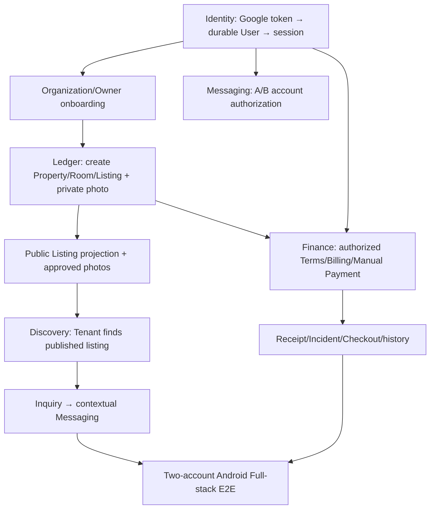

# TrọƠi — Integration Gap Register & Acceptance Checklist

> **Snapshot:** 14/10/2026  
> **Baseline:** `integration/discovery-ledger-ui-preview` — `36ee8f5c00a58743aad2d6273b20887975f296f6`  
> **Scope:** Hồ sơ / Identity, Tin nhắn, Sổ vận hành, Discovery; và các phụ thuộc Full-stack.  
> **Quy tắc:** Ghi nhận tình trạng theo source và bằng chứng kiểm thử đã có. **Không diễn giải “đã có code” thành “đã PASS Android Full-stack”.**  
> **Trạng thái tổng:** `PARTIAL_WITH_GATES` — **chưa** `PASS_FULLSTACK`.

## 0. Quy ước trạng thái

| Ký hiệu | Ý nghĩa |
|---|---|
| `IMPLEMENTED` | Đã tìm thấy code/route/UI, chưa mặc định chứng minh chạy E2E. |
| `PASS_BACKEND_ONLY` | Có bằng chứng kiểm thử Backend/API/PostgreSQL và/hoặc MinIO cô lập. |
| `PASS_GATED` | Luồng có test nhưng bị khóa bởi Identity/runtime contract; không thể coi đã dùng được với tài khoản thật. |
| `PASS_UI_PARTIAL` | Có UI, build/unit test hoặc test giao diện phạm vi hẹp; chưa có hành trình xuyên suốt. |
| `BLOCKED` | Phụ thuộc chưa mở hoặc chưa có chứng cứ nghiệm thu. |
| `NOT_IMPLEMENTED` | Chưa có cơ chế production tương ứng. |
| `DEFERRED` | Chưa bắt buộc để đạt MVP; cần chốt trước production khi thích hợp. |
| `DONE` | Chỉ dùng sau khi đủ điều kiện nghiệm thu và có đường dẫn bằng chứng. |

**Không dùng checklist trống để suy luận rằng code chưa có**: một số tài liệu P5.2B cũ đã bị supersede bởi P5.2C về ảnh Asset. Mọi kết luận lấy baseline tại HEAD nêu trên.

## 1. Tổng quan bốn module

| Module | Đã có | Thiếu / chưa được chứng minh | Trạng thái |
|---|---|---|---|
| **Hồ sơ (Profile/Identity)** | UI Profile/Settings/Onboarding; lưu tên hiển thị; Google token verifier + durable resolver đã code; Organization create route/client adapter exists | Mở phiên Google cho User thật, đăng ký mới, approved session/reauth, usable Organization onboarding, OTP có provider, avatar, preference, KYC, Android E2E | **`PASS_GATED` / `BLOCKED` — P0** |
| **Tin nhắn (Messaging)** | Backend PostgreSQL, MinIO ảnh riêng tư, authorization A/B/C, Android Messages UI, Inquiry/Tenancy context | Hai Google account thật → gửi/nhận/ảnh → logout/restart; UI/device QA; một số reliability/scaling | **`PASS_BACKEND_ONLY` — E2E P0** |
| **Sổ (Ledger)** | Property/Room/Listing, AssetWizard, ảnh riêng tư MinIO, Tenancy/Terms, Billing/Manual Payment/Deposit/Receipt, Incident/Checkout/History; Mock Ledger offline và public photo projection đã có code | Owner Organization thật; Asset/Payment E2E; PostgreSQL/MinIO photo authorization/readback; crash recovery / due day | **`PASS_BACKEND_ONLY` — E2E P0** |
| **Discovery** | UI feed/search/filter/sort/compare/detail, Google Maps, radius query, Inquiry entry; Android now loads owner-approved public photo covers/details | Owner publish → Tenant sees listing/photo → Inquiry → Messaging full flow; PostgreSQL/MinIO and device acceptance; map/device; favorites persistence; geocoding PR #10 chưa merge | **`PASS_UI_PARTIAL` — E2E P0** |

### Phụ thuộc trọng tâm

---

## 2. Hồ sơ — Profile / Identity / Organization

**Kết luận:** Profile chưa đủ để người dùng mới đăng nhập và sử dụng trọn bộ app. Đây là **blocker có tác động rộng nhất** lên các module khác.

### Đã triển khai / có bằng chứng

- [x] Giao diện Profile, Settings, Security, trang trợ giúp và luồng Onboarding chủ trọ ba bước.
- [x] `user_profiles.display_name` có thao tác cập nhật/đọc lại PostgreSQL qua principal được cấp quyền (`PASS_GATED`).
- [x] Google ID token verifier; `GooglePrincipalResolver` giải quyết binding `auth_identities` và từ chối xung đột (kiểm thử cô lập).
- [x] Không tự động tạo User bằng Google `sub` hoặc claim phòng demo trong Identity foundation mới.
- [x] OCR CCCD hỗ trợ **gợi ý nhập liệu**, không xác minh căn cước và không tạo quyền sở hữu.

### Gaps và việc cần làm

| ID | Ưu tiên | Vấn đề | Điều kiện nghiệm thu (DoD) | Trạng thái |
|---|---|---|---|---|
| `PRO-P0-01` | **P0** | `TROOI_IDENTITY_FOUNDATION_RESOLUTION_ENABLED` mặc định off; chưa chốt cutover/session/audit | Google thật → durable User đúng binding; AuthGuard cùng principal; refresh/restart/logout/revoke không mâu thuẫn; tài khoản không hợp lệ bị từ chối | `BLOCKED` |
| `PRO-P0-02` | **P0** | Người dùng Google mới chưa đăng ký được | Quy trình đăng ký có xác minh email, không đụng ownership lịch sử, không tạo User giả, test trường hợp alias/collision | `BLOCKED` |
| `PRO-P0-03` | **P0** | Organization create route/client có sẵn nhưng chủ trọ chưa thể hoàn tất onboarding trong app | Một User được ủy quyền hoàn thành onboarding → tạo Organization/role thực trong PostgreSQL; truy cập Sổ được; outsider không thể nhận quyền | `BLOCKED` — route binds owner from verified principal and existing authorization tests reject spoofing; Android create action fails closed with `REAUTH_UNAVAILABLE` because server reauthentication/session contract and live Identity acceptance are not approved |
| `PRO-P0-04` | **P0** | Luồng hai tài khoản trên Android chưa được nghiệm thu | Owner/Tenant login, chuyển tài khoản, restart, logout/relogin; mỗi người chỉ đọc dữ liệu có quyền | `BLOCKED` |
| `PRO-P1-01` | P1 | OTP email/phone thực và proof-bound flow còn thiếu | OTP server-side, TTL/cooldown/attempt limit/replay protection, đúng User/operation; test chống chiếm quyền | `BLOCKED` |
| `PRO-P1-02` | P1 | Đổi email, password setup/change/reset, PIN, reauthentication thiếu hợp đồng an toàn | API có proof và audit, session invalidation, không có UI giả thành công | `BLOCKED` |
| `PRO-P1-03` | P1 | Avatar riêng tư không có upload/readback bền vững | Owner tự upload → private storage + metadata → restart/cross-device readback; outsider bị từ chối | `NOT_IMPLEMENTED` |
| `PRO-P1-04` | P1 | Preferences/notifications vẫn là local UI state | Save/refresh qua API, persisted theo User và có default an toàn | `NOT_IMPLEMENTED` |
| `PRO-P2-01` | P2 / security gate | Trường thông tin cá nhân bổ sung, CCCD/KYC lưu chứng cứ/review | Data contract/retention/RBAC/manual review được duyệt; OCR không tự xác nhận KYC | `BLOCKED` |
| `PRO-P2-02` | P2 | Screenshot, dark mode, font 200%, TalkBack, keyboard, camera OCR | Thiết bị thực/emulator có bằng chứng cho mọi trạng thái quan trọng | `BLOCKED` |

**Quan trọng về Recovery của Duy Anh:** Có code email OTP/login grant cũ nhưng **không copy** `000008_login_otp` vào baseline vì `000008_identity_foundation` đã frozen. Nếu tái triển khai, dùng migration mới **sau `000011`** và bind OTP vào *durable User* đã resolve; không `ensureUser()` theo `sub`, không claim seed tự động. OTP của Recovery chưa nằm trong app baseline dưới dạng Backend flow hoạt động.

---

## 3. Tin nhắn — Messaging + PostgreSQL + MinIO

**Kết luận:** **MinIO Messaging đã chạy trong bài test Backend thật**, không cần viết lại hệ thống lưu ảnh từ đầu. Chưa đủ bằng chứng Android E2E với hai Google User thật.

### Đã triển khai / có bằng chứng

- [x] Contextual conversations theo **Inquiry** và **Tenancy**, sender/membership do Backend xác định.
- [x] PostgreSQL lưu conversation, participants, immutable messages, attachment metadata, read watermark.
- [x] MinIO lưu **private JPEG attachments**; API tải ảnh đã xác thực; không phát public bucket URL.
- [x] Bài test HTTP cô lập: A/B gửi–nhận, đọc lại sau DB/service reconnect, C/anonymous bị chặn, ảnh riêng tư readback `1/1 PASS` trong handoff.
- [x] Android UI có text/image, gallery, thumbnail camera, draft, loading/retry, refresh khi resume, đường vào từ Inquiry/Tenancy.
- [x] Các negative tests ngăn sender spoofing, account-switch sau dispatch, refresh cũ che kết quả send.

### Gaps và việc cần làm

| ID | Ưu tiên | Vấn đề | DoD | Trạng thái |
|---|---|---|---|---|
| `MSG-P0-01` | **P0** | Chưa test A/B bằng Google login/Identity thật | Hai User bind thật → Inquiry/Tenancy authorized → trao đổi text/JPEG trên emulator → DB/MinIO readback | `BLOCKED` bởi Identity |
| `MSG-P0-02` | **P0** | Chưa nghiệm thu UI camera/gallery/restart/account-switch | Ảnh hiển thị lại sau restart; không rò ảnh giữa tài khoản; lỗi gửi giữ draft; scroll/keyboard ổn | `BLOCKED` |
| `MSG-P0-03` | **P0** | Inquiry → Message sau relaunch chưa end-to-end | Inquiry nhận ID thật, mở conversation, không tạo trùng; sau restart vào được hội thoại đã có | `BLOCKED` |
| `MSG-P1-01` | P1 | Lịch sử chưa pagination; response Android giới hạn 3 MB | Phân trang/cursor ổn định, history dài tải dần, không nhân đôi hoặc mất tin | `BLOCKED` — additive keyset page API and Android load-older flow are implemented; backend checks, Android JVM (241/241), instrumentation compile, and targeted emulator component test pass. PostgreSQL/MinIO integration is blocked because Docker daemon is unavailable |
| `MSG-P1-02` | P1 | Read watermark có race khi cập nhật đồng thời | Watermark đơn điệu, không lùi trong race test | `BLOCKED` — read updates now use atomic PostgreSQL `GREATEST`; concurrent regression assertion is added to the PostgreSQL/MinIO integration test but cannot run while the local test services are unavailable |
| `MSG-P1-03` | P1 | MinIO orphan cleanup mới best-effort, không crash-safe | Retry/reconciliation an toàn sau process kill giữa upload và DB commit | `DEFERRED` |
| `MSG-P2-01` | P2 | Chưa có push notification/background delivery, performance/stress | Định nghĩa sản phẩm, triển khai khi ngoài-MVP cần | `DEFERRED` |

**Ràng buộc hiện tại:** text tối đa 4.000 ký tự; tối đa 5 JPEG/tin, tối đa 2.000.000 byte/ảnh. Kết quả `1/1` là **một integration test với nhiều assertion**, không phải chứng nhận live provider hay màn Android end-to-end.

---

## 4. Sổ — Ledger / Rental Operations / Finance

**Kết luận:** Backend nghiệp vụ của Sổ tương đối đầy đủ cho MVP, có ảnh riêng tư MinIO và tests. Blocker nằm ở Owner authorization, refresh Mock offline và hành trình Android end-to-end.

### Đã triển khai / có bằng chứng

- [x] Property → Room → Listing; asset fields, tiện nghi multi-select, draft/publish/archive được code.
- [x] `AssetWizard → BackendTroOiRepository → authenticated Listing media API → PostgreSQL metadata + private MinIO bytes`; JPEG/PNG, quyền chủ, outsider denial, ordering/retry/readback đã test Backend.
- [x] Migration additive `000010_listing_asset_details` và `000011_listing_asset_media` (không thay frozen `000008`).
- [x] Tenancy/participants/Terms có billing day; Billing RENT/ELECTRICITY/WATER; manual Payment/Deposit/Receipt; Incident/Checkout/history.
- [x] Manual Payment có provenance **`USER_RECORDED`** cho `MANUAL_CASH` / `MANUAL_TRANSFER`, không được mô tả thành `PROVIDER_VERIFIED`.

### Gaps và việc cần làm

| ID | Ưu tiên | Vấn đề | DoD | Trạng thái |
|---|---|---|---|---|
| `LED-P0-01` | **P0** | Owner không có Organization/role production do onboarding chưa nối Backend | Google Owner thật → tạo Organization → tạo Property/Room có quyền → outsider 403 | `BLOCKED` bởi Profile |
| `LED-P0-02` | **P0** | Mock Sổ có thể lỗi khi DemoPay `localhost:3001` offline | Mock Owner/Tenant mở Sổ khi không chạy DemoPay, vẫn thấy fixture operations/historical finance với nhãn rõ; checkout/action online lỗi minh bạch, không fake verified Payment | `PASS_ANDROID` — `:app:testDebugUnitTest --tests com.trooi.app.core.model.FixtureCatalogTest.mockLedgerLoadsHistoricalFixtureWhenDemoPayIsOffline` (2026-10-14) |
| `LED-P0-03` | **P0** | Chưa test AssetWizard upload từ Android → MinIO → app | Owner chọn JPEG/PNG, save/publish, reload/restart hiển thị đúng, thử outsider, thứ tự/cover/remove | `BLOCKED` |
| `LED-P0-04` | **P0** | Chưa test Terms → Billing → Manual Payment → Receipt trên Android | Ghi cash/transfer thật do operator xác nhận; Backend trả `USER_RECORDED`, phân bổ Charge/Deposit, readback hai phía qua restart | `BLOCKED` |
| `LED-P0-05` | **P0** | Incident/Checkout/history chưa có full device test | Tenant báo sự cố → Owner cập nhật → checkout; history/Payment không bị xóa sau restart | `BLOCKED` |
| `LED-P0-06` | **P0** | Chưa có một fixture chạy toàn vòng đời thuê | Có scenario versioned executable (không chỉ YAML spec) với assertions DB/API/ảnh/quyền/lịch sử | `NOT_IMPLEMENTED` |
| `LED-P0-07` | **P0** | Public photo projection của ảnh Asset chưa được nghiệm thu end-to-end | Có chính sách duyệt/publish ảnh và route public chỉ cho tin PUBLISHED/đủ quyền; không lộ owner media/private object key | `BLOCKED` — backend opt-in/public route and Android owner-consent/Discovery rendering slices coded; PostgreSQL/MinIO authorization/readback and authenticated API-backed device acceptance remain pending |
| `LED-P1-01` | P1 | Media upload/delete intent đã code; cần nghiệm thu fault injection PostgreSQL/MinIO | Fault injection sau PUT, sau delete trước DB commit, reconciliation an toàn | `BLOCKED` — migration `000013` and retry/startup reconciliation implemented for both operations; DB/MinIO fault-injection integration cannot run while local PostgreSQL is unavailable |
| `LED-P1-02` | P1 | Ngày đến hạn 29–31 trong tháng ngắn chưa xác định | Chốt quy tắc (ví dụ clamp về ngày cuối tháng **nếu được phê duyệt**) + deterministic tests | `OPEN_DECISION` |
| `LED-P1-03` | P1 | Terms Backend chấp nhận JSON due-date rộng hơn editor Android | Ghi rõ contract và validation/backward compatibility; không phá Terms lịch sử | `OPEN_DECISION` |

**Không làm lại:** ảnh MinIO owner, manual-payment engine, tenancies/charges/receipts. Trước hết **kiểm chứng UI ↔ API ↔ DB/storage ↔ UI**.

---

## 5. Khám phá — Discovery / Public Listing / Map

**Kết luận:** UI mới đã có, nhưng chưa đóng vòng dữ liệu thực từ Owner Publish đến Tenant Inquiry/Messaging.

### Đã triển khai / có bằng chứng

- [x] Feed, tìm kiếm khu vực/loại/giá, sort, compare tối đa 3 listing.
- [x] Listing Detail có tiện nghi, mô tả, chi phí chào, quy tắc; Inquiry entry.
- [x] Google Maps / chọn vị trí / tìm theo bán kính và giá bằng API public Listing.
- [x] Debug APK tích hợp Discovery + Ledger đã build; JVM `234/234 PASS`, Listing Detail instrumentation `1/1 PASS` trên bản preview trước đó.
- [x] Khi dùng Backend mode, không cố tình thay kết quả rỗng bằng fixture.

### Gaps và việc cần làm

| ID | Ưu tiên | Vấn đề | DoD | Trạng thái |
|---|---|---|---|---|
| `DIS-P0-01` | **P0** | Owner Publish → Tenant thấy listing chưa được Android E2E test | Owner publish → API PUBLISHED → Tenant reload/feed/search/detail có đúng ID/giá/trạng thái và không có tin riêng tư | `BLOCKED` |
| `DIS-P0-02` | **P0** | Public Listing photo pipeline chưa được nghiệm thu end-to-end | Ảnh được phép công bố hiển thị đúng ở public card/detail; unpublish/archive ẩn theo policy; private MinIO object không lộ | `BLOCKED` — backend public opt-in/content route and Android owner consent/card/detail rendering implemented; PostgreSQL/MinIO and authenticated API-backed device acceptance pending (see `LED-P0-07`) |
| `DIS-P0-03` | **P0** | Inquiry → Messaging chưa có E2E hai Google User | Tenant Inquiry → Owner nhận context → A/B mở đúng conversation → history tồn tại sau restart | `BLOCKED` |
| `DIS-P1-01` | P1 | Amenity public mapping cần nghiệm thu với database và Android runtime | Persist stable IDs trong Owner → public projection đúng label/icon, không thêm tiện nghi không có | `BLOCKED` — allowlisted amenity IDs now flow through public feed/search and Android reuses the owner catalog; PostgreSQL search/HTTP integration remain pending. Android component UI test is `PASS_ANDROID` only |
| `DIS-P1-02` | P1 | Map API key/markers/location picker, lỗi và quyền vị trí chưa device accepted | Emulator có key test hợp lệ; marker/detail/camera center/bounds, no-permission và no-key states đúng | `BLOCKED` |
| `DIS-P1-03` | P1 | Favorited IDs ở một số màn là state Compose local | Chốt có đưa Favorite vào MVP không; nếu có: User-scoped persistence và reload/restart | `DEFERRED` |
| `DIS-P1-04` | P1 | Geocoding tìm phòng bằng địa chỉ từ Duy Anh mới ở PR #10 | Typecheck/lint/build/test Backend, privacy/usage policy, explicit opt-in, rate limit/cache; rồi mới merge | `DRAFT_PR` |
| `DIS-P1-05` | P1 | Empty/loading/error/retry/filters API vs local chưa test đủ | Empty/error/reset/timeout/giá không hợp lệ, không trộn fixture vào Backend | `BLOCKED` |
| `DIS-P2-01` | P2 | Dark mode, font 200%, TalkBack, share, performance danh sách dài | Device QA với ảnh/video và accessibility | `DEFERRED` |

**Không tạo lại:** amenity multi-select trong `AssetWizard` đã có code; backlog UI-04 cũ mô tả trạng thái trước đó. Cần kiểm tra persistence/public mapping, không duplicate implementation.

---

## 6. Kế hoạch triển khai có thứ tự và Gate nghiệm thu

### Wave A — Mở khóa người dùng thật (`P0`, blocker chung)

- [ ] `APP-A01` Quyết định Identity G1-A/G1-E/G1-S: legacy mapping/cutover, verified-email registration, session/audit/revocation.
- [ ] `APP-A02` Google login/registration theo **durable User** và AuthGuard nhất quán; không tự claim seeded owner.
- [ ] `APP-A03` Owner onboarding → Organization + relationship-based permissions thật.
- [ ] `APP-A04` Test 2 tài khoản khác nhau, logout, restart, User/Org/tenancy authorizations. **Gate A** = cả hai vào app, tách dữ liệu chính xác.

### Wave B — Sổ + Discovery cùng dữ liệu

- [ ] `APP-B01` Sửa Mock Ledger offline để QA không phụ thuộc DemoPay 3001 và không giả tạo Payment thật.
- [ ] `APP-B02` Owner AssetWizard tạo phòng + ảnh MinIO + readback sau restart.
- [ ] `APP-B03` Public photo projection có chính sách publish rõ ràng.
- [ ] `APP-B04` Publish → tenant Discovery feed/search/detail nhận đúng dữ liệu.
- [ ] `APP-B05` Test tiện nghi, địa điểm public/operational, publish/unpublish/archive. **Gate B** = Owner publish → Tenant thấy tin công khai.

### Wave C — Inquiry → Messages

- [ ] `APP-C01` Tenant Inquiry thật, nhận ID chính xác.
- [ ] `APP-C02` A/B trao đổi text/JPEG, ảnh private MinIO; C bị 403.
- [ ] `APP-C03` Restart cả hai, không duplicate conversation hoặc mất lịch sử. **Gate C** = Messaging Android Full-stack PASS.

### Wave D — Rental + Finance + Closeout

- [ ] `APP-D01` Tenancy/Terms/billing day đọc lại.
- [ ] `APP-D02` RENT/ELECTRICITY/WATER → Manual Payment `USER_RECORDED` → allocation/Deposit → Receipt.
- [ ] `APP-D03` Incident → Checkout → lịch sử tồn tại sau restart.
- [ ] `APP-D04` Tạo một JSON scenario **executable** kiểm toàn hành trình. **Gate D** = rental operations Full-stack PASS.

### Wave E — Reliability, regression và release

- [ ] `APP-E01` Backend typecheck/lint/build/full test + database-v1 conformance; exact frozen `000008` fingerprint.
- [ ] `APP-E02` Android Debug/Release APK, JVM, instrumentation; MinIO permission/reconnect/failure, account isolation.
- [ ] `APP-E03` Chốt due-day 29–31, MinIO reconciliation strategy, Messaging pagination/watermark theo release scope.
- [ ] `APP-E04` Light/dark, 200% font, accessibility, camera/gallery, keyboard, error states.
- [ ] `APP-E05` Release candidate với test report và zero P0 blockers. **Gate E** = `PASS_FULLSTACK` khi có bằng chứng thực, không dựa vào test fixture đơn lẻ.

### Gate log mẫu

| Gate | Kết quả | Evidence (commit, command, artifact, screenshot, DB run ID) | Reviewer/date |
|---|---|---|---|
| A — Live Identity + Organization | `NOT_RUN` | — | — |
| B — Ledger ↔ Discovery publication | `NOT_RUN` | — | — |
| C — Inquiry ↔ Messaging MinIO Android | `NOT_RUN` | — | — |
| D — Finance / Incident / Checkout Android | `NOT_RUN` | — | — |
| E — Full regression / release candidate | `NOT_RUN` | — | — |

### P0 execution updates

- `LED-P0-02`: `PASS_ANDROID` at source HEAD after the Mock repository stopped fetching finance during fixture reads. Debug Owner/Tenant operations and explicitly historical finance remain available without DemoPay; checkout still fails against an unavailable service. Evidence: `:app:testDebugUnitTest --tests com.trooi.app.core.model.FixtureCatalogTest.mockLedgerLoadsHistoricalFixtureWhenDemoPayIsOffline` passed (2026-10-14). This does not establish `PASS_BACKEND` or `PASS_FULLSTACK`.
- `LED-P0-07`: backend/API and Android now support owner-selected public photos. Migration `000012_public_listing_photos` defaults each photo to private; public IDs/content require both owner opt-in and a currently `PUBLISHED` Listing, and content responses use `Cache-Control: no-store`. Android provides per-photo consent, protected owner updates, lazy visible-card cover loading, and detail-gallery loading. `BLOCKED`: PostgreSQL/MinIO authorization/readback and authenticated API-backed device acceptance remain pending; the local emulator component test does not exercise the photo API. Evidence: backend typecheck/lint/build, opt-in migration/media validation `3/3`, Android JVM `241/241`, debug/release assemble, lint, and detail UI component `2/2`. Do not report this as `PASS_BACKEND` or `PASS_FULLSTACK`.
- `DIS-P1-01`: backend now projects only recognized amenity catalog IDs for published Listings through both public feed and spatial search; Android maps IDs using the existing `AmenityCatalog` and renders a real Listing detail without loading fixture details. Service behavior tests cover unpublishing and filtering unknown historic IDs. PostgreSQL/PostGIS HTTP assertions were added but not run because local PostgreSQL is unavailable. Evidence: backend typecheck/lint/build, Android JVM `241/241`, Android emulator detail component `2/2` (`PASS_ANDROID` for this UI component only). Overall gate remains `BLOCKED`; no `PASS_BACKEND` or `PASS_FULLSTACK` claim.
- `PRO-P0-03`: the Organization API and Android adapter are implemented, but the app refuses the create write while no server-supported reauthentication proof exists. Backend organization/authorization behavior tests pass `13/13`; Android `ProtectedSubmissionTest` confirms no request is sent and no success is shown without reauthentication, while the request contract test verifies the authenticated POST shape. This is a fail-closed partial implementation, not production onboarding; remain `BLOCKED` pending approved session/reauth and live Identity acceptance.
- `LED-P1-01`: additive migration `000013_listing_asset_media_intents` commits an operation intent before MinIO upload or deletion. Upload retry is bound to the same SHA-256 content; restart reconciliation removes an unindexed object after interrupted upload. Delete retry removes the object and metadata under a Listing lock, then clears the intent. Upload, reorder and consent changes are refused while an operation is pending; public reads hide pending media. Static migration/media tests pass, but PostgreSQL/MinIO fault injection remains unrun because local PostgreSQL is unreachable. Implementation present; acceptance stays `BLOCKED` (no `PASS_BACKEND`/`PASS_FULLSTACK`).
- `MSG-P1-02`: read watermark persistence now atomically keeps the greater of the existing timestamp and the message timestamp observed by the request. The Messaging PostgreSQL/MinIO integration includes concurrent newer/stale updates and asserts the watermark does not regress. Runtime database evidence remains `BLOCKED` until isolated PostgreSQL/MinIO test services are available; no `PASS_BACKEND` claim is made.
- `MSG-P1-01`: added `GET /messaging/conversations/:id/messages/page` with bounded keyset pagination ordered by `(created_at, message_id)`, participant check, opaque validated cursor and batched attachment lookup. Android now loads the newest 50 messages and exposes an older-page action, merging by message ID. Cursor unit tests pass 2/2; backend typecheck/lint/build and Android JVM pass (`241/241`). Instrumentation compiles; targeted `olderMessagePageCanBeRequestedFromConversation` passes on emulator (`PASS_ANDROID` for this component only). PostgreSQL/MinIO HTTP integration cannot start because Docker daemon is unavailable. Acceptance remains `BLOCKED`; no `PASS_BACKEND` or `PASS_FULLSTACK` claim.
- Android verification follow-up for `MSG-P1-01`: an initial full `NativeMessagingStatesTest` class run exposed two unrelated existing accessibility-label failures in notification/message-save assertions. The pagination component test was rerun alone and passed; do not infer the complete Messaging UI suite passed.
- `LED-P0-06`: corrected the application-restart scenario fixture to use distinct Owner and Tenant principals, publish via the RentalLifecycle coordinator, activate the tenancy through its coordinator after Terms acknowledgement, verify the Listing is unpublished and Room occupied, and assert manual transfer remains server-derived `USER_RECORDED` after restart. `pnpm test:ledger:lifecycle-restart` is the direct runner and the harness refuses remote/non-`trooi_test` reset targets. This is partial service/database coverage; J04 still lacks the executable API/photo/authorization journey and remains `NOT_IMPLEMENTED` (no `PASS_FULLSTACK`).
- `DIS-P0-01`: the Discovery UI seed now creates a DRAFT and publishes it through `RentalLifecycleCoordinator`; the public HTTP assertion verifies the resulting published projection and USER actor event. The seed's in-memory behavior test passes, but HTTP/PostgreSQL/emulator run still requires local services, and no authenticated Owner publish UI is exercised. Keep the overall item `BLOCKED` (not `PASS_FULLSTACK`).

## 7. Không làm / nguyên tắc an toàn

1. **Không merge nguyên `recovery/payment-methods`**: migration `000008_login_otp` xung đột frozen `000008_identity_foundation`; Auth/ownership cũ không tương thích.
2. **Không nói Payment đã verified** với nguồn cash/transfer do User ghi nhận; `USER_RECORDED` khác `PROVIDER_VERIFIED`.
3. **Không coi upload private Asset media là public Listing photo**. Phải có public projection/publish policy riêng.
4. **Không tự tạo Organization, User, verified KYC, OTP thành công** để vượt gate E2E.
5. **Không dùng test-host/mock verifier thay cho live Google account E2E**. Test Backend/MinIO cô lập là bằng chứng hữu ích nhưng chỉ cho lớp đó.
6. **Không chạy migrations destructive / reset dữ liệu production** để “cho test qua”.
7. Một thay đổi chỉ đánh dấu `DONE` sau khi có evidence gắn với đúng HEAD/integration branch.

## 8. Source / Provenance

Tài liệu này tổng hợp từ source + báo cáo nghiệm thu đã tồn tại trên GitHub, **không có lần chạy test mới trong bước soạn Markdown**.

- [Profile & Identity acceptance](https://github.com/onsra520/TroOi-Project/blob/integration/discovery-ledger-ui-preview/docs/implementation/phase5/profile-identity-acceptance.md)
- [Messaging Phase 4 integration](https://github.com/onsra520/TroOi-Project/blob/integration/discovery-ledger-ui-preview/docs/implementation/unified-source/phase4-messaging-integration.md)
- [Messaging Full-stack MVP scope](https://github.com/onsra520/TroOi-Project/blob/integration/discovery-ledger-ui-preview/docs/messages-fullstack-mvp.md)
- [Ledger Rental Operations acceptance](https://github.com/onsra520/TroOi-Project/blob/integration/discovery-ledger-ui-preview/docs/implementation/phase5/ledger-rental-ops-acceptance.md)
- [Phase 5 execution checklist](https://github.com/onsra520/TroOi-Project/blob/integration/discovery-ledger-ui-preview/docs/implementation/phase5/execution-checklist.md)
- [Discovery UI deferred backlog (historical; reassess against newer code)](https://github.com/onsra520/TroOi-Project/blob/integration/discovery-ledger-ui-preview/docs/backlogs/discovery-ui-deferred-20261014.md)
- [Selective Recovery audit PR #9](https://github.com/onsra520/TroOi-Project/pull/9)
- [Geocoding adaptation PR #10 — draft; unmerged](https://github.com/onsra520/TroOi-Project/pull/10)

**Khuyến nghị vị trí trong repo:** `docs/implementation/phase5/integration-gap-register-20261014.md`.  
**Cập nhật khi:** merge thay đổi, một gate chuyển trạng thái hoặc phát hiện gap mới; ghi rõ commit SHA và bằng chứng, không overwrite lịch sử.
