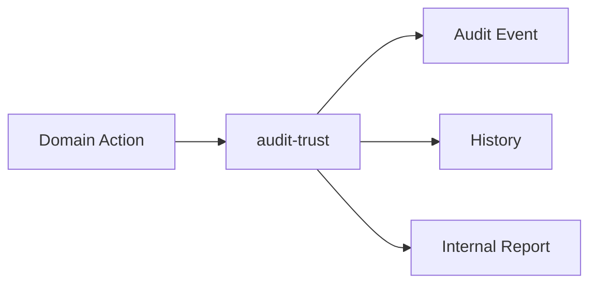
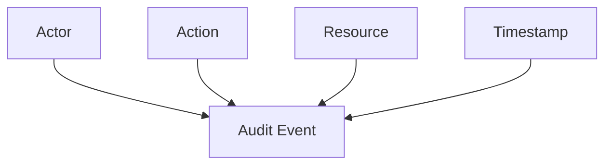
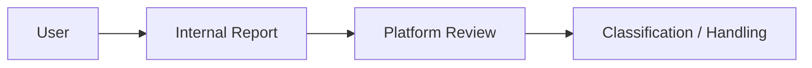
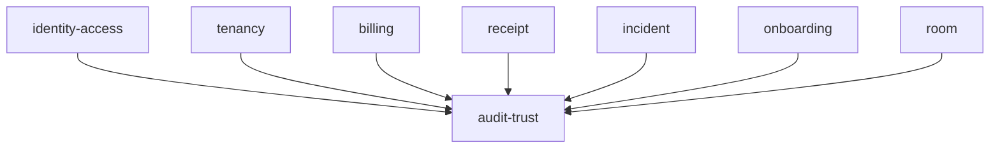
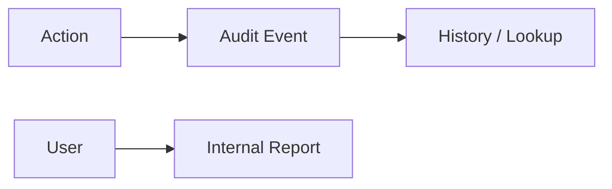

# Audit & Trust

Folder `audit-trust` chứa các chức năng liên quan đến **lưu vết thay đổi quan trọng và report nội bộ** trong TrọƠi.

## Folder này dùng để làm gì?

Folder này giúp hệ thống biết **ai đã làm gì, với resource nào và vào thời điểm nào**.

Nó chịu trách nhiệm cho:

- audit event;
- actor/action/resource/timestamp metadata;
- lịch sử thay đổi quan trọng;
- internal report;
- dữ liệu phục vụ tra cứu và đối chiếu.

## Chức năng chính

### Audit Event

Các thay đổi quan trọng từ module khác có thể tạo audit event.

Ví dụ nhóm dữ liệu cần lưu vết gồm:

- thay đổi quyền truy cập;
- tenancy terms;
- deposit;
- billing/công nợ;
- receipt;
- incident status;
- import dữ liệu quan trọng.

### History Lookup

Audit history dùng để tra cứu lại quá trình thay đổi khi cần đối chiếu.

### Internal Report

Người dùng có thể gửi report nội bộ khi phát hiện thông tin hoặc hành vi cần được kiểm tra.

Report nội bộ không đồng nghĩa với public rating hoặc kết luận ai đúng/sai.

## Quan hệ với các module khác

`audit-trust` là cross-cutting module nhận các sự kiện cần lưu vết từ những bounded context khác.

## Không thuộc folder này

- public review/rating;
- phán xử tranh chấp;
- cưỡng chế owner/operator/tenant ngoài đời thực;
- bảo đảm pháp lý;
- business logic chính của các resource được audit.

## Tóm tắt

`audit-trust` tập trung vào: **audit event → lịch sử thay đổi → tra cứu/đối chiếu → report nội bộ**.
