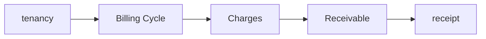
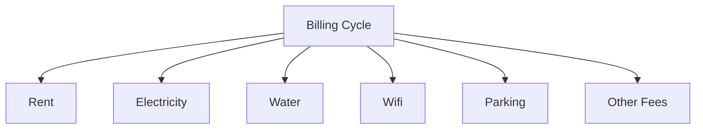
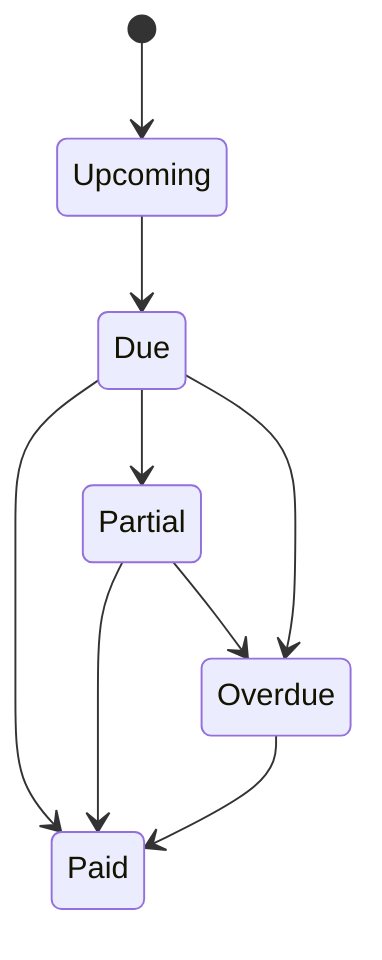
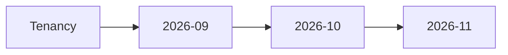
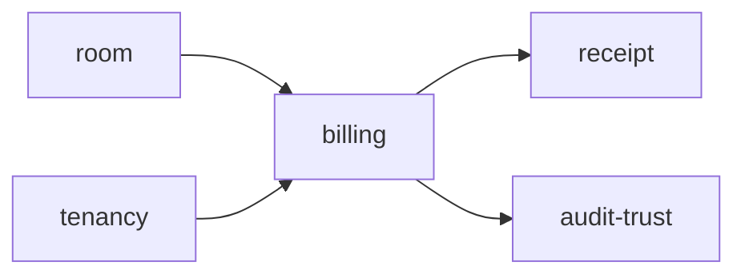

# Billing

Folder `billing` chứa các chức năng liên quan đến **chu kỳ thu tiền, khoản phải thu và công nợ** trong TrọƠi.

## Folder này dùng để làm gì?

Folder này quản lý các khoản cần thu trong từng kỳ của một tenancy.

Nó chịu trách nhiệm cho:

- billing period/cycle;
- tiền thuê và các khoản phụ phí;
- số điện/nước hoặc dữ liệu đầu vào cần tính phí khi có;
- tổng số tiền cần thu;
- số tiền còn thiếu;
- trạng thái công nợ của từng kỳ.

## Chức năng chính

### Billing Cycle

Mỗi kỳ thu tiền được quản lý độc lập.

### Receivable & Debt

Folder này tính và theo dõi:

- total due;
- amount paid được đối chiếu từ receipt;
- outstanding balance;
- due date;
- trạng thái khoản phải thu.

### Monthly Tracking

Billing cho phép theo dõi nhiều kỳ theo thời gian thay vì chỉ lưu một cờ `paid` trên room.

## Quan hệ với các module khác

- `tenancy`: cung cấp kỳ thuê và điều khoản nền;
- `room`: resource được billing gắn vào;
- `receipt`: ghi nhận khoản đã thanh toán;
- `audit-trust`: lưu vết thay đổi công nợ quan trọng.

## Không thuộc folder này

- payment gateway;
- receipt/biên nhận chi tiết;
- subscription SaaS của TrọƠi;
- tenancy lifecycle;
- room status.

## Tóm tắt

`billing` tập trung vào: **billing cycle → charges → receivable → outstanding balance → trạng thái công nợ**.
