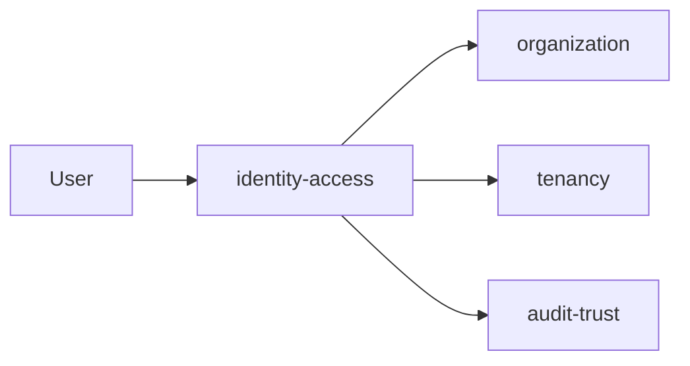
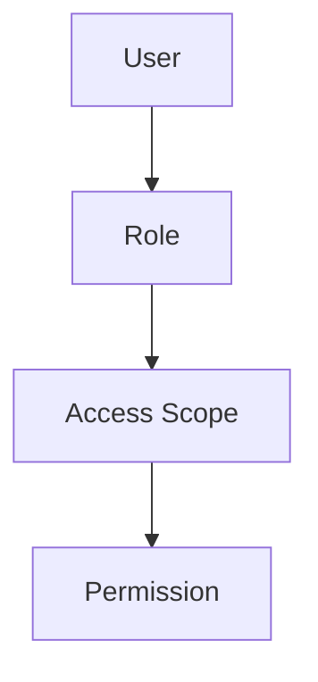
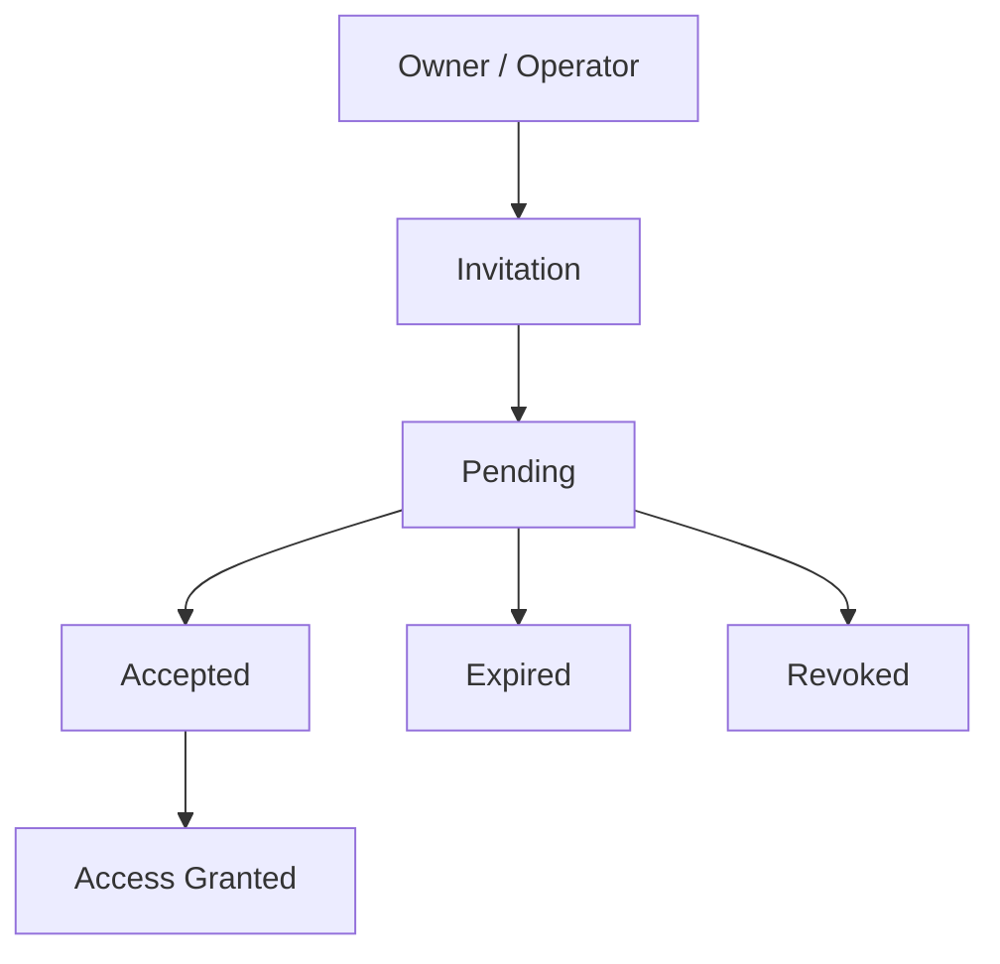
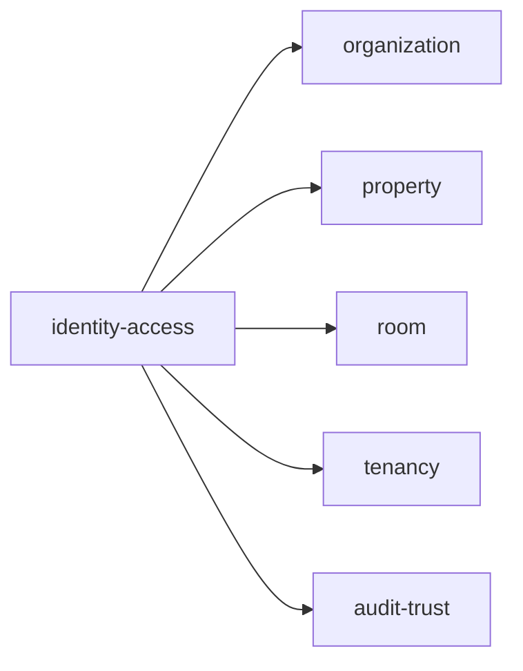
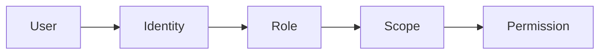

# Identity & Access

Folder `identity-access` chứa các chức năng liên quan đến **danh tính người dùng và quyền truy cập** trong TrọƠi.

## Folder này dùng để làm gì?

Folder này xác định:

- người dùng là ai;
- người dùng đang tham gia hệ thống với vai trò nào;
- người dùng được phép truy cập phạm vi nào;
- lời mời tham gia hệ thống được tạo, chấp nhận hoặc thu hồi ra sao.



`identity-access` chỉ quản lý **identity + access boundary**. Dữ liệu nghiệp vụ của phòng, tài sản, kỳ thuê hoặc tiền thuê thuộc các module khác.

## Chức năng chính

### User Identity

- tạo hoặc nhận diện user;
- lấy thông tin identity cần thiết;
- xác định trạng thái tài khoản;
- liên kết identity với quyền truy cập trong hệ thống.

### Role & Access Scope

Các vai trò chính hiện tại:

```text
OWNER
OPERATOR
TENANT
PLATFORM_ADMIN
```

Role được áp dụng trong một phạm vi cụ thể, không mặc định là quyền toàn hệ thống.



### Invitation

Folder này quản lý lời mời operator hoặc tenant vào hệ thống.



Các thao tác chính:

- create invitation;
- accept invitation;
- expire invitation;
- revoke invitation;
- grant access;
- revoke access.

## Quan hệ với các module khác



`identity-access` trả lời các câu hỏi: **user là ai, có role gì, có access vào scope nào và có được phép thực hiện action hay không**.

## Không thuộc folder này

- organization profile;
- property data;
- room data;
- tenancy data;
- billing và receipt;
- incident data;
- subscription data;
- lựa chọn auth provider, OAuth, JWT, session hoặc token strategy.

## Tóm tắt



`identity-access` tập trung vào: **User Identity → Role → Access Scope → Permission → Invitation**.
