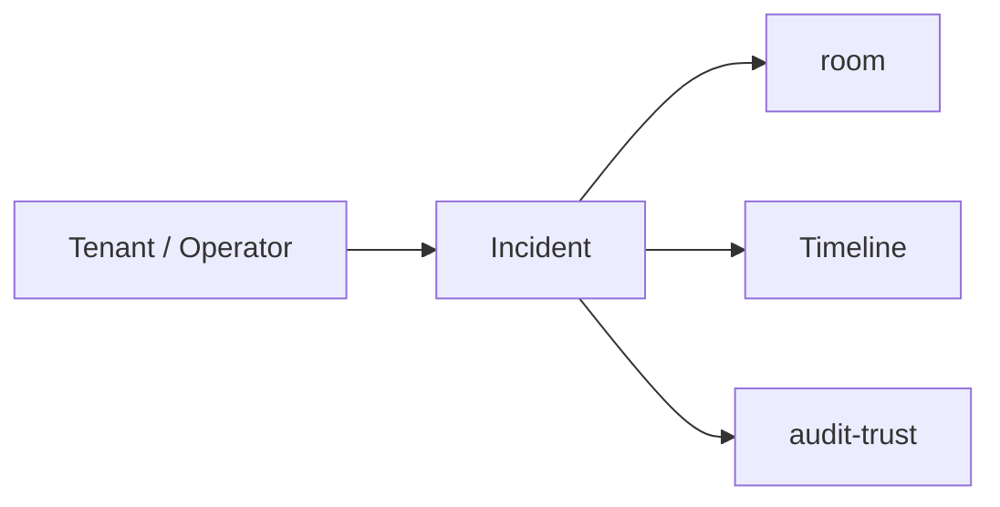
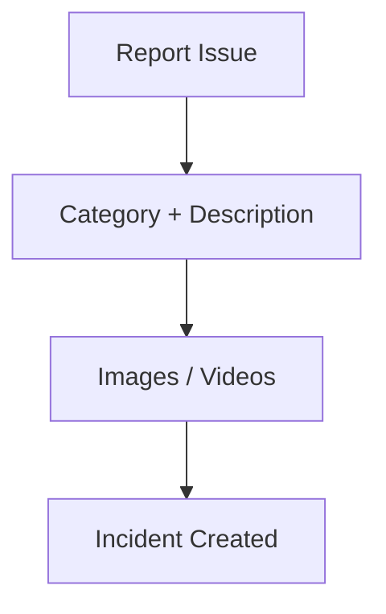
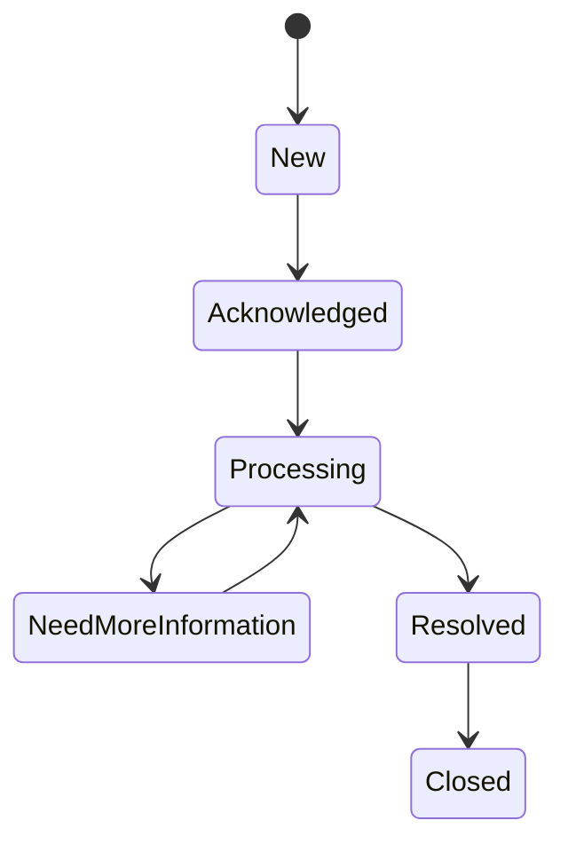
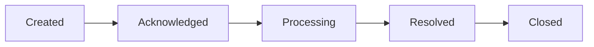
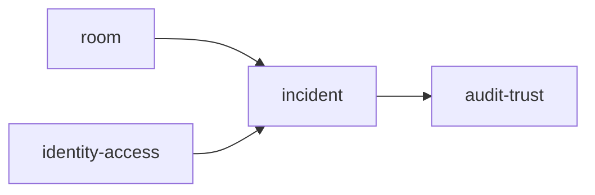
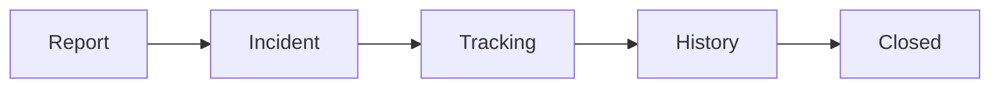

# Incident

Folder `incident` chứa các chức năng liên quan đến **ticket sự cố và lịch sử xử lý sự cố** trong TrọƠi.

## Folder này dùng để làm gì?

Folder này quản lý toàn bộ vòng đời một sự cố phát sinh tại room.

Nó chịu trách nhiệm cho:

- tạo incident/ticket;
- category và description;
- reporter;
- attachment references;
- trạng thái xử lý;
- người tiếp nhận/xử lý khi có;
- timeline và các mốc thời gian quan trọng.

## Chức năng chính

### Create Incident

Tenant hoặc operator có thể tạo ticket gắn với đúng room.

### Incident Lifecycle

State của incident tách hoàn toàn khỏi `room.status`.

### Timeline

Mỗi thay đổi quan trọng được ghi theo thời gian để hai bên theo dõi quá trình xử lý.

## Quan hệ với các module khác

- `room`: room phát sinh sự cố;
- `identity-access`: xác định reporter và quyền truy cập;
- `audit-trust`: lưu vết thay đổi và lịch sử quan trọng.

## Không thuộc folder này

- sửa chữa thực tế;
- marketplace đối tác dịch vụ;
- báo giá của partner;
- room lifecycle;
- public review/rating.

## Tóm tắt

`incident` tập trung vào: **báo sự cố → ticket → trạng thái xử lý → timeline → đóng sự cố**.
