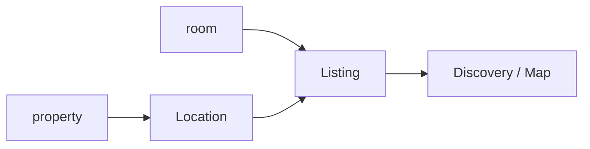
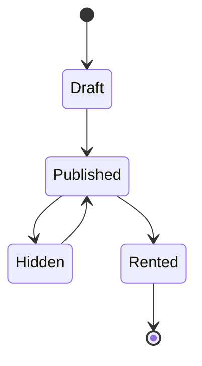
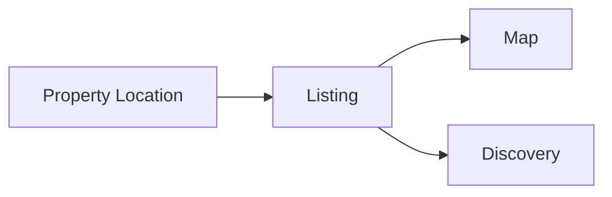
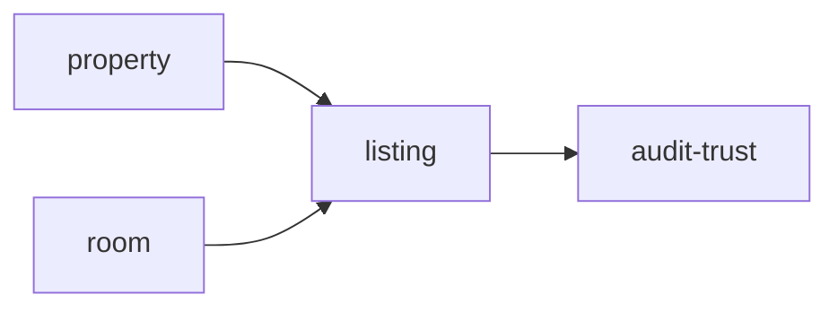
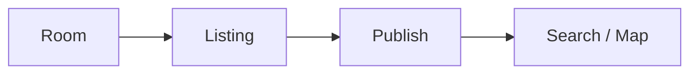

# Listing

Folder `listing` chứa các chức năng liên quan đến **tin đăng phòng và discovery/map** trong TrọƠi.

## Folder này dùng để làm gì?

Folder này quản lý cách một room được đưa ra bên ngoài để người thuê có thể tìm và xem thông tin.

Nó chịu trách nhiệm cho:

- listing profile;
- nội dung public của tin đăng;
- giá thuê, cọc và phụ phí được publish;
- media references;
- location dùng cho discovery/map;
- trạng thái publish của listing.

## Chức năng chính

### Listing Content

Quản lý nội dung được phép hiển thị public như:

- tiêu đề/mô tả;
- giá thuê;
- cọc;
- phụ phí;
- media;
- vị trí;
- trạng thái còn trống hay không.

### Listing Lifecycle

Listing state không phải room state.

### Map / Discovery

Map/discovery sử dụng dữ liệu vị trí của property/listing nhưng không sở hữu hồ sơ vận hành nội bộ của room.

## Quan hệ với các module khác

- `property`: cung cấp location nền;
- `room`: resource được publish;
- `audit-trust`: lưu vết thay đổi quan trọng khi cần.

## Không thuộc folder này

- room operational history;
- tenancy lifecycle;
- billing và receipt;
- incident;
- marketplace dịch vụ;
- logic vận hành sau khi tenant đã vào ở.

## Tóm tắt

`listing` tập trung vào: **room public information → publish lifecycle → discovery/map**.
