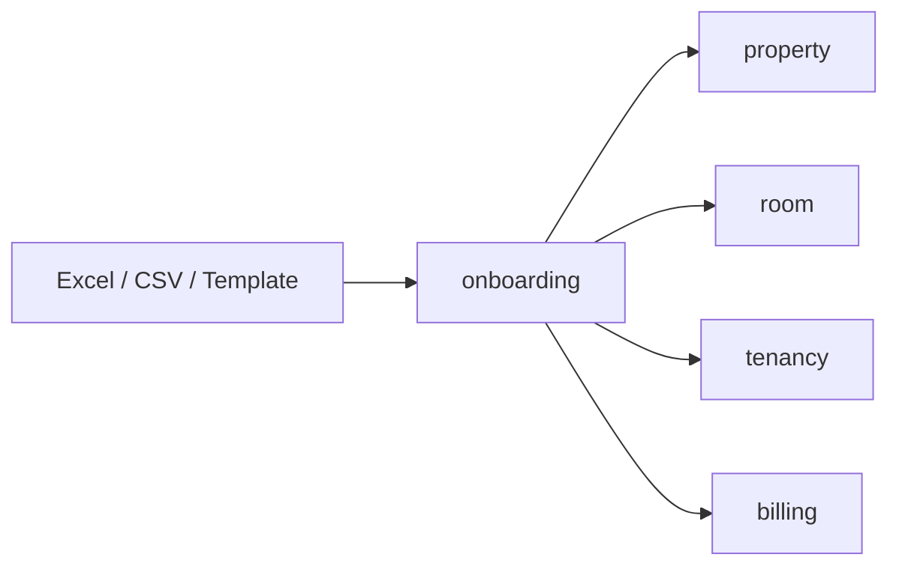
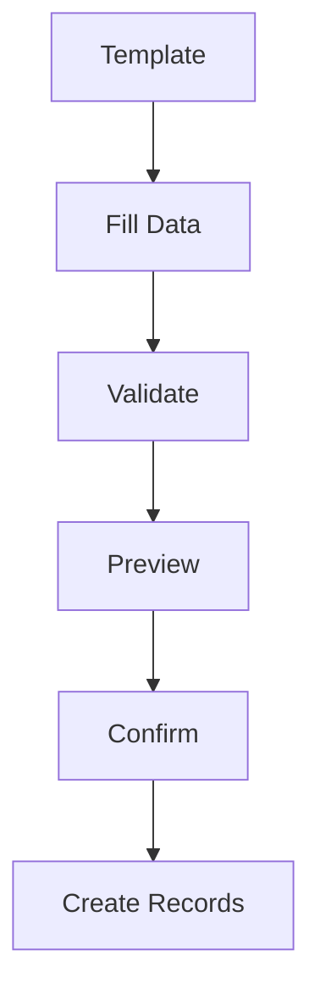
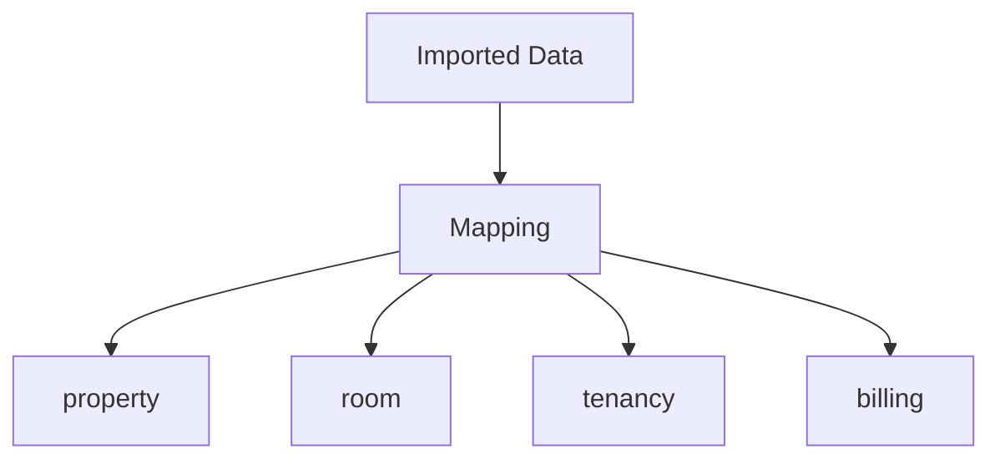
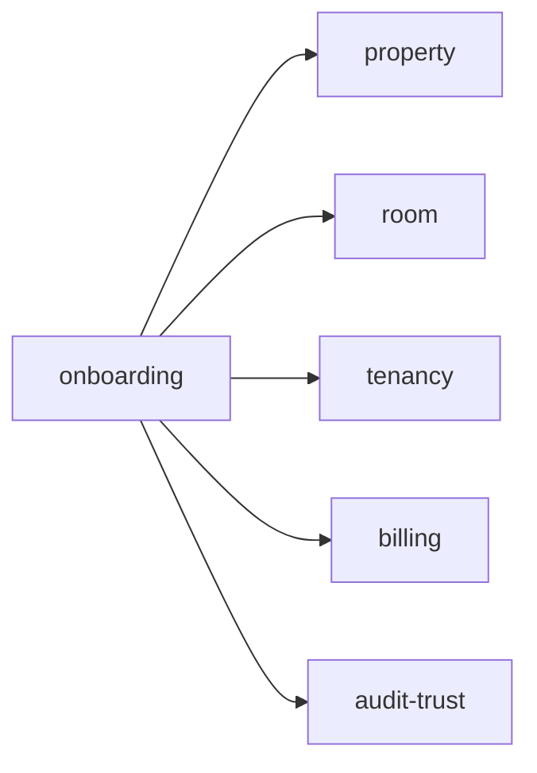

# Onboarding

Folder `onboarding` chứa các chức năng liên quan đến **đưa dữ liệu vận hành ban đầu vào TrọƠi nhanh và có kiểm soát**.

## Folder này dùng để làm gì?

Folder này giảm friction khi chủ trọ bắt đầu sử dụng hệ thống.

Nó chịu trách nhiệm cho:

- bulk room creation;
- template nhập liệu;
- Excel/CSV import;
- parse và validate dữ liệu;
- preview trước khi tạo dữ liệu thật;
- mapping dữ liệu sang các module đích;
- confirm trước khi ghi dữ liệu chính thức.

## Chức năng chính

### Bulk Create

Cho phép tạo nhiều room hoặc dữ liệu nền trong một lần thay vì nhập từng record thủ công.

### Excel / CSV Import

Luồng import phải có bước kiểm tra trước khi tạo dữ liệu thật.

### Data Mapping

Onboarding chỉ điều phối dữ liệu vào bounded context đích.

Sau khi dữ liệu được tạo, module đích trở thành nơi sở hữu dữ liệu đó.

## Quan hệ với các module khác

- `property`, `room`, `tenancy`, `billing`: nhận dữ liệu sau khi confirm;
- `audit-trust`: lưu vết các import/thay đổi quan trọng.

## Không thuộc folder này

- business ownership của dữ liệu sau khi import;
- room/tenancy/billing lifecycle lâu dài;
- AI/OCR production flow trong MVP;
- human data-entry như cơ chế vận hành mặc định;
- authentication.

## Tóm tắt

`onboarding` tập trung vào: **nhập dữ liệu → kiểm tra → preview → xác nhận → tạo dữ liệu vào module đích**.
