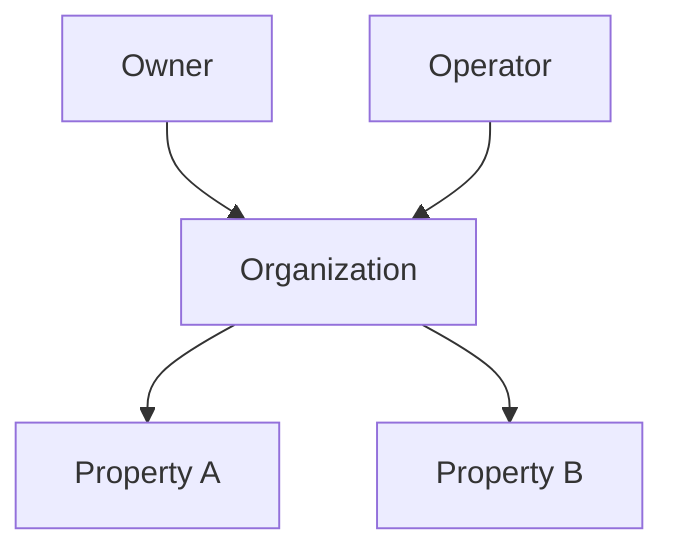
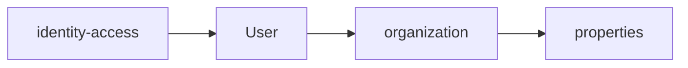
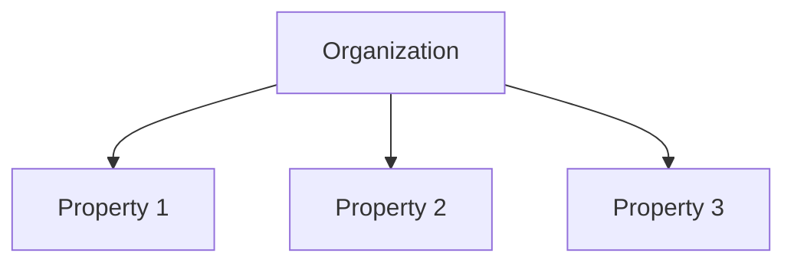
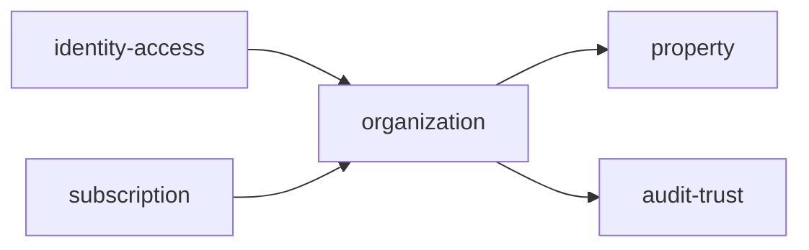
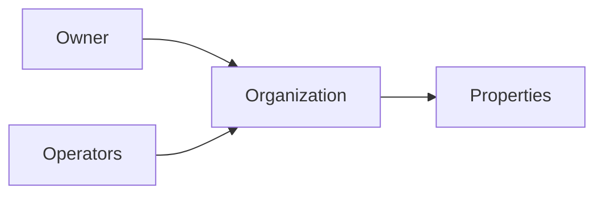

# Organization

Folder `organization` chứa các chức năng liên quan đến **đơn vị sở hữu hoặc vận hành tài sản cho thuê** trong TrọƠi.

## Folder này dùng để làm gì?

Folder này đại diện cho phạm vi vận hành cấp cao nhất của một chủ nhà/chủ trọ hoặc đơn vị quản lý.

Nó dùng để:

- tạo và quản lý organization;
- gắn owner/operator vào organization ở mức nghiệp vụ;
- nhóm nhiều property dưới cùng một đơn vị vận hành;
- làm scope chung cho các resource thuộc cùng một chủ thể vận hành.

## Chức năng chính

### Organization Profile

Quản lý thông tin cơ bản của organization như:

- tên hiển thị;
- trạng thái hoạt động;
- thông tin vận hành chung;
- owner reference.

### Operator Structure

Organization là nơi các operator được gắn vào phạm vi vận hành.

Quyền truy cập cụ thể vẫn do `identity-access` quyết định.

### Multi-property Grouping

Một organization có thể quản lý nhiều tài sản/khu trọ.

## Quan hệ với các module khác

- `identity-access`: xác định ai được truy cập organization;
- `property`: chứa tài sản thuộc organization;
- `subscription`: xác định entitlement của organization;
- `audit-trust`: lưu vết thay đổi quan trọng.

## Không thuộc folder này

- authentication và permission implementation;
- thông tin chi tiết của property;
- room lifecycle;
- tenancy;
- billing hoặc receipt;
- incident;
- subscription pricing logic chi tiết.

## Tóm tắt

`organization` tập trung vào: **đơn vị vận hành → owner/operator reference → nhóm property**.
