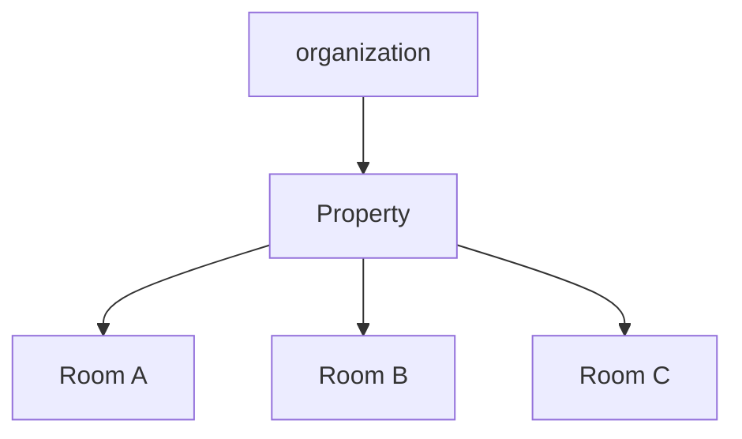
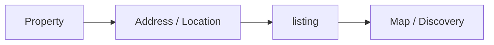
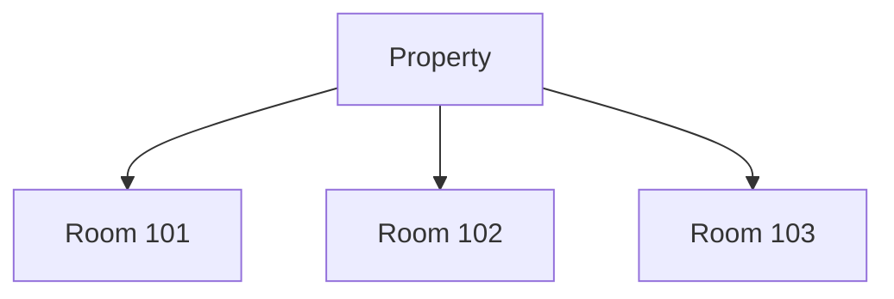
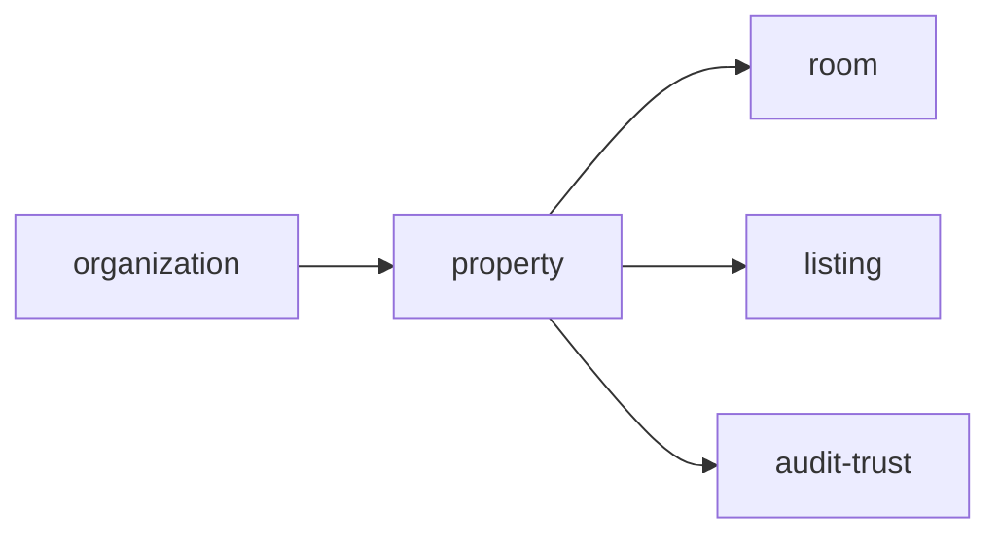
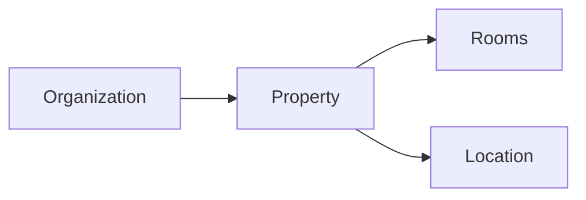

# Property

Folder `property` chứa các chức năng liên quan đến **tài sản/khu trọ ở cấp địa điểm** trong TrọƠi.

## Folder này dùng để làm gì?

Folder này dùng để quản lý một property như một nhóm các phòng cùng thuộc một tài sản hoặc địa điểm vận hành.

Nó chịu trách nhiệm cho:

- property profile;
- tên và địa chỉ;
- thông tin vị trí;
- quan hệ property → rooms;
- trạng thái tồn tại của property trong hệ thống.

## Chức năng chính

### Property Profile

Quản lý thông tin chung của một tài sản/khu trọ như:

- tên property;
- địa chỉ;
- thông tin mô tả vận hành ở cấp property;
- location reference;
- trạng thái active/archive khi cần.

### Location

Property là nguồn vị trí nền cho các chức năng cần biết tài sản nằm ở đâu.

`listing` có thể sử dụng location từ property để hiển thị discovery/map, nhưng nội dung public của tin đăng không thuộc `property`.

### Room Grouping

Một property có thể chứa nhiều room.

## Quan hệ với các module khác

- `organization`: sở hữu phạm vi property;
- `room`: quản lý từng đơn vị cho thuê bên trong property;
- `listing`: dùng thông tin vị trí khi publish phòng;
- `audit-trust`: lưu vết thay đổi quan trọng.

## Không thuộc folder này

- trạng thái chi tiết của từng room;
- tenancy;
- billing và receipt;
- incident;
- listing public;
- map provider hoặc geocoding implementation.

## Tóm tắt

`property` tập trung vào: **tài sản/khu trọ → vị trí → nhóm room**.
