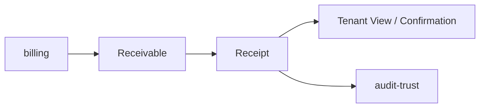
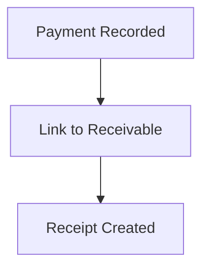
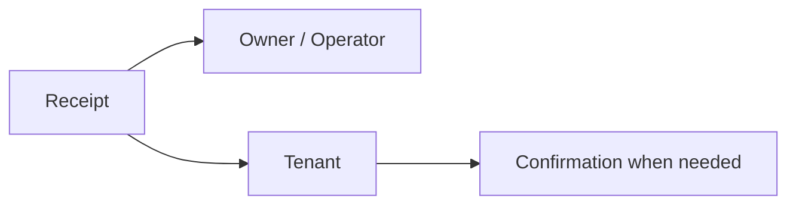
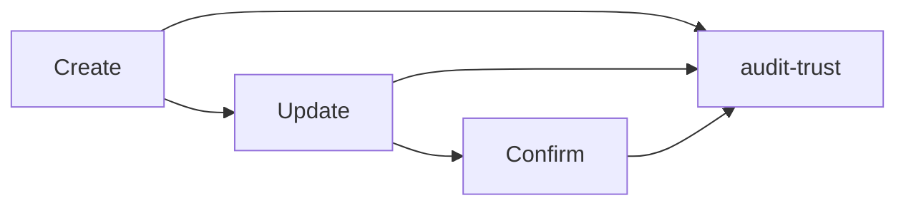
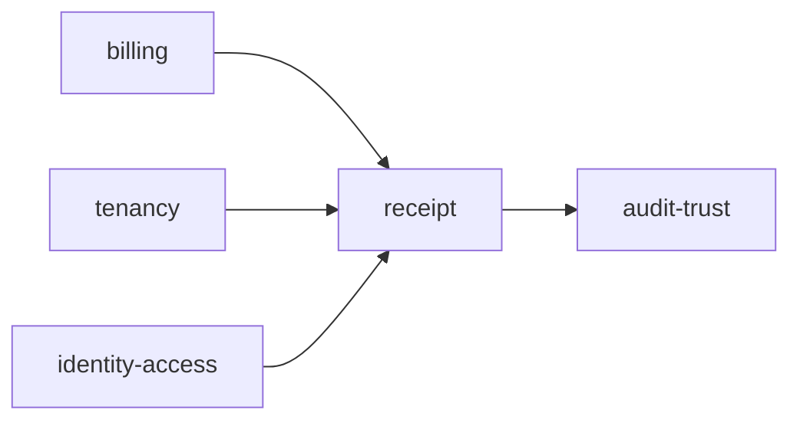

# Receipt

Folder `receipt` chứa các chức năng liên quan đến **bản ghi thanh toán, biên nhận và xác nhận phục vụ đối chiếu** trong TrọƠi.

## Folder này dùng để làm gì?

Folder này ghi nhận việc một khoản tiền đã được thanh toán hoặc được hai bên xác nhận ở mức vận hành.

Nó chịu trách nhiệm cho:

- payment record;
- receipt record;
- liên kết receipt với khoản phải thu;
- attachment/reference chứng minh giao dịch khi có;
- trạng thái xác nhận;
- lịch sử chỉnh sửa và đối chiếu liên quan.

## Chức năng chính

### Record Payment

Owner/operator có thể ghi nhận một khoản đã thu và liên kết nó với billing tương ứng.

### Receipt & Confirmation

Receipt cung cấp dữ liệu để owner/operator và tenant cùng xem và đối chiếu.

### History

Các thay đổi quan trọng của receipt cần có khả năng truy vết.

## Quan hệ với các module khác

- `billing`: cung cấp khoản phải thu cần đối chiếu;
- `tenancy`: xác định kỳ thuê liên quan;
- `identity-access`: xác định ai được xem/xác nhận;
- `audit-trust`: lưu vết thay đổi quan trọng.

## Không thuộc folder này

- payment gateway hoặc settlement ngân hàng;
- tính toán tổng công nợ;
- billing cycle;
- subscription payment;
- chứng từ pháp lý thay cho các bên.

## Tóm tắt

`receipt` tập trung vào: **ghi nhận khoản thanh toán → tạo biên nhận → xác nhận/đối chiếu → lưu lịch sử**.
